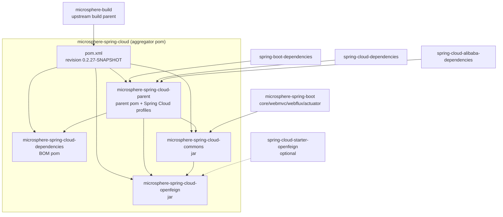

# Microsphere Spring Cloud — Documentation

[中文版 →](./zh/README.md)

This documentation set covers the `release` and `release-1.x` branches of
[microsphere-spring-cloud](https://github.com/microsphere-projects/microsphere-spring-cloud).
English is the default language; Chinese documents are stored in parallel `zh/` directories with identical file names.

## Structure

```
docs/
├── README.md                  ← you are here (English index)
├── zh/README.md               ← 中文总索引
├── diff/source/               ← Tag-to-tag source diffs (main-diff / test-diff, EN + 中文)
├── user-guide/                ← User Guide (English, default)
│   ├── README.md              ← User Guide index
│   ├── zh/                    ← 用户文档（中文）
│   ├── current/               ← release branch (0.2.x) — one document per Maven module
│   │   ├── parent.md  dependencies.md  commons.md  openfeign.md
│   │   └── zh/          (identical file names, Chinese)
│   └── 1.x/                   ← release-1.x branch (0.1.x)
│       ├── parent.md  dependencies.md  commons.md  openfeign.md
│       └── zh/          (Chinese mirrors)
└── developer-guide/           ← Developer Guide (English, default)
    ├── README.md              ← Developer Guide index
    ├── zh/                    ← 开发者文档（中文）
    ├── current/               ← release branch architecture & source analysis
    │   ├── parent.md  dependencies.md  commons.md  openfeign.md
    │   └── zh/          (Chinese mirrors)
    └── 1.x/                   ← release-1.x branch
        ├── parent.md  dependencies.md  commons.md  openfeign.md
        └── zh/          (Chinese mirrors)
```

## Start Here

| I am… | Go to |
|---|---|
| Using this library in a Spring Boot 3/4 application | [User Guide → current](./user-guide/current/commons.md) |
| Using this library in a Spring Boot 2.x / Java 8 application | [User Guide → 1.x](./user-guide/1.x/commons.md) |
| Contributing to the project or studying its design | [Developer Guide](./developer-guide/README.md) |
| 在中文环境下使用本项目 | [用户文档（中文）](./user-guide/zh/README.md) · [开发者文档（中文）](./developer-guide/zh/README.md) |

- [User Guide](./user-guide/README.md) — APIs, configuration properties, runnable examples (derived from the modules' own test cases), version information and compatibility ranges.
- [Developer Guide](./developer-guide/README.md) — architecture design, source-level analysis, design patterns, mermaid flow/sequence diagrams, module dependency graphs, build & test guidance.
- [Tag Diff 0.2.26 vs 0.1.26](./diff/source/main-diff-0.2.26-vs-0.1.26-en.md) — per-module implementation comparison of the two latest tags, split into separate [`src/main`](./diff/source/main-diff-0.2.26-vs-0.1.26-en.md) and [`src/test`](./diff/source/test-diff-0.2.26-vs-0.1.26-en.md) reports (中文：[src/main](./diff/source/main-diff-0.2.26-vs-0.1.26.md) · [src/test](./diff/source/test-diff-0.2.26-vs-0.1.26.md)).

## Branches and Version Lines / Branch–Directory Mapping

| Git branch | Version line | Docs directory | Java | Spring Boot | Spring Cloud | Latest release |
|---|---|---|---|---|---|---|
| `release` | 0.2.x | [`current`](./user-guide/current/commons.md) | 17+ | 3.0.x – 4.0.x | 2022.0.x – 2025.1.x | `0.2.26` |
| `release-1.x` | 0.1.x | [`1.x`](./user-guide/1.x/commons.md) | 8+ | 2.3.x – 2.6.x | Hoxton.SR12 – 2021.0.x | `0.1.26` |

Both lines are published to Maven Central under groupId `io.github.microsphere-projects`.
`main`/`dev` are working branches and are intentionally **not** documented.

## Maven Module Dependency Overview



The [Developer Guide index](./developer-guide/README.md) explains this graph in detail.
