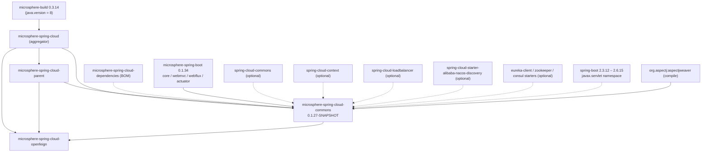
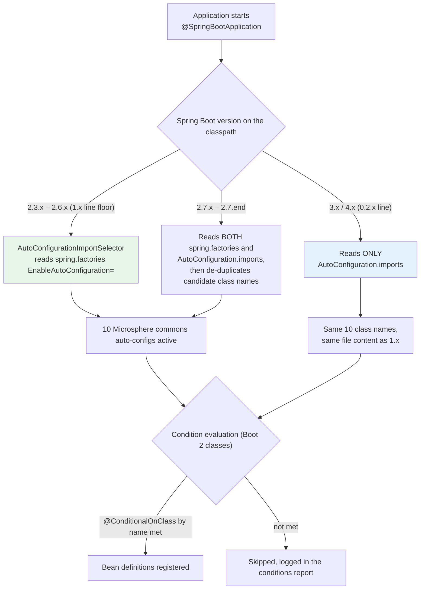
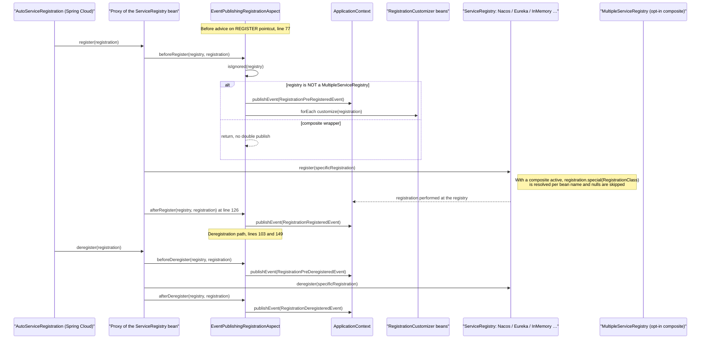
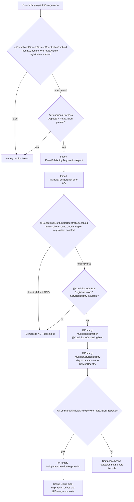

# Developer Guide · `microsphere-spring-cloud-commons` (1.x / 0.1.x line)

[中文](./zh/commons.md) · [0.2.x line](../current/commons.md) · [Developer Guide index](../README.md)

**Branch:** `release-1.x` · **Coordinates:** `io.github.microsphere-projects:microsphere-spring-cloud-commons:${revision}`
(`0.1.27-SNAPSHOT` at HEAD, latest release `0.1.26`) · **Packaging:** `jar`
**Source root:** `microsphere-spring-cloud-commons/src/main/java/io/microsphere/spring/cloud/` — 58 production sources,
54 test sources · **All classes are tagged `@since 1.0.0`.**

Paths below are relative to the source root unless they start with `…/resources/`
(= `microsphere-spring-cloud-commons/src/main/resources/`).

---

## 1. Architecture design

### 1.1 Where this module sits in the 1.x build



The **only** mandatory third-party compile dependencies are the four `microsphere-spring-boot-*` modules
and `org.aspectj:aspectjweaver`; every Spring Boot / Spring Cloud / registry client dependency is
`<optional>true</optional>` (`microsphere-spring-cloud-commons/pom.xml`). Combined with class-guarded
auto-configurations this makes the jar safe to add to any Boot 2.3–2.6 application: features switch
themselves off when their platform classes are absent. The one pom-level branch difference from 0.2.x is
the Testcontainers artifact: 1.x uses `org.testcontainers:junit-jupiter` (test scope), 0.2.x uses
`org.testcontainers:testcontainers-junit-jupiter` with a `junit:junit` exclusion.

### 1.2 The Boot 2 auto-configuration pipeline — and why two registration files exist

`release-1.x` targets Spring Boot **2.3.12 → 2.6.15**, whose `AutoConfigurationImportSelector` reads
`META-INF/spring.factories` under the `EnableAutoConfiguration=` key. The `AutoConfiguration.imports` file
is also present and is **byte-identical to the 0.2.x file**, but on Boot 2.3–2.6 nothing reads it.

```
…/resources/META-INF/spring.factories                      (authoritative on 1.x)
org.springframework.boot.autoconfigure.EnableAutoConfiguration=\
io.microsphere.spring.cloud.context.named.autoconfigure.SpecificationAutoConfiguration,\
io.microsphere.spring.cloud.client.discovery.autoconfigure.DiscoveryClientAutoConfiguration,\
io.microsphere.spring.cloud.client.discovery.autoconfigure.ReactiveDiscoveryClientAutoConfiguration,\
io.microsphere.spring.cloud.client.service.registry.autoconfigure.ServiceRegistryAutoConfiguration,\
io.microsphere.spring.cloud.client.service.registry.autoconfigure.WebMvcServiceRegistryAutoConfiguration,\
io.microsphere.spring.cloud.client.service.registry.autoconfigure.WebFluxServiceRegistryAutoConfiguration,\
io.microsphere.spring.cloud.client.service.registry.autoconfigure.SimpleAutoServiceRegistrationAutoConfiguration,\
io.microsphere.spring.cloud.client.service.registry.actuate.autoconfigure.ServiceRegistrationEndpointAutoConfiguration,\
io.microsphere.spring.cloud.fault.tolerance.tomcat.autoconfigure.TomcatFaultToleranceAutoConfiguration,\
io.microsphere.spring.cloud.client.actuator.autoconfigure.ConfigurationPropertyHasFeaturesAutoConfiguration

com.alibaba.cloud.nacos.registry.NacosServiceRegistry = com.alibaba.cloud.nacos.registry.NacosRegistration
```

The second key is **not** auto-configuration: it is a `SpringFactoriesLoader` mapping consumed by
`client/service/registry/MultipleServiceRegistry.java:193-207` — when a `ServiceRegistry`'s generic
argument resolves to plain `Registration`, `loadFactoryNames(serviceRegistryClass, classLoader)` looks the
concrete registration type up here, which is what makes Nacos usable inside the composite.
**Contributors must keep both keys in this file on 1.x**; deleting the `EnableAutoConfiguration` list
disables the whole module on Boot 2.



**Single-codebase-two-branches strategy.** The 10 class names are identical in both files on both
branches. That is intentional: a patch that only adds or removes an auto-configuration class can be
applied to `release` and `release-1.x` without touching the *other* registration mechanism, and a consumer
running Boot 2.7 gets a consistent (deduplicated) candidate set from either source.

### 1.3 The `javax` namespace boundary and the Java 8 constraint

* Exactly one servlet import exists in the whole module: `import javax.servlet.Filter;` at
  `client/service/registry/autoconfigure/WebMvcServiceRegistryAutoConfiguration.java:31`
  (0.2.x: `jakarta.servlet.Filter`). It is filtered out of the published `web.mappings` metadata together
  with `org.springframework.*` filter registrations.
* Because `microsphere-build` supplies `java.version = 8` (the 1.x root pom does **not** override it), no
  Java 9+ syntax appears: `instanceof` uses the old cast style, collections come from `io.microsphere.*`
  factories (`newHashSet`, `ofList`, `newConcurrentHashMap`), and lambdas/method references are the most
  modern construct allowed.
* Logging and JSON go through Microsphere abstractions — `io.microsphere.logging.Logger`,
  `io.microsphere.json.JSONObject` / `JSONArray` — not SLF4J or Jackson directly, so a Boot 2 consumer
  without Jackson still works.

### 1.4 Package map

| Package (under the source root) | Contents |
|---|---|
| `commons/constants` | `CommonsPropertyConstants`, `FeaturesConstants`, `InstanceConstants`, `SpringCloudPropertyConstants` |
| `commons/condition` | `ConditionalOnUtilEnabled` |
| `client/condition` | `ConditionalOnFeaturesAvailable`, `ConditionalOnFeaturesEnabled` |
| `client/discovery` (+ `autoconfigure`, `condition`, `constants`, `util`) | `UnionDiscoveryClient`, `ReactiveDiscoveryClientAdapter`, `DiscoveryUtils`, discovery conditions/`DiscoveryClientConstants` |
| `client/event` | `ServiceInstancesChangedEvent` |
| `client/service/registry` (+ `aspect`, `autoconfigure`, `condition`, `constants`, `endpoint`, `event`) | The registration stack: `Multiple*`, `SimpleServiceRegistry`, `InMemoryServiceRegistry`, `DefaultRegistration`, `RegistrationMetaData`, `RegistrationCustomizer`, `EventPublishingRegistrationAspect`, endpoints, `RegistrationEvent` family |
| `client/service/util` | `ServiceInstanceUtils` |
| `client/actuator` (+ `autoconfigure`, `constants`) | `FeaturesProperties`, `FeaturesUtils`, `NamedFeatureComparator`, `ConfigurationPropertyHasFeaturesAutoConfiguration` |
| `context/named` (+ `autoconfigure`, `config`) | `SpecificationCustomizer`, `SpecificationBeanPostProcessor`, `SpecificationAutoConfiguration` |
| `fault/tolerance` (+ `constants`, `loadbalancer`, `loadbalancer/util`, `tomcat/autoconfigure`, `tomcat/event`) | `WeightedRoundRobin`, `LoadBalancerUtils`, `FaultTolerancePropertyConstants`, `TomcatFaultToleranceAutoConfiguration`, `TomcatDynamicConfigurationListener` |
| `loadbalancer/condition` | `ConditionalOnLoadBalancerEnabled` |

---

## 2. Auto-configuration source analysis

Eleven configuration classes exist; ten are registered. `WebServiceRegistryAutoConfiguration` is abstract
and deliberately unregistered — it is the shared template of the WebMvc/WebFlux variants.

### 2.1 `SpecificationAutoConfiguration` — `context/named/autoconfigure/`
`@Configuration(proxyBeanMethods = false)`,
`@ConditionalOnClass(name = "org.springframework.cloud.context.named.NamedContextFactory")` (line 40),
`@AutoConfigureAfter(name = {"…loadbalancer.config.LoadBalancerAutoConfiguration", "…openfeign.FeignAutoConfiguration"})`.
One bean: `specificationBeanPostProcessor()` → `SpecificationBeanPostProcessor`, guarded by
`@Bean + @ConditionalOnBean(Specification.class) + @ConditionalOnMissingBean` (lines 47–52), so without at
least one `NamedContextFactory.Specification` bean (Feign/LoadBalancer per-client specifications) nothing
is created. This is the extension point the openfeign module plugs into (§ see
[openfeign developer guide](./openfeign.md)).

### 2.2 `DiscoveryClientAutoConfiguration` — `client/discovery/autoconfigure/`
`@ConditionalOnBlockingDiscoveryAvailable` +
`@AutoConfigureBefore(name = "org.springframework.cloud.client.CommonsClientAutoConfiguration")`.
Nested `public static class UnionConfiguration` is activated by
`@ConditionalOnProperty(name = "microsphere.spring.cloud.client.discovery.mode", havingValue = "union")`
(no `matchIfMissing` ⇒ **off by default**) and registers `unionDiscoveryClient()` → `new UnionDiscoveryClient()`.

### 2.3 `ReactiveDiscoveryClientAutoConfiguration`
`@ConditionalOnReactiveDiscoveryAvailable`, runs *before* `ReactiveCommonsClientAutoConfiguration` and
*after* `SimpleReactiveDiscoveryClientAutoConfiguration` / `ReactiveCompositeDiscoveryClientAutoConfiguration`.
Nested `BlockingConfiguration` is guarded by `@ConditionalOnBlockingDiscoveryEnabled`; its bean
`reactiveDiscoveryClientAdapter(ReactiveDiscoveryClient)` (also `@ConditionalOnBean(ReactiveDiscoveryClient.class)`)
bridges a reactive-only discovery stack into the blocking `DiscoveryClient` API.

### 2.4 `ServiceRegistryAutoConfiguration` — `client/service/registry/autoconfigure/`
Lines 47–57: `@Configuration(proxyBeanMethods = false)`, `@ConditionalOnAutoServiceRegistrationEnabled`,
`@ConditionalOnClass(name = {"org.aspectj.lang.annotation.Aspect", REGISTRATION_CLASS_NAME})`,
`@Import({EventPublishingRegistrationAspect.class, ServiceRegistryAutoConfiguration.MultipleConfiguration.class})`.
Two independent behaviours: the aspect is always imported (when AspectJ is present), and the nested
`static class MultipleConfiguration` (line 67, package-private) assembles the composite stack.

### 2.5 `WebMvcServiceRegistryAutoConfiguration` — **1.x-specific source**
```java
import javax.servlet.Filter;                                   // line 31 — the javax/jakarta boundary
@ConditionalOnWebMvcAvailable
@ConditionalOnAutoServiceRegistrationAvailable
@AutoConfigureAfter(value = {ServiceRegistryAutoConfiguration.class,
        SimpleAutoServiceRegistrationAutoConfiguration.class},
        name = {"io.microsphere.spring.boot.webmvc.autoconfigure.WebMvcAutoConfiguration"})
```
It declares **no `@Bean` method**: the configuration instance itself is the
`ApplicationListener<WebEndpointMappingsReadyEvent>`. Injected state: `@Value("${server.servlet.context-path:}")`,
`ObjectProvider<FilterRegistrationBean>`, `ObjectProvider<DispatcherServletRegistrationBean>`, and
`DEFAULT_URL_MAPPINGS = {"/*"}`. `isExcludedMapping(...)` drops filter registrations whose `Filter` type
comes from `org.springframework.*` and the `DispatcherServlet` URL mappings, so only application endpoints
are published to registry metadata.
*Branch delta:* 0.2.x differs only in the import (`jakarta.servlet.Filter`) and one extra `@see` javadoc line.

### 2.6 `WebFluxServiceRegistryAutoConfiguration`
Symmetric: `@ConditionalOnWebFluxAvailable`, `@AutoConfigureAfter(name = "…webflux.autoconfigure.WebFluxAutoConfiguration")`,
`getContextPath()` returns `""` and `isExcludedMapping(...)` returns `false` (nothing to exclude).

### 2.7 `WebServiceRegistryAutoConfiguration` (abstract, unregistered)
`onApplicationEvent(...)` is `final`: for every `Registration` bean it copies the event's mappings into a
`Set`, calls `excludeMappings(...)` (removes anything matching `isExcludedMapping` **or**
`isActuatorWebEndpointMapping`, the latter by `pattern.startsWith(actuatorBasePath)` where
`@Value("${management.endpoints.web.base-path:/actuator}")`), then
`attachMetadata(getContextPath(), registration, mappings)`. The two abstract hooks are the template
extension points of the pattern (see §5).

### 2.8 `SimpleAutoServiceRegistrationAutoConfiguration`
`@ConditionalOnAutoServiceRegistrationEnabled` + `@ConditionalOnProperty(name = ENABLED_PROPERTY_NAME)`
with **no `havingValue` and no `matchIfMissing`** ⇒ a pure opt-in on
`microsphere.spring.cloud.service-registry.auto-registration.simple.enabled`. It
`@Import`s `SimpleAutoServiceRegistration`, declares `@AutoConfigureBefore(AutoServiceRegistrationAutoConfiguration.class)`
and registers `registration(applicationName, ServerProperties, InetUtils)` → `DefaultRegistration`
(`instanceId = host + ":" + port`, host from `inetUtils.findFirstNonLoopbackHostInfo().getIpAddress()`,
port from `serverProperties.getPort()`) plus `serviceRegistry()` → `new InMemoryServiceRegistry()`
(`@Bean @ConditionalOnMissingBean`). This is the "no external registry" stack used by demos and tests —
note that on Boot 2 `ServerProperties.getPort()` is the accessor; the 0.2.x code is identical here.

### 2.9 `ServiceRegistrationEndpointAutoConfiguration`
`@ConditionalOnDiscoveryEnabled` + `@ConditionalOnAutoServiceRegistrationEnabled` +
`@ConditionalOnActuatorEndpointPresent` + `@ConditionalOnClass(name = AUTO_SERVICE_REGISTRATION_CLASS_NAME)`,
`@AutoConfigureAfter(name = …)` with **five string class names** (`ServiceRegistryAutoConfiguration`,
Zookeeper, Consul, Kubernetes and `com.alibaba.cloud.nacos.registry.NacosServiceRegistryAutoConfiguration`) —
string form, because none of those modules may be on the classpath. Beans: `ServiceRegistrationEndpoint`,
`ServiceDeregistrationEndpoint`, each `@Bean @ConditionalOnMissingBean @ConditionalOnAvailableEndpoint`.

### 2.10 `TomcatFaultToleranceAutoConfiguration`
`@ConditionalOnProperty(name = "microsphere.spring.cloud.fault-tolerance.tomcat.enabled", matchIfMissing = true)`
(**on by default**), `@ConditionalOnClass(name = {"org.apache.catalina.startup.Tomcat", "org.springframework.cloud.context.environment.EnvironmentChangeEvent"})`,
`@ConditionalOnWebApplication(type = SERVLET)`. No bean: a single
`@EventListener(WebServerInitializedEvent.class)` that, for a `ConfigurableWebServerApplicationContext`
holding `ServerProperties` and a `TomcatWebServer`, calls `context.addApplicationListener(new TomcatDynamicConfigurationListener(...))`.

### 2.11 `ConfigurationPropertyHasFeaturesAutoConfiguration`
Guarded by `@ConditionalOnFeaturesAvailable`; `@EnableConfigurationProperties(FeaturesProperties.class)`;
implements `BeanFactoryAware, BeanClassLoaderAware, InitializingBean`. In `afterPropertiesSet()` it turns
the two property maps into one `HasFeatures` **singleton per module**, registered with
`beanFactory.registerSingleton(FeaturesUtils.getHasFeaturesBeanName(moduleName), hasFeatures)` ⇒ bean name
`<module>.features` (e.g. `microsphere-spring-cloud-commons.features`). Abstract features whose class has
Spring bean types are expanded into named features (`getSimpleName(beanType)`); missing classes are logged
as `WARN` and skipped, quoting the exact property name — a broken feature catalogue never fails startup.

---

## 3. Conditional annotations

All are meta-annotation-only markers (`public @interface X {}`, `{TYPE, METHOD}`, `RUNTIME`, `@Documented`) —
**no attributes and therefore no `@AliasFor` anywhere in the module.**

| Annotation | Composes | Effective key / check |
|---|---|---|
| `ConditionalOnFeaturesAvailable` | `ConditionalOnFeaturesEnabled` + `@ConditionalOnClass(name = "org.springframework.cloud.client.actuator.FeaturesEndpoint")` + `@ConditionalOnAvailableEndpoint(endpoint = FeaturesEndpoint.class)` | property **and** class **and** endpoint exposure |
| `ConditionalOnFeaturesEnabled` | `@ConditionalOnProperty(name = "spring.cloud.features.enabled", matchIfMissing = true)` | on unless explicitly `false` |
| `ConditionalOnBlockingDiscoveryAvailable` | `@Inherited`, `@ConditionalOnClass(name = "…discovery.DiscoveryClient")`, `@ConditionalOnDiscoveryEnabled`, `@ConditionalOnBlockingDiscoveryEnabled` | three-way guard |
| `ConditionalOnReactiveDiscoveryAvailable` | `@Inherited`, `@ConditionalOnClass(name = "…discovery.ReactiveDiscoveryClient")`, `@ConditionalOnDiscoveryEnabled`, `@ConditionalOnReactiveDiscoveryEnabled` | three-way guard |
| `ConditionalOnAutoServiceRegistrationAvailable` | `@ConditionalOnClass(name = REGISTRATION_CLASS_NAME)`, `@ConditionalOnBean(type = REGISTRATION_CLASS_NAME)`, `@ConditionalOnAutoServiceRegistrationEnabled` | class **plus an existing bean** |
| `ConditionalOnAutoServiceRegistrationEnabled` | `@ConditionalOnProperty(name = "spring.cloud.service-registry.auto-registration.enabled", matchIfMissing = true)` | Boot-2-compatible property guard |
| `ConditionalOnMultipleRegistrationEnabled` | `@ConditionalOnProperty(name = "microsphere.spring.cloud.multiple-registration.enabled")` | **opt-in**: no `matchIfMissing`, no `havingValue` (`condition/ConditionalOnMultipleRegistrationEnabled.java:26`) |
| `ConditionalOnLoadBalancerEnabled` | `@ConditionalOnProperty(name = "spring.cloud.loadbalancer.enabled", havingValue = "true", matchIfMissing = true)` | declared for downstream modules; unused in this module |
| `ConditionalOnUtilEnabled` | `@ConditionalOnProperty(name = "spring.cloud.util.enabled", matchIfMissing = true)` | declared for downstream modules; unused in this module |

> **Known doc bug (do not reproduce):** the javadoc of `ConditionalOnFeaturesAvailable` mentions
> `microsphere.spring.cloud.features.enabled`; the bound key is `spring.cloud.features.enabled`.

---

## 4. Property and constant inventory (1.x values)

Prefix derivation: `MICROSPHERE_PROPERTY_NAME_PREFIX` (`io.microsphere.constants.PropertyConstants`) = `microsphere.`.

| Key | Constant | Default |
|---|---|---|
| `microsphere.spring.cloud.` | `CommonsPropertyConstants.MICROSPHERE_SPRING_CLOUD_PROPERTY_NAME_PREFIX` | root prefix |
| `microsphere.spring.cloud.web.mvc.` | `…MICROSPHERE_SPRING_CLOUD_WEB_MVC_PROPERTY_NAME_PREFIX` | declared, unused here |
| `spring.cloud.service-registry.auto-registration.enabled` | `SpringCloudPropertyConstants.SERVICE_REGISTRY_AUTO_REGISTRATION_ENABLED_PROPERTY_NAME` | `true` |
| `spring.cloud.features.enabled` / `spring.cloud.loadbalancer.enabled` / `spring.cloud.util.enabled` | `FEATURES_/LOAD_BALANCER_/UTIL_ENABLED_PROPERTY_NAME` | `true` |
| `microsphere.spring.cloud.multiple-registration.enabled` | `MULTIPLE_REGISTRATION_ENABLED_PROPERTY_NAME` | `false` (opt-in) |
| `microsphere.spring.cloud.default-registration.type` / `…default-service-registry.type` | `MULTIPLE_REGISTRATION_DEFAULT_REGISTRATION_PROPERTY_NAME` / `…_REGISTRY_PROPERTY_NAME` | none |
| `microsphere.spring.cloud.composite-registration.enabled` | `COMPOSITE_REGISTRATION_ENABLED_PROPERTY_NAME` | `false` |
| `microsphere.spring.cloud.client.discovery.mode` | `DiscoveryClientAutoConfiguration.DISCOVERY_CLIENT_MODE_PROPERTY_NAME` | must equal `union` |
| `microsphere.spring.cloud.service-registry.auto-registration.simple.enabled` | `SimpleAutoServiceRegistrationAutoConfiguration.ENABLED_PROPERTY_NAME` | none (opt-in) |
| `microsphere.spring.cloud.fault-tolerance.tomcat.enabled` | `TomcatFaultToleranceAutoConfiguration.ENABLED_PROPERTY_NAME` | `true` |
| `microsphere.spring.cloud.fault-tolerance.warmup-time` / `…weight` | `FaultTolerancePropertyConstants.WARMUP_TIME_PROPERTY_NAME` / `WEIGHT_PROPERTY_NAME` | `600000` ms / `100` |
| `microsphere.spring.cloud.features` (+ `.abstract.`, `.named.`) | `FeaturesConstants` | feature catalogue binding |
| `web.mappings` / `web.context-path` / `management-port` / `start-time` | `InstanceConstants` | service-instance metadata keys (`_status_` is the registry status key in `SimpleServiceRegistry.STATUS_KEY` and `InMemoryServiceRegistry`) |

`@ConfigurationProperty` (from `io.microsphere.annotation`, processed by `microsphere-annotation-processor`)
is **compile-time metadata only** — it feeds generated configuration metadata; it never binds at runtime.

Shipped defaults — `…/resources/META-INF/config/default/endpoints.properties` (loaded at lowest priority by
microsphere-spring-boot's `DefaultPropertiesApplicationListener`) — are identical to 0.2.x: the two
Microsphere endpoints are **disabled by default** and re-mapped, so the URLs are
`GET/POST /actuator/microsphere/service/registration` and `POST /actuator/microsphere/service/deregistration`
once `management.endpoint.serviceRegistration.enabled=true` / `…serviceDeregistration.enabled=true`.

---

## 5. Key public APIs and design patterns

### 5.1 Observer — registration lifecycle events
`client/service/registry/aspect/EventPublishingRegistrationAspect.java` (`@Aspect`, `ApplicationContextAware`):

```java
// line 51
public static final String REGISTER_POINTCUT_EXPRESSION =
    "execution(* org.springframework.cloud.client.serviceregistry.ServiceRegistry.register(*)) && target(registry) && args(registration)";
// line 56
public static final String DEREGISTER_POINTCUT_EXPRESSION =
    "execution(* org.springframework.cloud.client.serviceregistry.ServiceRegistry.deregister(*)) && target(registry) && args(registration)";
```

Advices: `@Before(REGISTER)` at line 77 publishes `RegistrationPreRegisteredEvent` **then** applies every
`RegistrationCustomizer`; `@Before(DEREGISTER)` at line 103 publishes `RegistrationPreDeregisteredEvent`;
`@After(REGISTER)` at line 126 publishes `RegistrationRegisteredEvent`; `@After(DEREGISTER)` at line 149
publishes `RegistrationDeregisteredEvent`. Every advice starts with
`boolean isIgnored(ServiceRegistry registry)` (line 157) =
`MultipleServiceRegistry.class.isAssignableFrom(registry.getClass())` — the composite is skipped so events
are emitted exactly once, by the **individual** registries (source comment: *"Remove redundant deregister"*).

`client/service/registry/event/RegistrationEvent.java` is the abstract `ApplicationEvent` carrying
`ServiceRegistry<Registration> registry` (`Assert.notNull(registry, "The 'registry' must not be null")`) and
`Registration source`, with `isPreRegistered()` / `isRegistered()` / `isPreDeregistered()` / `isDeregistered()`
final predicates and nested `enum Type { PRE_REGISTERED, REGISTERED, PRE_DEREGISTERED, DEREGISTERED }`.
`ServiceInstancesChangedEvent` (`client/event/`) is unrelated: `(String serviceName, List<ServiceInstance>)`,
list stored unmodifiable, plus a `processed()` / `isProcessed()` idempotency marker.



### 5.2 Composite + Registry — multiple registration
* `MultipleRegistration implements Registration` — collects every assignable `Registration` sub-type
  (excluding `Registration` itself) from the injected `Collection<Registration>` into
  `Map<Class<? extends Registration>, Registration>`, keeps the **last** as `defaultRegistration`, and
  exposes `<T extends Registration> T special(Class<T>)` (`this` when the requested type is `Registration`).
  All scalar accessors delegate to the default; `getMetadata()` returns the shared `RegistrationMetaData`.
* `MultipleServiceRegistry implements ServiceRegistry<MultipleRegistration>` — constructed from
  `Map<String, ServiceRegistry>` (bean name → registry); `register`/`deregister`/`setStatus` fan out through
  `iterate(...)` resolving each registry's own registration class via `getRegistrationClass(...)`
  (`MultipleServiceRegistry.java:193-207`, with the `SpringFactoriesLoader` fallback backed by the Nacos
  mapping in `spring.factories`); `getStatus` reads **only** the default registry; `close()` closes all.
* `MultipleAutoServiceRegistration extends AbstractAutoServiceRegistration<MultipleRegistration>` —
  `getConfiguration()` returns `null`, `isEnabled()` delegates to `AutoServiceRegistrationProperties`, and
  both `getRegistration()` and `getManagementRegistration()` return the same composite.



* **Strategy / Registry:** `RegistrationCustomizer.customize(Registration)` beans are applied by the aspect
  before registration; `SpecificationCustomizer.customize(Specification, String beanName)` beans are applied
  by `SpecificationBeanPostProcessor.processAfterInitialization(...)`, which loads the sorted customizers in
  `setBeanFactory(...)`.
* **Template Method:** `WebServiceRegistryAutoConfiguration.onApplicationEvent(...)` (`final`) with the two
  abstract hooks `getContextPath()` / `isExcludedMapping(WebEndpointMapping, String[])` and the overridable
  `isActuatorWebEndpointMapping(...)`; `AbstractServiceRegistrationEndpoint` (see §5.3) is the second
  instance of this pattern.
* **Null Object:** `NoOpRequestInterceptor` lives in the openfeign module, but the commons-side analogue is
  `SimpleServiceRegistry.close()` being an intentional no-op and `getMetadata(...)` returning `null` for
  unknown ids in `InMemoryServiceRegistry`.
* **Decorator (reactive bridge):** `ReactiveDiscoveryClientAdapter implements DiscoveryClient` delegates
  `description()`, `probe()`, `getOrder()` and blocks the `Flux` through
  `static <T> List<T> toList(Flux<T>)`: if `Schedulers.isInNonBlockingThread()` it uses
  `mono.toFuture().get()` inside `ThrowableSupplier.execute(...)`, otherwise `mono.block()`.
  `UnionDiscoveryClient` (`getOrder() = HIGHEST_PRECEDENCE`, `description() = "Union Discovery Client"`)
  concatenates instances (` duplicates preserved`) but deduplicates `getServices()` through a `LinkedHashSet`,
  and caches the sorted bean list excluding `CompositeDiscoveryClient` and itself.

### 5.3 Registry + endpoints (Actuator)
`client/service/registry/endpoint/AbstractServiceRegistrationEndpoint.java` implements
`SmartInitializingSingleton, ApplicationListener<WebServerInitializedEvent>`; `afterSingletonsInstantiated()`
resolves the three `ObjectProvider`s with `getIfAvailable()` (may be `null`), `onApplicationEvent` stores
`port` and `running = detectRunning(serviceRegistration)`. Note line 48:
`protected static boolean running;` — **the running flag is `static`, i.e. shared JVM-wide** between
`ServiceRegistrationEndpoint` and `ServiceDeregistrationEndpoint`. Both endpoints must therefore be treated
as one logical controller; a porting or refactoring patch that makes it non-`static` changes observable
behaviour of `GET /actuator/microsphere/service/registration`.
`ServiceRegistrationEndpoint` (`@Endpoint(id = "serviceRegistration")`) exposes `@ReadOperation metadata()`
(application-name, registration, port, status, running, enabled, phase, order, managementRegistration, config —
the last four obtained reflectively) and `@WriteOperation start()` returning the **previous** running state;
`ServiceDeregistrationEndpoint.stop()` returns the state **before** deregistration.

### 5.4 Metadata utilities — `client/service/util/ServiceInstanceUtils.java`
`attachMetadata(String contextPath, ServiceInstance, Collection<WebEndpointMapping>)` serialises each mapping
to JSON, joins with `"," + LINE_SEPARATOR` inside `[`…`]`, strips line separators, **URL-encodes** the result
and writes `metadata["web.context-path"]` + `metadata["web.mappings"]`. `getUriString(ServiceInstance)` falls
back to port `443`/`80` when `getPort() <= 0`, and `getUri(...)` uses `URI.create(...)` — faster than
`DefaultServiceInstance#getUri()`.

`setProperties(ServiceInstance source, DefaultServiceInstance target)` is the module's **only behavioural
Java difference from 0.2.x** (`ServiceInstanceUtils.java:196-205`):

```java
target.setInstanceId(source.getInstanceId());
target.setServiceId(source.getServiceId());
target.setUri(source.getUri());          // 1.x   — 0.2.x: target.setSecure(source.isSecure());
target.setHost(source.getHost());
target.setPort(source.getPort());
Map<String, String> metadata = source.getMetadata();
metadata.clear();
metadata.putAll(source.getMetadata());
```

Spring Cloud Commons removed `DefaultServiceInstance#setUri(URI)` in favour of the `secure` flag
(`getUri()` became derived), so 1.x copies the **resolved URI** while 0.2.x copies the **scheme flag**.
`DiscoveryUtils.simpleReactiveDiscoveryProperties(...)` / `simpleDiscoveryProperties(...)` (blocking ↔
reactive conversion of the "simple" config-file discovery properties) therefore carry a subtly different
semantic on each branch. The 1.x file additionally lacks a trailing newline.

### 5.5 Tomcat dynamic reconfiguration — **1.x-specific accessor**
`fault/tolerance/tomcat/event/TomcatDynamicConfigurationListener.java:272-277`:

```java
configure("Tomcat HTTP Headers' max size(bytes)")
        .value(refreshableServerProperties::getMaxHttpHeaderSize)     // 1.x — Boot 2 accessor
        .compare(currentServerProperties::getMaxHttpHeaderSize)
        .as(this::toIntBytes)
        .on(this::isPositive)
        .apply(protocol::setMaxHttpHeaderSize);                        // 0.2.x: ServerProperties::getMaxHttpRequestHeaderSize
```

`ServerProperties#getMaxHttpHeaderSize()` is the Boot 2 name; Boot 3 renamed it to
`getMaxHttpRequestHeaderSize()`, so the externally visible property key on this branch is
`server.max-http-header-size` (0.2.x: `server.max-http-request-header-size`) — the integration test
`src/test/java/…/TomcatFaultToleranceAutoConfigurationIntegrationTest.java:126` sets exactly that key.
Everything else about the listener is shared with 0.2.x: it filters `EnvironmentChangeEvent` keys starting
with `server`, prefers the live `ServerProperties` bean when a `ConfigurationPropertiesRebinder` is present
(otherwise re-binds just the changed keys), applies each setting through
`io.microsphere.util.Configurer` (write only when *changed, positive and convertible*), then re-snapshots.
Refreshable: `server.tomcat.threads.min-spare`, `…threads.max`, `…accept-count`, `…connection-timeout`,
`…max-connections`, the header size above, `…max-swallow-size`, `…max-http-form-post-size`.
**Not** refreshable: `server.port`, `server.ssl.*`, context path.

### 5.6 Features catalogue and load-balancer primitives
`client/actuator/FeaturesUtils` computes the names: `getAbstractFeaturePropertyName("jdbc")` →
`microsphere.spring.cloud.features.abstract.jdbc`, `getNamedFeaturePropertyName("web","rest-template")` →
`microsphere.spring.cloud.features.named.web.rest-template`, `getHasFeaturesBeanName("jdbc")` → `jdbc.features`,
`getQualifierFeatureName("web","rest-template")` → `web:rest-template`. `NamedFeatureComparator.INSTANCE`
orders by `getName()` then `getType().getName()`. `…/resources/META-INF/config/default/features.yaml` is
byte-identical to 0.2.x and lists, among others, the 14 abstract features of this module
(`UnionDiscoveryClient`, `ReactiveDiscoveryClientAdapter`, `MultipleRegistration`, `MultipleServiceRegistry`,
`MultipleAutoServiceRegistration`, `EventPublishingRegistrationAspect`, `SimpleServiceRegistry`,
`SimpleAutoServiceRegistration`, `InMemoryServiceRegistry`, `ServiceRegistrationEndpoint`,
`ServiceDeregistrationEndpoint`, `SpecificationBeanPostProcessor`, `SpecificationCustomizer`,
`TomcatDynamicConfigurationListener`).

`fault/tolerance/loadbalancer/WeightedRoundRobin` (`LongAdder current`, `setWeight(int)` **resets** `current`,
`increaseCurrent()` → `current.add(weight)`, `sel(total)` → `current.add(-1 * total)`) and
`LoadBalancerUtils.calculateWarmupWeight(uptime, warmup, weight)` =
`round(pow(uptime/(double)warmup, 2) * weight)` clamped to `[1, weight]` are **library building blocks**:
no `@Configuration` in this module wires them, and `…fault-tolerance.warmup-time` / `…weight` are not read here.

---

## 6. Porting & compatibility matrix (commons)

The 1.x `src/main` file inventory is **identical** to 0.2.x: 58 production sources, and only
**3 Java files + 1 resource + 1 pom** differ. Everything else — constants, conditions, auto-configuration
class bodies, `endpoints.properties`, `features.yaml`, `AutoConfiguration.imports` — is byte-identical,
so for those the analysis above applies to both lines.

| 1.x construct | 0.2.x counterpart | Porting action |
|---|---|---|
| `import javax.servlet.Filter;` (`WebMvcServiceRegistryAutoConfiguration.java:31`) | `import jakarta.servlet.Filter;` | Rename the import only; the filter-exclusion logic is unchanged |
| `target.setUri(source.getUri())` (`ServiceInstanceUtils.java:199`) | `target.setSecure(source.isSecure())` | API substitution: copy the URI on Boot 2, copy the scheme flag on Boot 3+ |
| `ServerProperties::getMaxHttpHeaderSize` (`TomcatDynamicConfigurationListener.java:273-274`) | `ServerProperties::getMaxHttpRequestHeaderSize` | Rename accessor **and** the property key in tests / docs |
| `META-INF/spring.factories` with `EnableAutoConfiguration=` (10 classes) **and** the Nacos `SpringFactoriesLoader` mapping on one line | `spring.factories` with the Nacos mapping only (2 lines) | Back-ports must re-add all 10 class names; forward-ports must delete them but keep the Nacos mapping |
| `AutoConfiguration.imports` (10 class names) | identical file, authoritative | Never delete it from 1.x: it is inert on Boot 2.3–2.6 but forward-compatible |
| `org.testcontainers:junit-jupiter` (test) | `org.testcontainers:testcontainers-junit-jupiter` + `junit:junit` exclusion | Artifact renamed in Testcontainers 2.x — do not copy pom edits across branches |
| Test `spring.profiles: nacos` (legacy YAML form in `src/test/resources/META-INF/config/default/test.yaml`) | `spring.config.activate.on-profile: nacos` | The legacy form is required for Boot 2.3 support; never forward-apply the 0.2.x form to 1.x |
| Test property `server.max-http-header-size` (Boot 2 key) | `server.max-http-request-header-size` (Boot 3 key) | Rename the key in `EnvironmentManager.setProperty(...)` when porting the Tomcat integration test |
| Java 8 language level (inherited) | `<java.version>17</java.version>` | Rewrite any Java 9+ construct into Java 8 form before merging into 1.x |
| Boot 2 `FilterRegistrationBean` / `DispatcherServletRegistrationBean` from `org.springframework.boot.web.servlet` | same package but Boot 3 line | Check generic signatures when a Spring Boot major version changes |

Forward-port rule of thumb: a patch touching any of the three Java files above needs a **manual** re-application
on the other branch (the diff is not textual); every other commons patch applies cleanly to both.

---

## 7. Build & test guidance

```bash
# from the repository root — default platform profile is spring-cloud-2021 (Boot 2.6.15 / Cloud 2021.0.9)
mvn -pl microsphere-spring-cloud-commons -am clean test
mvn -pl microsphere-spring-cloud-commons -am clean test --activate-profiles spring-cloud-hoxton
mvn -pl microsphere-spring-cloud-commons -am clean test --activate-profiles spring-cloud-2020

# registry integration tests need containers enabled
mvn -pl microsphere-spring-cloud-commons -am test --activate-profiles test,testcontainers,spring-cloud-2021
```

* Compile target is **Java 8** (`--release 8` via `maven.compiler.release` on JDK 9+); CI runs JDK 8 and 11.
* Auto-configuration tests reuse the `AutoConfigurationTest` infrastructure from
  `microsphere-spring-boot-test` (`io.github.microsphere-projects:microsphere-spring-boot-test`, test scope) —
  the same base as 0.2.x, so assertions such as "property `…enabled=false` removes bean X" are written the
  same way on both branches.
* `Testcontainers` is gated by the `testcontainers.enabled` system property set by the `testcontainers`
  Maven profile of `microsphere-spring-cloud-parent`; registry tests are skipped, not failed, when absent.
* Tests that branch-differ and must be re-verified after any port: `DefaultRegistrationTest`,
  `BaseServiceRegistrationEndpointTest`, `ServiceInstanceUtilsTest`,
  `TomcatFaultToleranceAutoConfigurationIntegrationTest`, `src/test/resources/META-INF/config/default/test.yaml`
  — they mirror the three production deltas in §6.

## 8. Contributor checklist

* [ ] New auto-configuration ⇒ add the class name to **both** `spring.factories` and `AutoConfiguration.imports`.
* [ ] Never reference `jakarta.*` on this branch; keep the servlet namespace at `javax.servlet`.
* [ ] Keep new code Java 8 legal (no `var`, records, switch expressions, pattern-matching `instanceof`).
* [ ] Guard every new feature with a class-name `@ConditionalOnClass` so an absent optional dependency is silent.
* [ ] New registration-type support that relies on `MultipleServiceRegistry.getRegistrationClass(...)` needs a
      `SpringFactoriesLoader` entry in `spring.factories`, not only a `ServiceRegistry` bean.
* [ ] Any change to the three delta files must be paired with its 0.2.x counterpart in the porting matrix (§6).

---

Related: [parent](./parent.md) · [dependencies](./dependencies.md) · [openfeign](./openfeign.md) ·
0.2.x analysis: [../current/commons.md](../current/commons.md)
