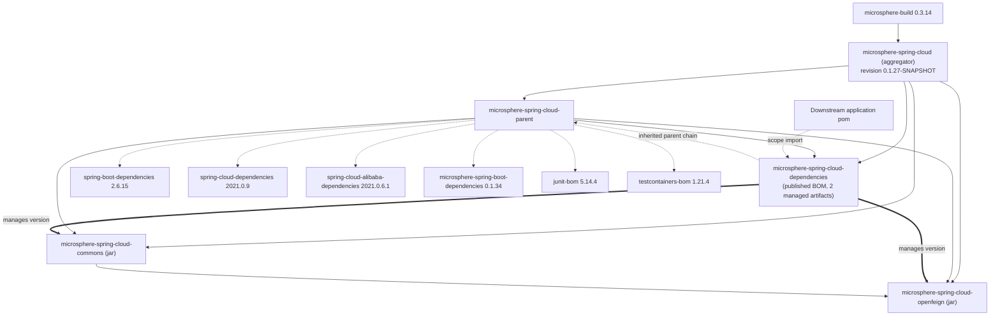
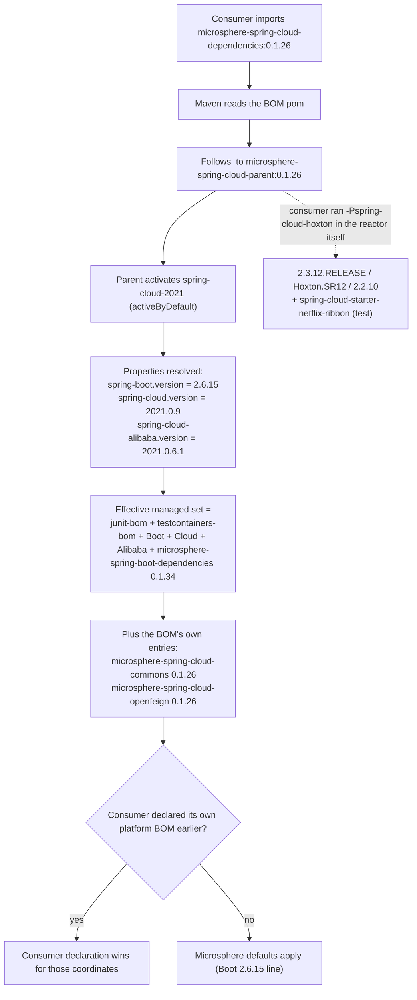

# Developer Guide · `microsphere-spring-cloud-dependencies` (1.x / 0.1.x line)

[中文](./zh/dependencies.md) · [0.2.x line](../current/dependencies.md) · [Developer Guide index](../README.md)

**Branch:** `release-1.x` · **Version line:** 0.1.x · **HEAD:** `0.1.27-SNAPSHOT` · **Latest release:** `0.1.26`
**File analysed:** `microsphere-spring-cloud-dependencies/pom.xml` (packaging `pom`, name `Microsphere :: Spring Cloud :: Dependencies`)

This is the **published BOM** of the project — the only artifact whose job is to be consumed by
downstream applications. It is deliberately the smallest pom in the reactor: 33 lines, no properties,
no profiles, no plugins.

---

## 1. Architecture design

### 1.1 What it declares

```xml
<parent>
    <artifactId>microsphere-spring-cloud-parent</artifactId>
    <version>${revision}</version>
    <relativePath>../microsphere-spring-cloud-parent/pom.xml</relativePath>
</parent>

<dependencyManagement>
    <dependency>… microsphere-spring-cloud-commons   <version>${revision}</version></dependency>
    <dependency>… microsphere-spring-cloud-openfeign <version>${revision}</version></dependency>
</dependencyManagement>
```

Two coordinates, both versioned with the reactor's CI-friendly `${revision}`. Nothing else is managed —
in particular the BOM does **not** re-declare Spring Boot / Spring Cloud / Alibaba / Microsphere
versions of its own; those arrive through inheritance from `microsphere-spring-cloud-parent`.

### 1.2 Why the parent chain matters to consumers

`flatten-maven-plugin` runs with `flatten.mode = resolveCiFriendliesOnly`, so the pom deployed to Maven
Central keeps its `<parent>` element and only substitutes `revision`/`sha1`/`changelist`.
Consequently, when an application writes:

```xml
<dependencyManagement>
    <dependencies>
        <dependency>
            <groupId>io.github.microsphere-projects</groupId>
            <artifactId>microsphere-spring-cloud-dependencies</artifactId>
            <version>0.1.26</version>
            <type>pom</type>
            <scope>import</scope>
        </dependency>
    </dependencies>
</dependencyManagement>
```

Maven resolves the imported pom **together with its parent chain**, i.e. the six BOM imports of
`microsphere-spring-cloud-parent` become part of the effective managed set. The version placeholders in
those imports (`${spring-boot.version}` …) are interpolated while reading the parent pom, where
`spring-cloud-2021` is `activeByDefault`. Practical reading:

* Importing the 1.x BOM tends to pull Boot `2.6.15` / Cloud `2021.0.9` / Alibaba `2021.0.6.1` defaults.
* Consumers that need a different generation must declare their own `spring-boot-dependencies` /
  `spring-cloud-dependencies` import **before** the Microsphere BOM — Maven's merged
  `dependencyManagement` follows *first declaration wins*.
* `microsphere-spring-boot.version` in this line is `0.1.34`; the 1.x BOM therefore pins the 0.1.x
  Microsphere Spring Boot modules (`microsphere-spring-boot-core`, `-webmvc`, `-webflux`, `-actuator`,
  `-test`) which are the Java 8 / Boot 2 builds.

### 1.3 Module and dependency graph



`COMMONS --> OPENFEIGN` is a real compile dependency (`microsphere-spring-cloud-openfeign` depends on
`microsphere-spring-cloud-commons`); the BOM only aligns their versions.

### 1.4 Profile-driven property resolution seen from the BOM



---

## 2. Source analysis

There is no Java source in this module. Its "source" is the pom contract, and three properties of it
matter during review:

1. **Single-sourcing of versions.** Both managed artifacts use `${revision}`, so the BOM can never drift
   from the jars it publishes. A hardcoded `<version>0.1.26</version>` here would be a release bug:
   the next patch bump would silently keep pointing at the previous release.
2. **No `<properties>` and no `<profiles>`.** Everything version-shaped belongs to the parent pom. This
   asymmetry is why the BOM is byte-identical between branches (see §4): the 1.x-ness lives one level up.
3. **`<relativePath>` is explicit.** It points at the sibling module rather than the default `../pom.xml`
   (which would land on the aggregator). Removing it breaks IDE/import resolution, not the reactor build.

The module is listed third in the root `<modules>` (`parent` → `dependencies` → `commons` → `openfeign`),
which is the order Maven needs: the BOM's parent must be installed/rebuilt before the BOM.

---

## 3. Design notes and patterns at the pom layer

| Pattern | Concrete evidence |
|---|---|
| **Bill of Materials** | `microsphere-spring-cloud-dependencies` — version alignment without inheritance for consumers |
| **Parent-as-platform (internal parent vs published BOM)** | `microsphere-spring-cloud-parent` holds the platform BOM imports and profiles; the published BOM holds only the product coordinates |
| **CI-friendly versions (`${revision}`)** | Declared once in the root pom; rewritten in deployed poms by `flatten-maven-plugin` (`resolveCiFriendliesOnly`) |
| **Strategy (build-time platform selection)** | The three `spring-cloud-*` profiles choose the Boot/Cloud/Alibaba triple; `activeByDefault` on `spring-cloud-2021` documents the recommended platform |
| **Layered composition** | `microsphere-build` (tooling) → `microsphere-spring-cloud-parent` (platform) → this BOM (product surface) → application pom (consumer choice) |

---

## 4. Porting & compatibility matrix

`microsphere-spring-cloud-dependencies/pom.xml` is **byte-identical** to the 0.2.x file
(`diff` between the two branches reports no difference) — the shared internals are exactly the same, and
the branch difference is entirely in what `${revision}` and the parent chain resolve to:

| Resolved value | `release-1.x` (0.1.x) | `release` (0.2.x) |
|---|---|---|
| BOM version published | `0.1.26` (HEAD `0.1.27-SNAPSHOT`) | `0.2.26` (HEAD `0.2.27-SNAPSHOT`) |
| Managed `microsphere-spring-cloud-commons` | `0.1.x` (Boot 2 / Java 8) | `0.2.x` (Boot 3+ / Java 17) |
| Managed `microsphere-spring-cloud-openfeign` | `0.1.x` (`feign.client.config.*`, `FeignContext`) | `0.2.x` (`spring.cloud.openfeign.client.config.*`, `NamedContextFactory`) |
| Inherited platform defaults | Boot `2.6.15`, Cloud `2021.0.9`, Alibaba `2021.0.6.1` | Boot `3.5.15`, Cloud `2025.0.3`, Alibaba `2025.0.0.0` |
| Inherited `microsphere-spring-boot-dependencies` | `0.1.34` | `0.2.34` |
| Servlet namespace delivered to consumers | `javax.servlet` | `jakarta.servlet` |

Porting rules:

* **Do not** copy a pom edit from one branch to the other blindly — this file is identical today, so any
  divergence you introduce (e.g. adding a managed artifact) must be applied to **both** branches in the
  same change set, otherwise the BOMs silently stop describing the same product surface.
* Adding a new jar module means adding one `<dependency>` entry here **and** one `<module>` entry in the
  root pom; both branches, with their own `revision`.
* Never add `<profiles>` or platform BOM imports here: that would duplicate the parent and break the
  "parent = platform, BOM = product" split.

---

## 5. Build & test guidance

```bash
# build the whole reactor with the default platform (Boot 2.6.15 line)
mvn clean install

# validate the BOM only, from the reactor
mvn -N -pl microsphere-spring-cloud-dependencies validate

# inspect what the BOM actually manages after profile interpolation
mvn -pl microsphere-spring-cloud-dependencies \
    --activate-profiles spring-cloud-2021 \
    org.apache.maven.plugins:maven-help-plugin:3.5.1:effective-pom \
    -Doutput=target/dependencies-effective-pom.xml

# the pom that Maven Central sees (flatten output)
ls microsphere-spring-cloud-dependencies/.flattened-pom.xml
```

Verification checklist for a BOM change:

* [ ] `effective-pom` lists `microsphere-spring-cloud-commons` and `microsphere-spring-cloud-openfeign`
      with a concrete version, never `${revision}`.
* [ ] `.flattened-pom.xml` still contains the `<parent>` element (proving `resolveCiFriendliesOnly` mode).
* [ ] Switching profiles changes only the platform BOM versions, never the two managed coordinates.
* [ ] The published BOM can be consumed by a Boot 2.3 application (i.e. `spring-cloud-hoxton`) — that is
      the floor of this version line.

## 6. Contributor checklist for this module

* [ ] Only product coordinates in `<dependencyManagement>`; versions are always `${revision}`.
* [ ] New module ⇒ new entry here **plus** the `<module>` entry in the root pom, on both branches.
* [ ] No plugins, no properties, no profiles.
* [ ] Keep the file byte-identical to its 0.2.x counterpart unless a genuinely line-specific coordinate appears.

---

← [parent developer guide](./parent.md) · [commons developer guide](./commons.md) ·
[openfeign developer guide](./openfeign.md)
