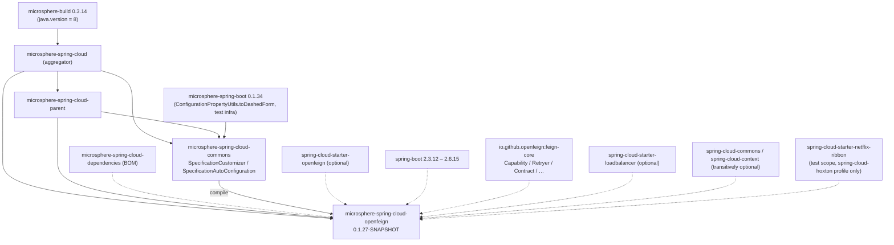
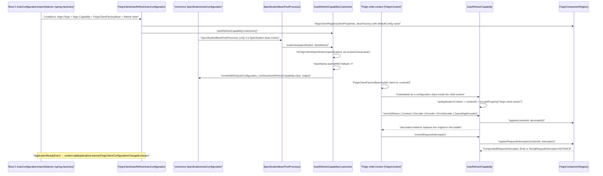

# Developer Guide · `microsphere-spring-cloud-openfeign` (1.x / 0.1.x line)

[中文](./zh/openfeign.md) · [0.2.x line](../current/openfeign.md) · [Developer Guide index](../README.md)

**Branch:** `release-1.x` · **Coordinates:** `io.github.microsphere-projects:microsphere-spring-cloud-openfeign:${revision}`
(`0.1.27-SNAPSHOT` at HEAD, latest release `0.1.26`) · **Packaging:** `jar`
**Source root:** `microsphere-spring-cloud-openfeign/src/main/java/io/microsphere/spring/cloud/openfeign/` ·
**All classes are tagged `@since 1.0.0`.**

This module replaces the Feign components (contract, encoder, decoder, error decoder, retryer, query-map
encoder, request interceptors) with refreshable decorators and rebuilds them in place when
`EnvironmentChangeEvent` reports a change under `feign.client.config.` — no restart, no client rebuild.
On `release-1.x` it is the **Spring Cloud Hoxton.SR12 → 2021.0.9 / Spring Boot 2.3–2.6** implementation of
that idea: the class-level behaviour is the same as 0.2.x, but the platform API it plugs into is the older one.

---

## 1. Architecture design

### 1.1 Module graph in the 1.x build



`spring-cloud-starter-openfeign` is `<optional>true</optional>` with a `spring-cloud-netflix-ribbon`
exclusion on both branches, and the **only** pom difference from 0.2.x is the extra
`<profile><id>spring-cloud-hoxton</id>` block that adds `spring-cloud-starter-netflix-ribbon` in **test**
scope: a Hoxton Feign test context still needs the Ribbon-era load-balancer classes present.

### 1.2 Boot 2 registration: both files, factories authoritative

```
…/src/main/resources/META-INF/spring.factories
org.springframework.boot.autoconfigure.EnableAutoConfiguration=\
io.microsphere.spring.cloud.openfeign.autoconfigure.FeignAutoConfiguration,\
io.microsphere.spring.cloud.openfeign.autoconfigure.FeignClientAutoRefreshAutoConfiguration
```

`…/src/main/resources/META-INF/spring/org.springframework.boot.autoconfigure.AutoConfiguration.imports`
lists the same two class names and is **byte-identical to the 0.2.x file** — inert on Boot 2.3–2.6,
authoritative if the artifact is ever run on Boot 2.7+/3.x. Unlike commons, this module therefore ships
*both* registration mechanisms: 0.2.x has only `AutoConfiguration.imports`.

### 1.3 The three platform couplings that make this "the 1.x variant"

| Coupling | 1.x (`release-1.x`) | 0.2.x (`release`) |
|---|---|---|
| Per-client context type | `org.springframework.cloud.openfeign.FeignContext` (line 33 of `AutoRefreshCapability.java`, line 27 of `DecoratedFeignComponent.java`) | `NamedContextFactory<FeignClientSpecification>` |
| Client-name property | `feign.client.name` (`CONTEXT_ID_PROPERTY_NAME`, `AutoRefreshCapability.java:39`) | `spring.cloud.openfeign.client.name` |
| Refreshed namespace | `feign.client.config.` (`FeignClientConfigurationChangedListener.java:34`) | `spring.cloud.openfeign.client.config.` |

The module switch `microsphere.spring.cloud.openfeign.enabled` (`FeignConstants.ENABLED_PROPERTY_NAME`,
default `true` through `matchIfMissing = true`) is **identical on both lines** — the Microsphere namespace
never moved, only the Spring Cloud one.

---

## 2. Auto-configuration source analysis

### 2.1 `autorefresh/EnableFeignAutoRefresh.java` (byte-identical to 0.2.x)
`@Retention(RUNTIME) @Target(TYPE) @Documented @Inherited`, **no attributes**, and
`@Import(value = { EnableFeignAutoRefresh.Marker.class })` where `Marker` is an empty nested
`public static class Marker {}` (lines 31–32) existing solely to satisfy
`@ConditionalOnBean(Marker.class)`. Enabling/disabling is therefore either `@EnableFeignAutoRefresh`
(presence) or the global property (absence).

### 2.2 `autoconfigure/FeignAutoConfiguration.java` (byte-identical)
`@Configuration(proxyBeanMethods = false)` + `@ConditionalOnOpenFeignAvailable` +
`@ConditionalOnClass(name = FEIGN_BUILDER_CUSTOMIZER_CLASS_NAME)` +
`@AutoConfigureAfter(name = "org.springframework.cloud.openfeign.FeignAutoConfiguration")`.
One bean (lines 36–41):

```java
@Bean
public FeignBuilderCustomizer addDefaultRequestInterceptorCustomizer() {
    return builder -> { builder.requestInterceptor(INSTANCE); };   // NoOpRequestInterceptor.INSTANCE
}
```

Seeding one interceptor guarantees the `Capability` pipeline always sees at least one `RequestInterceptor`
per client, which is what makes `default-request-headers` / `default-query-parameters` work from the very
first request.

### 2.3 `autoconfigure/FeignClientAutoRefreshAutoConfiguration.java` (byte-identical)
No `@Configuration` annotation — it is loaded purely as an auto-configuration. Guards:
`@ConditionalOnOpenFeignAvailable`, `@ConditionalOnClass(name = {FEIGN_CAPABILITY_CLASS_NAME,
FEIGN_CLIENT_FACTORY_BEAN_CLASS_NAME})`, `@ConditionalOnBean(Marker.class)`, and
`@AutoConfigureAfter(name = {"org.springframework.cloud.openfeign.FeignAutoConfiguration",
"io.microsphere.spring.cloud.context.named.autoconfigure.SpecificationAutoConfiguration"})` — the second
entry is commons' `SpecificationAutoConfiguration`, i.e. the extension point this module consumes.
Beans (both `@ConditionalOnMissingBean`):

```java
@Bean @ConditionalOnMissingBean
public FeignComponentRegistry feignClientRegistry(FeignClientProperties clientProperties, BeanFactory beanFactory) {
    return new FeignComponentRegistry(clientProperties.getDefaultConfig(), beanFactory);   // "default"
}
@Bean @ConditionalOnMissingBean
public AutoRefreshCapabilityCustomizer autoRefreshCapabilityCustomizer() { return new AutoRefreshCapabilityCustomizer(); }
```

plus `@EventListener(ApplicationReadyEvent.class) onApplicationReadyEvent(...)`, which does
`context.addApplicationListener(new FeignClientConfigurationChangedListener(registry))` **manually** — not as
a bean — with the source comment *"Make sure the FeignClientConfigurationChangedListener is registered after
the ConfigurationPropertiesRebinder"*. Registering at `ApplicationReadyEvent` guarantees `@ConfigurationProperties`
rebinding (including `FeignClientProperties`) has already refreshed the environment-backed beans before the
listener observes the resulting `EnvironmentChangeEvent`.

### 2.4 Composed conditions (`condition/`)
`ConditionalOnOpenFeignEnabled` = `@ConditionalOnProperty(name = "microsphere.spring.cloud.openfeign.enabled", matchIfMissing = true)`;
`ConditionalOnOpenFeignAvailable` = that plus `@ConditionalOnClass(name = "feign.Feign")`. Both target
`{TYPE, METHOD}`. Differences from 0.2.x are javadoc-only.

---

## 3. Core classes — source analysis

### 3.1 `autorefresh/FeignComponentRegistry.java` (byte-identical to 0.2.x)
Static `configComponentMappings` (lines 43–53) maps the dashed config key to the Feign SPI type:
`retryer → feign.Retryer`, `error-decoder → feign.codec.ErrorDecoder`, `request-interceptors`,
`default-request-headers`, `default-query-parameters → feign.RequestInterceptor`, `decoder`, `encoder`,
`contract`, `query-map-encoder → feign.QueryMapEncoder`.
`normalizeConfig(String)` (lines 96–99) truncates at `[` (`LEFT_SQUARE_BRACKET`) and then applies
`ConfigurationPropertyUtils.toDashedForm(...)`, so `errorDecoder[0]`, `errorDecoder` and `error-decoder`
all resolve to `ErrorDecoder.class`.
Storage: `Map<String, List<Refreshable>> refreshableComponents` and
`Map<String, CompositedRequestInterceptor> interceptorsMap`, both keyed by **Feign client name / contextId**.
`register(String, List<Refreshable>)` (lines 130–136) asserts non-blank name, non-empty list, no null
elements (`IllegalArgumentException`). `registerRequestInterceptor(...)` (lines 168–176) returns the
`CompositedRequestInterceptor` **only for the first** interceptor of a client (`addRequestInterceptor`
returns `true` iff the set was previously empty) and `NoOpRequestInterceptor.INSTANCE` afterwards, so the
builder receives the composite exactly once. `synchronized refresh(String, Set<String>)` (lines 207–244)
strips the `clientName + "."` prefix, maps the remainders through `getComponentClass`, and:
* if `clientName.equals(defaultClientName)` → refreshes **every** client's matching components
  (`isComponentPresent` via `isAssignableFrom`) and, when any `RequestInterceptor` change is present, all
  composites;
* otherwise → refreshes only that client's matching components plus its own composite.

### 3.2 `autorefresh/FeignClientConfigurationChangedListener.java` — **1.x namespace**
```java
private final String PREFIX = "feign.client.config.";   // line 34 — 0.2.x: "spring.cloud.openfeign.client.config."
```
`implements ApplicationListener<EnvironmentChangeEvent>` where the event is
`org.springframework.cloud.context.environment.EnvironmentChangeEvent` (Spring Cloud Context).
`RefreshEvent` is only the indirect trigger (`ContextRefresher` / RefreshScope publishes the
`EnvironmentChangeEvent`). `resolveChangedClient(event)` keeps keys starting with `PREFIX`, removes it and
groups by the first remaining dot-segment, collecting the sub-key:
`feign.client.config.my-client.decoder` → `{"my-client" → {"decoder"}}`; `onApplicationEvent` then calls
`registry.refresh(client, keys)` per entry.

### 3.3 `autorefresh/AutoRefreshCapability.java` — **1.x `FeignContext`**
`implements feign.Capability, ApplicationContextAware`; fields
`FeignClientProperties clientProperties`, `FeignContext feignContext` (line 33), `FeignComponentRegistry
componentRegistry`, `String contextId`.

```java
private static final String CONTEXT_ID_PROPERTY_NAME = "feign.client.name";                     // line 39
public AutoRefreshCapability(FeignClientProperties clientProperties, FeignContext feignContext, // line 55
                             FeignComponentRegistry componentRegistry) { … }
public void setApplicationContext(ApplicationContext applicationContext) {                        // line 76
    this.contextId = applicationContext.getEnvironment().getProperty(CONTEXT_ID_PROPERTY_NAME);
}
```

Inside a Feign **child** context, `feign.client.name` carries the owning client's name, which is why the
capability can be a shared configuration class yet still know which client it decorates. Each `enrich(...)`
returns `null` for `null` input, otherwise builds the decorator through
`DecoratedFeignComponent.instantiate(DecoratedX.class, X.class, contextId, feignContext, clientProperties, original)`,
registers it with `componentRegistry.register(contextId, decoratedX)` and returns it so the builder swaps the
original. `enrich(RequestInterceptor)` instead returns
`componentRegistry.registerRequestInterceptor(contextId, interceptor)`. `enrich(InvocationHandlerFactory)` is
not overridden (tests supply their own via `MockCapability`).

### 3.4 `autorefresh/AutoRefreshCapabilityCustomizer.java` — **1.x reflection-based decoupling**
`implements io.microsphere.spring.cloud.context.named.SpecificationCustomizer` (commons extension point).
Instead of a compile-time reference to `FeignClientSpecification`, 1.x resolves it **by name** and mutates it
reflectively, so the class loads even where that type is absent or relocated across Spring Cloud generations:

```java
static final String FEIGN_CLIENT_SPECIFICATION_CLASS_NAME = "org.springframework.cloud.openfeign.FeignClientSpecification";  // line 46
static final Class<?> FEIGN_CLIENT_SPECIFICATION_CLASS = resolveClass(FEIGN_CLIENT_SPECIFICATION_CLASS_NAME);               // line 48

public void customize(Specification specification, String beanName) {                                                        // line 57
    if (isFeignClientSpecification(specification) && beanName.startsWith("default.")) {
        injectAutoRefreshCapability(specification);
    }
}
boolean isFeignClientSpecification(Specification specification) {                                                            // line 62
    return FEIGN_CLIENT_SPECIFICATION_CLASS.equals(specification.getClass());
}
void injectAutoRefreshCapability(Specification specification) {                                                              // line 66
    Class<?>[] originConfigurationClasses = specification.getConfiguration();
    Class<?>[] newConfigurationClasses = combine(AUTO_REFRESH_CAPABILITY_CLASS, originConfigurationClasses);
    BeanMetadata beanMetadata = getBeanMetadata(FEIGN_CLIENT_SPECIFICATION_CLASS);
    Method setConfigurationMethod = findWriteMethod(beanMetadata, "configuration");
    invokeMethod(true, specification, setConfigurationMethod, new Object[]{newConfigurationClasses});
    …TRACE log of the before/after arrays…
}
```

(`resolveClass` = `io.microsphere.util.ClassLoaderUtils`, `findWriteMethod` / `getBeanMetadata` =
`io.microsphere.beans.BeanUtils`, `invokeMethod` = `io.microsphere.reflect.MethodUtils`.)
0.2.x replaces all of this with `specification instanceof FeignClientSpecification` plus a direct
`specification.setConfiguration(...)` — same observable behaviour.

Two details matter when reasoning about this class:
* The capability class is **prepended** (`combine(AUTO_REFRESH_CAPABILITY_CLASS, origin)`) into the
  specification's `configuration()` array, so Spring instantiates one `AutoRefreshCapability` **per Feign
  child context**, and Spring Cloud OpenFeign picks up any `Capability` bean in that context when building
  the client.
* Only specifications whose bean name starts with `default.` are decorated — the shared default
  configuration registration — which is enough, because the per-client identity is recovered at build time
  from `feign.client.name`.

### 3.5 `components/DecoratedFeignComponent.java` — **1.x `FeignContext`**
Abstract, `implements Refreshable`; field `private final FeignContext feignContext;` (line 27), constructor
`(String contextId, FeignContext feignContext, FeignClientProperties clientProperties, T delegate)` (line 49),
`protected volatile T delegate`.

* `delegate()` lazily re-loads when `delegate == null` (i.e. right after a refresh).
* `loadInstanceFromContextFactory(...)` (line 93): `ObjectProvider<T> beanProvider = this.feignContext.getProvider(contextId, componentType);`
  → `getIfAvailable(() -> instantiateClass(componentType))` — prefer the **current bean** of that type in the
  per-client context, else instantiate the configured class directly.
* `refresh()` = `this.delegate = null` (trace-logged).
* `componentType()` is the abstract subclass hook (Template Method inside the Decorator).
* `get(Function<FeignClientConfiguration, T>)` checks the **default** configuration first, then the current one.
* `equals`/`hashCode`/`toString` delegate to `delegate()`.
* Static factory (lines 233–236) — reflection with the **`FeignContext`** parameter type:

```java
Constructor<W> constructor = findConstructor(decoratedClass, String.class, FeignContext.class,
                                             FeignClientProperties.class, componentClass);
return instantiateClass(constructor, contextId, feignContext, clientProperties, delegate);
```

0.2.x uses `NamedContextFactory.class` in the same `findConstructor(...)` call and also adds a
`logger.isTraceEnabled()` guard around the trace statement in `delegate()`.

### 3.6 Decorator subclasses — identical class set on both lines

| Class | `componentType()` source on **1.x** | Fallback | Delegated methods |
|---|---|---|---|
| `DecoratedContract` | `FeignClientConfiguration::getContract` | `Contract.class` | `parseAndValidateMetadata(Class)` |
| `DecoratedDecoder` | `::getDecoder` | `Decoder.class` | `decode(Response, Type)` |
| `DecoratedEncoder` | `::getEncoder` | `Encoder.class` | `encode(Object, Type, RequestTemplate)` |
| `DecoratedErrorDecoder` | `::getErrorDecoder` | `ErrorDecoder.Default.class` | `decode(String methodKey, Response)` |
| `DecoratedRetryer` | `::getRetryer` | `Retryer.class` | `continueOrPropagate(RetryableException)`, `clone()` |
| `DecoratedQueryMapEncoder` | **hard-coded** `PageableSpringQueryMapEncoder.class` (line 34) | — | `encode(Object) → Map<String,Object>` |

> **1.x-only functional limitation.** `DecoratedQueryMapEncoder.componentType()` ignores
> `feign.client.config.<name>.query-map-encoder` entirely: after a refresh the delegate is always
> `PageableSpringQueryMapEncoder`. 0.2.x resolves the configured class first (current config, then default)
> through a `MethodHandle` on `FeignClientConfiguration#getQueryMapEncoder()` with a `NOT_FOUND_METHOD_HANDLE`
> guard, falling back to `PageableSpringQueryMapEncoder`. Do not "clean up" the 1.x method into the 0.2.x form
> without adding the `MethodHandle` helper — and note that the 1.x `querymapencoder` tests therefore assert the
> *type* change differently from 0.2.x.

```mermaid
classDiagram
    class Refreshable {
        <<interface>>
        +refresh() void
    }
    class DecoratedFeignComponent {
        <<abstract>>
        -FeignContext feignContext
        -String contextId
        -FeignClientProperties clientProperties
        #volatile T delegate
        +delegate() T
        #componentType() Class
        +refresh() void
        +loadInstance() T
        {static} +instantiate() W
    }
    class DecoratedContract
    class DecoratedDecoder
    class DecoratedEncoder
    class DecoratedErrorDecoder
    class DecoratedRetryer
    class DecoratedQueryMapEncoder
    class CompositedRequestInterceptor {
        -BeanFactory beanFactory
        -String contextId
        -LinkedHashSet~RequestInterceptor~ set
        +apply(RequestTemplate) void
        +addRequestInterceptor(...) boolean
        +refresh() void
    }
    class NoOpRequestInterceptor {
        +INSTANCE
        +apply(RequestTemplate) void
    }

    Refreshable <|.. DecoratedFeignComponent
    Refreshable <|.. CompositedRequestInterceptor
    DecoratedFeignComponent <|-- DecoratedContract
    DecoratedFeignComponent <|-- DecoratedDecoder
    DecoratedFeignComponent <|-- DecoratedEncoder
    DecoratedFeignComponent <|-- DecoratedErrorDecoder
    DecoratedFeignComponent <|-- DecoratedRetryer
    DecoratedFeignComponent <|-- DecoratedQueryMapEncoder
    DecoratedFeignComponent ..> FeignContext : "1.x field type"
    CompositedRequestInterceptor o-- NoOpRequestInterceptor : "seeded by FeignAutoConfiguration"
```

The class set, the field names and `Refreshable` are identical on both branches; only the
`FeignContext` vs `NamedContextFactory<FeignClientSpecification>` type in the constructor signatures differs.

### 3.7 `components/CompositedRequestInterceptor.java` and `NoOpRequestInterceptor.java`
Composite: `implements RequestInterceptor, Refreshable`; holds a `LinkedHashSet<RequestInterceptor>`
(insertion-ordered) with all mutations synchronised on the set; `apply(RequestTemplate)` iterates under
`synchronized (set)` so refresh is request-safe. `refresh()` re-reads `FeignClientProperties`
(`getOrInstantiate` = `beanFactory.getBeanProvider(...).getIfAvailable(fallback)`) and rebuilds from **default
then current** configuration: configured `requestInterceptors` classes, a lambda applying
`defaultRequestHeaders` (only for keys not already set), a lambda applying `defaultQueryParameters`.
Consequently header/parameter changes propagate purely through this refresh.
Null Object: `NoOpRequestInterceptor.INSTANCE` with an intentionally empty `apply(...)`; two roles — the seed
interceptor in `FeignAutoConfiguration` and the return value for the 2nd..n-th interceptor in
`AutoRefreshCapability.enrich(RequestInterceptor)`.

---

## 4. Startup wiring on 1.x



---

## 5. Runtime refresh flow on 1.x

```mermaid
flowchart TD
    A["/actuator/refresh or ContextRefresher"] --> B["RefreshEvent"]
    B --> C["ConfigurationPropertiesRebinder rebinds FeignClientProperties"]
    C --> D["EnvironmentChangeEvent(keys) published (Spring Cloud Context)"]
    D --> E{"key starts with PREFIX = \"feign.client.config.\"?"}
    E -->|no| F["ignored"]
    E -->|yes| G["strip PREFIX, group by first dot-segment"]
    G --> H["clientName -> changed sub-keys, e.g. my-client -> decoder"]
    H --> I["FeignComponentRegistry.refresh(clientName, keys)"]
    I --> J["normalizeConfig: truncate at bracket, toDashedForm"]
    J --> K["getComponentClass -> Feign SPI type"]
    K --> L{"clientName == defaultConfigName (\"default\")?"}
    L -->|yes| M["refresh ALL clients matching those component types"]
    L -->|no| N["refresh only this client's matching components"]
    M --> O{"any RequestInterceptor change?"}
    N --> O
    O -->|yes| P["CompositedRequestInterceptor.refresh() — all (default) or one client"]
    O -->|no| Q["skip interceptor refresh"]
    P --> R["delegate = null on each affected DecoratedFeignComponent"]
    Q --> R
    R --> S["next call: delegate() reloads via feignContext.getProvider(contextId, componentType())"]
    S --> T{"componentType() source"}
    T -->|"Contract / Decoder / Encoder / ErrorDecoder / Retryer"| U["configured class honoured"]
    T -->|"QueryMapEncoder"| V["1.x limitation: always PageableSpringQueryMapEncoder<br/>configured query-map-encoder is ignored"]
```

---

## 6. Design patterns (concrete classes)

| Pattern | Classes | Note for 1.x |
|---|---|---|
| **Decorator** | `DecoratedFeignComponent` + the six `Decorated*`; also commons' `ReactiveDiscoveryClientAdapter` | `componentType()` is an internal Template Method hook; `equals`/`hashCode`/`toString` forward to `delegate()` so the decorator is transparent |
| **Composite** | `CompositedRequestInterceptor` (per client); commons `MultipleServiceRegistry` / `MultipleRegistration` / `RegistrationMetaData` | the composite is handed to the builder exactly once (guarded by `NoOpRequestInterceptor` return) |
| **Observer** | commons `EventPublishingRegistrationAspect` + the `RegistrationEvent` family; here `FeignClientConfigurationChangedListener` on `EnvironmentChangeEvent` | listener added manually at `ApplicationReadyEvent`, deliberately after the rebinder |
| **Template Method** | commons `WebServiceRegistryAutoConfiguration` (final `onApplicationEvent` + two abstract hooks) and `AbstractServiceRegistrationEndpoint`; here `delegate()` → `componentType()` / `loadInstance()` | |
| **Null Object** | `NoOpRequestInterceptor.INSTANCE` | seed interceptor **and** duplicate-suppression return value |
| **Registry** | `FeignComponentRegistry` (client name → `Refreshable`s) and commons `InMemoryServiceRegistry` / `SimpleServiceRegistry` | `refreshableComponents` and `interceptorsMap` are `newConcurrentHashMap(32)` |
| **Strategy** | `SpecificationCustomizer` (openfeign contributes `AutoRefreshCapabilityCustomizer`); commons `RegistrationCustomizer` | customizers are applied in `getSortedBeans(...)` order |
| **Reflection-based decoupling (compatibility pattern)** | **1.x** `AutoRefreshCapabilityCustomizer` (`resolveClass`, `getBeanMetadata`, `findWriteMethod`, `invokeMethod`) and the `findConstructor(..., FeignContext.class, …)` lookup in `DecoratedFeignComponent.instantiate` | On 0.2.x the same problem is solved with `MethodHandle` in `DecoratedQueryMapEncoder` and a direct `instanceof`; **1.x hard-codes** `PageableSpringQueryMapEncoder` instead |

---

## 7. Porting & compatibility matrix (openfeign)

Byte-identical between the two branches: `EnableFeignAutoRefresh.java`, `FeignConstants.java`,
`FeignAutoConfiguration.java`, `FeignClientAutoRefreshAutoConfiguration.java`, `FeignComponentRegistry.java`,
`Refreshable.java`, both registration files' class lists, `features.yaml`. Everything else in
`autorefresh`/`components` differs — and the differences are real platform migrations, not formatting.

| 1.x construct | 0.2.x counterpart | Porting action |
|---|---|---|
| `org.springframework.cloud.openfeign.FeignContext` field / constructor / `getProvider(...)` parameter | `NamedContextFactory<FeignClientSpecification>` (`getProvider` unchanged in behaviour) | Replace the type in **three** places: `AutoRefreshCapability`, `DecoratedFeignComponent` (field + ctor + `findConstructor`), all six `Decorated*` constructors |
| `CONTEXT_ID_PROPERTY_NAME = "feign.client.name"` | inline `"spring.cloud.openfeign.client.name"` | Property rename; constant disappears on 0.2.x |
| `PREFIX = "feign.client.config."` | `"spring.cloud.openfeign.client.config."` | Property rename — also every test `@TestPropertySource` key |
| `AutoRefreshCapabilityCustomizer`: `resolveClass` + `getBeanMetadata` + `findWriteMethod` + `invokeMethod(true, …)` | `instanceof FeignClientSpecification` + `specification.setConfiguration(...)` | Replace the reflective block with the direct call when forward-porting; keep reflection when back-porting |
| `DecoratedQueryMapEncoder.componentType()` returns `PageableSpringQueryMapEncoder.class` unconditionally | resolves configured class via `MethodHandle` on `getQueryMapEncoder()`, `NOT_FOUND_METHOD_HANDLE` guard, same fallback | Functional improvement exists **only** on 0.2.x — port it deliberately, with `MethodHandleUtils`/`MethodHandlesLookupUtils` dependencies |
| `META-INF/spring.factories` (`EnableAutoConfiguration=` two classes) **+** `AutoConfiguration.imports` | `AutoConfiguration.imports` only | Back-ports must add the factories file; forward-ports must delete it |
| `spring-cloud-hoxton` profile adds `spring-cloud-starter-netflix-ribbon` (test) | no ribbon anywhere (and it stays excluded from the starter) | Never port the hoxton profile to 0.2.x; never delete it from 1.x |
| `microsphere-spring-boot` 0.1.34 (test infra, `ConfigurationPropertyUtils`) | 0.2.34 | Version alignment through the parent pom, not this pom |
| Java 8 language level | `java.version = 17` | Same source style on both lines — this module never used Java 9+ constructs, so no rewrite is needed |

---

## 8. Build & test guidance

```bash
mvn -pl microsphere-spring-cloud-openfeign -am clean test                         # Boot 2.6.15 / Cloud 2021.0.9
mvn -pl microsphere-spring-cloud-openfeign -am clean test --activate-profiles spring-cloud-2020
mvn -pl microsphere-spring-cloud-openfeign -am clean test --activate-profiles spring-cloud-hoxton  # + ribbon (test)
```

Canonical refresh test pattern (`src/test/java/…/autorefresh/BaseTest.java` + `decoder/DecoderChangedTest.java`):

1. `@TestPropertySource` seeds the defaults **under the 1.x namespace**, e.g.
   `feign.client.config.default.decoder=io.microsphere.spring.cloud.openfeign.decoder.ADecoder`,
   `…default.query-map-encoder=…`, `…default.retryer=…`, `…default.request-interceptors[0]=…`,
   `…default.default-request-headers.app=my-app`, `…default.default-query-parameters.sign=my-sign`,
   plus `spring.main.allow-bean-definition-overriding=true`; values are plain FQCNs and the component classes
   need only a public default constructor — they are **not** Spring beans.
2. The test app is `@EnableFeignClients(clients = BaseClient.class)` + `@EnableFeignAutoRefresh` + `@ComponentScan`;
   `BaseClient` is `@FeignClient(contextId = "my-client", name = "my-client", configuration = {MockCapability.class})`,
   and `MockCapability` swaps `InvocationHandlerFactory` for `ObservableFeignInvocationHandler`, which
   reflectively extracts the live `ResponseHandler` → `DecoratedDecoder` etc. and asserts
   `decoder.delegate().getClass()` before each call.
3. `replaceConfig()` adds a higher-priority `MapPropertySource("after", {feign.client.config.my-client.decoder: BDecoder.class.getName()})`,
   publishes `RefreshEvent` then `EnvironmentChangeEvent(Set.of(key))`; the next call observes the new delegate.
4. Negative/auto-config tests (`FeignAutoConfigurationTest`, `FeignClientAutoRefreshAutoConfigurationTest`)
   use the `AutoConfigurationTest` base from `microsphere-spring-boot-test` — the same infrastructure as 0.2.x —
   booting with `classes = {EnableFeignAutoRefresh.Marker.class, …}` (Marker presence activates auto-refresh)
   and asserting `FeignComponentRegistry` + `AutoRefreshCapabilityCustomizer`; disabling is
   `microsphere.spring.cloud.openfeign.enabled=false` or removing `feign.Feign` / `feign.Capability` /
   `FeignClientFactoryBean` from the classpath.
5. Unit-level: `FeignComponentRegistryTest` (key↔class mapping incl. camel/dashed/`[0]`, `IllegalArgumentException`
   on illegal args, first-vs-later `registerRequestInterceptor`), `AutoRefreshCapabilityTest`
   (`enrich(null)` → `null` for all seven types), `AutoRefreshCapabilityCustomizerTest`
   (`injectAutoRefreshCapability` prepends `AutoRefreshCapability.class`).

## 9. Contributor checklist

* [ ] Every new property key touched by refresh goes through `FeignComponentRegistry.normalizeConfig(...)` — the
      canonical form on this branch is dashed, the namespace is `feign.client.config.`.
* [ ] New `Decorated*` component: add the class, its `componentType()`, an `enrich(...)` overload in
      `AutoRefreshCapability`, and register it with `componentRegistry.register(contextId, …)`.
* [ ] Keep constructors at `(String, FeignContext, FeignClientProperties, T)` so
      `findConstructor(..., FeignContext.class, …)` in `DecoratedFeignComponent.instantiate` still resolves.
* [ ] Update **both** `spring.factories` and `AutoConfiguration.imports` when adding an auto-configuration.
* [ ] Record the new class in `…/META-INF/config/default/features.yaml` abstract features.
* [ ] Do not introduce Java 9+ syntax, and do not adopt the 0.2.x `spring.cloud.openfeign.*` prefixes here.

---

Related: [commons](./commons.md) · [parent](./parent.md) · [dependencies](./dependencies.md) ·
0.2.x analysis: [../current/openfeign.md](../current/openfeign.md)
