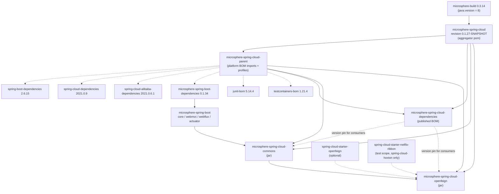
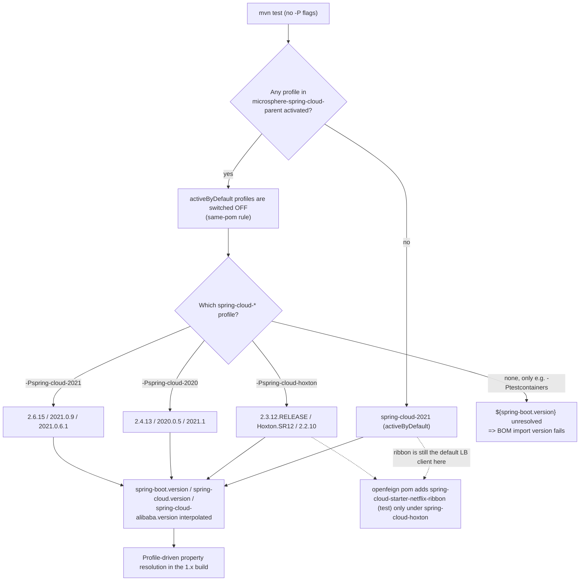

# Developer Guide · `microsphere-spring-cloud-parent` (1.x / 0.1.x line)

[中文](./zh/parent.md) · [0.2.x line](../current/parent.md) · [Developer Guide index](../README.md)

**Branch:** `release-1.x` · **Version line:** 0.1.x · **HEAD:** `0.1.27-SNAPSHOT` · **Latest release:** `0.1.26`
**File analysed:** `microsphere-spring-cloud-parent/pom.xml` (packaging `pom`, name `Microsphere :: Spring Cloud :: Parent`)

This module publishes no artifacts of its own. It is the *internal build contract* of the
`release-1.x` branch: one `<dependencyManagement>` block built from six BOM imports plus four
Maven profiles that select the Spring Boot / Spring Cloud / Spring Cloud Alibaba platform generation.

---

## 1. Architecture design

### 1.1 Layered build

The 1.x build is a four-layer chain, all layers linked by `<parent>`:

```
microsphere-build:0.3.14                 ← upstream build parent (compiler, javadoc, flatten, enforcer, surefire)
  └── microsphere-spring-cloud:${revision}          ← root aggregator (pom.xml), lists the 4 modules
        ├── microsphere-spring-cloud-parent:${revision}          ← this module: platform BOM imports + profiles
        ├── microsphere-spring-cloud-dependencies:${revision}    ← published BOM (consumers)
        ├── microsphere-spring-cloud-commons:${revision}         ← jar
        └── microsphere-spring-cloud-openfeign:${revision}       ← jar
```

Two structural facts contributors must keep:

1. The root `pom.xml` is **both** the aggregator (`<modules>`) **and** the parent of `microsphere-spring-cloud-parent`
   (`<parent>microsphere-spring-cloud</parent>`, `<relativePath>../pom.xml</relativePath>`).
2. The jar modules and the BOM do **not** inherit from the root aggregator — they point at
   `microsphere-spring-cloud-parent` explicitly (`<relativePath>../microsphere-spring-cloud-parent/pom.xml</relativePath>`),
   which is what gives them the platform BOMs and the profile properties.

### 1.2 The Boot 2 pipeline this branch targets

`release-1.x` compiles against Spring Boot **2.3.x – 2.6.x** and Spring Cloud **Hoxton.SR12 – 2021.0.x**.
Everything downstream in the reactor is shaped by that:

| Constraint | Consequence for contributors |
|---|---|
| Spring Boot 2.3–2.6 | Auto-configuration is registered through `META-INF/spring.factories` (`EnableAutoConfiguration=`), **not** `META-INF/spring/org.springframework.boot.autoconfigure.AutoConfiguration.imports` |
| Spring Boot 2.x | `org.springframework.boot.web.server.ServerProperties` uses the Boot 2 accessors (e.g. `getMaxHttpHeaderSize()`), and `javax.servlet.*` is the servlet namespace |
| Java 8 baseline | No `var`, records, sealed types, text blocks, switch expressions or pattern-matching `instanceof` in any module (see §3) |
| Boot 2 config metadata | `@ConstructorBinding` / `spring-configuration-metadata` generation behaves per Boot 2 — annotation processors are declared `optional` in the jar poms |

For the module-level detail see [commons](./commons.md) and [openfeign](./openfeign.md).

### 1.3 Module and dependency graph of the 1.x build



Dotted arrows are `scope=import` BOM relationships or `optional`/`test` dependencies; solid arrows are
`<parent>` relationships or compile-scope dependencies.

---

## 2. Source analysis: what the parent pom actually declares

### 2.1 Properties

| Property | Value at HEAD | Role |
|---|---|---|
| `microsphere-spring-boot.version` | `0.1.34` | Version of the imported `microsphere-spring-boot-dependencies` BOM — the 0.1.x counterpart of 0.2.x's `0.2.34` |
| `testcontainers.version` | `1.21.4` | Version of `org.testcontainers:testcontainers-bom` |
| `junit-jupiter.version` | `5.14.4` | Version of `org.junit:junit-bom` |
| `spring-boot.version`, `spring-cloud.version`, `spring-cloud-alibaba.version` | *defined only inside profiles* | Resolved by profile activation; see §2.3 |

`spring-boot.version` & friends are intentionally **not** declared in `<properties>`: they must always
come from exactly one active platform profile, which makes an unresolvable `${spring-boot.version}`
a build-time signal rather than a silently wrong default.

### 2.2 `<dependencyManagement>` — six imports, order-sensitive

```
org.junit:junit-bom:${junit-jupiter.version}                    (pom, import)
org.testcontainers:testcontainers-bom:${testcontainers.version} (pom, import)
org.springframework.boot:spring-boot-dependencies:${spring-boot.version}          (pom, import)
org.springframework.cloud:spring-cloud-dependencies:${spring-cloud.version}       (pom, import)
com.alibaba.cloud:spring-cloud-alibaba-dependencies:${spring-cloud-alibaba.version}(pom, import)
io.github.microsphere-projects:microsphere-spring-boot-dependencies:${microsphere-spring-boot.version} (pom, import)
```

Maven applies *first declaration wins* when merging imported BOMs, which is why `junit-bom` is declared
**above** `spring-boot-dependencies`: the branch deliberately tests on JUnit 5.14.4 instead of the
5.7.x line managed by Boot 2.6. The same reasoning keeps `testcontainers-bom` ahead of Boot's BOM.
Do not reorder these imports when "tidying up" the pom.

The last import (`microsphere-spring-boot-dependencies` 0.1.34) is what supplies the versions of the
four compile-scope Microsphere dependencies used by the commons module
(`microsphere-spring-boot-core`, `-webmvc`, `-webflux`, `-actuator`) and of `microsphere-spring-boot-test`.

### 2.3 Platform profiles

| Profile id | Activation | `spring-boot.version` | `spring-cloud.version` | `spring-cloud-alibaba.version` |
|---|---|---|---|---|
| `spring-cloud-hoxton` | manual | `2.3.12.RELEASE` | `Hoxton.SR12` | `2.2.10` |
| `spring-cloud-2020` | manual | `2.4.13` | `2020.0.5` | `2021.1` |
| `spring-cloud-2021` | `activeByDefault` | `2.6.15` | `2021.0.9` | `2021.0.6.1` |
| `testcontainers` | manual | — | — | — |

`testcontainers` is not a platform profile — it only configures `maven-surefire-plugin` with the system
property `testcontainers.enabled=true`, which is how the integration tests (Nacos / Eureka / Zookeeper /
Consul) opt in to spawning containers.



> **Gotcha (verified against the poms):** `activeByDefault` is deactivated as soon as *any* profile
> declared in the same pom is activated — and `testcontainers` is declared in this pom. CI therefore
> always names a `spring-cloud-*` profile explicitly. Reproduce that locally:
> `mvn test --activate-profiles test,coverage,testcontainers,spring-cloud-2021`.

---

## 3. The Java 8 baseline — where it comes from and what it forbids

The 1.x root `pom.xml` declares **only** `<revision>0.1.27-SNAPSHOT</revision>`; there is **no**
`<java.version>` property. `microsphere-build:0.3.14` supplies:

```
<java.version>8</java.version>
<maven.compiler.source>${java.version}</maven.compiler.source>
<maven.compiler.target>${java.version}</maven.compiler.target>
```

and the `java9+` profile (`<activation><jdk>[9,)</jdk></activation>`) additionally sets
`<maven.compiler.release>${java.version}</maven.compiler.release>`. Net effect: the 1.x sources compile
with `--release 8` even on a modern JDK, and `java16+`/`java17+` profiles only adjust `--add-opens`
arguments and the Checkstyle version, never the language level.

Consequences for code review on this branch:

* No `var`, records, sealed types, text blocks, switch expressions or pattern-matching `instanceof`
  anywhere in `microsphere-spring-cloud-commons` / `microsphere-spring-cloud-openfeign` (58 + 24 main
  sources, none of which use a Java 9+ construct).
* Servlet API type is `javax.servlet.Filter` (see the single occurrence in
  `WebMvcServiceRegistryAutoConfiguration`), never `jakarta.servlet.Filter`.
* Spring Boot 2 API surface only — `ServerProperties#getMaxHttpHeaderSize()`, `FilterRegistrationBean`,
  `DispatcherServletRegistrationBean` from `org.springframework.boot.web.servlet`.
* `@since 1.0.0` javadoc tags stay as-is; the 0.1.x line documents the same `@since` values as 0.2.x
  because the API was introduced in the 1.0.0 feature generation, not per release line.

---

## 4. Porting & compatibility matrix (parent / build layer)

| Concern | `release-1.x` (0.1.x) | `release` (0.2.x) | What a contributor must do |
|---|---|---|---|
| Build parent | `microsphere-build:0.3.14` | `microsphere-build:0.3.16` | Never cherry-pick the `<version>` of `<parent>` in the root pom across branches |
| `revision` | `0.1.27-SNAPSHOT` (released `0.1.26`) | `0.2.27-SNAPSHOT` (released `0.2.26`) | Keep patch bumps on the correct line; `revision` is declared once, in the root pom |
| `<java.version>` | absent → inherits `8` | `17` (explicit in root pom) | A patch needing Java 17 syntax cannot be back-ported; rewrite it in Java 8 form |
| Platform profiles | `spring-cloud-hoxton`, `spring-cloud-2020`, `spring-cloud-2021` (default) | `spring-cloud-2022`, `2023`, `2024`, `2025` (default), `2025.1` | When porting a build fix, port the *structure* (three profiles + `activeByDefault`), not the version numbers |
| `microsphere-spring-boot.version` | `0.1.34` | `0.2.34` | Track the counterpart release; API additions land in 0.2.x first |
| JUnit Jupiter | `5.14.4` | `6.1.3` | Tests using JUnit 6 APIs (`@Isolated`, new extension APIs) must be down-graded for 1.x |
| Testcontainers | `1.21.4`, artifact `org.testcontainers:junit-jupiter` | `2.0.5`, artifact `org.testcontainers:testcontainers-junit-jupiter` (+ `junit:junit` exclusion) | The artifact was renamed in Testcontainers 2.x — pom edits are *not* portable verbatim |
| Auto-config registration file | `META-INF/spring.factories` authoritative | `AutoConfiguration.imports` authoritative | See [commons §3](./commons.md) and [openfeign §3](./openfeign.md) |
| Servlet namespace | `javax.servlet` | `jakarta.servlet` | Only one file in the whole codebase is affected |
| CI matrix | JDK `8`, `11` × 3 profiles | JDK `17`, `21`, `25` × 5 profiles | A 1.x PR must pass on JDK 8; `.github/workflows/maven-build.yml` differs per branch |

`microsphere-spring-cloud-dependencies/pom.xml` and `microsphere-spring-cloud-parent`'s `<dependencyManagement>`
block structure are otherwise the same on both branches — the 0.2.x parent pom is a superset with two extra profiles
and higher versions, and the *aggregator/parent/BOM layer carries no Java code at all*.

---

## 5. Build & test guidance

```bash
# default platform (Boot 2.6.15 / Cloud 2021.0.9 / Alibaba 2021.0.6.1)
mvn clean install

# explicit platform
mvn clean test --activate-profiles spring-cloud-2021
mvn clean test --activate-profiles spring-cloud-2020
mvn clean test --activate-profiles spring-cloud-hoxton   # Ribbon-era context; openfeign adds ribbon (test)

# what CI does (matrix: java 8 and 11 × the three profiles above)
mvn --batch-mode --update-snapshots --file pom.xml \
    -Drevision=0.0.1-SNAPSHOT -Dsurefire.useSystemClassLoader=false \
    test --activate-profiles test,coverage,testcontainers,spring-cloud-2021
```

Notes:

* `-Drevision=0.0.1-SNAPSHOT` in CI proves the CI-friendly `${revision}` scheme works; `flatten-maven-plugin`
  (`flatten.mode = resolveCiFriendliesOnly`) rewrites only the CI-friendly variables in the published pom.
* `testcontainers` must be activated for the registry integration tests; without it those tests are skipped
  rather than failed.
* The `hoxton` profile is the only one where `spring-cloud-starter-netflix-ribbon` appears in the reactor
  (test scope, contributed by `microsphere-spring-cloud-openfeign/pom.xml`), because a Hoxton Feign test
  context needs the Ribbon-era load-balancer classes on the classpath.

## 6. Contributor checklist for this module

* [ ] Exactly one `spring-cloud-*` profile stays `activeByDefault` (`spring-cloud-2021` on 1.x).
* [ ] New platform generations are added as a **new profile**, never by mutating an existing one.
* [ ] BOM import order preserved: JUnit → Testcontainers → Boot → Cloud → Alibaba → Microsphere.
* [ ] Any new managed version goes into a `<profile>`-free property in this pom, not into a jar pom.
* [ ] Never set `<java.version>` in the 1.x root pom — the Java 8 baseline is the branch's contract.

---

← [commons developer guide](./commons.md) · [openfeign developer guide](./openfeign.md) ·
[dependencies developer guide](./dependencies.md)
