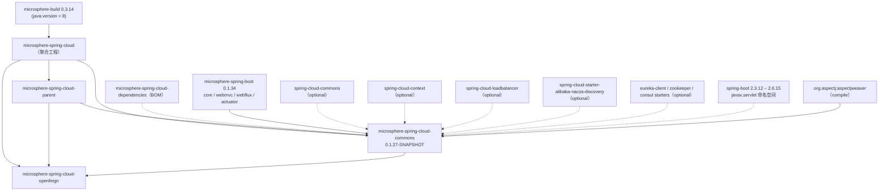
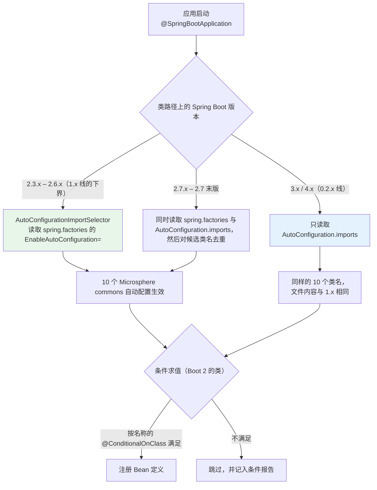
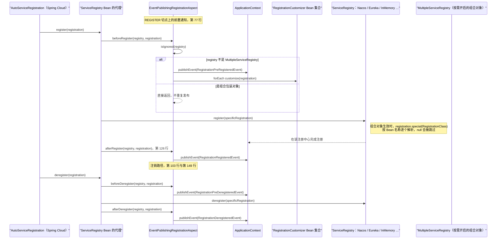
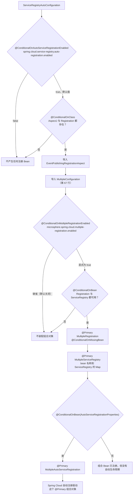

# 开发者文档 · `microsphere-spring-cloud-commons`（1.x / 0.1.x 版本线）

[English](../commons.md) · [0.2.x 版本线](../../current/zh/commons.md) · [开发者文档首页](../../zh/README.md)

**分支：** `release-1.x` · **坐标：** `io.github.microsphere-projects:microsphere-spring-cloud-commons:${revision}`
（HEAD 处为 `0.1.27-SNAPSHOT`，最新发布版本 `0.1.26`）· **打包方式：** `jar`
**源码根：** `microsphere-spring-cloud-commons/src/main/java/io/microsphere/spring/cloud/` —— 58 个生产源文件，
54 个测试源文件 · **所有类都带有 `@since 1.0.0` 标签。**

下文的路径若不以 `…/resources/` 开头，都是相对源码根的
（`…/resources/` = `microsphere-spring-cloud-commons/src/main/resources/`）。

---

## 1. 架构设计

### 1.1 本模块在 1.x 构建中的位置



**唯一**强制的第三方编译依赖是那四个 `microsphere-spring-boot-*` 模块和 `org.aspectj:aspectjweaver`；
每一个 Spring Boot / Spring Cloud / 注册中心客户端依赖都是 `<optional>true</optional>`
（`microsphere-spring-cloud-commons/pom.xml`）。配合由类条件守卫的自动配置，这个 jar 可以安全地加入任何
Boot 2.3–2.6 应用：当平台类缺失时，相应特性会自行关闭。与 0.2.x 之间唯一的 pom 级分支差异是
Testcontainers 构件：1.x 使用 `org.testcontainers:junit-jupiter`（test 作用域），0.2.x 使用
`org.testcontainers:testcontainers-junit-jupiter` 并排除 `junit:junit`。

### 1.2 Boot 2 的自动配置流水线 —— 以及为什么存在两个注册文件

`release-1.x` 面向 Spring Boot **2.3.12 → 2.6.15**，其 `AutoConfigurationImportSelector` 在
`EnableAutoConfiguration=` 键下读取 `META-INF/spring.factories`。`AutoConfiguration.imports` 文件同样存在，
并且**与 0.2.x 的文件字节级一致**，但在 Boot 2.3–2.6 上没有任何东西读取它。

```
…/resources/META-INF/spring.factories                      （1.x 上的权威来源）
org.springframework.boot.autoconfigure.EnableAutoConfiguration=\
io.microsphere.spring.cloud.context.named.autoconfigure.SpecificationAutoConfiguration,\
io.microsphere.spring.cloud.client.discovery.autoconfigure.DiscoveryClientAutoConfiguration,\
io.microsphere.spring.cloud.client.discovery.autoconfigure.ReactiveDiscoveryClientAutoConfiguration,\
io.microsphere.spring.cloud.client.service.registry.autoconfigure.ServiceRegistryAutoConfiguration,\
io.microsphere.spring.cloud.client.service.registry.autoconfigure.WebMvcServiceRegistryAutoConfiguration,\
io.microsphere.spring.cloud.client.service.registry.autoconfigure.WebFluxServiceRegistryAutoConfiguration,\
io.microsphere.spring.cloud.client.service.registry.autoconfigure.SimpleAutoServiceRegistrationAutoConfiguration,\
io.microsphere.spring.cloud.client.service.registry.actuate.autoconfigure.ServiceRegistrationEndpointAutoConfiguration,\
io.microsphere.spring.cloud.fault.tolerance.tomcat.autoconfigure.TomcatFaultToleranceAutoConfiguration,\
io.microsphere.spring.cloud.client.actuator.autoconfigure.ConfigurationPropertyHasFeaturesAutoConfiguration

com.alibaba.cloud.nacos.registry.NacosServiceRegistry = com.alibaba.cloud.nacos.registry.NacosRegistration
```

第二个键**不是**自动配置：它是一条由 `SpringFactoriesLoader` 消费、位于
`client/service/registry/MultipleServiceRegistry.java:193-207` 的映射 —— 当某个 `ServiceRegistry` 的泛型
参数解析为裸 `Registration` 时，`loadFactoryNames(serviceRegistryClass, classLoader)` 会在此查出具体
registration 类型，这正是 Nacos 能被用于组合注册中心的原因。
**在 1.x 上，贡献者必须保留该文件的这两个键**；删掉 `EnableAutoConfiguration` 清单会让整个模块在 Boot 2
上失效。



**单一代码库、两条分支的策略。** 这 10 个类名在两个分支的两个文件里都完全相同。这是有意为之：
一个只增删自动配置类的补丁可以同时应用到 `release` 与 `release-1.x`，而无需触碰*另一个*注册机制；
而运行 Boot 2.7 的使用者从任一来源都会得到一致（已去重）的候选集合。

### 1.3 `javax` 命名空间边界与 Java 8 约束

* 整个模块中只存在一处 servlet 导入：`import javax.servlet.Filter;`，位于
  `client/service/registry/autoconfigure/WebMvcServiceRegistryAutoConfiguration.java:31`
  （0.2.x：`jakarta.servlet.Filter`）。它与来自 `org.springframework.*` 的过滤器注册一起，
  被从发布的 `web.mappings` 元数据中过滤掉。
* 由于 `microsphere-build` 提供 `java.version = 8`（1.x 根 pom **不**覆盖它），代码中不会出现任何
  Java 9+ 语法：`instanceof` 使用老的强转风格，集合来自 `io.microsphere.*` 工厂方法
  （`newHashSet`、`ofList`、`newConcurrentHashMap`），lambda 与方法引用是允许使用的最现代构造。
* 日志与 JSON 都经由 Microsphere 抽象 —— `io.microsphere.logging.Logger`、
  `io.microsphere.json.JSONObject` / `JSONArray` —— 而不是直接用 SLF4J 或 Jackson，
  因此没有 Jackson 的 Boot 2 使用者照样能工作。

### 1.4 包结构图

| 包（位于源码根之下） | 内容 |
|---|---|
| `commons/constants` | `CommonsPropertyConstants`、`FeaturesConstants`、`InstanceConstants`、`SpringCloudPropertyConstants` |
| `commons/condition` | `ConditionalOnUtilEnabled` |
| `client/condition` | `ConditionalOnFeaturesAvailable`、`ConditionalOnFeaturesEnabled` |
| `client/discovery`（+ `autoconfigure`、`condition`、`constants`、`util`） | `UnionDiscoveryClient`、`ReactiveDiscoveryClientAdapter`、`DiscoveryUtils`、发现相关条件 / `DiscoveryClientConstants` |
| `client/event` | `ServiceInstancesChangedEvent` |
| `client/service/registry`（+ `aspect`、`autoconfigure`、`condition`、`constants`、`endpoint`、`event`） | 注册栈：`Multiple*`、`SimpleServiceRegistry`、`InMemoryServiceRegistry`、`DefaultRegistration`、`RegistrationMetaData`、`RegistrationCustomizer`、`EventPublishingRegistrationAspect`、各端点、`RegistrationEvent` 事件族 |
| `client/service/util` | `ServiceInstanceUtils` |
| `client/actuator`（+ `autoconfigure`、`constants`） | `FeaturesProperties`、`FeaturesUtils`、`NamedFeatureComparator`、`ConfigurationPropertyHasFeaturesAutoConfiguration` |
| `context/named`（+ `autoconfigure`、`config`） | `SpecificationCustomizer`、`SpecificationBeanPostProcessor`、`SpecificationAutoConfiguration` |
| `fault/tolerance`（+ `constants`、`loadbalancer`、`loadbalancer/util`、`tomcat/autoconfigure`、`tomcat/event`） | `WeightedRoundRobin`、`LoadBalancerUtils`、`FaultTolerancePropertyConstants`、`TomcatFaultToleranceAutoConfiguration`、`TomcatDynamicConfigurationListener` |
| `loadbalancer/condition` | `ConditionalOnLoadBalancerEnabled` |

---

## 2. 自动配置源码解析

共有十一个配置类；十个被注册。`WebServiceRegistryAutoConfiguration` 是抽象类且刻意不注册 ——
它是 WebMvc/WebFlux 两个变体共享的模板。

### 2.1 `SpecificationAutoConfiguration` —— `context/named/autoconfigure/`
`@Configuration(proxyBeanMethods = false)`、
`@ConditionalOnClass(name = "org.springframework.cloud.context.named.NamedContextFactory")`（第 40 行）、
`@AutoConfigureAfter(name = {"…loadbalancer.config.LoadBalancerAutoConfiguration", "…openfeign.FeignAutoConfiguration"})`。
一个 Bean：`specificationBeanPostProcessor()` → `SpecificationBeanPostProcessor`，由
`@Bean + @ConditionalOnBean(Specification.class) + @ConditionalOnMissingBean` 守卫（第 47–52 行），
所以若没有至少一个 `NamedContextFactory.Specification` Bean（Feign/LoadBalancer 的按客户端规范定义），
什么都不会创建。这正是 openfeign 模块所插入的扩展点（参见
[openfeign 开发者文档](./openfeign.md)）。

### 2.2 `DiscoveryClientAutoConfiguration` —— `client/discovery/autoconfigure/`
`@ConditionalOnBlockingDiscoveryAvailable` +
`@AutoConfigureBefore(name = "org.springframework.cloud.client.CommonsClientAutoConfiguration")`。
嵌套的 `public static class UnionConfiguration` 由
`@ConditionalOnProperty(name = "microsphere.spring.cloud.client.discovery.mode", havingValue = "union")`
激活（没有 `matchIfMissing` ⇒ **默认关闭**），并注册 `unionDiscoveryClient()` → `new UnionDiscoveryClient()`。

### 2.3 `ReactiveDiscoveryClientAutoConfiguration`
`@ConditionalOnReactiveDiscoveryAvailable`，运行在 `ReactiveCommonsClientAutoConfiguration` *之前*，
运行在 `SimpleReactiveDiscoveryClientAutoConfiguration` / `ReactiveCompositeDiscoveryClientAutoConfiguration`
*之后*。嵌套的 `BlockingConfiguration` 由 `@ConditionalOnBlockingDiscoveryEnabled` 守卫；它的 Bean
`reactiveDiscoveryClientAdapter(ReactiveDiscoveryClient)`（同样带 `@ConditionalOnBean(ReactiveDiscoveryClient.class)`）
把一个只有响应式的发现技术栈桥接回阻塞式 `DiscoveryClient` API。

### 2.4 `ServiceRegistryAutoConfiguration` —— `client/service/registry/autoconfigure/`
第 47–57 行：`@Configuration(proxyBeanMethods = false)`、`@ConditionalOnAutoServiceRegistrationEnabled`、
`@ConditionalOnClass(name = {"org.aspectj.lang.annotation.Aspect", REGISTRATION_CLASS_NAME})`、
`@Import({EventPublishingRegistrationAspect.class, ServiceRegistryAutoConfiguration.MultipleConfiguration.class})`。
两个彼此独立的行为：只要 AspectJ 存在，切面总会被导入；嵌套的
`static class MultipleConfiguration`（第 67 行，包级私有）负责装配组合栈。

### 2.5 `WebMvcServiceRegistryAutoConfiguration` —— **1.x 特有的源码**
```java
import javax.servlet.Filter;                                   // line 31 — the javax/jakarta boundary
@ConditionalOnWebMvcAvailable
@ConditionalOnAutoServiceRegistrationAvailable
@AutoConfigureAfter(value = {ServiceRegistryAutoConfiguration.class,
        SimpleAutoServiceRegistrationAutoConfiguration.class},
        name = {"io.microsphere.spring.boot.webmvc.autoconfigure.WebMvcAutoConfiguration"})
```
它**不声明任何 `@Bean` 方法**：配置类实例本身就是
`ApplicationListener<WebEndpointMappingsReadyEvent>`。注入的状态：`@Value("${server.servlet.context-path:}")`、
`ObjectProvider<FilterRegistrationBean>`、`ObjectProvider<DispatcherServletRegistrationBean>`，以及
`DEFAULT_URL_MAPPINGS = {"/*"}`。`isExcludedMapping(...)` 会丢弃 `Filter` 类型来自 `org.springframework.*`
的过滤器注册以及 `DispatcherServlet` 的 URL 映射，从而只把应用自身的端点发布到注册元数据中。
*分支差异：* 0.2.x 只在导入语句（`jakarta.servlet.Filter`）上不同，并多一行 `@see` javadoc。

### 2.6 `WebFluxServiceRegistryAutoConfiguration`
对称实现：`@ConditionalOnWebFluxAvailable`、
`@AutoConfigureAfter(name = "…webflux.autoconfigure.WebFluxAutoConfiguration")`，
`getContextPath()` 返回 `""`，`isExcludedMapping(...)` 返回 `false`（无内容可排除）。

### 2.7 `WebServiceRegistryAutoConfiguration`（抽象，未注册）
`onApplicationEvent(...)` 是 `final` 的：对每一个 `Registration` Bean，它把事件携带的映射复制进一个
`Set`，调用 `excludeMappings(...)`（移除任何匹配 `isExcludedMapping` **或**
`isActuatorWebEndpointMapping` 的项，后者通过 `pattern.startsWith(actuatorBasePath)` 判断，其中
`@Value("${management.endpoints.web.base-path:/actuator}")`），然后调用
`attachMetadata(getContextPath(), registration, mappings)`。两个抽象钩子就是该模式的模板扩展点（见 §5）。

### 2.8 `SimpleAutoServiceRegistrationAutoConfiguration`
`@ConditionalOnAutoServiceRegistrationEnabled` + `@ConditionalOnProperty(name = ENABLED_PROPERTY_NAME)`，
**既没有 `havingValue` 也没有 `matchIfMissing`** ⇒ 纯粹是对
`microsphere.spring.cloud.service-registry.auto-registration.simple.enabled` 的按需开启。它
`@Import` 了 `SimpleAutoServiceRegistration`，声明 `@AutoConfigureBefore(AutoServiceRegistrationAutoConfiguration.class)`，
并注册 `registration(applicationName, ServerProperties, InetUtils)` → `DefaultRegistration`
（`instanceId = host + ":" + port`，host 取自 `inetUtils.findFirstNonLoopbackHostInfo().getIpAddress()`，
port 取自 `serverProperties.getPort()`），再加上 `serviceRegistry()` → `new InMemoryServiceRegistry()`
（`@Bean @ConditionalOnMissingBean`）。这就是 demo 与测试所使用的“无外部注册中心”栈 ——
注意在 Boot 2 上访问器是 `ServerProperties.getPort()`；0.2.x 在这里的代码完全相同。

### 2.9 `ServiceRegistrationEndpointAutoConfiguration`
`@ConditionalOnDiscoveryEnabled` + `@ConditionalOnAutoServiceRegistrationEnabled` +
`@ConditionalOnActuatorEndpointPresent` + `@ConditionalOnClass(name = AUTO_SERVICE_REGISTRATION_CLASS_NAME)`，
`@AutoConfigureAfter(name = …)` 中列出**五个字符串类名**（`ServiceRegistryAutoConfiguration`、
Zookeeper、Consul、Kubernetes 以及
`com.alibaba.cloud.nacos.registry.NacosServiceRegistryAutoConfiguration`）—— 之所以用字符串形式，
是因为这些模块都可能不在类路径上。Bean：`ServiceRegistrationEndpoint`、`ServiceDeregistrationEndpoint`，
各自都是 `@Bean @ConditionalOnMissingBean @ConditionalOnAvailableEndpoint`。

### 2.10 `TomcatFaultToleranceAutoConfiguration`
`@ConditionalOnProperty(name = "microsphere.spring.cloud.fault-tolerance.tomcat.enabled", matchIfMissing = true)`
（**默认开启**）、
`@ConditionalOnClass(name = {"org.apache.catalina.startup.Tomcat", "org.springframework.cloud.context.environment.EnvironmentChangeEvent"})`、
`@ConditionalOnWebApplication(type = SERVLET)`。没有 Bean：只有一个
`@EventListener(WebServerInitializedEvent.class)`，针对持有 `ServerProperties` 与 `TomcatWebServer` 的
`ConfigurableWebServerApplicationContext`，调用
`context.addApplicationListener(new TomcatDynamicConfigurationListener(...))`。

### 2.11 `ConfigurationPropertyHasFeaturesAutoConfiguration`
由 `@ConditionalOnFeaturesAvailable` 守卫；`@EnableConfigurationProperties(FeaturesProperties.class)`；
实现 `BeanFactoryAware, BeanClassLoaderAware, InitializingBean`。在 `afterPropertiesSet()` 中，它把两个
属性映射合成**每个模块一个**的 `HasFeatures` **单例**，通过
`beanFactory.registerSingleton(FeaturesUtils.getHasFeaturesBeanName(moduleName), hasFeatures)` 注册
⇒ Bean 名为 `<module>.features`（例如 `microsphere-spring-cloud-commons.features`）。
类中含 Spring Bean 类型的抽象特性会被展开为具名特性（`getSimpleName(beanType)`）；缺失的类以 `WARN`
记录并跳过，同时打印出确切的属性名 —— 一份坏掉的特性目录绝不会让启动失败。

---

## 3. 条件注解

它们全都只是组合元注解形式的标记（`public @interface X {}`、`{TYPE, METHOD}`、`RUNTIME`、`@Documented`）——
**没有属性，因此整个模块里没有任何 `@AliasFor`。**

| 注解 | 组合了什么 | 生效的键 / 检查 |
|---|---|---|
| `ConditionalOnFeaturesAvailable` | `ConditionalOnFeaturesEnabled` + `@ConditionalOnClass(name = "org.springframework.cloud.client.actuator.FeaturesEndpoint")` + `@ConditionalOnAvailableEndpoint(endpoint = FeaturesEndpoint.class)` | 属性**且**类**且**端点已暴露 |
| `ConditionalOnFeaturesEnabled` | `@ConditionalOnProperty(name = "spring.cloud.features.enabled", matchIfMissing = true)` | 除非显式 `false`，否则开启 |
| `ConditionalOnBlockingDiscoveryAvailable` | `@Inherited`、`@ConditionalOnClass(name = "…discovery.DiscoveryClient")`、`@ConditionalOnDiscoveryEnabled`、`@ConditionalOnBlockingDiscoveryEnabled` | 三重守卫 |
| `ConditionalOnReactiveDiscoveryAvailable` | `@Inherited`、`@ConditionalOnClass(name = "…discovery.ReactiveDiscoveryClient")`、`@ConditionalOnDiscoveryEnabled`、`@ConditionalOnReactiveDiscoveryEnabled` | 三重守卫 |
| `ConditionalOnAutoServiceRegistrationAvailable` | `@ConditionalOnClass(name = REGISTRATION_CLASS_NAME)`、`@ConditionalOnBean(type = REGISTRATION_CLASS_NAME)`、`@ConditionalOnAutoServiceRegistrationEnabled` | 类 **加上一个已存在的 Bean** |
| `ConditionalOnAutoServiceRegistrationEnabled` | `@ConditionalOnProperty(name = "spring.cloud.service-registry.auto-registration.enabled", matchIfMissing = true)` | 与 Boot 2 兼容的属性守卫 |
| `ConditionalOnMultipleRegistrationEnabled` | `@ConditionalOnProperty(name = "microsphere.spring.cloud.multiple-registration.enabled")` | **按需开启**：没有 `matchIfMissing`，也没有 `havingValue`（`condition/ConditionalOnMultipleRegistrationEnabled.java:26`） |
| `ConditionalOnLoadBalancerEnabled` | `@ConditionalOnProperty(name = "spring.cloud.loadbalancer.enabled", havingValue = "true", matchIfMissing = true)` | 为下游模块声明；本模块未使用 |
| `ConditionalOnUtilEnabled` | `@ConditionalOnProperty(name = "spring.cloud.util.enabled", matchIfMissing = true)` | 为下游模块声明；本模块未使用 |

> **已知文档 bug（不要复刻）：** `ConditionalOnFeaturesAvailable` 的 javadoc 提到了
> `microsphere.spring.cloud.features.enabled`；实际绑定的键是 `spring.cloud.features.enabled`。

---

## 4. 属性与常量清单（1.x 取值）

前缀推导：`MICROSPHERE_PROPERTY_NAME_PREFIX`（`io.microsphere.constants.PropertyConstants`）= `microsphere.`。

| 键 | 常量 | 默认值 |
|---|---|---|
| `microsphere.spring.cloud.` | `CommonsPropertyConstants.MICROSPHERE_SPRING_CLOUD_PROPERTY_NAME_PREFIX` | 根前缀 |
| `microsphere.spring.cloud.web.mvc.` | `…MICROSPHERE_SPRING_CLOUD_WEB_MVC_PROPERTY_NAME_PREFIX` | 已声明，本模块未使用 |
| `spring.cloud.service-registry.auto-registration.enabled` | `SpringCloudPropertyConstants.SERVICE_REGISTRY_AUTO_REGISTRATION_ENABLED_PROPERTY_NAME` | `true` |
| `spring.cloud.features.enabled` / `spring.cloud.loadbalancer.enabled` / `spring.cloud.util.enabled` | `FEATURES_/LOAD_BALANCER_/UTIL_ENABLED_PROPERTY_NAME` | `true` |
| `microsphere.spring.cloud.multiple-registration.enabled` | `MULTIPLE_REGISTRATION_ENABLED_PROPERTY_NAME` | `false`（按需开启） |
| `microsphere.spring.cloud.default-registration.type` / `…default-service-registry.type` | `MULTIPLE_REGISTRATION_DEFAULT_REGISTRATION_PROPERTY_NAME` / `…_REGISTRY_PROPERTY_NAME` | 无 |
| `microsphere.spring.cloud.composite-registration.enabled` | `COMPOSITE_REGISTRATION_ENABLED_PROPERTY_NAME` | `false` |
| `microsphere.spring.cloud.client.discovery.mode` | `DiscoveryClientAutoConfiguration.DISCOVERY_CLIENT_MODE_PROPERTY_NAME` | 必须等于 `union` |
| `microsphere.spring.cloud.service-registry.auto-registration.simple.enabled` | `SimpleAutoServiceRegistrationAutoConfiguration.ENABLED_PROPERTY_NAME` | 无（按需开启） |
| `microsphere.spring.cloud.fault-tolerance.tomcat.enabled` | `TomcatFaultToleranceAutoConfiguration.ENABLED_PROPERTY_NAME` | `true` |
| `microsphere.spring.cloud.fault-tolerance.warmup-time` / `…weight` | `FaultTolerancePropertyConstants.WARMUP_TIME_PROPERTY_NAME` / `WEIGHT_PROPERTY_NAME` | `600000` 毫秒 / `100` |
| `microsphere.spring.cloud.features`（+ `.abstract.`、`.named.`） | `FeaturesConstants` | 特性目录绑定 |
| `web.mappings` / `web.context-path` / `management-port` / `start-time` | `InstanceConstants` | 服务实例元数据键（`_status_` 是 `SimpleServiceRegistry.STATUS_KEY` 与 `InMemoryServiceRegistry` 中的注册中心状态键） |

`@ConfigurationProperty`（来自 `io.microsphere.annotation`，由 `microsphere-annotation-processor` 处理）
**只是编译期元数据** —— 它喂给生成的配置元数据；运行期从不绑定。

随包发布的默认值 —— `…/resources/META-INF/config/default/endpoints.properties`
（由 microsphere-spring-boot 的 `DefaultPropertiesApplicationListener` 以最低优先级加载）—— 与 0.2.x 相同：
两个 Microsphere 端点**默认关闭**并被重新映射，因此一旦设置
`management.endpoint.serviceRegistration.enabled=true` / `…serviceDeregistration.enabled=true`，
URL 就是 `GET/POST /actuator/microsphere/service/registration` 与
`POST /actuator/microsphere/service/deregistration`。

---

## 5. 关键公共 API 与设计模式

### 5.1 观察者 —— 注册生命周期事件
`client/service/registry/aspect/EventPublishingRegistrationAspect.java`（`@Aspect`、`ApplicationContextAware`）：

```java
// line 51
public static final String REGISTER_POINTCUT_EXPRESSION =
    "execution(* org.springframework.cloud.client.serviceregistry.ServiceRegistry.register(*)) && target(registry) && args(registration)";
// line 56
public static final String DEREGISTER_POINTCUT_EXPRESSION =
    "execution(* org.springframework.cloud.client.serviceregistry.ServiceRegistry.deregister(*)) && target(registry) && args(registration)";
```

通知：第 77 行的 `@Before(REGISTER)` 先发布 `RegistrationPreRegisteredEvent`，**然后**应用每一个
`RegistrationCustomizer`；第 103 行的 `@Before(DEREGISTER)` 发布 `RegistrationPreDeregisteredEvent`；
第 126 行的 `@After(REGISTER)` 发布 `RegistrationRegisteredEvent`；第 149 行的 `@After(DEREGISTER)`
发布 `RegistrationDeregisteredEvent`。每个通知都以
`boolean isIgnored(ServiceRegistry registry)`（第 157 行）开头，其实现为
`MultipleServiceRegistry.class.isAssignableFrom(registry.getClass())` —— 组合注册中心被跳过，从而事件
恰好只发布一次，由**各个**具体注册中心发布（源码注释：*"Remove redundant deregister"*）。

`client/service/registry/event/RegistrationEvent.java` 是抽象的 `ApplicationEvent`，携带
`ServiceRegistry<Registration> registry`（`Assert.notNull(registry, "The 'registry' must not be null")`）与
`Registration source`，并提供 `isPreRegistered()` / `isRegistered()` / `isPreDeregistered()` /
`isDeregistered()` 这些 `final` 断言方法，以及嵌套的 `enum Type { PRE_REGISTERED, REGISTERED,
PRE_DEREGISTERED, DEREGISTERED }`。
`ServiceInstancesChangedEvent`（`client/event/`）与之无关：`(String serviceName,
List<ServiceInstance>)`，列表以不可修改形式存储，另有一个 `processed()` / `isProcessed()` 幂等标记。



### 5.2 组合 + 注册表 —— 多重注册
* `MultipleRegistration implements Registration` —— 从注入的 `Collection<Registration>` 中收集每一个
  可赋值的 `Registration` 子类型（不含 `Registration` 本身），放进
  `Map<Class<? extends Registration>, Registration>`，把**最后一个**保留为 `defaultRegistration`，
  并暴露 `<T extends Registration> T special(Class<T>)`（当请求类型是 `Registration` 时返回 `this`）。
  所有标量访问器都委托给默认项；`getMetadata()` 返回共享的 `RegistrationMetaData`。
* `MultipleServiceRegistry implements ServiceRegistry<MultipleRegistration>` —— 由
  `Map<String, ServiceRegistry>`（Bean 名 → 注册中心）构造；`register`/`deregister`/`setStatus`
  通过 `iterate(...)` 扇出，每个注册中心各自的 registration 类由 `getRegistrationClass(...)` 解析
  （`MultipleServiceRegistry.java:193-207`，其 `SpringFactoriesLoader` 兜底依赖 `spring.factories`
  中的 Nacos 映射）；`getStatus` **只**读取默认注册中心；`close()` 关闭全部。
* `MultipleAutoServiceRegistration extends AbstractAutoServiceRegistration<MultipleRegistration>` ——
  `getConfiguration()` 返回 `null`，`isEnabled()` 委托给 `AutoServiceRegistrationProperties`，
  而 `getRegistration()` 与 `getManagementRegistration()` 返回同一个组合对象。



* **策略 / 注册表：** `RegistrationCustomizer.customize(Registration)` Bean 由切面在注册之前应用；
  `SpecificationCustomizer.customize(Specification, String beanName)` Bean 由
  `SpecificationBeanPostProcessor.processAfterInitialization(...)` 应用，后者在
  `setBeanFactory(...)` 中加载排好序的 customizer 列表。
* **模板方法：** `WebServiceRegistryAutoConfiguration.onApplicationEvent(...)`（`final`）配合两个
  抽象钩子 `getContextPath()` / `isExcludedMapping(WebEndpointMapping, String[])` 以及可覆写的
  `isActuatorWebEndpointMapping(...)`；`AbstractServiceRegistrationEndpoint`（见 §5.3）是该模式的
  第二个实例。
* **空对象：** `NoOpRequestInterceptor` 位于 openfeign 模块，但 commons 侧的对应物是
  `SimpleServiceRegistry.close()` 刻意做成 no-op，以及 `InMemoryServiceRegistry` 的
  `getMetadata(...)` 对未知 id 返回 `null`。
* **装饰器（响应式桥接）：** `ReactiveDiscoveryClientAdapter implements DiscoveryClient` 委托
  `description()`、`probe()`、`getOrder()`，并通过
  `static <T> List<T> toList(Flux<T>)` 阻塞 `Flux`：若 `Schedulers.isInNonBlockingThread()` 为真，
  则在 `ThrowableSupplier.execute(...)` 内使用 `mono.toFuture().get()`，否则使用 `mono.block()`。
  `UnionDiscoveryClient`（`getOrder() = HIGHEST_PRECEDENCE`，`description() = "Union Discovery Client"`）
  拼接实例（` duplicates preserved` —— 重复项保留），但通过 `LinkedHashSet` 对 `getServices()` 去重，
  并缓存排好序的 Bean 列表，其中排除 `CompositeDiscoveryClient` 与它自身。

### 5.3 注册表 + 端点（Actuator）
`client/service/registry/endpoint/AbstractServiceRegistrationEndpoint.java` 实现
`SmartInitializingSingleton, ApplicationListener<WebServerInitializedEvent>`；
`afterSingletonsInstantiated()` 用 `getIfAvailable()` 解析三个 `ObjectProvider`（可能为 `null`），
`onApplicationEvent` 保存 `port` 与 `running = detectRunning(serviceRegistration)`。注意第 48 行：
`protected static boolean running;` —— **运行标志是 `static` 的，即在整个 JVM 内共享**，
`ServiceRegistrationEndpoint` 与 `ServiceDeregistrationEndpoint` 共用它。因此这两个端点必须被当作
一个逻辑控制器来看待；一个把它改成非 `static` 的移植或重构补丁，会改变
`GET /actuator/microsphere/service/registration` 的可观测行为。
`ServiceRegistrationEndpoint`（`@Endpoint(id = "serviceRegistration")`）暴露 `@ReadOperation metadata()`
（application-name、registration、port、status、running、enabled、phase、order、managementRegistration、
config —— 最后四项通过反射获取）以及 `@WriteOperation start()`，后者返回**之前**的运行状态；
`ServiceDeregistrationEndpoint.stop()` 返回注销**之前**的状态。

### 5.4 元数据工具 —— `client/service/util/ServiceInstanceUtils.java`
`attachMetadata(String contextPath, ServiceInstance, Collection<WebEndpointMapping>)` 把每个映射序列化为
JSON，用 `"," + LINE_SEPARATOR` 连接并包在 `[`…`]` 中，剥掉行分隔符，对结果做 **URL 编码**，
然后写入 `metadata["web.context-path"]` 与 `metadata["web.mappings"]`。`getUriString(ServiceInstance)`
在 `getPort() <= 0` 时回退到端口 `443`/`80`；`getUri(...)` 使用 `URI.create(...)` —— 比
`DefaultServiceInstance#getUri()` 更快。

`setProperties(ServiceInstance source, DefaultServiceInstance target)` 是本模块与 0.2.x 之间**唯一有行为差异的
Java 代码**（`ServiceInstanceUtils.java:196-205`）：

```java
target.setInstanceId(source.getInstanceId());
target.setServiceId(source.getServiceId());
target.setUri(source.getUri());          // 1.x   — 0.2.x: target.setSecure(source.isSecure());
target.setHost(source.getHost());
target.setPort(source.getPort());
Map<String, String> metadata = source.getMetadata();
metadata.clear();
metadata.putAll(source.getMetadata());
```

Spring Cloud Commons 移除了 `DefaultServiceInstance#setUri(URI)`，改用 `secure` 标志
（`getUri()` 变成派生值），所以 1.x 复制的是**已解析的 URI**，而 0.2.x 复制的是**协议标志**。
因此 `DiscoveryUtils.simpleReactiveDiscoveryProperties(...)` / `simpleDiscoveryProperties(...)`
（“simple” 配置文件发现属性在阻塞 ↔ 响应式之间的转换）在两个分支上带有微妙不同的语义。
1.x 的该文件另外还缺少结尾换行符。

### 5.5 Tomcat 动态重配置 —— **1.x 特有的访问器**
`fault/tolerance/tomcat/event/TomcatDynamicConfigurationListener.java:272-277`：

```java
configure("Tomcat HTTP Headers' max size(bytes)")
        .value(refreshableServerProperties::getMaxHttpHeaderSize)     // 1.x — Boot 2 accessor
        .compare(currentServerProperties::getMaxHttpHeaderSize)
        .as(this::toIntBytes)
        .on(this::isPositive)
        .apply(protocol::setMaxHttpHeaderSize);                        // 0.2.x: ServerProperties::getMaxHttpRequestHeaderSize
```

`ServerProperties#getMaxHttpHeaderSize()` 是 Boot 2 的名字；Boot 3 将其重命名为
`getMaxHttpRequestHeaderSize()`，因此本分支对外可见的属性键是
`server.max-http-header-size`（0.2.x：`server.max-http-request-header-size`）—— 集成测试
`src/test/java/…/TomcatFaultToleranceAutoConfigurationIntegrationTest.java:126` 设置的正是这个键。
该监听器的其余部分与 0.2.x 共享：它筛选以 `server` 开头的 `EnvironmentChangeEvent` 键，
当存在 `ConfigurationPropertiesRebinder` 时优先使用活的 `ServerProperties` Bean
（否则只重新绑定发生变化的键），随后通过 `io.microsphere.util.Configurer`
应用每一项设置（仅在*发生变化、为正且可转换*时才写入），最后重新取快照。
可刷新的有：`server.tomcat.threads.min-spare`、`…threads.max`、`…accept-count`、
`…connection-timeout`、`…max-connections`、上面那项 header 大小、`…max-swallow-size`、
`…max-http-form-post-size`。**不可**刷新的有：`server.port`、`server.ssl.*`、context path。

### 5.6 特性目录与负载均衡原语
`client/actuator/FeaturesUtils` 负责计算名称：`getAbstractFeaturePropertyName("jdbc")` →
`microsphere.spring.cloud.features.abstract.jdbc`，`getNamedFeaturePropertyName("web","rest-template")` →
`microsphere.spring.cloud.features.named.web.rest-template`，`getHasFeaturesBeanName("jdbc")` → `jdbc.features`，
`getQualifierFeatureName("web","rest-template")` → `web:rest-template`。`NamedFeatureComparator.INSTANCE`
先按 `getName()` 再按 `getType().getName()` 排序。`…/resources/META-INF/config/default/features.yaml`
与 0.2.x 字节级一致，其中列出的内容包含本模块的 14 个抽象特性
（`UnionDiscoveryClient`、`ReactiveDiscoveryClientAdapter`、`MultipleRegistration`、`MultipleServiceRegistry`、
`MultipleAutoServiceRegistration`、`EventPublishingRegistrationAspect`、`SimpleServiceRegistry`、
`SimpleAutoServiceRegistration`、`InMemoryServiceRegistry`、`ServiceRegistrationEndpoint`、
`ServiceDeregistrationEndpoint`、`SpecificationBeanPostProcessor`、`SpecificationCustomizer`、
`TomcatDynamicConfigurationListener`）。

`fault/tolerance/loadbalancer/WeightedRoundRobin`（`LongAdder current`、`setWeight(int)` 会**重置** `current`、
`increaseCurrent()` → `current.add(weight)`、`sel(total)` → `current.add(-1 * total)`）与
`LoadBalancerUtils.calculateWarmupWeight(uptime, warmup, weight)` =
`round(pow(uptime/(double)warmup, 2) * weight)`，并被夹在 `[1, weight]` 内，是**库级构建块**：
本模块中没有任何 `@Configuration` 装配它们，`…fault-tolerance.warmup-time` / `…weight` 也不在这里被读取。

---

## 6. 移植与兼容性矩阵（commons）

1.x 的 `src/main` 文件清单与 0.2.x **完全一致**：58 个生产源文件，只有
**3 个 Java 文件 + 1 个资源文件 + 1 个 pom** 存在差异。其余一切 —— 常量、条件注解、自动配置类的实现、
`endpoints.properties`、`features.yaml`、`AutoConfiguration.imports` —— 都是字节级一致的，
因此上文对这些内容的分析同样适用于两条版本线。

| 1.x 构造 | 0.2.x 对应物 | 移植动作 |
|---|---|---|
| `import javax.servlet.Filter;`（`WebMvcServiceRegistryAutoConfiguration.java:31`） | `import jakarta.servlet.Filter;` | 只改导入名；过滤器排除逻辑不变 |
| `target.setUri(source.getUri())`（`ServiceInstanceUtils.java:199`） | `target.setSecure(source.isSecure())` | API 替换：Boot 2 上复制 URI，Boot 3+ 上复制协议标志 |
| `ServerProperties::getMaxHttpHeaderSize`（`TomcatDynamicConfigurationListener.java:273-274`） | `ServerProperties::getMaxHttpRequestHeaderSize` | 访问器**和**测试/文档中的属性键都要改名 |
| `META-INF/spring.factories` 同时含 `EnableAutoConfiguration=`（10 个类）**与**同一行上的 Nacos `SpringFactoriesLoader` 映射 | `spring.factories` 只含 Nacos 映射（2 行） | 反向移植必须重新加回全部 10 个类名；前向移植必须删除它们但保留 Nacos 映射 |
| `AutoConfiguration.imports`（10 个类名） | 完全相同的文件，且是权威来源 | 绝不要从 1.x 删除它：在 Boot 2.3–2.6 上它是惰性的，但保证了向前兼容 |
| `org.testcontainers:junit-jupiter`（test） | `org.testcontainers:testcontainers-junit-jupiter` + `junit:junit` 排除 | 该构件在 Testcontainers 2.x 中被重命名 —— 不要跨分支复制 pom 改动 |
| 测试用 `spring.profiles: nacos`（`src/test/resources/META-INF/config/default/test.yaml` 中的旧式 YAML 写法） | `spring.config.activate.on-profile: nacos` | 旧式写法是支持 Boot 2.3 所必需的；绝不把 0.2.x 的写法前向套用到 1.x |
| 测试属性 `server.max-http-header-size`（Boot 2 键） | `server.max-http-request-header-size`（Boot 3 键） | 移植 Tomcat 集成测试时，改名 `EnvironmentManager.setProperty(...)` 中的键 |
| Java 8 语言级别（继承而来） | `<java.version>17</java.version>` | 合并进 1.x 前，把任何 Java 9+ 构造改写为 Java 8 形式 |
| Boot 2 的 `FilterRegistrationBean` / `DispatcherServletRegistrationBean`，来自 `org.springframework.boot.web.servlet` | 同一个包，但属于 Boot 3 线 | Spring Boot 大版本变化时要检查泛型签名 |

前向移植的经验法则：触及上述三个 Java 文件中任意一个的补丁，在另一个分支上都需要**手工**重新落地
（差异不是文本级的）；其余 commons 补丁在两个分支上都能干净应用。

---

## 7. 构建与测试指南

```bash
# 在仓库根目录执行 —— 默认平台 profile 是 spring-cloud-2021（Boot 2.6.15 / Cloud 2021.0.9）
mvn -pl microsphere-spring-cloud-commons -am clean test
mvn -pl microsphere-spring-cloud-commons -am clean test --activate-profiles spring-cloud-hoxton
mvn -pl microsphere-spring-cloud-commons -am clean test --activate-profiles spring-cloud-2020

# 注册中心集成测试需要启用容器
mvn -pl microsphere-spring-cloud-commons -am test --activate-profiles test,testcontainers,spring-cloud-2021
```

* 编译目标是 **Java 8**（在 JDK 9+ 上通过 `maven.compiler.release` 实现 `--release 8`）；CI 使用 JDK 8 与 11。
* 自动配置测试复用 `microsphere-spring-boot-test`
  （`io.github.microsphere-projects:microsphere-spring-boot-test`，test 作用域）中的
  `AutoConfigurationTest` 基础设施 —— 与 0.2.x 同源，因此诸如“属性 `…enabled=false` 会移除 Bean X”
  这类断言在两个分支上的写法完全一致。
* `Testcontainers` 由 `microsphere-spring-cloud-parent` 的 `testcontainers` Maven profile 所设置的
  `testcontainers.enabled` 系统属性来控制；该属性缺失时注册中心测试是被跳过而非失败。
* 因分支而异、任何移植之后必须重新验证的测试：`DefaultRegistrationTest`、
  `BaseServiceRegistrationEndpointTest`、`ServiceInstanceUtilsTest`、
  `TomcatFaultToleranceAutoConfigurationIntegrationTest`、
  `src/test/resources/META-INF/config/default/test.yaml`
  —— 它们与 §6 中的三处生产代码差异一一对应。

## 8. 贡献者清单

* [ ] 新增自动配置 ⇒ 把类名**同时**加入 `spring.factories` 与 `AutoConfiguration.imports`。
* [ ] 本分支绝不引用 `jakarta.*`；servlet 命名空间保持 `javax.servlet`。
* [ ] 新代码必须是合法的 Java 8（无 `var`、record、switch 表达式、模式匹配 `instanceof`）。
* [ ] 每个新特性都要用按类名的 `@ConditionalOnClass` 守卫，使可选依赖缺失时保持静默。
* [ ] 依赖 `MultipleServiceRegistry.getRegistrationClass(...)` 的新注册类型支持，需要在
      `spring.factories` 中有一条 `SpringFactoriesLoader` 条目，而不只是一个 `ServiceRegistry` Bean。
* [ ] 对三个差异文件的任何改动，都必须与 §6 移植矩阵中对应的 0.2.x 改动成对出现。

---

相关：[parent](./parent.md) · [dependencies](./dependencies.md) · [openfeign](./openfeign.md) ·
0.2.x 分析：[../../current/zh/commons.md](../../current/zh/commons.md)
