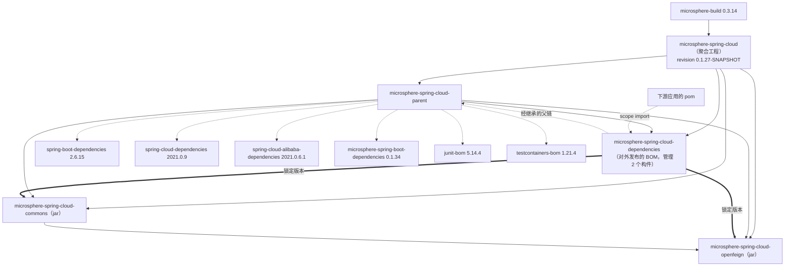
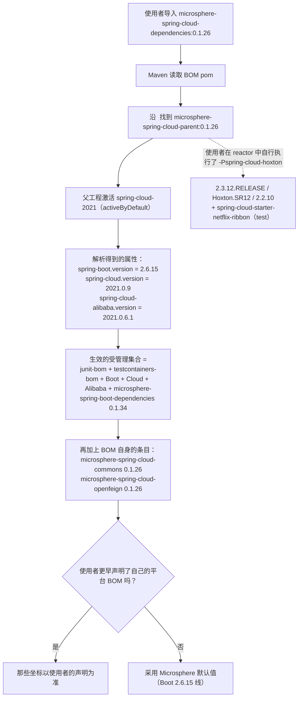

# 开发者文档 · `microsphere-spring-cloud-dependencies`（1.x / 0.1.x 版本线）

[English](../dependencies.md) · [0.2.x 版本线](../../current/zh/dependencies.md) · [开发者文档首页](../../zh/README.md)

**分支：** `release-1.x` · **版本线：** 0.1.x · **HEAD：** `0.1.27-SNAPSHOT` · **最新发布版本：** `0.1.26`
**分析文件：** `microsphere-spring-cloud-dependencies/pom.xml`（打包方式 `pom`，名称 `Microsphere :: Spring Cloud :: Dependencies`）

这是本项目的**对外发布 BOM** —— 唯一一个职责是被下游应用消费的构件。它刻意是 reactor 中最小的 pom：
33 行，没有属性，没有 profile，没有插件。

---

## 1. 架构设计

### 1.1 它声明了什么

```xml
<parent>
    <artifactId>microsphere-spring-cloud-parent</artifactId>
    <version>${revision}</version>
    <relativePath>../microsphere-spring-cloud-parent/pom.xml</relativePath>
</parent>

<dependencyManagement>
    <dependency>… microsphere-spring-cloud-commons   <version>${revision}</version></dependency>
    <dependency>… microsphere-spring-cloud-openfeign <version>${revision}</version></dependency>
</dependencyManagement>
```

两个坐标，版本都使用 reactor 的 CI 友好属性 `${revision}`。除此之外什么都不管理 ——
特别是，该 BOM **不**自行重新声明 Spring Boot / Spring Cloud / Alibaba / Microsphere 的版本；
那些版本通过继承自 `microsphere-spring-cloud-parent` 获得。

### 1.2 为什么父链对使用者很重要

`flatten-maven-plugin` 以 `flatten.mode = resolveCiFriendliesOnly` 运行，因此部署到 Maven Central 的 pom
保留了自己的 `<parent>` 元素，只替换 `revision`/`sha1`/`changelist`。于是，当应用写下：

```xml
<dependencyManagement>
    <dependencies>
        <dependency>
            <groupId>io.github.microsphere-projects</groupId>
            <artifactId>microsphere-spring-cloud-dependencies</artifactId>
            <version>0.1.26</version>
            <type>pom</type>
            <scope>import</scope>
        </dependency>
    </dependencies>
</dependencyManagement>
```

Maven 会**连同其父链一起**解析被导入的 pom，也就是说 `microsphere-spring-cloud-parent` 的六个 BOM 导入
会成为生效受管理集合的一部分。那些导入里的版本占位符（`${spring-boot.version}` …）是在读取父 pom 时
插值的，而在父 pom 中 `spring-cloud-2021` 处于 `activeByDefault`。实际阅读结论：

* 导入 1.x 的 BOM 往往会带来 Boot `2.6.15` / Cloud `2021.0.9` / Alibaba `2021.0.6.1` 的默认值。
* 需要另一代平台的使用者，必须把自己的 `spring-boot-dependencies` / `spring-cloud-dependencies` 导入
  声明在 Microsphere BOM **之前** —— Maven 合并后的 `dependencyManagement` 遵循*先声明者优先*。
* 本版本线的 `microsphere-spring-boot.version` 是 `0.1.34`；因此 1.x 的 BOM 锁定的是 0.1.x 的
  Microsphere Spring Boot 模块（`microsphere-spring-boot-core`、`-webmvc`、`-webflux`、`-actuator`、
  `-test`），也就是 Java 8 / Boot 2 的构建产物。

### 1.3 模块与依赖图



`COMMONS --> OPENFEIGN` 是一条真实的编译依赖（`microsphere-spring-cloud-openfeign` 依赖
`microsphere-spring-cloud-commons`）；BOM 只负责对齐二者的版本。

### 1.4 从 BOM 视角看由 profile 驱动的属性解析



---

## 2. 源码解析

本模块没有 Java 源码。它的“源码”就是 pom 契约，其中三个特性在评审时至关重要：

1. **版本的单一来源。** 两个受管理构件都使用 `${revision}`，因此 BOM 不可能与它所发布的 jar 脱节。
   在这里硬编码 `<version>0.1.26</version>` 会是一个发布期 bug：下一次补丁号递增后会静默地继续指向上一个
   发布版本。
2. **没有 `<properties>`，也没有 `<profiles>`。** 一切与版本相关的东西都属于父 pom。正是这种不对称使
   BOM 在各分支之间字节级一致（见 §4）：1.x 的特性住在上一层。
3. **`<relativePath>` 是显式的。** 它指向兄弟模块，而不是默认的 `../pom.xml`（那会落到聚合工程上）。
   删掉它破坏的是 IDE/导入解析，而不是 reactor 构建。

该模块在根 `<modules>` 中位列第三（`parent` → `dependencies` → `commons` → `openfeign`），
这正是 Maven 需要的顺序：BOM 的父工程必须先于 BOM 被安装/重建。

---

## 3. 设计说明与 pom 层的模式

| 模式 | 具体证据 |
|---|---|
| **物料清单（Bill of Materials）** | `microsphere-spring-cloud-dependencies` —— 让使用者无需继承即可对齐版本 |
| **父工程即平台（内部 parent 与对外发布 BOM 的分工）** | `microsphere-spring-cloud-parent` 持有平台 BOM 导入与 profiles；对外发布的 BOM 只持有产品坐标 |
| **CI 友好版本（`${revision}`）** | 在根 pom 声明一次；由 `flatten-maven-plugin`（`resolveCiFriendliesOnly`）在部署的 pom 中重写 |
| **策略 Strategy（构建期平台选择）** | 三个 `spring-cloud-*` profile 选定 Boot/Cloud/Alibaba 三元组；`spring-cloud-2021` 上的 `activeByDefault` 记录了推荐平台 |
| **分层组合（Layered composition）** | `microsphere-build`（工具链）→ `microsphere-spring-cloud-parent`（平台）→ 本 BOM（产品面）→ 应用 pom（使用者选择） |

---

## 4. 移植与兼容性矩阵

`microsphere-spring-cloud-dependencies/pom.xml` 与 0.2.x 的同名文件**字节级一致**
（在两个分支之间 `diff` 报告无差异）—— 共享的内部结构完全相同，分支差异全部体现在 `${revision}`
与父链所解析出的取值上：

| 解析后的取值 | `release-1.x`（0.1.x） | `release`（0.2.x） |
|---|---|---|
| 发布的 BOM 版本 | `0.1.26`（HEAD `0.1.27-SNAPSHOT`） | `0.2.26`（HEAD `0.2.27-SNAPSHOT`） |
| 受管理的 `microsphere-spring-cloud-commons` | `0.1.x`（Boot 2 / Java 8） | `0.2.x`（Boot 3+ / Java 17） |
| 受管理的 `microsphere-spring-cloud-openfeign` | `0.1.x`（`feign.client.config.*`、`FeignContext`） | `0.2.x`（`spring.cloud.openfeign.client.config.*`、`NamedContextFactory`） |
| 继承而来的平台默认值 | Boot `2.6.15`、Cloud `2021.0.9`、Alibaba `2021.0.6.1` | Boot `3.5.15`、Cloud `2025.0.3`、Alibaba `2025.0.0.0` |
| 继承而来的 `microsphere-spring-boot-dependencies` | `0.1.34` | `0.2.34` |
| 交付给使用者的 Servlet 命名空间 | `javax.servlet` | `jakarta.servlet` |

移植规则：

* **不要**把一个分支的 pom 改动盲目复制到另一个分支 —— 该文件今天是完全一致的，因此你引入的任何分歧
  （例如新增一个受管理构件）都必须在**两个**分支的同一改动集中落地，否则两个 BOM 会静默地不再描述
  同一个产品面。
* 新增 jar 模块意味着在这里加一个 `<dependency>` 条目**并**在根 pom 加一个 `<module>` 条目；
  两个分支都要，各自使用自己的 `revision`。
* 绝不在这里添加 `<profiles>` 或平台 BOM 导入：那会重复父工程，破坏“parent = 平台、BOM = 产品”的分工。

---

## 5. 构建与测试指南

```bash
# 用默认平台（Boot 2.6.15 线）构建整个 reactor
mvn clean install

# 只校验 BOM，从 reactor 中执行
mvn -N -pl microsphere-spring-cloud-dependencies validate

# 查看属性插值后 BOM 实际管理了什么
mvn -pl microsphere-spring-cloud-dependencies \
    --activate-profiles spring-cloud-2021 \
    org.apache.maven.plugins:maven-help-plugin:3.5.1:effective-pom \
    -Doutput=target/dependencies-effective-pom.xml

# Maven Central 看到的 pom（flatten 输出）
ls microsphere-spring-cloud-dependencies/.flattened-pom.xml
```

BOM 改动的验证清单：

* [ ] `effective-pom` 中 `microsphere-spring-cloud-commons` 与 `microsphere-spring-cloud-openfeign`
      都是具体版本，绝不是 `${revision}`。
* [ ] `.flattened-pom.xml` 仍然包含 `<parent>` 元素（证明处于 `resolveCiFriendliesOnly` 模式）。
* [ ] 切换 profile 只改变平台 BOM 的版本，绝不改变那两个受管理坐标。
* [ ] 发布的 BOM 能被一个 Boot 2.3 应用消费（即 `spring-cloud-hoxton`）—— 那是本版本线的下界。

## 6. 本模块贡献者清单

* [ ] `<dependencyManagement>` 中只放产品坐标；版本一律是 `${revision}`。
* [ ] 新模块 ⇒ 这里新增一个条目，**加上**根 pom 的 `<module>` 条目，两个分支同做。
* [ ] 不要插件，不要属性，不要 profile。
* [ ] 除非出现真正只属于某条版本线的坐标，否则保持该文件与 0.2.x 对应物字节级一致。

---

← [parent 开发者文档](./parent.md) · [commons 开发者文档](./commons.md) ·
[openfeign 开发者文档](./openfeign.md)
