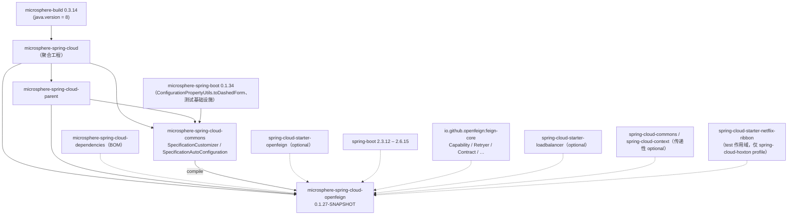
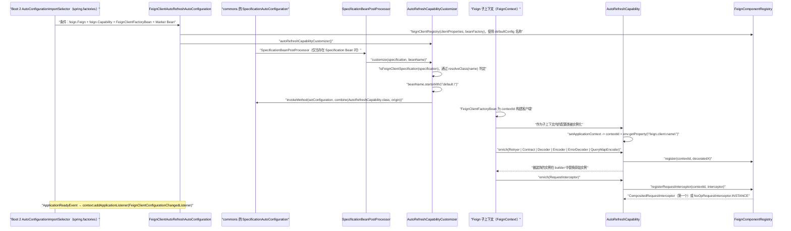

# 开发者文档 · `microsphere-spring-cloud-openfeign`（1.x / 0.1.x 版本线）

[English](../openfeign.md) · [0.2.x 版本线](../../current/zh/openfeign.md) · [开发者文档首页](../../zh/README.md)

**分支：** `release-1.x` · **坐标：** `io.github.microsphere-projects:microsphere-spring-cloud-openfeign:${revision}`
（HEAD 处为 `0.1.27-SNAPSHOT`，最新发布版本 `0.1.26`）· **打包方式：** `jar`
**源码根：** `microsphere-spring-cloud-openfeign/src/main/java/io/microsphere/spring/cloud/openfeign/` ·
**所有类都带有 `@since 1.0.0` 标签。**

本模块用可刷新的装饰器替换 Feign 的各个组件（contract、encoder、decoder、error decoder、retryer、
query-map encoder、request interceptors），并在 `EnvironmentChangeEvent` 报告 `feign.client.config.`
之下发生变化时就地重建它们 —— 不重启，也不重建客户端。在 `release-1.x` 上，它是这一思路的
**Spring Cloud Hoxton.SR12 → 2021.0.9 / Spring Boot 2.3–2.6** 实现：类级别的行为与 0.2.x 相同，
但它所接入的平台 API 是更老的那一套。

---

## 1. 架构设计

### 1.1 1.x 构建中的模块图



两个分支上 `spring-cloud-starter-openfeign` 都是带 `spring-cloud-netflix-ribbon` 排除项的
`<optional>true</optional>`，而与 0.2.x 之间**唯一**的 pom 差异就是多出的
`<profile><id>spring-cloud-hoxton</id>` 块，它在 **test** 作用域加入
`spring-cloud-starter-netflix-ribbon`：Hoxton 的 Feign 测试上下文仍然需要 Ribbon 时代的负载均衡类在场。

### 1.2 Boot 2 的注册方式：两个文件都在，factories 权威

```
…/src/main/resources/META-INF/spring.factories
org.springframework.boot.autoconfigure.EnableAutoConfiguration=\
io.microsphere.spring.cloud.openfeign.autoconfigure.FeignAutoConfiguration,\
io.microsphere.spring.cloud.openfeign.autoconfigure.FeignClientAutoRefreshAutoConfiguration
```

`…/src/main/resources/META-INF/spring/org.springframework.boot.autoconfigure.AutoConfiguration.imports`
列出同样的两个类名，并且**与 0.2.x 的文件字节级一致** —— 在 Boot 2.3–2.6 上它是惰性的，
但如果该构件被运行在 Boot 2.7+/3.x 上，它就是权威来源。因此与 commons 不同，本模块
*同时*发布了两套注册机制：0.2.x 只有 `AutoConfiguration.imports`。

### 1.3 造就“1.x 变体”的三处平台耦合

| 耦合点 | 1.x（`release-1.x`） | 0.2.x（`release`） |
|---|---|---|
| 按客户端上下文类型 | `org.springframework.cloud.openfeign.FeignContext`（`AutoRefreshCapability.java` 第 33 行、`DecoratedFeignComponent.java` 第 27 行） | `NamedContextFactory<FeignClientSpecification>` |
| 客户端名称属性 | `feign.client.name`（`CONTEXT_ID_PROPERTY_NAME`，`AutoRefreshCapability.java:39`） | `spring.cloud.openfeign.client.name` |
| 被刷新的命名空间 | `feign.client.config.`（`FeignClientConfigurationChangedListener.java:34`） | `spring.cloud.openfeign.client.config.` |

模块总开关 `microsphere.spring.cloud.openfeign.enabled`（`FeignConstants.ENABLED_PROPERTY_NAME`，
通过 `matchIfMissing = true` 默认为 `true`）在**两条线上完全相同** —— Microsphere 的命名空间从未迁移，
发生迁移的只是 Spring Cloud 那一侧。

---

## 2. 自动配置源码解析

### 2.1 `autorefresh/EnableFeignAutoRefresh.java`（与 0.2.x 字节级一致）
`@Retention(RUNTIME) @Target(TYPE) @Documented @Inherited`，**没有属性**，并且
`@Import(value = { EnableFeignAutoRefresh.Marker.class })`，其中 `Marker` 是一个空的嵌套类
`public static class Marker {}`（第 31–32 行），它存在的唯一目的就是满足
`@ConditionalOnBean(Marker.class)`。因此启用/禁用要么靠 `@EnableFeignAutoRefresh`（存在性），
要么靠全局属性（不存在性）。

### 2.2 `autoconfigure/FeignAutoConfiguration.java`（字节级一致）
`@Configuration(proxyBeanMethods = false)` + `@ConditionalOnOpenFeignAvailable` +
`@ConditionalOnClass(name = FEIGN_BUILDER_CUSTOMIZER_CLASS_NAME)` +
`@AutoConfigureAfter(name = "org.springframework.cloud.openfeign.FeignAutoConfiguration")`。
一个 Bean（第 36–41 行）：

```java
@Bean
public FeignBuilderCustomizer addDefaultRequestInterceptorCustomizer() {
    return builder -> { builder.requestInterceptor(INSTANCE); };   // NoOpRequestInterceptor.INSTANCE
}
```

预置一个拦截器，保证 `Capability` 流水线在处理每个客户端时总能看到至少一个 `RequestInterceptor`，
这正是 `default-request-headers` / `default-query-parameters` 从第一个请求起就能生效的原因。

### 2.3 `autoconfigure/FeignClientAutoRefreshAutoConfiguration.java`（字节级一致）
没有 `@Configuration` 注解 —— 它纯粹作为自动配置被加载。守卫条件：
`@ConditionalOnOpenFeignAvailable`、`@ConditionalOnClass(name = {FEIGN_CAPABILITY_CLASS_NAME,
FEIGN_CLIENT_FACTORY_BEAN_CLASS_NAME})`、`@ConditionalOnBean(Marker.class)`，以及
`@AutoConfigureAfter(name = {"org.springframework.cloud.openfeign.FeignAutoConfiguration",
"io.microsphere.spring.cloud.context.named.autoconfigure.SpecificationAutoConfiguration"})` —— 第二项就是
commons 的 `SpecificationAutoConfiguration`，即本模块所消费的扩展点。
Bean（两个都带 `@ConditionalOnMissingBean`）：

```java
@Bean @ConditionalOnMissingBean
public FeignComponentRegistry feignClientRegistry(FeignClientProperties clientProperties, BeanFactory beanFactory) {
    return new FeignComponentRegistry(clientProperties.getDefaultConfig(), beanFactory);   // "default"
}
@Bean @ConditionalOnMissingBean
public AutoRefreshCapabilityCustomizer autoRefreshCapabilityCustomizer() { return new AutoRefreshCapabilityCustomizer(); }
```

此外还有 `@EventListener(ApplicationReadyEvent.class) onApplicationReadyEvent(...)`，它**手工**调用
`context.addApplicationListener(new FeignClientConfigurationChangedListener(registry))` —— 而不是作为
Bean —— 源码注释写着 *"Make sure the FeignClientConfigurationChangedListener is registered after
the ConfigurationPropertiesRebinder"*。在 `ApplicationReadyEvent` 时注册，保证 `@ConfigurationProperties`
的重绑定（包括 `FeignClientProperties`）已经刷新完环境支撑的 Bean，监听器才去观察随之产生的
`EnvironmentChangeEvent`。

### 2.4 组合条件（`condition/`）
`ConditionalOnOpenFeignEnabled` = `@ConditionalOnProperty(name = "microsphere.spring.cloud.openfeign.enabled", matchIfMissing = true)`；
`ConditionalOnOpenFeignAvailable` = 在它之上再加 `@ConditionalOnClass(name = "feign.Feign")`。两者都作用于
`{TYPE, METHOD}`。与 0.2.x 的差异仅在 javadoc。

---

## 3. 核心类 —— 源码解析

### 3.1 `autorefresh/FeignComponentRegistry.java`（与 0.2.x 字节级一致）
静态的 `configComponentMappings`（第 43–53 行）把短横线形式的配置键映射到 Feign SPI 类型：
`retryer → feign.Retryer`、`error-decoder → feign.codec.ErrorDecoder`、`request-interceptors`、
`default-request-headers`、`default-query-parameters → feign.RequestInterceptor`、`decoder`、`encoder`、
`contract`、`query-map-encoder → feign.QueryMapEncoder`。
`normalizeConfig(String)`（第 96–99 行）先在 `[`（`LEFT_SQUARE_BRACKET`）处截断，再应用
`ConfigurationPropertyUtils.toDashedForm(...)`，因此 `errorDecoder[0]`、`errorDecoder` 与 `error-decoder`
都会解析为 `ErrorDecoder.class`。
存储结构：`Map<String, List<Refreshable>> refreshableComponents` 与
`Map<String, CompositedRequestInterceptor> interceptorsMap`，二者都以 **Feign 客户端名 / contextId** 为键。
`register(String, List<Refreshable>)`（第 130–136 行）断言名称非空白、列表非空、元素不为 null
（否则抛 `IllegalArgumentException`）。`registerRequestInterceptor(...)`（第 168–176 行）
**只对该客户端的第一个**拦截器返回 `CompositedRequestInterceptor`（`addRequestInterceptor`
仅当集合此前为空时返回 `true`），之后返回 `NoOpRequestInterceptor.INSTANCE`，从而 builder
恰好只收到一次组合对象。`synchronized refresh(String, Set<String>)`（第 207–244 行）
剥掉 `clientName + "."` 前缀，把剩余部分经 `getComponentClass` 映射，然后：
* 若 `clientName.equals(defaultClientName)` → 刷新**每个**客户端中匹配的组件
  （通过 `isAssignableFrom` 判断 `isComponentPresent`），并且只要存在任何 `RequestInterceptor` 变化，
  就刷新全部组合对象；
* 否则 → 只刷新该客户端匹配的组件以及它自己的组合对象。

### 3.2 `autorefresh/FeignClientConfigurationChangedListener.java` —— **1.x 命名空间**
```java
private final String PREFIX = "feign.client.config.";   // line 34 — 0.2.x: "spring.cloud.openfeign.client.config."
```
`implements ApplicationListener<EnvironmentChangeEvent>`，这里的事件是
`org.springframework.cloud.context.environment.EnvironmentChangeEvent`（Spring Cloud Context）。
`RefreshEvent` 只是间接触发器（`ContextRefresher` / RefreshScope 会发布 `EnvironmentChangeEvent`）。
`resolveChangedClient(event)` 保留以 `PREFIX` 开头的键，去掉该前缀，并按剩余的第一个点分段分组，
同时收集子键：`feign.client.config.my-client.decoder` → `{"my-client" → {"decoder"}}`；
随后 `onApplicationEvent` 对每个条目调用 `registry.refresh(client, keys)`。

### 3.3 `autorefresh/AutoRefreshCapability.java` —— **1.x 的 `FeignContext`**
`implements feign.Capability, ApplicationContextAware`；字段为
`FeignClientProperties clientProperties`、`FeignContext feignContext`（第 33 行）、
`FeignComponentRegistry componentRegistry`、`String contextId`。

```java
private static final String CONTEXT_ID_PROPERTY_NAME = "feign.client.name";                     // line 39
public AutoRefreshCapability(FeignClientProperties clientProperties, FeignContext feignContext, // line 55
                             FeignComponentRegistry componentRegistry) { … }
public void setApplicationContext(ApplicationContext applicationContext) {                        // line 76
    this.contextId = applicationContext.getEnvironment().getProperty(CONTEXT_ID_PROPERTY_NAME);
}
```

在 Feign 的**子**上下文里，`feign.client.name` 携带着所属客户端的名称，这就是为什么该 capability
可以是一个共享的配置类，却仍然知道自己在装饰哪个客户端。每个 `enrich(...)` 对 `null` 输入返回 `null`，
否则通过
`DecoratedFeignComponent.instantiate(DecoratedX.class, X.class, contextId, feignContext, clientProperties, original)`
构造装饰器，用 `componentRegistry.register(contextId, decoratedX)` 登记它并返回，从而让 builder 替换掉
原始实例。`enrich(RequestInterceptor)` 则返回
`componentRegistry.registerRequestInterceptor(contextId, interceptor)`。`enrich(InvocationHandlerFactory)`
没有被覆写（测试通过 `MockCapability` 自行提供）。

### 3.4 `autorefresh/AutoRefreshCapabilityCustomizer.java` —— **1.x 基于反射的解耦**
`implements io.microsphere.spring.cloud.context.named.SpecificationCustomizer`（commons 的扩展点）。
1.x 不是编译期引用 `FeignClientSpecification`，而是**按名称**解析它并借助反射改写它，
因此即使该类型缺失或在不同 Spring Cloud 代际间被挪位，这个类也照样能加载：

```java
static final String FEIGN_CLIENT_SPECIFICATION_CLASS_NAME = "org.springframework.cloud.openfeign.FeignClientSpecification";  // line 46
static final Class<?> FEIGN_CLIENT_SPECIFICATION_CLASS = resolveClass(FEIGN_CLIENT_SPECIFICATION_CLASS_NAME);               // line 48

public void customize(Specification specification, String beanName) {                                                        // line 57
    if (isFeignClientSpecification(specification) && beanName.startsWith("default.")) {
        injectAutoRefreshCapability(specification);
    }
}
boolean isFeignClientSpecification(Specification specification) {                                                            // line 62
    return FEIGN_CLIENT_SPECIFICATION_CLASS.equals(specification.getClass());
}
void injectAutoRefreshCapability(Specification specification) {                                                              // line 66
    Class<?>[] originConfigurationClasses = specification.getConfiguration();
    Class<?>[] newConfigurationClasses = combine(AUTO_REFRESH_CAPABILITY_CLASS, originConfigurationClasses);
    BeanMetadata beanMetadata = getBeanMetadata(FEIGN_CLIENT_SPECIFICATION_CLASS);
    Method setConfigurationMethod = findWriteMethod(beanMetadata, "configuration");
    invokeMethod(true, specification, setConfigurationMethod, new Object[]{newConfigurationClasses});
    …TRACE log of the before/after arrays…
}
```

（`resolveClass` 来自 `io.microsphere.util.ClassLoaderUtils`，`findWriteMethod` / `getBeanMetadata` 来自
`io.microsphere.beans.BeanUtils`，`invokeMethod` 来自 `io.microsphere.reflect.MethodUtils`。）
0.2.x 把以上全部替换为 `specification instanceof FeignClientSpecification` 加上直接的
`specification.setConfiguration(...)` —— 可观测行为相同。

推理这个类时有两个细节至关重要：
* capability 类是被**前置**（`combine(AUTO_REFRESH_CAPABILITY_CLASS, origin)`）进 specification 的
  `configuration()` 数组的，因此 Spring 会**为每个 Feign 子上下文**实例化一个
  `AutoRefreshCapability`，而 Spring Cloud OpenFeign 在构建客户端时会拾取该上下文中任意
  `Capability` Bean。
* 只有 Bean 名以 `default.` 开头的 specification 会被装饰 —— 即共享默认配置的那次注册 ——
  这就足够了，因为按客户端的身份是在构建期从 `feign.client.name` 还原出来的。

### 3.5 `components/DecoratedFeignComponent.java` —— **1.x 的 `FeignContext`**
抽象类，`implements Refreshable`；字段 `private final FeignContext feignContext;`（第 27 行），
构造器 `(String contextId, FeignContext feignContext, FeignClientProperties clientProperties, T delegate)`
（第 49 行），`protected volatile T delegate`。

* `delegate()` 在 `delegate == null` 时惰性重新加载（即紧随一次刷新之后）。
* `loadInstanceFromContextFactory(...)`（第 93 行）：
  `ObjectProvider<T> beanProvider = this.feignContext.getProvider(contextId, componentType);`
  → `getIfAvailable(() -> instantiateClass(componentType))` —— 优先使用该按客户端上下文中
  该类型的**当前 Bean**，否则直接实例化所配置的类。
* `refresh()` = `this.delegate = null`（以 trace 日志记录）。
* `componentType()` 是面向子类的抽象钩子（装饰器内部的模板方法）。
* `get(Function<FeignClientConfiguration, T>)` 先检查**默认**配置，再检查当前配置。
* `equals`/`hashCode`/`toString` 委托给 `delegate()`。
* 静态工厂（第 233–236 行）—— 使用 **`FeignContext`** 参数类型做反射查找：

```java
Constructor<W> constructor = findConstructor(decoratedClass, String.class, FeignContext.class,
                                             FeignClientProperties.class, componentClass);
return instantiateClass(constructor, contextId, feignContext, clientProperties, delegate);
```

0.2.x 在同一个 `findConstructor(...)` 调用里使用 `NamedContextFactory.class`，
并且额外给 `delegate()` 中的 trace 语句加了 `logger.isTraceEnabled()` 守卫。

### 3.6 装饰器子类 —— 两条线上的类集合相同

| 类 | **1.x** 上 `componentType()` 的取值来源 | 兜底 | 被委托的方法 |
|---|---|---|---|
| `DecoratedContract` | `FeignClientConfiguration::getContract` | `Contract.class` | `parseAndValidateMetadata(Class)` |
| `DecoratedDecoder` | `::getDecoder` | `Decoder.class` | `decode(Response, Type)` |
| `DecoratedEncoder` | `::getEncoder` | `Encoder.class` | `encode(Object, Type, RequestTemplate)` |
| `DecoratedErrorDecoder` | `::getErrorDecoder` | `ErrorDecoder.Default.class` | `decode(String methodKey, Response)` |
| `DecoratedRetryer` | `::getRetryer` | `Retryer.class` | `continueOrPropagate(RetryableException)`、`clone()` |
| `DecoratedQueryMapEncoder` | **硬编码** `PageableSpringQueryMapEncoder.class`（第 34 行） | — | `encode(Object) → Map<String,Object>` |

> **仅 1.x 的功能限制。** `DecoratedQueryMapEncoder.componentType()` 完全忽略
> `feign.client.config.<name>.query-map-encoder`：刷新之后委托对象永远是
> `PageableSpringQueryMapEncoder`。0.2.x 会先解析所配置的类（当前配置，然后默认配置），
> 借助 `FeignClientConfiguration#getQueryMapEncoder()` 上的 `MethodHandle` 并带
> `NOT_FOUND_METHOD_HANDLE` 守卫，最终回退到 `PageableSpringQueryMapEncoder`。
> 不要在没有补上 `MethodHandle` 辅助逻辑的情况下把 1.x 这个方法“清理”成 0.2.x 的形式 ——
> 并且要注意，1.x 的 `querymapencoder` 测试因此对*类型*变化的断言方式与 0.2.x 不同。

```mermaid
classDiagram
    class Refreshable {
        <<interface>>
        +refresh() void
    }
    class DecoratedFeignComponent {
        <<abstract>>
        -FeignContext feignContext
        -String contextId
        -FeignClientProperties clientProperties
        #volatile T delegate
        +delegate() T
        #componentType() Class
        +refresh() void
        +loadInstance() T
        {static} +instantiate() W
    }
    class DecoratedContract
    class DecoratedDecoder
    class DecoratedEncoder
    class DecoratedErrorDecoder
    class DecoratedRetryer
    class DecoratedQueryMapEncoder
    class CompositedRequestInterceptor {
        -BeanFactory beanFactory
        -String contextId
        -LinkedHashSet~RequestInterceptor~ set
        +apply(RequestTemplate) void
        +addRequestInterceptor(...) boolean
        +refresh() void
    }
    class NoOpRequestInterceptor {
        +INSTANCE
        +apply(RequestTemplate) void
    }

    Refreshable <|.. DecoratedFeignComponent
    Refreshable <|.. CompositedRequestInterceptor
    DecoratedFeignComponent <|-- DecoratedContract
    DecoratedFeignComponent <|-- DecoratedDecoder
    DecoratedFeignComponent <|-- DecoratedEncoder
    DecoratedFeignComponent <|-- DecoratedErrorDecoder
    DecoratedFeignComponent <|-- DecoratedRetryer
    DecoratedFeignComponent <|-- DecoratedQueryMapEncoder
    DecoratedFeignComponent ..> FeignContext : "1.x 的字段类型"
    CompositedRequestInterceptor o-- NoOpRequestInterceptor : "由 FeignAutoConfiguration 预置"
```

类集合、字段名以及 `Refreshable` 在两个分支上完全相同；只有构造器签名里的
`FeignContext` 与 `NamedContextFactory<FeignClientSpecification>` 类型不同。

### 3.7 `components/CompositedRequestInterceptor.java` 与 `NoOpRequestInterceptor.java`
组合对象：`implements RequestInterceptor, Refreshable`；持有一个是插入有序的
`LinkedHashSet<RequestInterceptor>`，所有修改都在该集合上加锁；`apply(RequestTemplate)`
在 `synchronized (set)` 下遍历，因此刷新对请求是安全的。`refresh()` 重新读取
`FeignClientProperties`（`getOrInstantiate` = `beanFactory.getBeanProvider(...).getIfAvailable(fallback)`）
并按**先默认后当前**的配置重建：所配置的 `requestInterceptors` 类、一个应用
`defaultRequestHeaders` 的 lambda（只对尚未设置的键生效）、一个应用 `defaultQueryParameters` 的
lambda。因此 header/参数的变化完全通过这条刷新路径传播。
空对象：`NoOpRequestInterceptor.INSTANCE`，其 `apply(...)` 是刻意为空的；它承担两个角色 ——
`FeignAutoConfiguration` 中的预置拦截器，以及
`AutoRefreshCapability.enrich(RequestInterceptor)` 对第 2..n 个拦截器的返回值。

---

## 4. 1.x 上的启动装配



---

## 5. 1.x 上的运行期刷新流程

```mermaid
flowchart TD
    A["/actuator/refresh 或 ContextRefresher"] --> B["RefreshEvent"]
    B --> C["ConfigurationPropertiesRebinder 重新绑定 FeignClientProperties"]
    C --> D["发布 EnvironmentChangeEvent(keys)（Spring Cloud Context）"]
    D --> E{"键以 PREFIX = \"feign.client.config.\" 开头吗？"}
    E -->|"否"| F["被忽略"]
    E -->|"是"| G["剥掉 PREFIX，按第一个点分段分组"]
    G --> H["clientName -> 发生变化的子键，例如 my-client -> decoder"]
    H --> I["FeignComponentRegistry.refresh(clientName, keys)"]
    I --> J["normalizeConfig：在方括号处截断，再 toDashedForm"]
    J --> K["getComponentClass -> Feign SPI 类型"]
    K --> L{"clientName == defaultConfigName（\"default\"）？"}
    L -->|"是"| M["刷新所有匹配这些组件类型的客户端"]
    L -->|"否"| N["只刷新该客户端匹配到的组件"]
    M --> O{"存在任何 RequestInterceptor 变化吗？"}
    N --> O
    O -->|"是"| P["CompositedRequestInterceptor.refresh() —— 全部（default）或单个客户端"]
    O -->|"否"| Q["跳过拦截器刷新"]
    P --> R["把每个受影响的 DecoratedFeignComponent 的 delegate 置为 null"]
    Q --> R
    R --> S["下一次调用：delegate() 通过 feignContext.getProvider(contextId, componentType()) 重新加载"]
    S --> T{"componentType() 的取值来源"}
    T -->|"Contract / Decoder / Encoder / ErrorDecoder / Retryer"| U["按所配置的类生效"]
    T -->|"QueryMapEncoder"| V["1.x 的限制：永远是 PageableSpringQueryMapEncoder<br/>所配置的 query-map-encoder 被忽略"]
```

---

## 6. 设计模式（具体类）

| 模式 | 涉及的类 | 关于 1.x 的说明 |
|---|---|---|
| **装饰器 Decorator** | `DecoratedFeignComponent` + 六个 `Decorated*`；此外还有 commons 的 `ReactiveDiscoveryClientAdapter` | `componentType()` 是内部的模板方法钩子；`equals`/`hashCode`/`toString` 转发给 `delegate()`，使装饰器保持透明 |
| **组合 Composite** | `CompositedRequestInterceptor`（按客户端）；commons 的 `MultipleServiceRegistry` / `MultipleRegistration` / `RegistrationMetaData` | 组合对象恰好只交给 builder 一次（由 `NoOpRequestInterceptor` 返回值来守卫） |
| **观察者 Observer** | commons 的 `EventPublishingRegistrationAspect` + `RegistrationEvent` 事件族；本模块是监听 `EnvironmentChangeEvent` 的 `FeignClientConfigurationChangedListener` | 监听器在 `ApplicationReadyEvent` 上手工添加，刻意排在 rebinder 之后 |
| **模板方法 Template Method** | commons 的 `WebServiceRegistryAutoConfiguration`（`final` 的 `onApplicationEvent` + 两个抽象钩子）与 `AbstractServiceRegistrationEndpoint`；本模块是 `delegate()` → `componentType()` / `loadInstance()` | |
| **空对象 Null Object** | `NoOpRequestInterceptor.INSTANCE` | 既是预置拦截器，**也是**抑制重复注册时的返回值 |
| **注册表 Registry** | `FeignComponentRegistry`（客户端名 → `Refreshable` 列表）以及 commons 的 `InMemoryServiceRegistry` / `SimpleServiceRegistry` | `refreshableComponents` 与 `interceptorsMap` 都是 `newConcurrentHashMap(32)` |
| **策略 Strategy** | `SpecificationCustomizer`（openfeign 贡献 `AutoRefreshCapabilityCustomizer`）；commons 的 `RegistrationCustomizer` | customizer 按 `getSortedBeans(...)` 的顺序应用 |
| **基于反射的解耦（兼容性模式）** | **1.x** 的 `AutoRefreshCapabilityCustomizer`（`resolveClass`、`getBeanMetadata`、`findWriteMethod`、`invokeMethod`），以及 `DecoratedFeignComponent.instantiate` 中的 `findConstructor(..., FeignContext.class, …)` 查找 | 在 0.2.x 上，同一问题由 `DecoratedQueryMapEncoder` 里的 `MethodHandle` 和直接的 `instanceof` 解决；**1.x 则硬编码** `PageableSpringQueryMapEncoder` |

---

## 7. 移植与兼容性矩阵（openfeign）

两个分支之间字节级一致的文件：`EnableFeignAutoRefresh.java`、`FeignConstants.java`、
`FeignAutoConfiguration.java`、`FeignClientAutoRefreshAutoConfiguration.java`、
`FeignComponentRegistry.java`、`Refreshable.java`、两个注册文件中的类清单、`features.yaml`。
`autorefresh`/`components` 中的其余一切都有差异 —— 而且这些差异是真实的平台迁移，不是格式问题。

| 1.x 构造 | 0.2.x 对应物 | 移植动作 |
|---|---|---|
| `org.springframework.cloud.openfeign.FeignContext` 字段 / 构造器 / `getProvider(...)` 参数 | `NamedContextFactory<FeignClientSpecification>`（`getProvider` 行为不变） | 在**三处**替换类型：`AutoRefreshCapability`、`DecoratedFeignComponent`（字段 + 构造器 + `findConstructor`）、全部六个 `Decorated*` 构造器 |
| `CONTEXT_ID_PROPERTY_NAME = "feign.client.name"` | 内联的 `"spring.cloud.openfeign.client.name"` | 属性改名；该常量在 0.2.x 上消失 |
| `PREFIX = "feign.client.config."` | `"spring.cloud.openfeign.client.config."` | 属性改名 —— 每个测试的 `@TestPropertySource` 键也要一起改 |
| `AutoRefreshCapabilityCustomizer`：`resolveClass` + `getBeanMetadata` + `findWriteMethod` + `invokeMethod(true, …)` | `instanceof FeignClientSpecification` + `specification.setConfiguration(...)` | 前向移植时用直接调用替换反射块；反向移植时保留反射 |
| `DecoratedQueryMapEncoder.componentType()` 无条件返回 `PageableSpringQueryMapEncoder.class` | 通过 `getQueryMapEncoder()` 上的 `MethodHandle` 解析所配置的类，带 `NOT_FOUND_METHOD_HANDLE` 守卫，兜底相同 | 这一功能改进**只**存在于 0.2.x —— 要有意识地移植它，并一并带上 `MethodHandleUtils`/`MethodHandlesLookupUtils` 依赖 |
| `META-INF/spring.factories`（`EnableAutoConfiguration=` 两个类）**+** `AutoConfiguration.imports` | 只有 `AutoConfiguration.imports` | 反向移植必须补上 factories 文件；前向移植必须删除它 |
| `spring-cloud-hoxton` profile 追加 `spring-cloud-starter-netflix-ribbon`（test） | 任何地方都没有 ribbon（而且它始终被 starter 排除） | 绝不把 hoxton profile 移植到 0.2.x；也绝不从 1.x 删除它 |
| `microsphere-spring-boot` 0.1.34（测试基础设施、`ConfigurationPropertyUtils`） | 0.2.34 | 通过父 pom 对齐版本，而不是本 pom |
| Java 8 语言级别 | `java.version = 17` | 两条线源码风格相同 —— 本模块从未使用 Java 9+ 构造，因此无需改写 |

---

## 8. 构建与测试指南

```bash
mvn -pl microsphere-spring-cloud-openfeign -am clean test                         # Boot 2.6.15 / Cloud 2021.0.9
mvn -pl microsphere-spring-cloud-openfeign -am clean test --activate-profiles spring-cloud-2020
mvn -pl microsphere-spring-cloud-openfeign -am clean test --activate-profiles spring-cloud-hoxton  # + ribbon（test）
```

规范的刷新测试模式（`src/test/java/…/autorefresh/BaseTest.java` + `decoder/DecoderChangedTest.java`）：

1. `@TestPropertySource` **在 1.x 命名空间下**播下默认值，例如
   `feign.client.config.default.decoder=io.microsphere.spring.cloud.openfeign.decoder.ADecoder`、
   `…default.query-map-encoder=…`、`…default.retryer=…`、`…default.request-interceptors[0]=…`、
   `…default.default-request-headers.app=my-app`、`…default.default-query-parameters.sign=my-sign`，
   再加上 `spring.main.allow-bean-definition-overriding=true`；取值就是普通的全限定类名，
   而这些组件类只需要一个 public 无参构造器 —— 它们**不是** Spring Bean。
2. 测试应用是 `@EnableFeignClients(clients = BaseClient.class)` + `@EnableFeignAutoRefresh` + `@ComponentScan`；
   `BaseClient` 是 `@FeignClient(contextId = "my-client", name = "my-client", configuration = {MockCapability.class})`，
   而 `MockCapability` 把 `InvocationHandlerFactory` 换成 `ObservableFeignInvocationHandler`，后者通过反射
   取出活的 `ResponseHandler` → `DecoratedDecoder` 等，并在每次调用前断言
   `decoder.delegate().getClass()`。
3. `replaceConfig()` 追加一个更高优先级的
   `MapPropertySource("after", {feign.client.config.my-client.decoder: BDecoder.class.getName()})`，
   随后发布 `RefreshEvent` 与 `EnvironmentChangeEvent(Set.of(key))`；下一次调用就会观察到新的委托对象。
4. 负向/自动配置测试（`FeignAutoConfigurationTest`、`FeignClientAutoRefreshAutoConfigurationTest`）
   使用 `microsphere-spring-boot-test` 提供的 `AutoConfigurationTest` 基类 —— 与 0.2.x 相同的基础设施 ——
   以 `classes = {EnableFeignAutoRefresh.Marker.class, …}` 启动（Marker 存在即激活自动刷新），
   并断言 `FeignComponentRegistry` + `AutoRefreshCapabilityCustomizer`；关闭的方式是
   `microsphere.spring.cloud.openfeign.enabled=false`，或从类路径移除 `feign.Feign` / `feign.Capability` /
   `FeignClientFactoryBean`。
5. 单元级：`FeignComponentRegistryTest`（键 ↔ 类映射，含 camel/短横线/`[0]` 形式，非法参数抛
   `IllegalArgumentException`，首次与后续的 `registerRequestInterceptor`）、`AutoRefreshCapabilityTest`
   （七种类型的 `enrich(null)` → `null`）、`AutoRefreshCapabilityCustomizerTest`
   （`injectAutoRefreshCapability` 把 `AutoRefreshCapability.class` 前置）。

## 9. 贡献者清单

* [ ] 刷新会触及的每个新属性键都要经过 `FeignComponentRegistry.normalizeConfig(...)` ——
      本分支的规范形式是短横线式，命名空间是 `feign.client.config.`。
* [ ] 新增 `Decorated*` 组件：加上这个类、它的 `componentType()`、`AutoRefreshCapability` 中一个
      `enrich(...)` 重载，并用 `componentRegistry.register(contextId, …)` 登记它。
* [ ] 构造器保持 `(String, FeignContext, FeignClientProperties, T)` 形式，这样
      `DecoratedFeignComponent.instantiate` 中的 `findConstructor(..., FeignContext.class, …)` 仍能解析。
* [ ] 新增自动配置时**同时**更新 `spring.factories` 与 `AutoConfiguration.imports`。
* [ ] 在 `…/META-INF/config/default/features.yaml` 的抽象特性中登记新类。
* [ ] 不要引入 Java 9+ 语法，也不要在本分支采用 0.2.x 的 `spring.cloud.openfeign.*` 前缀。

---

相关：[commons](./commons.md) · [parent](./parent.md) · [dependencies](./dependencies.md) ·
0.2.x 分析：[../../current/zh/openfeign.md](../../current/zh/openfeign.md)
