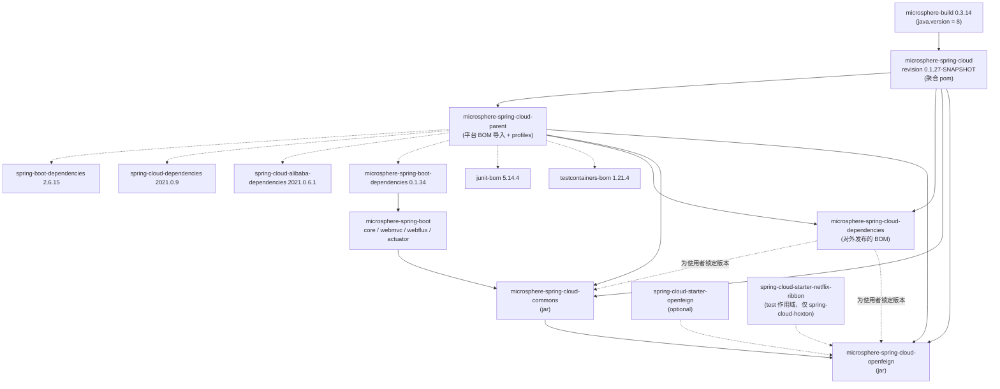
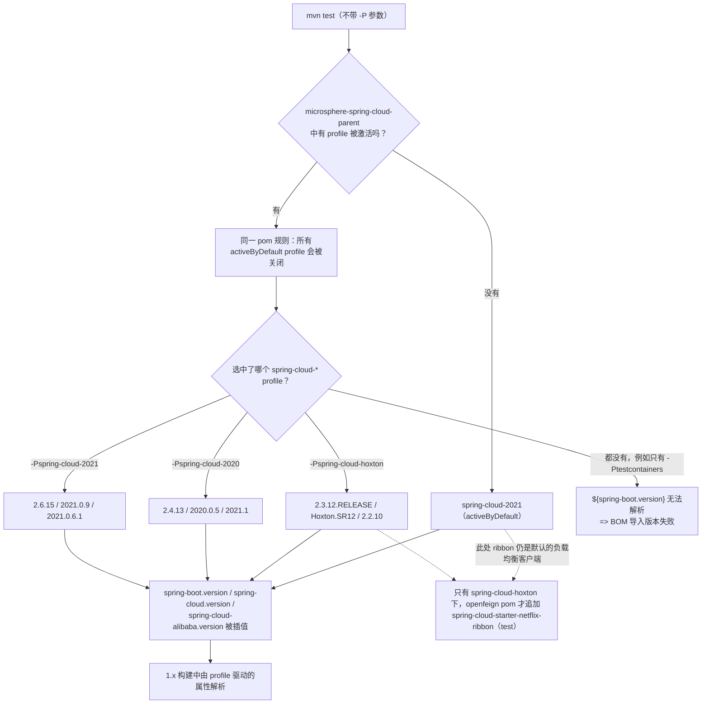

# 开发者文档 · `microsphere-spring-cloud-parent`（1.x / 0.1.x 版本线）

[English](../parent.md) · [0.2.x 版本线](../../current/zh/parent.md) · [开发者文档首页](../../zh/README.md)

**分支：** `release-1.x` · **版本线：** 0.1.x · **HEAD：** `0.1.27-SNAPSHOT` · **最新发布版本：** `0.1.26`
**分析文件：** `microsphere-spring-cloud-parent/pom.xml`（打包方式 `pom`，名称 `Microsphere :: Spring Cloud :: Parent`）

本模块不发布任何属于自己的构件。它是 `release-1.x` 分支的*内部构建契约*：一个由六个 BOM 导入构成的
`<dependencyManagement>` 块，外加四个用于选择 Spring Boot / Spring Cloud / Spring Cloud Alibaba 平台代际的
Maven profile。

---

## 1. 架构设计

### 1.1 分层构建

1.x 的构建是一条四层链条，各层之间全部由 `<parent>` 关联：

```
microsphere-build:0.3.14                 ← 上游构建父工程（compiler、javadoc、flatten、enforcer、surefire）
  └── microsphere-spring-cloud:${revision}          ← 根聚合工程（pom.xml），列出 4 个模块
        ├── microsphere-spring-cloud-parent:${revision}          ← 本模块：平台 BOM 导入 + profiles
        ├── microsphere-spring-cloud-dependencies:${revision}    ← 对外发布的 BOM（面向使用者）
        ├── microsphere-spring-cloud-commons:${revision}         ← jar
        └── microsphere-spring-cloud-openfeign:${revision}       ← jar
```

贡献者必须牢记两条结构性事实：

1. 根 `pom.xml` **同时**是聚合工程（`<modules>`）**和** `microsphere-spring-cloud-parent` 的父工程
   （`<parent>microsphere-spring-cloud</parent>`、`<relativePath>../pom.xml</relativePath>`）。
2. jar 模块和 BOM **并不**从根聚合工程继承——它们显式指向
   `microsphere-spring-cloud-parent`（`<relativePath>../microsphere-spring-cloud-parent/pom.xml</relativePath>`），
   正是这一点让它们获得平台 BOM 与 profile 属性。

### 1.2 本分支所面向的 Boot 2 流水线

`release-1.x` 针对 Spring Boot **2.3.x – 2.6.x** 与 Spring Cloud **Hoxton.SR12 – 2021.0.x** 编译。
reactor 中一切下游内容都由它决定形状：

| 约束 | 对贡献者的影响 |
|---|---|
| Spring Boot 2.3–2.6 | 自动配置通过 `META-INF/spring.factories`（`EnableAutoConfiguration=`）注册，**而不是** `META-INF/spring/org.springframework.boot.autoconfigure.AutoConfiguration.imports` |
| Spring Boot 2.x | `org.springframework.boot.web.server.ServerProperties` 使用 Boot 2 的访问器（例如 `getMaxHttpHeaderSize()`），并且 servlet 命名空间是 `javax.servlet.*` |
| Java 8 基线 | 任何模块都不得出现 `var`、record、密封类型、文本块、switch 表达式或模式匹配 `instanceof`（见 §3） |
| Boot 2 配置元数据 | `@ConstructorBinding` / `spring-configuration-metadata` 的生成行为遵循 Boot 2 —— 注解处理器在 jar pom 中声明为 `optional` |

模块级细节见 [commons](./commons.md) 与 [openfeign](./openfeign.md)。

### 1.3 1.x 构建的模块与依赖图



虚线箭头表示 `scope=import` 的 BOM 关系或 `optional`/`test` 依赖；实线箭头表示 `<parent>` 关系或
compile 作用域依赖。

---

## 2. 源码解析：parent pom 实际声明了什么

### 2.1 属性

| 属性 | HEAD 处取值 | 作用 |
|---|---|---|
| `microsphere-spring-boot.version` | `0.1.34` | 所导入的 `microsphere-spring-boot-dependencies` BOM 的版本 —— 即 0.2.x 的 `0.2.34` 在 0.1.x 的对应物 |
| `testcontainers.version` | `1.21.4` | `org.testcontainers:testcontainers-bom` 的版本 |
| `junit-jupiter.version` | `5.14.4` | `org.junit:junit-bom` 的版本 |
| `spring-boot.version`、`spring-cloud.version`、`spring-cloud-alibaba.version` | *只在 profile 内定义* | 由 profile 激活来决定取值；见 §2.3 |

`spring-boot.version` 之类**有意**不声明在 `<properties>` 中：它们必须始终恰好来自一个激活的平台 profile，
这样 `${spring-boot.version}` 无法解析就是一个构建期信号，而不是一个静默出错的默认值。

### 2.2 `<dependencyManagement>` —— 六个导入，顺序敏感

```
org.junit:junit-bom:${junit-jupiter.version}                    (pom, import)
org.testcontainers:testcontainers-bom:${testcontainers.version} (pom, import)
org.springframework.boot:spring-boot-dependencies:${spring-boot.version}          (pom, import)
org.springframework.cloud:spring-cloud-dependencies:${spring-cloud.version}       (pom, import)
com.alibaba.cloud:spring-cloud-alibaba-dependencies:${spring-cloud-alibaba.version}(pom, import)
io.github.microsphere-projects:microsphere-spring-boot-dependencies:${microsphere-spring-boot.version} (pom, import)
```

Maven 在合并被导入的 BOM 时遵循*先声明者优先*，这正是 `junit-bom` 声明在
`spring-boot-dependencies` **之上**的原因：本分支刻意使用 JUnit 5.14.4 进行测试，而不是 Boot 2.6 所管理的
5.7.x 线。同样的理由让 `testcontainers-bom` 也排在 Boot 的 BOM 之前。在“整理”pom 时不要重排这些导入。

最后一个导入（`microsphere-spring-boot-dependencies` 0.1.34）提供了 commons 模块所使用的四个
compile 作用域 Microsphere 依赖（`microsphere-spring-boot-core`、`-webmvc`、`-webflux`、`-actuator`）
以及 `microsphere-spring-boot-test` 的版本。

### 2.3 平台 profile

| Profile id | 激活方式 | `spring-boot.version` | `spring-cloud.version` | `spring-cloud-alibaba.version` |
|---|---|---|---|---|
| `spring-cloud-hoxton` | 手动 | `2.3.12.RELEASE` | `Hoxton.SR12` | `2.2.10` |
| `spring-cloud-2020` | 手动 | `2.4.13` | `2020.0.5` | `2021.1` |
| `spring-cloud-2021` | `activeByDefault` | `2.6.15` | `2021.0.9` | `2021.0.6.1` |
| `testcontainers` | 手动 | — | — | — |

`testcontainers` 不是平台 profile —— 它只是为 `maven-surefire-plugin` 配置了系统属性
`testcontainers.enabled=true`，集成测试（Nacos / Eureka / Zookeeper / Consul）据此选择是否启动容器。



> **陷阱（已对照 pom 核实）：** 只要同一个 pom 中声明的*任意* profile 被激活，`activeByDefault`
> 就会失效——而 `testcontainers` 正是声明在这个 pom 里的。因此 CI 总会显式点名一个 `spring-cloud-*`
> profile。本地复现该行为：
> `mvn test --activate-profiles test,coverage,testcontainers,spring-cloud-2021`。

---

## 3. Java 8 基线 —— 它从何而来、禁止了什么

1.x 的根 `pom.xml` **只**声明了 `<revision>0.1.27-SNAPSHOT</revision>`；这里**没有** `<java.version>`
属性。`microsphere-build:0.3.14` 提供了：

```
<java.version>8</java.version>
<maven.compiler.source>${java.version}</maven.compiler.source>
<maven.compiler.target>${java.version}</maven.compiler.target>
```

而 `java9+` profile（`<activation><jdk>[9,)</jdk></activation>`）额外设置了
`<maven.compiler.release>${java.version}</maven.compiler.release>`。最终效果是：即使在现代 JDK 上，
1.x 源码也是以 `--release 8` 编译；`java16+`/`java17+` profile 只调整 `--add-opens` 参数与
Checkstyle 版本，从不改动语言级别。

对本分支代码评审的影响：

* `microsphere-spring-cloud-commons` / `microsphere-spring-cloud-openfeign` 中任何位置都不得使用
  `var`、record、密封类型、文本块、switch 表达式或模式匹配 `instanceof`（58 + 24 个主源文件，
  其中没有任何一个使用 Java 9+ 构造）。
* Servlet API 类型是 `javax.servlet.Filter`（见 `WebMvcServiceRegistryAutoConfiguration` 中的唯一一处），
  绝不会是 `jakarta.servlet.Filter`。
* 只使用 Spring Boot 2 的 API 面 —— `ServerProperties#getMaxHttpHeaderSize()`、来自
  `org.springframework.boot.web.servlet` 的 `FilterRegistrationBean`、`DispatcherServletRegistrationBean`。
* `@since 1.0.0` javadoc 标签保持原样；0.1.x 线与 0.2.x 线记录相同的 `@since` 值，因为这些 API
  是在 1.0.0 这一代特性中引入的，而非按发布版本线引入。

---

## 4. 移植与兼容性矩阵（parent / build 层）

| 关注点 | `release-1.x`（0.1.x） | `release`（0.2.x） | 贡献者需要做的事 |
|---|---|---|---|
| 构建父工程 | `microsphere-build:0.3.14` | `microsphere-build:0.3.16` | 绝不在分支间挑选式移植根 pom 里 `<parent>` 的 `<version>` |
| `revision` | `0.1.27-SNAPSHOT`（已发布 `0.1.26`） | `0.2.27-SNAPSHOT`（已发布 `0.2.26`） | 补丁版本号要在正确的版本线上递增；`revision` 只在根 pom 声明一次 |
| `<java.version>` | 缺失 → 继承 `8` | `17`（根 pom 显式声明） | 依赖 Java 17 语法的补丁无法反向移植；须改写为 Java 8 形式 |
| 平台 profile | `spring-cloud-hoxton`、`spring-cloud-2020`、`spring-cloud-2021`（默认） | `spring-cloud-2022`、`2023`、`2024`、`2025`（默认）、`2025.1` | 移植构建修复时，移植的是*结构*（三个 profile + `activeByDefault`），而不是版本号 |
| `microsphere-spring-boot.version` | `0.1.34` | `0.2.34` | 跟踪对应版本发布；API 新增先落在 0.2.x |
| JUnit Jupiter | `5.14.4` | `6.1.3` | 使用 JUnit 6 API（`@Isolated`、新扩展 API）的测试在 1.x 必须降级 |
| Testcontainers | `1.21.4`，构件 `org.testcontainers:junit-jupiter` | `2.0.5`，构件 `org.testcontainers:testcontainers-junit-jupiter`（+ `junit:junit` 排除） | 该构件在 Testcontainers 2.x 中被重命名 —— pom 改动*不能*原样移植 |
| 自动配置注册文件 | `META-INF/spring.factories` 权威 | `AutoConfiguration.imports` 权威 | 见 [commons §3](./commons.md) 与 [openfeign §3](./openfeign.md) |
| Servlet 命名空间 | `javax.servlet` | `jakarta.servlet` | 整个代码库只影响一个文件 |
| CI 矩阵 | JDK `8`、`11` × 3 个 profile | JDK `17`、`21`、`25` × 5 个 profile | 1.x 的 PR 必须在 JDK 8 上通过；`.github/workflows/maven-build.yml` 各分支不同 |

除此之外，`microsphere-spring-cloud-dependencies/pom.xml` 与 `microsphere-spring-cloud-parent` 的
`<dependencyManagement>` 块结构在两个分支上完全相同 —— 0.2.x 的 parent pom 是一个超集，多出两个 profile
且版本更高，而*聚合/父工程/BOM 这一层根本不包含任何 Java 代码*。

---

## 5. 构建与测试指南

```bash
# 默认平台（Boot 2.6.15 / Cloud 2021.0.9 / Alibaba 2021.0.6.1）
mvn clean install

# 显式指定平台
mvn clean test --activate-profiles spring-cloud-2021
mvn clean test --activate-profiles spring-cloud-2020
mvn clean test --activate-profiles spring-cloud-hoxton   # Ribbon 时代的上下文；openfeign 会追加 ribbon（test）

# CI 执行的命令（矩阵：java 8 与 11 × 上面三个 profile）
mvn --batch-mode --update-snapshots --file pom.xml \
    -Drevision=0.0.1-SNAPSHOT -Dsurefire.useSystemClassLoader=false \
    test --activate-profiles test,coverage,testcontainers,spring-cloud-2021
```

说明：

* CI 中的 `-Drevision=0.0.1-SNAPSHOT` 是为了证明 CI 友好的 `${revision}` 机制可用；`flatten-maven-plugin`
  （`flatten.mode = resolveCiFriendliesOnly`）只重写被发布 pom 中的 CI 友好变量。
* 注册中心集成测试必须激活 `testcontainers`；否则这些测试是被跳过而非失败。
* `hoxton` 是唯一一个让 `spring-cloud-starter-netflix-ribbon` 进入 reactor 的 profile
  （test 作用域，由 `microsphere-spring-cloud-openfeign/pom.xml` 贡献），因为 Hoxton 的 Feign 测试上下文
  需要 Ribbon 时代的负载均衡类在类路径上。

## 6. 本模块贡献者清单

* [ ] 恰好只有一个 `spring-cloud-*` profile 处于 `activeByDefault`（1.x 上是 `spring-cloud-2021`）。
* [ ] 新的平台代际以**新增 profile** 的方式加入，绝不通过修改既有 profile 实现。
* [ ] 保持 BOM 导入顺序：JUnit → Testcontainers → Boot → Cloud → Alibaba → Microsphere。
* [ ] 新的受管理版本要放进本 pom 中**不依赖 profile** 的属性，而不是放进 jar pom。
* [ ] 绝不在 1.x 根 pom 里设置 `<java.version>` —— Java 8 基线就是本分支的契约。

---

← [commons 开发者文档](./commons.md) · [openfeign 开发者文档](./openfeign.md) ·
[dependencies 开发者文档](./dependencies.md)
