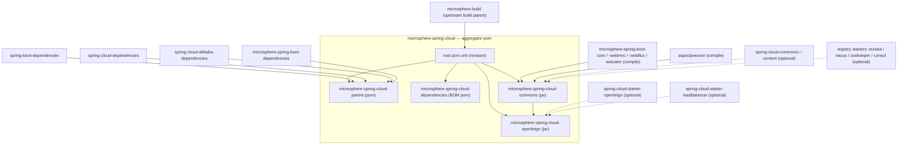
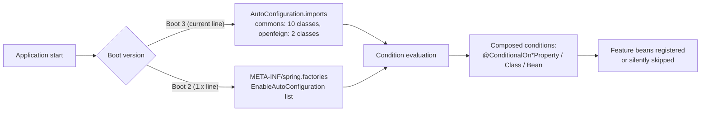

# Microsphere Spring Cloud — Developer Guide

[中文 →](./zh/README.md) · [Docs home](../README.md) · [User Guide](../user-guide/README.md)

The Developer Guide is for **contributors and maintainers**: architecture design, source-level analysis,
design patterns used, mermaid flow/sequence diagrams for complex processes, and build/test guidance.

## Choose Your Version Line

| Branch | Version line | Docs directory | Platform |
|---|---|---|---|
| `release` | 0.2.x (latest release `0.2.26`) | [current/](./current/commons.md) | Java 17 · Spring Boot 3.x–4.x · Spring Cloud 2022–2025.1 |
| `release-1.x` | 0.1.x (latest release `0.1.26`) | [1.x/](./1.x/commons.md) | Java 8 · Spring Boot 2.3–2.6 · Spring Cloud Hoxton–2021 |

## Documents per Version Line (one per Maven module)

| Module | Focus of its developer document | current | 1.x |
|---|---|---|---|
| `microsphere-spring-cloud-parent` | Build architecture, `${revision}` flattening, profile-driven version resolution | [parent.md](./current/parent.md) | [parent.md](./1.x/parent.md) |
| `microsphere-spring-cloud-dependencies` | BOM composition and its position in the dependency graph | [dependencies.md](./current/dependencies.md) | [dependencies.md](./1.x/dependencies.md) |
| `microsphere-spring-cloud-commons` | Auto-configuration pipeline, registry aggregation internals, event aspect, discovery/feature/specification subsystems, fault tolerance | [commons.md](./current/commons.md) | [commons.md](./1.x/commons.md) |
| `microsphere-spring-cloud-openfeign` | Capability injection, decorator/registry refresh machinery, sequence diagrams | [openfeign.md](./current/openfeign.md) | [openfeign.md](./1.x/openfeign.md) |

Every English page has a same-named Chinese mirror in the `zh/` subdirectory of its directory.

## Module Dependency Graph



Reading the graph:

- **Solid arrows** are mandatory build/compile relationships; **dotted arrows** are optional dependencies guarded by
  `@ConditionalOnClass`, which is the project-wide degradation strategy.
- `openfeign` compile-depends on `commons` because it injects `AutoRefreshCapability` through the
  `SpecificationCustomizer` extension point defined in `commons`.
- All third-party Spring dependencies are `optional`: consumers supply their own Spring Boot / Spring Cloud /
  registry starters, and features silently switch off when classes are absent.

## Auto-Configuration Registration Mechanism



Details per branch: [current/commons.md](./current/commons.md) · [current/openfeign.md](./current/openfeign.md) ·
[1.x/commons.md](./1.x/commons.md) · [1.x/openfeign.md](./1.x/openfeign.md).

## Design Patterns at a Glance

| Pattern | Where |
|---|---|
| Decorator | `Decorated*` Feign components (openfeign), `ReactiveDiscoveryClientAdapter` (commons) |
| Composite | `MultipleRegistration`, `MultipleServiceRegistry`, `CompositedRequestInterceptor` |
| Observer / events | `RegistrationPre/Post…Event` family + `EventPublishingRegistrationAspect`, `ServiceInstancesChangedEvent` |
| Template Method | `WebServiceRegistryAutoConfiguration` (abstract hooks), `AbstractServiceRegistrationEndpoint` |
| Null Object | `NoOpRequestInterceptor` |
| Registry | `FeignComponentRegistry`, `InMemoryServiceRegistry` |
| Strategy | `RegistrationCustomizer`, `SpecificationCustomizer` |
| Post-processor | `SpecificationBeanPostProcessor` |
| Marker-class gating | `@EnableFeignAutoRefresh.Marker` + `@ConditionalOnBean` |

Class-level analysis and diagrams are in the module documents above.

## Build & Test Quick Reference

```bash
# current line (release): pick the target Spring Cloud train, 2025 is default
mvn clean install -Pspring-cloud-2023
mvn clean install                      # = -Pspring-cloud-2025

# 1.x line (release-1.x): hoxton / 2020 / 2021(default)
mvn clean install -Pspring-cloud-hoxton

# integration tests that need containers
mvn verify -Ptestcontainers
```
