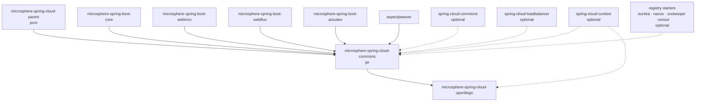
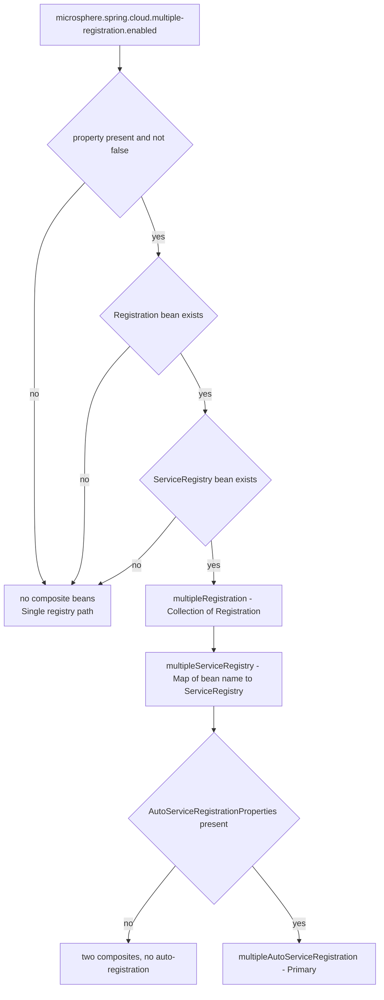
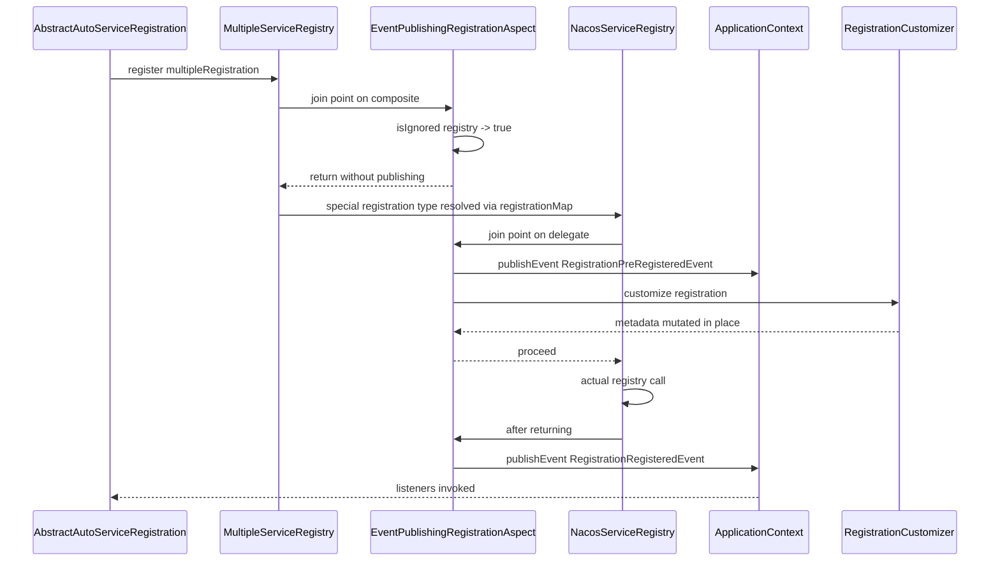
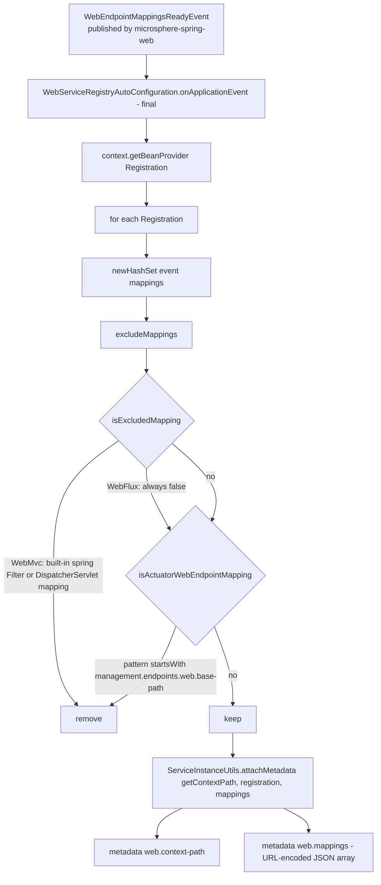
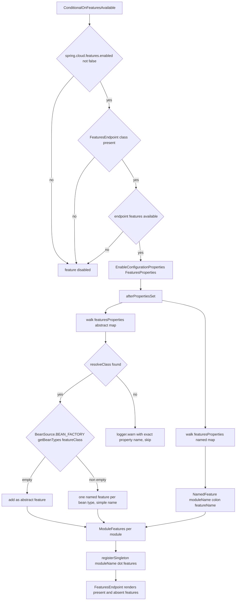

# Developer Guide — `microsphere-spring-cloud-commons`

[中文](./zh/commons.md) · [1.x line](../1.x/commons.md) · [Developer Guide index](../README.md)

> Branch `release` · version line `0.2.x` · latest release `0.2.26`, head `0.2.27-SNAPSHOT` · Java 17 · Spring Boot 3.0.x–4.0.x · Spring Cloud 2022.0.x–2025.1.x · upstream `microsphere-spring-boot` 0.2.34.
> Analysed sources: `microsphere-spring-cloud-commons/src/main/java/io/microsphere/spring/cloud/**` (58 production classes), `src/main/resources/META-INF/**`, `src/test/java/**` (52 test classes).

For contributors: the build layering is in [parent](./parent.md) / [dependencies](./dependencies.md);
this document covers architecture, source-level behaviour, design patterns and extension points of the
`commons` jar.

---

## 1. Module at a glance

| Aspect | Value |
|---|---|
| Coordinates | `io.github.microsphere-projects:microsphere-spring-cloud-commons:${revision}` |
| Packaging | `jar`, parent `microsphere-spring-cloud-parent` |
| Root package | `io.microsphere.spring.cloud` |
| Auto-configurations registered | 10, via `META-INF/spring/org.springframework.boot.autoconfigure.AutoConfiguration.imports` |
| Compile-scope (non-optional) dependencies | `microsphere-spring-boot-core`, `-webmvc`, `-webflux`, `-actuator`, `org.aspectj:aspectjweaver` |
| Optional dependencies | `spring-cloud-commons`, `spring-cloud-context`, `spring-cloud-loadbalancer`, eureka client, Nacos/Zookeeper/Consul discovery starters, Boot web/actuator starters |
| Test-only | `junit-jupiter`, `spring-boot-starter-test`, `microsphere-spring-boot-test`, `testcontainers-junit-jupiter` |

### Package map

| Package (under `io.microsphere.spring.cloud`) | Responsibility |
|---|---|
| `client.actuator` | Feature catalogue → `HasFeatures` singletons, `/actuator/features` integration |
| `client.condition` | `@ConditionalOnFeaturesEnabled` / `@ConditionalOnFeaturesAvailable` |
| `client.discovery` | `UnionDiscoveryClient`, `ReactiveDiscoveryClientAdapter`, `DiscoveryUtils` |
| `client.event` | `ServiceInstancesChangedEvent` |
| `client.service.registry` | Registration/registry model: `Multiple*`, `Simple*`, `InMemoryServiceRegistry`, `RegistrationMetaData`, events, aspect, endpoints |
| `client.service.util` | `ServiceInstanceUtils` — metadata encoding/decoding, URI building |
| `commons.condition` · `commons.constants` | `@ConditionalOnUtilEnabled`, property-name constants |
| `context.named` | `SpecificationCustomizer` + `SpecificationBeanPostProcessor` (extension seam used by `openfeign`) |
| `fault.tolerance` | Weighted round-robin primitives + dynamic Tomcat reconfiguration |
| `loadbalancer.condition` | `@ConditionalOnLoadBalancerEnabled` |

---

## 2. Module dependency graph



Mandatory edges (`compile`) supply the Microsphere abstractions — `io.microsphere.logging.Logger`,
`io.microsphere.json.JSONObject`, `io.microsphere.util.Configurer`, `WebEndpointMapping`,
`GenericBeanPostProcessorAdapter`. Optional edges are guarded at runtime by class conditions, which is
the module's central degradation strategy.

---

## 3. Architecture

### 3.1 Auto-configuration pipeline on Spring Boot 3

Registration is **imports-file based**. `META-INF/spring.factories` survives only as a
`SpringFactoriesLoader` data file (see §5.2); it no longer registers auto-configurations — that was
the mechanism of the `0.1.x` line, which targeted Boot 2.3–2.6.

```
spring.factories (auto-configuration list)      -> removed on this branch
META-INF/spring/...AutoConfiguration.imports    -> authoritative, 10 lines
```

The registered set, in file order:

```
SpecificationAutoConfiguration
DiscoveryClientAutoConfiguration
ReactiveDiscoveryClientAutoConfiguration
ServiceRegistryAutoConfiguration
WebMvcServiceRegistryAutoConfiguration
WebFluxServiceRegistryAutoConfiguration
SimpleAutoServiceRegistrationAutoConfiguration
ServiceRegistrationEndpointAutoConfiguration
TomcatFaultToleranceAutoConfiguration
ConfigurationPropertyHasFeaturesAutoConfiguration
```

File order is **not** evaluation order. Boot sorts by `@AutoConfigureBefore` / `@AutoConfigureAfter`,
and this module expresses ordering through *class-name* variants so that a missing optional artifact
never causes a `ClassNotFoundException`:

| Auto-configuration | Before | After |
|---|---|---|
| `DiscoveryClientAutoConfiguration` | `o.s.c.client.CommonsClientAutoConfiguration` | — |
| `ReactiveDiscoveryClientAutoConfiguration` | `o.s.c.client.ReactiveCommonsClientAutoConfiguration` | `SimpleReactiveDiscoveryClientAutoConfiguration`, `ReactiveCompositeDiscoveryClientAutoConfiguration` |
| `SpecificationAutoConfiguration` | — | `LoadBalancerAutoConfiguration`, `o.s.c.openfeign.FeignAutoConfiguration` |
| `WebMvc/WebFluxServiceRegistryAutoConfiguration` | — | `ServiceRegistryAutoConfiguration`, `SimpleAutoServiceRegistrationAutoConfiguration`, `io.microsphere.spring.boot.webmvc.autoconfigure.WebMvcAutoConfiguration` (resp. `webflux…WebFluxAutoConfiguration`) |
| `SimpleAutoServiceRegistrationAutoConfiguration` | `AutoServiceRegistrationAutoConfiguration` | `UtilAutoConfiguration`, `AutoServiceRegistrationConfiguration`, `SimpleDiscoveryClientAutoConfiguration` |
| `ServiceRegistrationEndpointAutoConfiguration` | — | the five vendor registry auto-configurations by name (Spring Cloud `ServiceRegistryAutoConfiguration`, Zookeeper, Consul, Kubernetes, Nacos) |
| `TomcatFaultToleranceAutoConfiguration` | — | `TomcatWebServer`, `EmbeddedWebServerFactoryCustomizerAutoConfiguration`, `ConfigurationPropertiesRebinderAutoConfiguration` |
| `ConfigurationPropertyHasFeaturesAutoConfiguration` | `CommonsClientAutoConfiguration` | — |
| `FeignClientAutoRefreshAutoConfiguration` (openfeign module) | — | `SpecificationAutoConfiguration` — the reason commons must load first |

### 3.2 Optional-dependency degradation

Two cooperating idioms:

1. **Class-name conditions only.** `@ConditionalOnClass(name = …)` with string constants from
   `DiscoveryClientConstants`, `ServiceRegistryConstants`, `FeaturesConstants`
   (e.g. `REGISTRATION_CLASS_NAME`, `FEATURES_ENDPOINT_CLASS_NAME`). A registry client that is absent
   silently switches whole feature groups off.
2. **Composed meta-annotations.** `@ConditionalOnAutoServiceRegistrationAvailable` = class present +
   `@ConditionalOnBean(type = REGISTRATION_CLASS_NAME)` + `@ConditionalOnAutoServiceRegistrationEnabled`.
   This is how `WebMvcServiceRegistryAutoConfiguration` refuses to load in an app with no
   `Registration` bean.

`ConditionalOnMultipleRegistrationEnabled` and the `@ConditionalOnProperty` in
`SimpleAutoServiceRegistrationAutoConfiguration` deliberately omit `matchIfMissing`, making those two
features **opt-in**; the Tomcat listener and the `features` endpoint are opt-out
(`matchIfMissing = true`).

### 3.3 The upstream `microsphere-spring-boot` layer

| Provided by upstream | Consumed here by |
|---|---|
| Default-properties mechanism loading `META-INF/config/default/*` as lowest-priority properties (`DefaultPropertiesApplicationListener`, `SpringApplicationDefaultPropertiesPostProcessor`) | `endpoints.properties`, `features.yaml` |
| `ConditionalOnWebMvcAvailable`, `ConditionalOnWebFluxAvailable`, `ConditionalOnActuatorEndpointPresent` | Web registry auto-configs, `ServiceRegistrationEndpointAutoConfiguration` |
| `WebEndpointMapping`, `WebEndpointMappingsReadyEvent` (`microsphere-spring-web`) | `WebServiceRegistryAutoConfiguration`, `ServiceInstanceUtils` |
| `GenericBeanPostProcessorAdapter`, `BeanUtils.getSortedBeans`, `ValueHolder`, `Configurer`, `Assert`, `Logger`, `JSONObject` | `SpecificationBeanPostProcessor`, `UnionDiscoveryClient`, `TomcatDynamicConfigurationListener`, … |
| `io.microsphere.annotation.ConfigurationProperty` + `microsphere-annotation-processor` | compile-time configuration metadata for every property constant |
| `microsphere-spring-boot-test` (`AutoConfigurationTest`, `WebAutoConfigurationTest`, `ReactiveWebAutoConfigurationTest`) | all auto-configuration tests |

---

## 4. Source analysis — service registration

### 4.1 `ServiceRegistryAutoConfiguration`

```java
@Configuration(proxyBeanMethods = false)
@ConditionalOnAutoServiceRegistrationEnabled
@ConditionalOnClass(name = {"org.aspectj.lang.annotation.Aspect", REGISTRATION_CLASS_NAME})
@Import({EventPublishingRegistrationAspect.class, ServiceRegistryAutoConfiguration.MultipleConfiguration.class})
```

Two independent duties: (a) always install the event-publishing aspect; (b) conditionally install the
composite beans through the package-private nested `MultipleConfiguration`, gated by
`@ConditionalOnMultipleRegistrationEnabled` + `@ConditionalOnBean({Registration.class, ServiceRegistry.class})`.
All three of its beans are `@Primary @Bean @ConditionalOnMissingBean`, and
`multipleAutoServiceRegistration(...)` additionally requires an `AutoServiceRegistrationProperties` bean.



### 4.2 `EventPublishingRegistrationAspect`

Pointcut expressions (verbatim, `src/main/java/.../aspect/EventPublishingRegistrationAspect.java:51,56`):

```java
public static final String REGISTER_POINTCUT_EXPRESSION =
    "execution(* org.springframework.cloud.client.serviceregistry.ServiceRegistry.register(*)) && target(registry) && args(registration)";
public static final String DEREGISTER_POINTCUT_EXPRESSION =
    "execution(* org.springframework.cloud.client.serviceregistry.ServiceRegistry.deregister(*)) && target(registry) && args(registration)";
```

Four advices, all with `argNames = "registry, registration"`:

| Advice | Method | Publishes | Extra behaviour |
|---|---|---|---|
| `@Before` REGISTER | `beforeRegister` | `RegistrationPreRegisteredEvent` | then iterates `registrationCustomizers.forEach(c -> c.customize(registration))` |
| `@After` REGISTER | `afterRegister` | `RegistrationRegisteredEvent` | — |
| `@Before` DEREGISTER | `beforeDeregister` | `RegistrationPreDeregisteredEvent` | — |
| `@After` DEREGISTER | `afterDeregister` | `RegistrationDeregisteredEvent` | — |

Every advice begins with `if (isIgnored(registry)) return;` where
`isIgnored` is `MultipleServiceRegistry.class.isAssignableFrom(registry.getClass())` (source comment:
`// Remove redundant deregister`). Because `MultipleServiceRegistry.register(...)` fans out to the
individual registries, the join point matches twice — once on the composite, once on each delegate.
Ignoring the composite keeps exactly one event pair per real registry.

`setApplicationContext` caches `applicationContext.getBeanProvider(RegistrationCustomizer.class)`, so
customizers are resolved lazily and `@Order` is honoured.



### 4.3 `MultipleRegistration` — generic-type resolution

Constructor contract: `assertNotEmpty(registrations)`, then for every `Registration`:

```java
Class<? extends Registration> clazz = (Class) ultimateTargetClass(registration);          // AOP-proxy aware
List<Class<? extends Registration>> classes = (List) findAllClasses(clazz,
        type -> isAssignableFrom(Registration.class, type) && !Registration.class.equals(type));
classes.forEach(type -> registrationMap.put(type, registration));
this.defaultRegistration = registration;                                                  // last wins
```

So `registrationMap` holds **every** supertype of the concrete class except `Registration` itself
(`EurekaRegistration` maps under `EurekaRegistration`, its interfaces, `OrderedRegistration`, …), and the
**last** element of the injected collection becomes the default — iteration order of the injected
`Collection<Registration>` therefore decides which registry is "primary".
`getMetadata()` returns a single shared `RegistrationMetaData(registrations)` built over the whole collection.

`special(Class<T>)` returns `this` when the requested class is exactly `Registration`, else
`registrationMap.getOrDefault(clazz, null)` — a `null` here is meaningful and is filtered by the caller.

### 4.4 `MultipleServiceRegistry` — registry-to-registration pairing

Constructor resolves, per bean name, `getRegistrationClass(ultimateTargetClass(serviceRegistry))`:

```java
Class<?> registrationClass = forClass(serviceRegistryClass).as(ServiceRegistry.class).getGeneric(0).resolve();
if (Registration.class.equals(registrationClass)) {
    List<String> registrationClassNames = loadFactoryNames(serviceRegistryClass, classLoader);
    for (String name : registrationClassNames) registrationClass = resolveClassName(name, classLoader);
}
```

The `if` branch is the **Nacos trick**: `NacosServiceRegistry` is declared as `ServiceRegistry<Registration>`
in some versions, so the generic argument degrades to the plain interface and the pairing is recovered
from `META-INF/spring.factories`:

```properties
com.alibaba.cloud.nacos.registry.NacosServiceRegistry = \
com.alibaba.cloud.nacos.registry.NacosRegistration
```

That two-line file is the module's only remaining `spring.factories` and exists purely as
`SpringFactoriesLoader` data — do not delete it while multi-registration support is documented.

Behaviour: `register` / `deregister` / `setStatus` all delegate to
`iterate(registration, (reg, registry) -> …)`, which looks up `beanNameToRegistrationTypesMap`, calls
`registration.special(type)` and **skips `null`**; `close()` iterates every registry; `getStatus(...)`
reads **only** the default registry (the last map entry).

### 4.5 `RegistrationMetaData` — one map, N targets

`implements Map<String, String>` over `applicationMetaData` (a `ConcurrentHashMap`) plus the
`Collection<Registration>`; writes are guarded by `synchronized (lock)`:

| Operation | Fan-out | Read source |
|---|---|---|
| `put`, `remove`, `putAll`, `clear` | applied to every underlying registration's metadata first, then to `applicationMetaData` | — |
| `get`, `size`, `isEmpty`, `containsKey`, `containsValue` | none | `applicationMetaData` |
| `keySet`, `values` | none | `Collections.unmodifiable*` views |
| `entrySet` | none | **raw, modifiable** view of `applicationMetaData` |

The constructor also handles the Zookeeper special case: when
`ultimateTargetClass(registration).getName()` equals
`org.springframework.cloud.zookeeper.serviceregistry.ServiceInstanceRegistration`, it reflectively calls
`getServiceInstance()` (`GET_SERVICE_INSTANCE_METHOD_NAME`) so the lazily built
`ServiceInstance<ZookeeperInstance>` exists before metadata is written into it.

---

## 5. Source analysis — remaining feature groups

### 5.1 Simple / in-memory stack (no external registry)

`SimpleAutoServiceRegistrationAutoConfiguration` is opt-in via
`microsphere.spring.cloud.service-registry.auto-registration.simple.enabled` and `@Import`s
`SimpleAutoServiceRegistration`. It provides:

- `registration(...)` → `DefaultRegistration extends DefaultServiceInstance implements Registration`
  (empty subclass), instanceId `host + ":" + port`, host from
  `inetUtils.findFirstNonLoopbackHostInfo().getIpAddress()`, port from `ServerProperties`;
- `serviceRegistry()` → `InMemoryServiceRegistry` (`@ConditionalOnMissingBean`), a raw
  `ServiceRegistry` over `ConcurrentMap<String, Registration> storage` keyed by instance id;
  `deregister` uses the two-arg `remove(id, registration)`, `close()` clears, and status lives in
  metadata under the private key `_status_`.

`SimpleServiceRegistry` is the sibling used against `SimpleDiscoveryProperties` /
`SimpleReactiveDiscoveryProperties`: three constructors funnel into a
`Map<String, List<DefaultServiceInstance>>` and `register`/`deregister` mutate the per-service list
(`computeIfAbsent(..., newLinkedList)`); `STATUS_KEY = "_status_"` is `public static final` here.
`SimpleAutoServiceRegistration` extends `AbstractAutoServiceRegistration<Registration>` and returns the
same instance from `getRegistration()` and `getManagementRegistration()`, `getConfiguration()` → the
`AutoServiceRegistrationProperties` (contrast with `MultipleAutoServiceRegistration`, which returns `null`).

### 5.2 Web endpoint mapping metadata — Template Method



The abstract base declares `onApplicationEvent` `final` and exposes three hooks:
`protected abstract String getContextPath()`, `protected abstract boolean isExcludedMapping(WebEndpointMapping, String[])`,
and the overridable `protected boolean isActuatorWebEndpointMapping(WebEndpointMapping, String[])`.
`WebMvcServiceRegistryAutoConfiguration` injects `ObjectProvider<FilterRegistrationBean>` and
`ObjectProvider<DispatcherServletRegistrationBean>` and treats `/*` as the default URL mapping
(`DEFAULT_URL_MAPPINGS`); `WebFluxServiceRegistryAutoConfiguration` returns `""` / `false`.
Neither registers a `@Bean` — the configuration **is** the listener.

`ServiceInstanceUtils.attachMetadata` serialises each mapping with `WebEndpointMapping::toJSON`, joins
with `"," + LINE_SEPARATOR` inside `[` … `]`, strips line separators, URL-encodes, then writes
`web.context-path` and `web.mappings`. The inverse `getWebEndpointMappings(ServiceInstance)` decodes and
rebuilds through `WebEndpointMapping.of(Kind.valueOf(kind))`, reading keys `kind`, `id`, `negated`,
`patterns`, `methods`, `params`, `headers`, `consumes`, `produces` and applying `.negate()` when needed.
`setProperties(ServiceInstance, DefaultServiceInstance)` copies the **`secure` flag** (this is the
`0.2.x` behaviour; `0.1.x` copied `getUri()` — see the 1.x guide).

### 5.3 Discovery aggregation

- `UnionDiscoveryClient` (`final`, `DiscoveryClient`, `ApplicationContextAware`,
  `SmartInitializingSingleton`, `DisposableBean`): `getOrder()` → `HIGHEST_PRECEDENCE`;
  `getInstances` concatenates non-empty lists preserving duplicates; `getServices` deduplicates through a
  `LinkedHashSet`; `getDiscoveryClients()` caches `getSortedBeans(context, DiscoveryClient.class)` while
  excluding `CompositeDiscoveryClient` **by class name** and `this`. `afterSingletonsInstantiated()` warms
  the cache, `destroy()` clears it.
- `ReactiveDiscoveryClientAdapter`: pure delegation for `description`, `probe`, `getOrder`, and blocking
  collection for the two `Flux`-based reads through `static <T> List<T> toList(Flux<T>)`, which uses
  `mono.toFuture().get()` inside `ThrowableSupplier.execute(...)` when `Schedulers.isInNonBlockingThread()`
  and `mono.block()` otherwise — Reactor's non-blocking-thread guard is the reason the branch exists.
- `DiscoveryUtils` converts `SimpleDiscoveryProperties` ⇄ `SimpleReactiveDiscoveryProperties`; the
  reactive side's `getInstances` is reached via `invokeMethod(true, properties, "getInstances")` because
  that accessor is not public API in every Spring Cloud version.

### 5.4 Specification seam — the commons ↔ openfeign contract

`SpecificationAutoConfiguration` registers `SpecificationBeanPostProcessor` under
`@ConditionalOnBean(Specification.class)` + `@ConditionalOnMissingBean`. The post-processor is a
`GenericBeanPostProcessorAdapter<Specification>` that loads `getSortedBeans(beanFactory, SpecificationCustomizer.class)`
in `setBeanFactory` and runs every customizer in `processAfterInitialization(specification, beanName)`.
With no customizer bean the post-processor is not created at all — that is what keeps the feature inert
in applications that never register one.

### 5.5 Feature catalogue — `ConfigurationPropertyHasFeaturesAutoConfiguration`



`FeaturesProperties` binds prefix `microsphere.spring.cloud.features` with two maps —
`_abstract` (`Map<String, List<String>>`, accessors `getAbstract`/`setAbstract`, the underscore dodging the
Java keyword) and `named` (`Map<String, Map<String, String>>`). `FeaturesUtils` centralises the name
algebra: `getAbstractFeaturePropertyName("jdbc")` → `microsphere.spring.cloud.features.abstract.jdbc`,
`getNamedFeaturePropertyName("web","rest-template")` → `…named.web.rest-template`,
`getHasFeaturesBeanName("jdbc")` → `jdbc.features`, `getQualifierFeatureName("web","rest-template")` → `web:rest-template`.
`ModuleFeatures` keeps a `LinkedHashSet` of abstract classes and a `TreeSet<NamedFeature>` ordered by
`NamedFeatureComparator.INSTANCE` (name, then type name); `toHasFeatures()` logs at INFO and returns
`new HasFeatures(ofList(abstract), ofList(named))`. Missing classes **never fail startup** — they are
warned and skipped, with the offending property name quoted.

The shipped catalogue `META-INF/config/default/features.yaml` declares the module's own abstract features
(`UnionDiscoveryClient`, `ReactiveDiscoveryClientAdapter`, `MultipleRegistration`, `MultipleServiceRegistry`,
`MultipleAutoServiceRegistration`, `EventPublishingRegistrationAspect`, `SimpleServiceRegistry`,
`SimpleAutoServiceRegistration`, `InMemoryServiceRegistry`, `ServiceRegistrationEndpoint`,
`ServiceDeregistrationEndpoint`, `SpecificationBeanPostProcessor`, `SpecificationCustomizer`,
`TomcatDynamicConfigurationListener`) plus entries for the upstream `microsphere-spring-*` modules.

### 5.6 Actuator endpoints

`AbstractServiceRegistrationEndpoint` implements `SmartInitializingSingleton` +
`ApplicationListener<WebServerInitializedEvent>`, resolving `ObjectProvider`s for `Registration`,
`ServiceRegistry` and `AbstractAutoServiceRegistration` in `afterSingletonsInstantiated()`
(`getIfAvailable()` may yield `null`), storing the port on `WebServerInitializedEvent`, and computing
`running` through `static boolean detectRunning(...)` into a **`protected static boolean running`** field —
shared JVM-wide between the two endpoints. `ServiceRegistrationEndpoint` (`@Endpoint(id = "serviceRegistration")`)
offers `@ReadOperation Map<String,Object> metadata()` and `@WriteOperation boolean start()` (returns the
*previous* state); `ServiceDeregistrationEndpoint` offers `@WriteOperation boolean stop()`. Reflection is
used for `isEnabled`, `getPhase`, `getOrder`, `getManagementRegistration`, `getConfiguration`, each guarded
to `null` on error. `META-INF/config/default/endpoints.properties` ships both endpoints **disabled** and
path-mapped to `microsphere/service/registration` and `microsphere/service/deregistration`.

### 5.7 Dynamic Tomcat reconfiguration

`TomcatFaultToleranceAutoConfiguration` has no beans: on `WebServerInitializedEvent` it checks
`ConfigurableWebServerApplicationContext` → `ObjectProvider<ServerProperties>.ifAvailable` →
`webServer instanceof TomcatWebServer`, and only then `context.addApplicationListener(new TomcatDynamicConfigurationListener(...))`.

The listener's `onApplicationEvent` pipeline: `isSourceFrom(event)` (identity against the stored context,
trace log otherwise) → `filterServerPropertyNames` (keys starting with `server`) → `configureTomcatIfChanged`.
The "refreshable" `ServerProperties` source is chosen by constructor-computed
`configurationPropertiesRebinderPresent = isBeanPresent(context, ConfigurationPropertiesRebinder.class)`:
when a rebinder exists the **live bean** is trusted; otherwise only the changed keys are re-bound
(`bind(getProperties(environment, names), "server", ServerProperties.class)`). After applying,
`currentServerProperties` is re-snapshotted from `getSubProperties(environment, "server")` bound to
`ServerProperties` — that snapshot is the "compare" side of every change.

Each setting goes through the fluent `Configurer`:

```java
configure("Tomcat connection timeout(ms)")
        .value(refreshableTomcatProperties::getConnectionTimeout)
        .compare(currentTomcatProperties::getConnectionTimeout)
        .as(this::toIntMillis)
        .on(this::isPositive)
        .apply(protocol::setConnectionTimeout);
```

i.e. write only when **changed, convertible and positive** (`isPositive(int) { return value > 0; }`,
`toIntMillis(Duration)`, `toIntBytes(DataSize)`).

| Handler | Setting | Source | Target |
|---|---|---|---|
| `AbstractProtocol` | core threads | `Tomcat.getThreads().getMinSpare()` | `setMinSpareThreads` |
| `AbstractProtocol` | max threads | `Tomcat.getThreads().getMax()` | `setMaxThreads` |
| `AbstractProtocol` | accept count | `Tomcat::getAcceptCount` | `setAcceptCount` |
| `AbstractProtocol` | connection timeout | `Tomcat::getConnectionTimeout` | `setConnectionTimeout` |
| `AbstractProtocol` | max connections | `Tomcat::getMaxConnections` | `setMaxConnections` |
| `AbstractHttp11Protocol` | max HTTP request header size | `ServerProperties::getMaxHttpRequestHeaderSize` | `setMaxHttpHeaderSize` |
| `AbstractHttp11Protocol` | max swallow size | `Tomcat::getMaxSwallowSize` | `setMaxSwallowSize` |
| `AbstractHttp11Protocol` | max form POST size | `Tomcat::getMaxHttpFormPostSize` | `connector::setMaxPostSize` |

`port`, `ssl.*` and the context path are **not** in the list — they cannot be applied to a live connector.
The accessor name here is Boot 3-specific (`getMaxHttpRequestHeaderSize`), one of the three real deltas
between `0.2.x` and `0.1.x`.

### 5.8 Unwired load-balancing primitives

`WeightedRoundRobin` (`String id`, `volatile int weight`, `LongAdder current`, `volatile long lastUpdate`;
`increaseCurrent()` adds the weight, `sel(total)` subtracts it, `setWeight(int)` resets `current`) and
`LoadBalancerUtils.calculateWarmupWeight(uptime, warmup, weight)` = `round(pow(uptime/warmup, 2) * weight)`
clamped to `[1, weight]` are **library code only**: no `@Configuration` in this module wires them, and
`microsphere.spring.cloud.fault-tolerance.warmup-time` (default `600000`) / `…weight` (default `100`) are
not read here. `@ConditionalOnLoadBalancerEnabled` and `@ConditionalOnUtilEnabled` are likewise declared but
unused in this module — they exist for downstream consumers such as `openfeign`.

---

## 6. Design patterns

| Pattern | Classes | Notes |
|---|---|---|
| **Decorator** | `ReactiveDiscoveryClientAdapter`, `MultipleRegistration` | Wraps a delegate while keeping the Spring Cloud interface contract |
| **Composite** | `MultipleRegistration`, `MultipleServiceRegistry`, `RegistrationMetaData`, `CompositedRequestInterceptor` (openfeign) | Uniform `Registration` / `ServiceRegistry` façade over N delegates |
| **Observer / event-driven** | 4 `Registration*Event` classes + `EventPublishingRegistrationAspect`, `ServiceInstancesChangedEvent`, `WebEndpointMappingsReadyEvent`, `EnvironmentChangeEvent` listeners | AOP is the producer; the context is the bus |
| **Template Method** | `WebServiceRegistryAutoConfiguration` (`onApplicationEvent` final; `getContextPath` / `isExcludedMapping` abstract), `AbstractServiceRegistrationEndpoint` | Subclasses fill only the web-stack-specific hooks |
| **Null Object** | `NoOpRequestInterceptor` (openfeign), `SimpleServiceRegistry.close()` no-op, `MultipleAutoServiceRegistration.getConfiguration()` → `null` | Neutral values instead of exceptions |
| **Registry** | `InMemoryServiceRegistry`, `SimpleServiceRegistry`, `FeignComponentRegistry` (openfeign) | Instance-id or client-name keyed stores |
| **Strategy** | `RegistrationCustomizer`, `SpecificationCustomizer`, `ComponentType` resolution in `Decorated*` | Pluggable per-bean behaviour |
| **Post-Processor** | `SpecificationBeanPostProcessor` over `GenericBeanPostProcessorAdapter` | Cross-cutting init hook without bean modification |
| **Marker-class gating** | `EnableFeignAutoRefresh.Marker` + `@ConditionalOnBean`; `ConditionalOnClass(name = …)` constants | Feature toggles without attributes |
| **Fluent command / guarded write** | `io.microsphere.util.Configurer` in `TomcatDynamicConfigurationListener` | `value → compare → as → on → apply` |
| **Factory method (reflective)** | `DecoratedFeignComponent.instantiate`, `WebEndpointMapping.of` usage in `ServiceInstanceUtils` | Type-safe construction with runtime class resolution |

---

## 7. Property reference

| Property | Type | Default | Consumed by |
|---|---|---|---|
| `spring.cloud.service-registry.auto-registration.enabled` | boolean | `true` | `ConditionalOnAutoServiceRegistrationEnabled` |
| `spring.cloud.features.enabled` | boolean | `true` | `ConditionalOnFeaturesEnabled` |
| `spring.cloud.loadbalancer.enabled` | boolean | `true` | `ConditionalOnLoadBalancerEnabled` (declared, unused here) |
| `spring.cloud.util.enabled` | boolean | `true` | `ConditionalOnUtilEnabled` (declared, unused here) |
| `microsphere.spring.cloud.multiple-registration.enabled` | boolean | opt-in | `ConditionalOnMultipleRegistrationEnabled` |
| `microsphere.spring.cloud.service-registry.auto-registration.simple.enabled` | boolean | opt-in | `SimpleAutoServiceRegistrationAutoConfiguration` |
| `microsphere.spring.cloud.client.discovery.mode` | String | unset, needs `union` | `DiscoveryClientAutoConfiguration.UnionConfiguration` |
| `microsphere.spring.cloud.fault-tolerance.tomcat.enabled` | boolean | `true` | `TomcatFaultToleranceAutoConfiguration` |
| `microsphere.spring.cloud.features.abstract.*` / `.named.*` | lists / maps | from `features.yaml` | `FeaturesProperties` |
| `microsphere.spring.cloud.default-registration.type` · `.default-service-registry.type` | Class | unset | **constants only** — declared and used as test properties, not read in main code |
| `microsphere.spring.cloud.composite-registration.enabled` | boolean | `false` | constant only |
| `management.endpoints.web.base-path` | String | `/actuator` | `WebServiceRegistryAutoConfiguration` |
| `server.servlet.context-path` | String | empty | `WebMvcServiceRegistryAutoConfiguration` |
| `management.endpoint.serviceRegistration/serviceDeregistration.enabled` | boolean | `false` | shipped defaults in `endpoints.properties` |

---

## 8. Build & test guidance

```bash
# whole reactor, default train
./mvnw -pl microsphere-spring-cloud-commons -am clean test

# against another release train
./mvnw -pl microsphere-spring-cloud-commons -am -P spring-cloud-2022 test

# enable the Testcontainers integration tests (Nacos + Eureka via docker compose)
./mvnw -pl microsphere-spring-cloud-commons -am -P test,coverage,testcontainers test

# one test class
./mvnw -pl microsphere-spring-cloud-commons test -Dtest=MultipleRegistrationTest
```

Test infrastructure in use:

- **`AutoConfigurationTest<A>` / `WebAutoConfigurationTest<A>` / `ReactiveWebAutoConfigurationTest<A>`**
  from `microsphere-spring-boot-test`. Subclasses override
  `configureAutoConfiguredClasses(Set<Class<?>>)` (expected beans), `configureGlobalDisabledPropertyValues(Set<String>)`
  (the property that must disable the auto-configuration) and `configureGlobalMissingClasses(Set<Class<?>>)`
  (classes whose absence must disable it). See `ServiceRegistryAutoConfigurationTest`, which expects
  `EventPublishingRegistrationAspect` and disables on `spring.cloud.service-registry.auto-registration.enabled=false`
  or a missing `Aspect` / `Registration`.
- **`*IntegrationTest`** classes boot a real context (`@SpringBootTest` / `@ExtendWith(SpringExtension.class)` +
  `@EnableAutoConfiguration`); registry-backed ones are double-gated with
  `@EnabledIfSystemProperty(named = "testcontainers.enabled", matches = "true")` and `@EnabledIfDockerAvailable`,
  and start `ComposeContainer` from `src/test/resources/META-INF/docker/service-registry-servers.yml`.
- Naming is enforced by the inherited surefire config: `**/*Test.java`, `**/*Tests.java` are executed,
  `**/Abstract*.java` is excluded — hence `BaseServiceRegistrationEndpointTest` is a shared base, not a test.

Source constraints when contributing: the bytecode target is 17 but the **style is Java 8** — no records,
no `var`, no pattern-matching `instanceof`, no text blocks. Non-JSL logging and JSON go through
`io.microsphere.logging.Logger` and `io.microsphere.json.*`. The module's only Servlet import is
`jakarta.servlet.Filter` in `WebMvcServiceRegistryAutoConfiguration`.

---

## 9. Extension points for contributors

| Seam | How to use | Ordering |
|---|---|---|
| `RegistrationCustomizer#customize(Registration)` | Register a bean; runs in the `@Before` register advice, before the registry call | `@Order` / `Ordered` honoured by `getBeanProvider` |
| `SpecificationCustomizer#customize(Specification, String)` | Register a bean to mutate every `NamedContextFactory.Specification` — the mechanism `openfeign` uses | `getSortedBeans`, executed by `SpecificationBeanPostProcessor` |
| `ServiceInstancesChangedEvent` | Publish/observe per-service instance changes; `processed()` marks idempotency | plain event bus |
| Feature catalogue | Add lines to `META-INF/config/default/features.yaml` under `microsphere.spring.cloud.features.abstract.<module>` | bound by `FeaturesProperties` |
| Registry pairing | Add a `spring.factories` entry `<ServiceRegistry impl> = <Registration impl>` when generics cannot express it | read by `MultipleServiceRegistry.getRegistrationClass` |
| New optional feature | New auto-configuration + a `.imports` line + `@ConditionalOnClass(name = …)` + an entry in `features.yaml` + an `AutoConfigurationTest` subclass | Boot sorting via `AutoConfigure*` |

---

## 10. Caveats worth knowing before you change code

| Caveat | Consequence |
|---|---|
| "last bean wins" | `MultipleRegistration.defaultRegistration` and `MultipleServiceRegistry.defaultServiceRegistry` depend on bean iteration order; deterministic behaviour requires explicit ordering |
| static `running` flag in `AbstractServiceRegistrationEndpoint` | Shared across both endpoints and across contexts in one JVM |
| `RegistrationMetaData.entrySet()` is modifiable while `keySet()`/`values()` are not | Callers mutating `entrySet()` bypass the synchronized fan-out |
| Javadoc of `ConditionalOnFeaturesAvailable` mentions `microsphere.spring.cloud.features.enabled` | The bound key is `spring.cloud.features.enabled`; fix the comment, never the constant |
| `microsphere.spring.cloud.default-registration.type` is not read | Multi-registration ordering is positional today; implementing it is an open task |
| Aspect ignores only `MultipleServiceRegistry` | A custom composite registry would publish duplicate events |

---

## 11. Related documents

- [Developer Guide — parent](./parent.md) · [Developer Guide — dependencies](./dependencies.md) · [Developer Guide — openfeign](./openfeign.md)
- [User Guide — commons](../../user-guide/current/commons.md)
