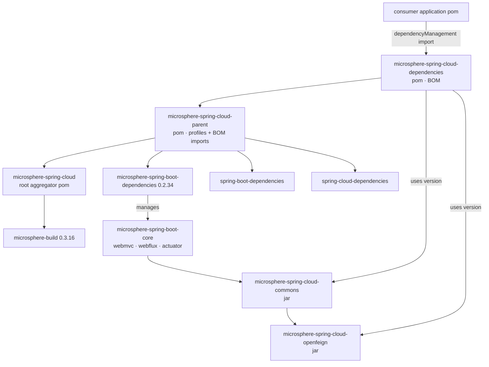
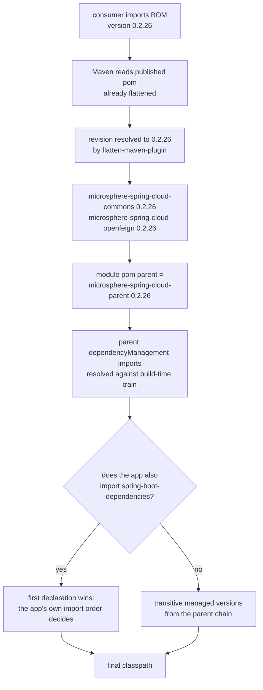

# Developer Guide — `microsphere-spring-cloud-dependencies`

[中文](./zh/dependencies.md) · [1.x line](../1.x/dependencies.md) · [Developer Guide index](../README.md)

> Branch `release` · version line `0.2.x` · latest release `0.2.26`, head `0.2.27-SNAPSHOT` · Java 17 · Spring Boot 3.0.x–4.0.x · Spring Cloud 2022.0.x–2025.1.x.
> Source analysed: `microsphere-spring-cloud-dependencies/pom.xml` in the `release` branch.

Contributor-facing notes on the project BOM: what it pins, what it deliberately does **not** pin,
and how a consumer's version request travels through the POM chain.

---

## 1. Responsibility

`microsphere-spring-cloud-dependencies` (`packaging: pom`) is a **convenience BOM for consumers**.
Its entire `<dependencyManagement>` block manages this project's own artifacts:

| Managed artifact | Version |
|---|---|
| `io.github.microsphere-projects:microsphere-spring-cloud-commons` | `${revision}` |
| `io.github.microsphere-projects:microsphere-spring-cloud-openfeign` | `${revision}` |

Nothing else: no third-party entries, no plugins, no modules of its own besides the parent chain.
Third-party version policy lives in `microsphere-spring-cloud-parent`; this POM only answers
"which build of Microsphere Spring Cloud do these artifacts come from".

Inheritance of the parent is important and slightly surprising: the BOM inherits
`microsphere-spring-cloud-parent`, so a consumer importing **only** this BOM still gets the parent's
`dependencyManagement` imports (`spring-boot-dependencies`, `spring-cloud-dependencies`, …) resolved
against whichever `spring-cloud-*` build profile was active when the BOM was flattened.

---

## 2. Module and resolution graph



---

## 3. Anatomy of the POM

| Element | Value | Why it matters |
|---|---|---|
| `<parent>` | `microsphere-spring-cloud-parent`, `${revision}`, `<relativePath>../microsphere-spring-cloud-parent/pom.xml</relativePath>` | Explicit relative path is mandatory for `${revision}` builds; otherwise Maven looks for `../pom.xml` and fails |
| `<version>` | `${revision}` | CI-friendly; flattened at `process-resources` |
| `<packaging>` | `pom` | No sources, no tests, no `AutoConfiguration.imports` |
| managed entries | 2 | Both are `jar` artifacts of the same reactor |
| `<name>` / `<description>` | `Microsphere :: Spring Cloud :: Dependencies` | Used by the site/javadoc aggregation |

There is no `<properties>` block: every version it needs (`${revision}`, `${spring-boot.version}`, …)
comes from the parent chain, which is exactly the design intent — a single place to change.

---

## 4. Version resolution chain



Key rule to remember when reviewing a dependency bug: **`dependencyManagement` is first-wins, and the
importing POM's own entries always beat entries inherited through imports.** If an application sees an
unexpected Spring Cloud version, the cause is almost always the relative position of the BOM import,
not this file.

---

## 5. BOM vs. parent — division of responsibility

| Question | Answered by |
|---|---|
| "Which version of my `microsphere-spring-cloud-*` dependency?" | **dependencies** BOM |
| "Which Spring Boot / Spring Cloud / Alibaba train?" | **parent** profiles |
| "Which JUnit / Testcontainers version in tests?" | **parent** (`junit-bom`, `testcontainers-bom`) |
| "Which plugins, compiler level, flatten behaviour?" | `microsphere-build` + root `java.version` / `revision` |
| "Which third-party dependencies are optional at runtime?" | each jar module's own `<dependencies>` with `<optional>true</optional>` |

---

## 6. Build behaviour that affects the published BOM

| Plugin / setting | Behaviour |
|---|---|
| `flatten-maven-plugin` 1.7.3, `flattenMode=resolveCiFriendliesOnly` | Only `${revision}`, `${sha1}`, `${changelist}` are resolved; `pomElements` keeps `properties`, expands `parent`, interpolates `dependencyManagement` |
| `updatePomFile=true` | The flattened pom is the installed/deployed artifact — consumers never see `${revision}` |
| Central publishing (`central-publishing-maven-plugin` 0.11.0 under `publish`/`release`) | BOM is deployed as a plain `.pom`, no jar |
| surefire | No tests exist in this module; `mvn test -pl microsphere-spring-cloud-dependencies` is a no-op that still validates the POM model |

---

## 7. Build & verify commands

```bash
# build the BOM together with its parents (needed before other modules resolve it)
./mvnw -N install
./mvnw -pl microsphere-spring-cloud-dependencies -am install

# sanity-check the managed coordinates
./mvnw -pl microsphere-spring-cloud-dependencies help:effective-pom \
    | grep -A2 microsphere-spring-cloud-commons

# prove that a consumer resolves the right versions
./mvnw -f /path/to/consumer/pom.xml dependency:tree -Dincludes=io.github.microsphere-projects

# the flattened pom actually published
cat microsphere-spring-cloud-dependencies/target/.flattened-pom.xml
```

The repository root also keeps a `.flattened-pom.xml` for the aggregator; it is generated output, not
source, and is ignored by Git.

---

## 8. Contributor checklist

**Add a new jar module to the BOM**

1. Create the module and add its `<module>` entry to the root `microsphere-spring-cloud/pom.xml`.
2. Declare `<parent>` = `microsphere-spring-cloud-parent` with `${revision}` + `<relativePath>`.
3. Add one `<dependency>` entry here: `groupId io.github.microsphere-projects`, the new
   `artifactId`, `<version>${revision}</version>` — no `<type>`, no `<scope>`.
4. Keep the list alphabetical-by-artifactId; the block is short and diffs are read often.
5. Do **not** manage third-party artifacts here — that belongs to the parent's import chain.

**Release-line rules**

- Every managed entry must use `${revision}`; hard-coding a version here breaks the release automation
  and produces a BOM that cannot be bumped by the `0.2.x` pipeline.
- The BOM version line (`0.2.x`) is the contract: a consumer on `0.2.26` gets `0.2.26` artifacts, and
  mixing lines (e.g. a `0.1.x` BOM with `0.2.x` artifacts) is unsupported because `commons` swaps
  `javax.servlet` for `jakarta.servlet` and changes `DefaultServiceInstance` copy semantics.

---

## 9. Known caveats

| Caveat | Detail |
|---|---|
| BOM is not a starter | Importing it adds **no** dependencies; the app must declare `microsphere-spring-cloud-commons` / `-openfeign` explicitly |
| BOM does not re-export the Spring Cloud train | Transitive parent imports make versions *available* during this build, but a consumer's own `spring-cloud-dependencies` import may take precedence |
| Optional dependencies are invisible here | Everything except the four `microsphere-spring-boot-*` artifacts and `aspectjweaver` is `<optional>` in `commons`, so an app must add `spring-cloud-commons`, a Boot starter and a registry client itself |
| `2025.1` line | Boot 4.0.x moves some actuator/autoconfigure classes; if the BOM is consumed on that train, verify `FeaturesEndpoint` and `spring-cloud-context` still resolve |

---

## 10. Related documents

- [Developer Guide — `microsphere-spring-cloud-parent`](./parent.md)
- [Developer Guide — `microsphere-spring-cloud-commons`](./commons.md)
- [Developer Guide — `microsphere-spring-cloud-openfeign`](./openfeign.md)
- [User Guide — current](../../user-guide/current/dependencies.md)
