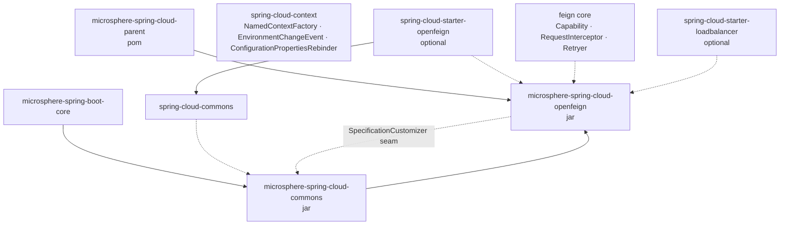
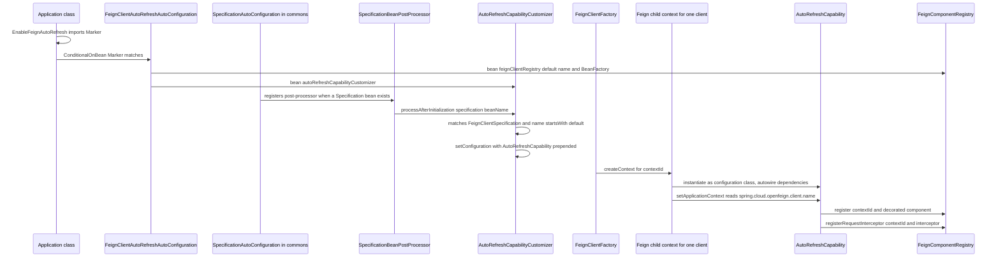
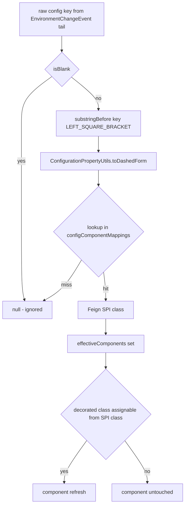
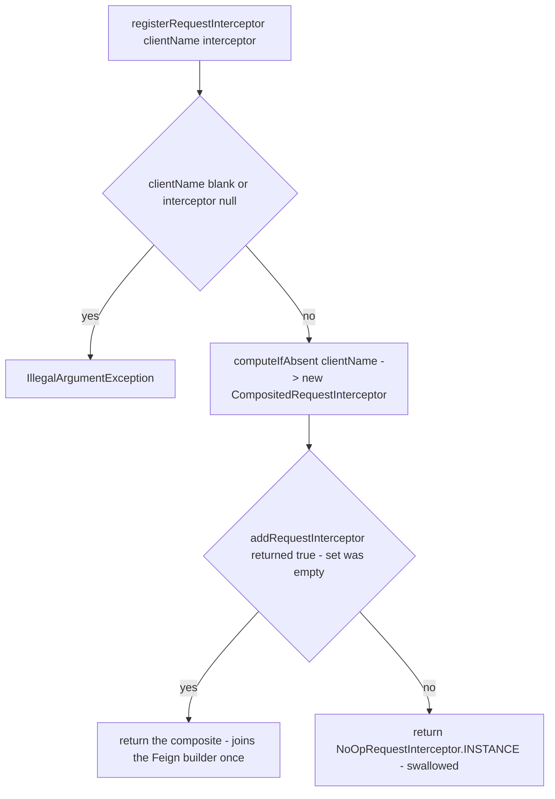
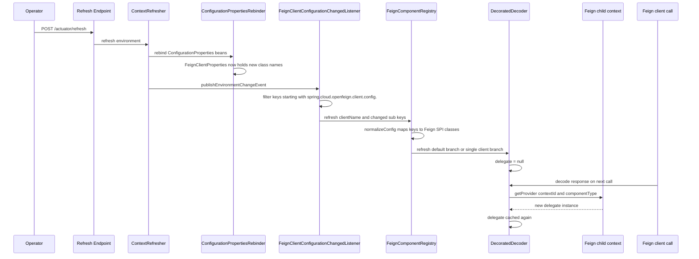

# Developer Guide — `microsphere-spring-cloud-openfeign`

[中文](./zh/openfeign.md) · [1.x line](../1.x/openfeign.md) · [Developer Guide index](../README.md)

> Branch `release` · version line `0.2.x` · latest release `0.2.26`, head `0.2.27-SNAPSHOT` · Java 17 · Spring Boot 3.0.x–4.0.x · Spring Cloud 2022.0.x–2025.1.x · upstream `microsphere-spring-boot` 0.2.34.
> Analysed sources: `microsphere-spring-cloud-openfeign/src/main/java/io/microsphere/spring/cloud/openfeign/**` (21 production classes), `src/main/resources/META-INF/**`, `src/test/java/**` (44 test classes).

Contributor documentation: architecture, source-level behaviour, design patterns, extension points.
Module-level facts shared with `commons` are covered in [commons.md](./commons.md).

---

## 1. Module at a glance

| Aspect | Value |
|---|---|
| Coordinates | `io.github.microsphere-projects:microsphere-spring-cloud-openfeign:${revision}` |
| Packaging | `jar`, parent `microsphere-spring-cloud-parent` |
| Root package | `io.microsphere.spring.cloud.openfeign` |
| Mandatory dependency | `microsphere-spring-cloud-commons` (same reactor, `${revision}`) |
| Optional dependencies | `spring-cloud-starter-openfeign` (ribbon excluded), `spring-cloud-starter-loadbalancer`, the two Boot annotation processors, `microsphere-annotation-processor` |
| Feature | Runtime replacement of Feign components (`Decoder`, `Encoder`, `Retryer`, `Contract`, `ErrorDecoder`, `QueryMapEncoder`, `RequestInterceptor`) after `/actuator/refresh`, with **no client rebuild and no restart** |
| Auto-configurations | 2, in `META-INF/spring/org.springframework.boot.autoconfigure.AutoConfiguration.imports` (`spring.factories` does not exist on this branch) |

### Package map

| Package | Contents |
|---|---|
| `autorefresh` | `EnableFeignAutoRefresh` (+ `Marker`), `AutoRefreshCapability`, `AutoRefreshCapabilityCustomizer`, `FeignComponentRegistry`, `FeignClientConfigurationChangedListener` |
| `components` | `Refreshable`, `DecoratedFeignComponent<T>` + six `Decorated*`, `CompositedRequestInterceptor`, `NoOpRequestInterceptor` |
| `autoconfigure` | `FeignAutoConfiguration`, `FeignClientAutoRefreshAutoConfiguration` |
| `condition` | `ConditionalOnOpenFeignEnabled`, `ConditionalOnOpenFeignAvailable` |
| `constants` | `FeignConstants` |

---

## 2. Module dependency graph



The dotted edge from `openfeign` back into `commons` is the architectural key: the module never touches
Feign's own auto-configuration ordering; it registers a `SpecificationCustomizer` bean and lets
`SpecificationAutoConfiguration` (commons) inject `AutoRefreshCapability` into the Feign child contexts.

---

## 3. Architecture

### 3.1 Three-stage wiring

1. **Enablement** — `@EnableFeignAutoRefresh` imports the empty nested class
   `EnableFeignAutoRefresh.Marker`. The annotation has **no attributes**; the annotation exists only to
   place a bean of type `Marker` in the context so that
   `@ConditionalOnBean(EnableFeignAutoRefresh.Marker.class)` on `FeignClientAutoRefreshAutoConfiguration`
   can match. Global kill switch is the property `microsphere.spring.cloud.openfeign.enabled`
   (`matchIfMissing = true`).
2. **Seeding the specifications** — `FeignAutoConfiguration` contributes a `FeignBuilderCustomizer` that
   registers `NoOpRequestInterceptor.INSTANCE` on every builder; `FeignClientAutoRefreshAutoConfiguration`
   contributes `FeignComponentRegistry` and `AutoRefreshCapabilityCustomizer`.
3. **Per-client decoration** — when Spring Cloud builds a client from a `FeignClientSpecification`, the
   child context instantiates `AutoRefreshCapability` (it was prepended to `configuration()`), and Feign
   calls every `Capability.enrich(...)` overload with the component it is about to use.

### 3.2 STARTUP sequence



Note the ordering constraint expressed by `@AutoConfigureAfter(name = …)`:
`org.springframework.cloud.openfeign.FeignAutoConfiguration` must run first (so `FeignClientProperties`
and the specification beans exist), and
`io.microsphere.spring.cloud.context.named.autoconfigure.SpecificationAutoConfiguration` must run after
the customizer bean is available — hence commons loads before this module's auto-configuration.

### 3.3 Degradation

| Missing artifact / setting | Result |
|---|---|
| `feign.Feign` absent | `@ConditionalOnOpenFeignAvailable` fails → no beans at all |
| `microsphere.spring.cloud.openfeign.enabled=false` | both auto-configurations skipped |
| `feign.Capability` or `FeignClientFactoryBean` absent | `FeignClientAutoRefreshAutoConfiguration` skipped, `FeignAutoConfiguration` may still apply |
| `FeignBuilderCustomizer` absent | `FeignAutoConfiguration` skipped |
| `@EnableFeignAutoRefresh` not used | `Marker` bean missing → auto-refresh inactive; the NoOp interceptor seeding still happens |

---

## 4. Source analysis

### 4.1 `AutoRefreshCapability`

`implements feign.Capability, ApplicationContextAware`; constructor
`(FeignClientProperties, NamedContextFactory<FeignClientSpecification>, FeignComponentRegistry)` — on this
branch the context factory is typed as the generic `NamedContextFactory` rather than the `0.1.x`
concrete `FeignContext`.

`setApplicationContext` resolves the owning client:
`applicationContext.getEnvironment().getProperty("spring.cloud.openfeign.client.name")` → `contextId`.

Every `enrich` follows the same template and returns `null` for `null` input:

```java
DecoratedDecoder decoratedDecoder = instantiate(DecoratedDecoder.class, Decoder.class,
        contextId, contextFactory, clientProperties, decoder);
this.componentRegistry.register(contextId, decoratedDecoder);
return decoratedDecoder;
```

| `enrich` overload | Produced wrapper | Registered as |
|---|---|---|
| `Retryer` | `DecoratedRetryer` | `Refreshable` under `contextId` |
| `Contract` | `DecoratedContract` | `Refreshable` |
| `Decoder` | `DecoratedDecoder` | `Refreshable` |
| `Encoder` | `DecoratedEncoder` | `Refreshable` |
| `ErrorDecoder` | `DecoratedErrorDecoder` | `Refreshable` |
| `QueryMapEncoder` | `DecoratedQueryMapEncoder` | `Refreshable` |
| `RequestInterceptor` | none | `registerRequestInterceptor(...)` → composite or NoOp |
| `InvocationHandlerFactory` | not overridden | tests inject their own via `MockCapability` |

`DecoratedFeignComponent.instantiate` is a reflective factory: `findConstructor(decoratedClass, String.class,
NamedContextFactory.class, FeignClientProperties.class, componentClass)` + `BeanUtils.instantiateClass(...)`.
The wrapper returned by `enrich` is what ends up inside the built client, so the client keeps a
**stable reference to the decorator** while the delegate behind it is swappable.

### 4.2 `DecoratedFeignComponent<T>` — volatile delegate

| Member | Behaviour |
|---|---|
| `protected volatile T delegate` | the only mutable state; visibility guarantees the reset is seen by in-flight request threads |
| `delegate()` | if `delegate == null` → `loadInstance()` then store; otherwise return cached |
| `loadInstance()` | `loadInstanceFromContextFactory(contextId(), componentType())` |
| `loadInstanceFromContextFactory(...)` | `contextFactory.getProvider(contextId, componentType)` → `ObjectProvider.getIfAvailable(() -> instantiateClass(componentType))` — prefer the **current bean** of the per-client context, else instantiate the class directly |
| `refresh()` | `this.delegate = null` (trace-logged) — the reload happens on the *next* call, not during refresh |
| `componentType()` | abstract; each subclass reads the configured class from `FeignClientProperties.FeignClientConfiguration` |
| `get(Function<FeignClientConfiguration, T>)` | **default config first**, then the current client config — inverse of the usual precedence because `…config.default.*` is the shared baseline |
| `equals` / `hashCode` / `toString` | all delegate to `delegate()` |

| Subclass | `componentType()` source | Fallback |
|---|---|---|
| `DecoratedContract` | `FeignClientConfiguration::getContract` | `Contract.class` |
| `DecoratedDecoder` | `::getDecoder` | `Decoder.class` |
| `DecoratedEncoder` | `::getEncoder` | `Encoder.class` |
| `DecoratedErrorDecoder` | `::getErrorDecoder` | `ErrorDecoder.Default.class` |
| `DecoratedRetryer` | `::getRetryer` | `Retryer.class` |
| `DecoratedQueryMapEncoder` | `getQueryMapEncoder` via `MethodHandle`, **current config first**, then default | `PageableSpringQueryMapEncoder.class` |

`DecoratedQueryMapEncoder` is the cross-version defence:

```java
static final MethodHandle getQueryMapEncoderMethodHandle = findVirtual(FeignClientConfiguration.class, "getQueryMapEncoder");
...
if (methodHandle == NOT_FOUND_METHOD_HANDLE) return null;
```

so a Spring Cloud version that does not expose `query-map-encoder` degrades to the fallback instead of
failing at link time. `DecoratedRetryer.continueOrPropagate` delegates through a static null-guard helper
and also overrides `clone()`.

### 4.3 `FeignComponentRegistry` — keys, storage, fan-out

Static `configComponentMappings`: `retryer`→`Retryer`, `error-decoder`→`ErrorDecoder`,
`request-interceptors`→`RequestInterceptor`, `default-request-headers`→`RequestInterceptor`,
`default-query-parameters`→`RequestInterceptor`, `decoder`→`Decoder`, `encoder`→`Encoder`,
`contract`→`Contract`, `query-map-encoder`→`QueryMapEncoder`.



Accepted spellings, all verified by `FeignComponentRegistryTest`: `errorDecoder`, `error-decoder`,
`errorDecoder[0]`, `error-decoder[0]`. A **map sub-key** such as `default-request-headers.app` does not
resolve, because normalisation only removes `[...]` — extend `normalizeConfig` if per-key header refresh
is ever required.

Storage: `Map<String, List<Refreshable>> refreshableComponents` and
`Map<String, CompositedRequestInterceptor> interceptorsMap`, both keyed by client name/contextId,
both `newConcurrentHashMap(32)`. Registration asserts non-blank name, non-empty list, no null elements
(`IllegalArgumentException`).



`refresh(String clientName, Set<String> changedConfigs)` is `synchronized`: it strips the
`clientName + "."` prefix from each key, maps keys to SPI classes, then:

- `clientName.equals(defaultClientName)` → refresh **every** registered component of **every** client whose
  class matches an effective SPI class, plus **all** composites when any `RequestInterceptor` change is present;
- otherwise → only that client's matching components and its own composite.

Matching uses `isComponentPresent(component, effectiveComponents)` → `actualComponent.isAssignableFrom(component.getClass())`,
which is why `DecoratedDecoder` (implementing `feign.codec.Decoder`) is picked up by a `decoder` change.

### 4.4 `CompositedRequestInterceptor` — rebuild on refresh

Holds a `LinkedHashSet<RequestInterceptor>` (insertion-ordered, all mutations inside
`synchronized (this.set)`; `apply` also synchronises so refresh is request-safe). `refresh()` re-resolves
`FeignClientProperties` from the `BeanFactory` (`getOrInstantiate` = `getBeanProvider(...).getIfAvailable(fallback)`)
and rebuilds the set from:

1. `getRequestInterceptors()` classes of the **default** config, then of the **current** config — each
   resolved as a bean when available, otherwise instantiated by class;
2. one lambda applying merged default **headers** (`putIfAbsent`, default first) to keys not already present;
3. one lambda applying merged default **query parameters** with the same guard.

That is how `default-request-headers.*` / `default-query-parameters.*` changes propagate without any client
rebuild — the composite is a single stable object held by the built client.

### 4.5 `AutoRefreshCapabilityCustomizer`

```java
if (specification instanceof FeignClientSpecification && beanName.startsWith("default.")) {
    injectAutoRefreshCapability((FeignClientSpecification) specification);
}
...
specification.setConfiguration(combine(AUTO_REFRESH_CAPABILITY_CLASS, originConfigurationClasses));
```

Only the specifications registered under `default.`-prefixed bean names are touched — the shared default
configuration — and the capability class is **prepended** (`combine` puts it first), so it is created
before user configuration classes and its `enrich` calls see the originals. Because `AutoRefreshCapability`
captures its own `contextId` inside each child context, one injection covers every client. On this branch
the check and the setter are direct (`instanceof` + `setConfiguration`); `0.1.x` used class-name resolution
and reflective `setConfiguration` to avoid a compile-time dependency on `FeignClientSpecification`.

### 4.6 `FeignClientConfigurationChangedListener`

`implements ApplicationListener<org.springframework.cloud.context.environment.EnvironmentChangeEvent>`
with `private final String PREFIX = "spring.cloud.openfeign.client.config.";`.
`resolveChangedClient` filters by prefix, removes it, and groups by the first remaining dot-segment, so
`…config.my-client.decoder` → `{"my-client" → {"my-client.decoder"}}` — the values keep the client prefix,
which is exactly what `FeignComponentRegistry.refresh` strips again. Non-matching keys are ignored, so
refreshing unrelated properties costs nothing.

The listener is **not a bean**. `FeignClientAutoRefreshAutoConfiguration` registers it manually:

```java
@EventListener(ApplicationReadyEvent.class)
public void onApplicationReadyEvent(ApplicationReadyEvent event) {
    /** Make sure the FeignClientConfigurationChangedListener is registered after the ConfigurationPropertiesRebinder */
    registerFeignClientConfigurationChangedListener(event);
}
```

Rationale: `ConfigurationPropertiesRebinder` is itself an `EnvironmentChangeEvent` listener that rebinds
`@ConfigurationProperties` beans — including `FeignClientProperties`. Listener registration order in Spring
is invocation order, so subscribing only at `ApplicationReadyEvent` guarantees that when this listener runs,
`FeignClientProperties.getConfig()` already contains the new values. Registering it earlier (e.g. as a bean
or via `@Bean` of type `ApplicationListener`) would let it observe an environment that has changed but whose
bound properties have not — `componentType()` would then read stale class names and the refresh would be a
no-op until the next change.

### 4.7 `NoOpRequestInterceptor`

`public static final NoOpRequestInterceptor INSTANCE`, empty `apply(RequestTemplate)`. Two roles: the seed
interceptor added by `FeignAutoConfiguration.addDefaultRequestInterceptorCustomizer()` (guaranteeing the
capability pipeline always sees at least one interceptor) and the "swallow" return value for the
2nd…n-th interceptor so the composite is added to the builder exactly once per client.

---

## 5. Runtime refresh flow



The whole design hinges on the two-step: *invalidate eagerly, resolve lazily*. Refresh never touches the
live client object graph; the next invocation pays the lookup cost once.

---

## 6. Design patterns

| Pattern | Classes | Notes |
|---|---|---|
| **Decorator** | `DecoratedFeignComponent<T>` + `Decorated{Contract,Decoder,Encoder,ErrorDecoder,Retryer,QueryMapEncoder}` | Keeps Feign SPI identity, swaps implementation |
| **Composite** | `CompositedRequestInterceptor` | One `RequestInterceptor` presenting N, rebuilt on refresh |
| **Null Object** | `NoOpRequestInterceptor.INSTANCE` | Neutral interceptor used for seeding and de-duplication |
| **Registry** | `FeignComponentRegistry` | Client-name-keyed registry of `Refreshable`s plus composite lookup |
| **Observer** | `FeignClientConfigurationChangedListener` on `EnvironmentChangeEvent` | Prefix-filtered, non-bean listener |
| **Template Method** | `DecoratedFeignComponent` (`delegate()` / `loadInstance()` fixed, `componentType()` abstract) | Subclasses only declare where the class name comes from |
| **Strategy** | `AutoRefreshCapabilityCustomizer implements SpecificationCustomizer` | Pluggable per-specification mutation |
| **Factory Method** | `DecoratedFeignComponent.instantiate(...)` reflective constructor lookup | |
| **Marker-class gating** | `EnableFeignAutoRefresh.Marker` + `@ConditionalOnBean` | Annotation without attributes, opt-in semantics |
| **Post-Processor** | `SpecificationBeanPostProcessor` (commons) driving the customizer | |
| **Proxy / interception for tests** | `MockCapability` + `ObservableFeignInvocationHandler` | Reflectively reaches `ResponseHandler` to assert live delegates |

---

## 7. Configuration reference

| Property | Default | Effect |
|---|---|---|
| `microsphere.spring.cloud.openfeign.enabled` | `true` (`matchIfMissing`) | Master switch for both auto-configurations |
| `spring.cloud.openfeign.client.config.<client>.{decoder,encoder,retryer,contract,error-decoder,query-map-encoder}` | — | The values are class names; a change triggers delegate replacement |
| `spring.cloud.openfeign.client.config.<client>.request-interceptors[n]` | — | Rebuilds the composite interceptor list |
| `spring.cloud.openfeign.client.config.<client>.default-request-headers.<k>` / `default-query-parameters.<k>` | — | Rebuild on any interceptor-type change; per-key names do not match `normalizeConfig` |
| `spring.cloud.openfeign.client.name` | set by Spring Cloud per child context | Read by `AutoRefreshCapability.setApplicationContext` to obtain `contextId` |
| `@EnableFeignAutoRefresh` | absent = feature off | Registers `Marker`; no attributes |

Refresh trigger is `EnvironmentChangeEvent`, normally published by `/actuator/refresh`; a bare
`RefreshEvent` is not enough for this module's listener (the tests publish both explicitly).

---

## 8. Build & test guidance

```bash
# reactor with commons
./mvnw -pl microsphere-spring-cloud-openfeign -am clean test

# another release train
./mvnw -pl microsphere-spring-cloud-openfeign -am -P spring-cloud-2022 test
./mvnw -pl microsphere-spring-cloud-openfeign -am -P "spring-cloud-2025.1" test

# a single refresh scenario
./mvnw -pl microsphere-spring-cloud-openfeign test -Dtest=DecoderChangedTest
```

### 8.1 The observable-invocation test pattern

The module's tests prove refresh behaviour without mocking the HTTP layer:

1. `BaseTest<T>` (`@EnableFeignClients(clients = BaseClient.class)`, `@EnableFeignAutoRefresh`,
   `@ComponentScan`, `@TestPropertySource` seeding `spring.cloud.openfeign.client.config.default.*` with
   `ADecoder`, `AEncoder`, `ARetry`, `AErrorDecoder`, `AQueryMapEncoder`,
   `ARequestInterceptor`, `default-request-headers.app=my-app`, `default-query-parameters.sign=my-sign`).
2. `BaseClient` is `@FeignClient(contextId = "my-client", name = "my-client", configuration = {MockCapability.class})`.
   `MockCapability implements Capability` replaces only `InvocationHandlerFactory` with
   `ObservableFeignInvocationHandler::new`.
3. `ObservableFeignInvocationHandler.invoke(...)` reflects into the Feign `MethodHandler`
   (`methodHandlerConfiguration`, guarded by `isPresent("feign.MethodHandlerConfiguration", …)` for
   cross-version tolerance, then `responseHandler`), and asks the static
   `FeignComponentAssert` to verify the live delegate class before dispatching — an assertion **inside the
   call path**, so a stale delegate fails the test rather than silently passing.
4. `replaceConfig()` adds a `MapPropertySource("after", …)` first in the environment, publishes `RefreshEvent`
   then `EnvironmentChangeEvent(Set.of(key))`, and the next call must observe the new implementation class.
   No restart, no client rebuild.

Component families under test: `decoder`, `encoder`, `errordecoder`, `querymapencoder`, `retryer`,
`requestInterceptor` — each with `A*`/`B*` implementations, a `*ComponentAssert` and a `*ChangedTest`.
Custom Feign components do **not** need to be Spring beans: a public class with a default constructor
implementing the Feign SPI is enough, because `loadInstanceFromContextFactory` falls back to
`instantiateClass(componentType)`.

### 8.2 Auto-configuration tests

`FeignAutoConfigurationTest` and `FeignClientAutoRefreshAutoConfigurationTest` extend
`AutoConfigurationTest<A>` from `microsphere-spring-boot-test` and override the three hooks
(`configureAutoConfiguredClasses`, `configureGlobalDisabledPropertyValues` with
`microsphere.spring.cloud.openfeign.enabled=false`, `configureGlobalMissingClasses` with `Feign.class`,
`Capability.class`, `FeignClientFactoryBean.class`). The second one boots with
`classes = {EnableFeignAutoRefresh.Marker.class, …}` — proving `Marker` presence is the activation gate.
`AutoRefreshCapabilityTest` asserts every `enrich` overload returns `null` for `null`, and
`AutoRefreshCapabilityCustomizerTest` asserts the prepending behaviour of `injectAutoRefreshCapability`.

### 8.3 Style constraints

Compiled with `java.version=17`, written in Java 8 style: no records, `var`, sealed types, text blocks or
pattern-matching `instanceof`; **no** `javax.*` and no `jakarta.*` imports at all. Cross-version tolerance is
achieved through class-name conditions, `MethodHandle` lookups, and reflective field reads — keep that
approach when touching code, and prefer adding a `MethodHandle` guard over a direct call to a
Spring Cloud API that has moved between `2022.0.x` and `2025.1.x`.

---

## 9. Extension points

| Seam | Usage |
|---|---|
| `SpecificationCustomizer` | Contribute another customizer bean to alter every `FeignClientSpecification`; ordered, executed by commons' `SpecificationBeanPostProcessor` |
| `Refreshable` | Any component registered in `FeignComponentRegistry` receives `refresh()`; implement it for custom per-client state |
| `feign.Capability` | Add a bean inside a `FeignClientSpecification` configuration array to participate in `enrich` — the same hook `AutoRefreshCapability` uses; tests demonstrate it with `MockCapability` |
| New refreshable Feign component | Register the dashed config key → SPI class pair in `FeignComponentRegistry.configComponentMappings`, add a `Decorated*` subclass with the `(String, NamedContextFactory, FeignClientProperties, T)` constructor, and an `enrich` overload |
| Feature catalogue | `META-INF/config/default/features.yaml` already lists `FeignComponentRegistry` and `AutoRefreshCapability` plus the `spring-cloud-openfeign-core` classes — extend it when adding user-visible features |

---

## 10. Caveats

| Caveat | Detail |
|---|---|
| Prefix coupling | `FeignClientConfigurationChangedListener` keeps the client prefix inside the grouped value and `FeignComponentRegistry.refresh` strips it again; changing one side alone breaks the mapping |
| `hasInterceptor` uses `=` not `|=` | In the loop over `changedConfigs`, the flag reflects the last iterated key; multi-key events containing an interceptor change are therefore iteration-order dependent — worth fixing with tests first |
| Default-config refresh is global | A `…config.default.decoder` change refreshes every client's matching component, which is intentional but easy to forget in benchmarks |
| Only `spring.cloud.openfeign.client.config.` triggers refresh | Custom configuration namespaces need their own listener |
| Delegate reload is lazy | Between `refresh()` and the next invocation, the old delegate is still in use; in-flight requests complete against the previous implementation |
| `InvocationHandlerFactory` is not enriched | Feign's handler factory cannot be hot-swapped by this module |

---

## 11. Related documents

- [Developer Guide — `microsphere-spring-cloud-commons`](./commons.md) — `SpecificationCustomizer` / `SpecificationBeanPostProcessor`
- [Developer Guide — parent](./parent.md) · [Developer Guide — dependencies](./dependencies.md)
- [User Guide — openfeign](../../user-guide/current/openfeign.md)
