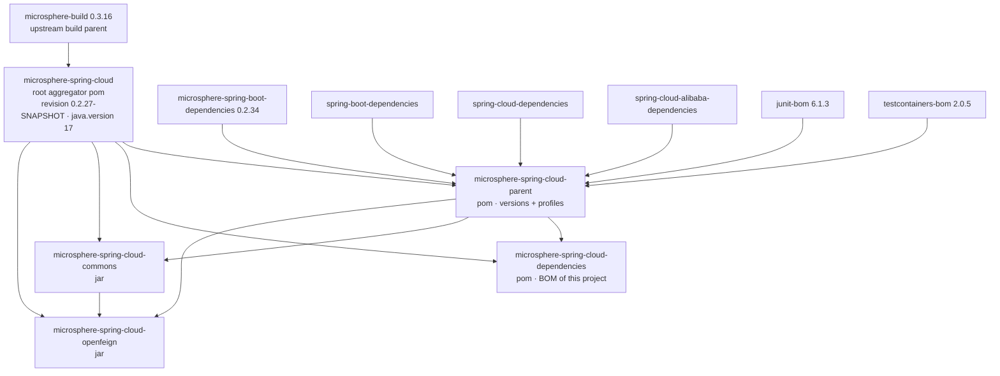
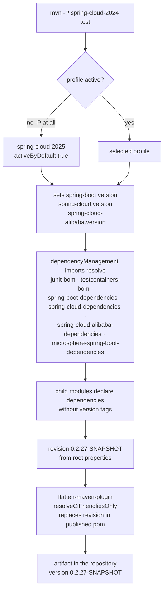

# Developer Guide — `microsphere-spring-cloud-parent`

[中文](./zh/parent.md) · [1.x line](../1.x/parent.md) · [Developer Guide index](../README.md)

> Branch `release` · version line `0.2.x` · latest release `0.2.26`, head `0.2.27-SNAPSHOT` · Java 17 · Spring Boot 3.0.x–4.0.x · Spring Cloud 2022.0.x–2025.1.x.
> Source analysed: `microsphere-spring-cloud-parent/pom.xml` in the `release` branch.

This document is for **contributors**. It explains what the parent POM is responsible for, how the
build layering is organised, and how a change in this POM ripples through every other module.

---

## 1. Responsibility

`microsphere-spring-cloud-parent` (`packaging: pom`) is the **build policy layer** of the project.
It owns exactly three things:

| Concern | Where it is expressed |
|---|---|
| Central version properties for BOMs that are *not* Spring Boot / Spring Cloud | `<properties>` — `microsphere-spring-boot.version`, `testcontainers.version`, `junit-jupiter.version` |
| The **BOM import chain** that supplies dependency versions to all modules | `<dependencyManagement>` — six `scope: import` entries |
| The **Spring Cloud release-train matrix** and the test-infrastructure switches | `<profiles>` — `spring-cloud-2022` … `spring-cloud-2025.1` + `testcontainers` |

It does **not** manage this project's own artifacts (that is `microsphere-spring-cloud-dependencies`),
and it does **not** configure plugins (that is the upstream build parent `microsphere-build`).

---

## 2. Build layering



Inheritance vs. import — both matter and are often confused:

| Relationship | Mechanism | Consequence |
|---|---|---|
| `microsphere-build` → root → `parent`/`commons`/`openfeign`/`dependencies` | Maven `<parent>` | Plugin management, `flatten`, checkstyle, enforcer, publishing profile behaviour |
| `parent` → BOM imports | `<dependencyManagement>` `scope: import` | Provides `${spring-boot.version}`-style coordinates to child modules |
| Consumer app → `dependencies` | `<dependencyManagement>` `scope: import` in the app | Only this project's own artifacts get pinned |

All four reactor modules declare `<version>${revision}</version>` and reference the parent with an
explicit `<relativePath>` (`../pom.xml` or `../microsphere-spring-cloud-parent/pom.xml`) — required
because the reactor version is a CI-friendly property, not a literal.

---

## 3. Version properties owned by the parent

| Property | Value on `release` | Effect |
|---|---|---|
| `microsphere-spring-boot.version` | `0.2.34` | Pins the upstream Microsphere Spring Cloud–agnostic layer (`microsphere-spring-boot-core/-webmvc/-webflux/-actuator/-test`) |
| `testcontainers.version` | `2.0.5` | `org.testcontainers:testcontainers-bom` import — used by the integration tests in `commons` |
| `junit-jupiter.version` | `6.1.3` | `org.junit:junit-bom` import |
| `spring-boot.version` | *profile-driven* | `3.0.13` / `3.3.13` / `3.4.13` / `3.5.15` / `4.0.8` |
| `spring-cloud.version` | *profile-driven* | `2022.0.5` / `2023.0.6` / `2024.0.3` / `2025.0.3` / `2025.1.3` |
| `spring-cloud-alibaba.version` | *profile-driven* | `2022.0.0.2` / `2023.0.3.4` / `2023.0.3.4` / `2025.0.0.0` / `2025.1.0.0` |

`${revision}` and `${java.version}` are **not** defined here — they live in the root aggregator POM
(`0.2.27-SNAPSHOT`, `17`) so that a single commit line drives both the reactor and the compiler.

---

## 4. Profile-driven version resolution



| Profile | Spring Boot | Spring Cloud | Spring Cloud Alibaba | Notes |
|---|---|---|---|---|
| `spring-cloud-2022` | 3.0.13 | 2022.0.5 | 2022.0.0.2 | Lower bound of the `0.2.x` compatibility range |
| `spring-cloud-2023` | 3.3.13 | 2023.0.6 | 2023.0.3.4 | |
| `spring-cloud-2024` | 3.4.13 | 2024.0.3 | 2023.0.3.4 | Alibaba train intentionally reused |
| `spring-cloud-2025` | 3.5.15 | 2025.0.3 | 2025.0.0.0 | `<activeByDefault>true</activeByDefault>` |
| `spring-cloud-2025.1` | 4.0.8 | 2025.1.3 | 2025.1.0.0 | Spring Boot 4 / Jakarta EE 11 line |
| `testcontainers` | — | — | — | Adds `testcontainers.enabled=true` as a surefire **system property**; the JUnit 5 tests are gated on it |

The `spring-cloud-2025.1` id contains a dot, which is legal in Maven but must be quoted in shell
commands: `mvn -P "spring-cloud-2025.1" test`.

Note on `activeByDefault`: it is deactivated as soon as **any** other profile in the same POM is
activated explicitly, so `mvn -P spring-cloud-2022 test` silently drops the default `2025` train.

---

## 5. The import chain and its ordering rule

Maven resolves `dependencyManagement` **first declaration wins** across imports. The parent's order is:

1. `org.junit:junit-bom`
2. `org.testcontainers:testcontainers-bom`
3. `org.springframework.boot:spring-boot-dependencies`
4. `org.springframework.cloud:spring-cloud-dependencies`
5. `com.alibaba.cloud:spring-cloud-alibaba-dependencies`
6. `io.github.microsphere-projects:microsphere-spring-boot-dependencies`

Practical consequences for contributors:

- A version conflict between Spring Boot and Spring Cloud is settled in favour of **Spring Boot**,
  because it is imported earlier. To override a managed version, redefine the property
  (e.g. `-Dspring-boot.version=…`) rather than adding a dependency entry after the imports.
- `microsphere-spring-boot-dependencies` is last: it can manage Microsphere-specific artifacts, but
  it can no longer re-pin anything already managed by Boot/Cloud.
- Adding a new import **above** `spring-boot-dependencies` changes the resolution of every module —
  review the full reactor, not just one module.

---

## 6. What is inherited from `microsphere-build` 0.3.16

The parent does not declare `<build>` at all; everything comes from the upstream POM:

| Concern | Provision in `microsphere-build` 0.3.16 |
|---|---|
| Compiler | `maven-compiler-plugin` 3.16.0, `source`/`target` = `${java.version}` (17 via the root POM), `<parameters>true</parameters>` |
| CI-friendly versioning | `flatten-maven-plugin` 1.7.3, `flattenMode=resolveCiFriendliesOnly`, `updatePomFile=true`, bound to `process-resources` |
| Test execution | surefire 3.6.0 includes `**/*Test.java`, `**/*Tests.java`, excludes `**/Abstract*.java`; `argLine = @{jacoco.argLine} ${jvm.argLine}` |
| Coverage | `jacoco-maven-plugin` 0.8.15 under the `coverage` profile |
| Style | `maven-checkstyle-plugin` 3.6.0 with checkstyle 14.1.0 under the `test` profile, `<skip>${disable.checks}</skip>` where `disable.checks` defaults to `true` |
| Enforcer | `bannedDependencies` (transitive) and `banDuplicatePomDependencyVersions` |
| Releases | `release`/`publish` profiles attach javadoc, sources, GPG signing and `central-publishing-maven-plugin` 0.11.0 (`publishingServerId=ossrh`, `autoPublish=true`) |
| Metadata | `git-commit-id-plugin` writes a filtered `git.properties` into the jar |

Resources are filtered with delimiter `@` and `src/main/java` is included as a resource directory for
`**/*.properties` / `**/*.xml` — that is why non-Java files placed next to sources still ship.

---

## 7. Build & test commands

```bash
# default train (spring-cloud-2025), full reactor, skip install
./mvnw clean verify

# a specific release train
./mvnw -P spring-cloud-2022 clean test
./mvnw -P "spring-cloud-2025.1" clean test

# what CI runs (GitHub Actions "Maven Build", matrix java 17 / 21 / 25)
mvn --batch-mode --update-snapshots --file pom.xml \
    -Drevision=0.0.1-SNAPSHOT \
    -Dsurefire.useSystemClassLoader=false \
    test --activate-profiles test,coverage,testcontainers,spring-cloud-2025

# enable checkstyle explicitly (it is skipped by default)
./mvnw -P test -Ddisable.checks=false validate

# inspect the resolved version chain
./mvnw -P spring-cloud-2024 help:evaluate -Dexpression=spring-cloud.version -q -DforceStdout
./mvnw dependency:tree -pl microsphere-spring-cloud-commons
```

`-Drevision=0.0.1-SNAPSHOT` in CI is deliberate: it keeps snapshot publishing independent of the
release line while still exercising the `${revision}` flattening path.

---

## 8. Contributor checklists

**Add a new Spring Cloud release train**

1. Add a `<profile>` in `microsphere-spring-cloud-parent/pom.xml` with the three properties
   (`spring-boot.version`, `spring-cloud.version`, `spring-cloud-alibaba.version`).
2. Run `./mvnw -P <new-profile> clean test` on the whole reactor.
3. Add the id to the `maven-profile-spring-cloud` matrix in `.github/workflows/maven-build.yml`.
4. If the train moves to a new Boot major, re-check the `javax`→`jakarta` boundary and any renamed
   `ServerProperties` accessor used by `TomcatDynamicConfigurationListener`.

**Bump the upstream layer**

Change `microsphere-spring-boot.version` only. Modules never pin Microsphere artifacts individually —
they rely on `microsphere-spring-boot-dependencies` for versions and use `<optional>`/compile scopes.

**Release**

`revision` is bumped by the release automation on `release` (e.g. `0.2.26` published, head becomes
`0.2.27-SNAPSHOT`); no per-module versions exist, so there is nothing else to edit.

---

## 9. Design notes and known traps

| Note | Detail |
|---|---|
| Profiles are **build-time only** | `flattenMode=resolveCiFriendliesOnly` does not embed profile dependencies (`embedBuildProfileDependencies=false`), so a published POM still resolves versions through the parent chain. Consumers must pick the same Spring Cloud train at build time. |
| No plugin block in this POM | Deliberate: build policy belongs upstream. Adding plugins here forks behaviour from the rest of the Microsphere family. |
| `2024` reuses the Alibaba `2023.0.3.4` train | Intentional, matching Alibaba's own compatibility statement; do not "fix" it without verifying the Nacos artifacts resolve. |
| `testcontainers` profile only sets a switch | Tests are gated with `@EnabledIfSystemProperty(named = "testcontainers.enabled", matches = "true")`; the profile does not add dependencies — those are declared per module. |

---

## 10. Related documents

- [Developer Guide — `microsphere-spring-cloud-dependencies`](./dependencies.md)
- [Developer Guide — `microsphere-spring-cloud-commons`](./commons.md)
- [Developer Guide — `microsphere-spring-cloud-openfeign`](./openfeign.md)
- [User Guide — current](../../user-guide/current/parent.md)
