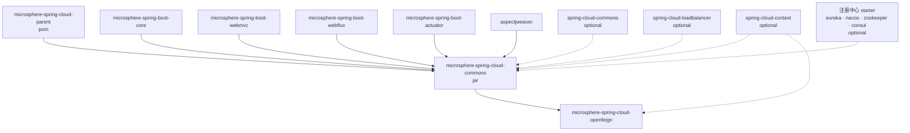
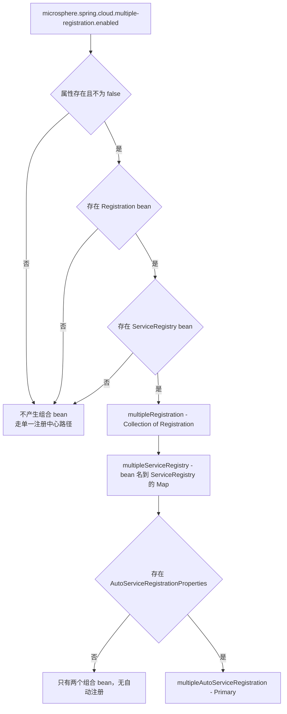
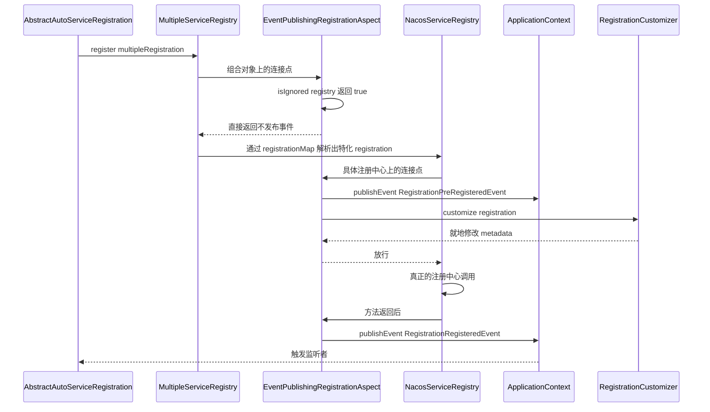
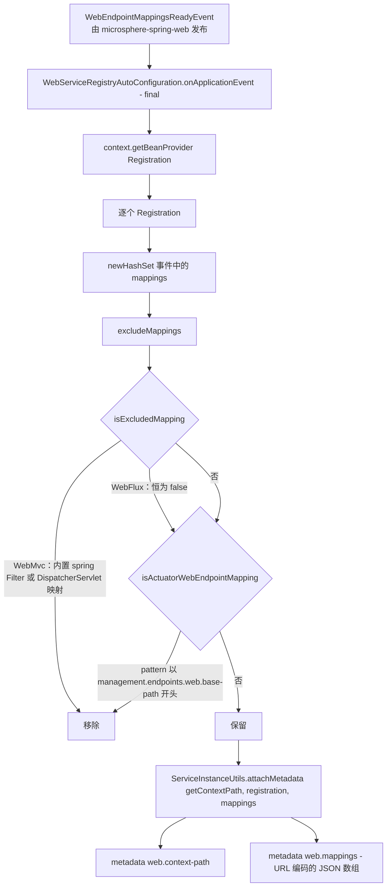
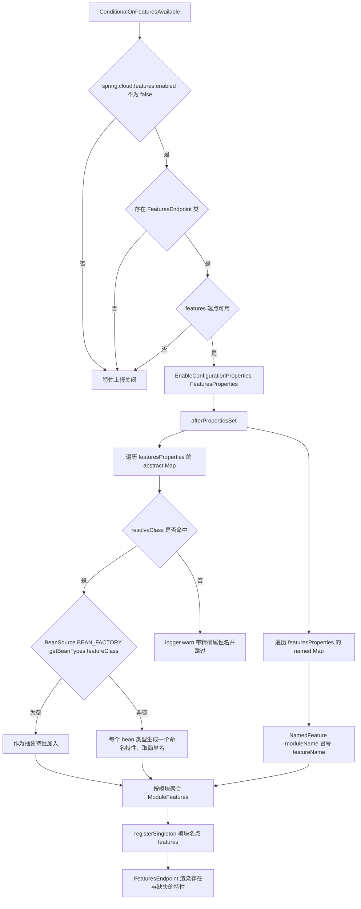

# 开发者文档 — `microsphere-spring-cloud-commons`

[English](../commons.md) · [1.x 版本线](../../1.x/zh/commons.md) · [开发者文档首页](../../README.md)

> 分支 `release` · 版本线 `0.2.x` · 最新发布版本 `0.2.26`，当前 HEAD `0.2.27-SNAPSHOT` · Java 17 · Spring Boot 3.0.x–4.0.x · Spring Cloud 2022.0.x–2025.1.x · 上游 `microsphere-spring-boot` 0.2.34。
> 分析源码：`microsphere-spring-cloud-commons/src/main/java/io/microsphere/spring/cloud/**`（58 个生产类）、`src/main/resources/META-INF/**`、`src/test/java/**`（52 个测试类）。

面向贡献者：构建分层见 [parent](./parent.md) / [dependencies](./dependencies.md)；本文覆盖 `commons` jar 的
架构设计、源码级行为、设计模式与扩展点。

---

## 1. 模块概览

| 维度 | 取值 |
|---|---|
| 坐标 | `io.github.microsphere-projects:microsphere-spring-cloud-commons:${revision}` |
| 打包 | `jar`，parent 为 `microsphere-spring-cloud-parent` |
| 根包 | `io.microsphere.spring.cloud` |
| 注册的自动配置 | 10 个，位于 `META-INF/spring/org.springframework.boot.autoconfigure.AutoConfiguration.imports` |
| compile 作用域（非可选）依赖 | `microsphere-spring-boot-core`、`-webmvc`、`-webflux`、`-actuator`、`org.aspectj:aspectjweaver` |
| 可选依赖 | `spring-cloud-commons`、`spring-cloud-context`、`spring-cloud-loadbalancer`、eureka client、Nacos/Zookeeper/Consul discovery starter、Boot web/actuator starter |
| 仅测试 | `junit-jupiter`、`spring-boot-starter-test`、`microsphere-spring-boot-test`、`testcontainers-junit-jupiter` |

### 包结构

| 包（`io.microsphere.spring.cloud` 之下） | 职责 |
|---|---|
| `client.actuator` | 特性目录 → `HasFeatures` 单例，`/actuator/features` 集成 |
| `client.condition` | `@ConditionalOnFeaturesEnabled` / `@ConditionalOnFeaturesAvailable` |
| `client.discovery` | `UnionDiscoveryClient`、`ReactiveDiscoveryClientAdapter`、`DiscoveryUtils` |
| `client.event` | `ServiceInstancesChangedEvent` |
| `client.service.registry` | 注册模型：`Multiple*`、`Simple*`、`InMemoryServiceRegistry`、`RegistrationMetaData`、事件、切面、端点 |
| `client.service.util` | `ServiceInstanceUtils` — 元数据编解码、URI 构造 |
| `commons.condition` · `commons.constants` | `@ConditionalOnUtilEnabled`、属性名常量 |
| `context.named` | `SpecificationCustomizer` + `SpecificationBeanPostProcessor`（供 `openfeign` 使用的扩展缝） |
| `fault.tolerance` | 加权轮询原语 + Tomcat 动态重配置 |
| `loadbalancer.condition` | `@ConditionalOnLoadBalancerEnabled` |

---

## 2. 模块依赖图



强制边（`compile`）提供 Microsphere 抽象——`io.microsphere.logging.Logger`、`io.microsphere.json.JSONObject`、
`io.microsphere.util.Configurer`、`WebEndpointMapping`、`GenericBeanPostProcessorAdapter`。可选边在运行期由
类条件守卫，这正是本模块的核心降级策略。

---

## 3. 架构

### 3.1 Spring Boot 3 上的自动配置流水线

注册方式是**基于 imports 文件**。`META-INF/spring.factories` 仅作为 `SpringFactoriesLoader` 数据文件保留
（见 §5.2）；它不再注册自动配置——那是 `0.1.x` 版本线（面向 Boot 2.3–2.6）的机制。

```
spring.factories (auto-configuration list)      -> 本分支已移除
META-INF/spring/...AutoConfiguration.imports    -> 权威来源，10 行
```

注册集合，按文件顺序：

```
SpecificationAutoConfiguration
DiscoveryClientAutoConfiguration
ReactiveDiscoveryClientAutoConfiguration
ServiceRegistryAutoConfiguration
WebMvcServiceRegistryAutoConfiguration
WebFluxServiceRegistryAutoConfiguration
SimpleAutoServiceRegistrationAutoConfiguration
ServiceRegistrationEndpointAutoConfiguration
TomcatFaultToleranceAutoConfiguration
ConfigurationPropertyHasFeaturesAutoConfiguration
```

文件顺序**不是**求值顺序。Boot 依据 `@AutoConfigureBefore` / `@AutoConfigureAfter` 排序，而本模块刻意使用
*类名字符串*形式表达顺序，从而在可选 artifact 缺失时不会抛出 `ClassNotFoundException`：

| 自动配置 | Before | After |
|---|---|---|
| `DiscoveryClientAutoConfiguration` | `o.s.c.client.CommonsClientAutoConfiguration` | — |
| `ReactiveDiscoveryClientAutoConfiguration` | `o.s.c.client.ReactiveCommonsClientAutoConfiguration` | `SimpleReactiveDiscoveryClientAutoConfiguration`、`ReactiveCompositeDiscoveryClientAutoConfiguration` |
| `SpecificationAutoConfiguration` | — | `LoadBalancerAutoConfiguration`、`o.s.c.openfeign.FeignAutoConfiguration` |
| `WebMvc/WebFluxServiceRegistryAutoConfiguration` | — | `ServiceRegistryAutoConfiguration`、`SimpleAutoServiceRegistrationAutoConfiguration`、`io.microsphere.spring.boot.webmvc.autoconfigure.WebMvcAutoConfiguration`（WebFlux 对应 `webflux…WebFluxAutoConfiguration`） |
| `SimpleAutoServiceRegistrationAutoConfiguration` | `AutoServiceRegistrationAutoConfiguration` | `UtilAutoConfiguration`、`AutoServiceRegistrationConfiguration`、`SimpleDiscoveryClientAutoConfiguration` |
| `ServiceRegistrationEndpointAutoConfiguration` | — | 按名称列出的五个厂商注册中心自动配置（Spring Cloud `ServiceRegistryAutoConfiguration`、Zookeeper、Consul、Kubernetes、Nacos） |
| `TomcatFaultToleranceAutoConfiguration` | — | `TomcatWebServer`、`EmbeddedWebServerFactoryCustomizerAutoConfiguration`、`ConfigurationPropertiesRebinderAutoConfiguration` |
| `ConfigurationPropertyHasFeaturesAutoConfiguration` | `CommonsClientAutoConfiguration` | — |
| `FeignClientAutoRefreshAutoConfiguration`（openfeign 模块） | — | `SpecificationAutoConfiguration` — 这就是 commons 必须先加载的原因 |

### 3.2 可选依赖降级

两条相互配合的惯用法：

1. **只按类名做条件。** `@ConditionalOnClass(name = …)` 配合来自 `DiscoveryClientConstants`、
   `ServiceRegistryConstants`、`FeaturesConstants` 的字符串常量（如 `REGISTRATION_CLASS_NAME`、
   `FEATURES_ENDPOINT_CLASS_NAME`）。注册中心客户端缺失时，整块功能静默关闭。
2. **组合元注解。** `@ConditionalOnAutoServiceRegistrationAvailable` = 类存在 +
   `@ConditionalOnBean(type = REGISTRATION_CLASS_NAME)` + `@ConditionalOnAutoServiceRegistrationEnabled`。
   这就是 `WebMvcServiceRegistryAutoConfiguration` 在没有 `Registration` bean 的应用中拒绝加载的原因。

`ConditionalOnMultipleRegistrationEnabled` 与 `SimpleAutoServiceRegistrationAutoConfiguration` 中的
`@ConditionalOnProperty` 刻意省略了 `matchIfMissing`，使这两个特性**默认关闭、按需开启**；
Tomcat 监听器与 `features` 端点则是默认开启（`matchIfMissing = true`）。

### 3.3 上游 `microsphere-spring-boot` 层

| 上游提供 | 本模块的消费点 |
|---|---|
| 以最低优先级加载 `META-INF/config/default/*` 的默认属性机制（`DefaultPropertiesApplicationListener`、`SpringApplicationDefaultPropertiesPostProcessor`） | `endpoints.properties`、`features.yaml` |
| `ConditionalOnWebMvcAvailable`、`ConditionalOnWebFluxAvailable`、`ConditionalOnActuatorEndpointPresent` | Web 注册相关自动配置、`ServiceRegistrationEndpointAutoConfiguration` |
| `WebEndpointMapping`、`WebEndpointMappingsReadyEvent`（`microsphere-spring-web`） | `WebServiceRegistryAutoConfiguration`、`ServiceInstanceUtils` |
| `GenericBeanPostProcessorAdapter`、`BeanUtils.getSortedBeans`、`ValueHolder`、`Configurer`、`Assert`、`Logger`、`JSONObject` | `SpecificationBeanPostProcessor`、`UnionDiscoveryClient`、`TomcatDynamicConfigurationListener` 等 |
| `io.microsphere.annotation.ConfigurationProperty` + `microsphere-annotation-processor` | 为每个属性常量生成编译期配置元数据 |
| `microsphere-spring-boot-test`（`AutoConfigurationTest`、`WebAutoConfigurationTest`、`ReactiveWebAutoConfigurationTest`） | 全部自动配置测试 |

---

## 4. 源码解析 — 服务注册

### 4.1 `ServiceRegistryAutoConfiguration`

```java
@Configuration(proxyBeanMethods = false)
@ConditionalOnAutoServiceRegistrationEnabled
@ConditionalOnClass(name = {"org.aspectj.lang.annotation.Aspect", REGISTRATION_CLASS_NAME})
@Import({EventPublishingRegistrationAspect.class, ServiceRegistryAutoConfiguration.MultipleConfiguration.class})
```

两项彼此独立的职责：(a) 始终安装事件发布切面；(b) 通过包级私有嵌套类 `MultipleConfiguration` 条件安装组合
bean，其门槛是 `@ConditionalOnMultipleRegistrationEnabled` + `@ConditionalOnBean({Registration.class, ServiceRegistry.class})`。
该内部类的三个 bean 都是 `@Primary @Bean @ConditionalOnMissingBean`，并且
`multipleAutoServiceRegistration(...)` 额外要求存在 `AutoServiceRegistrationProperties` bean。



### 4.2 `EventPublishingRegistrationAspect`

切点表达式（逐字，`src/main/java/.../aspect/EventPublishingRegistrationAspect.java:51,56`）：

```java
public static final String REGISTER_POINTCUT_EXPRESSION =
    "execution(* org.springframework.cloud.client.serviceregistry.ServiceRegistry.register(*)) && target(registry) && args(registration)";
public static final String DEREGISTER_POINTCUT_EXPRESSION =
    "execution(* org.springframework.cloud.client.serviceregistry.ServiceRegistry.deregister(*)) && target(registry) && args(registration)";
```

四个通知，均声明 `argNames = "registry, registration"`：

| 通知 | 方法 | 发布事件 | 附加行为 |
|---|---|---|---|
| `@Before` REGISTER | `beforeRegister` | `RegistrationPreRegisteredEvent` | 随后遍历 `registrationCustomizers.forEach(c -> c.customize(registration))` |
| `@After` REGISTER | `afterRegister` | `RegistrationRegisteredEvent` | — |
| `@Before` DEREGISTER | `beforeDeregister` | `RegistrationPreDeregisteredEvent` | — |
| `@After` DEREGISTER | `afterDeregister` | `RegistrationDeregisteredEvent` | — |

每个通知开头都是 `if (isIgnored(registry)) return;`，其中
`isIgnored` 即 `MultipleServiceRegistry.class.isAssignableFrom(registry.getClass())`（源码注释：
`// Remove redundant deregister`）。由于 `MultipleServiceRegistry.register(...)` 会扇出到各个真实注册中心，
连接点会命中两次——一次在组合对象上，一次在每个被代理对象上。忽略组合对象后，每个真实注册中心恰好一对事件。

`setApplicationContext` 会缓存 `applicationContext.getBeanProvider(RegistrationCustomizer.class)`，
因此 customizer 延迟解析且 `@Order` 生效。



### 4.3 `MultipleRegistration` — 泛型类型解析

构造契约：`assertNotEmpty(registrations)`，随后对每个 `Registration`：

```java
Class<? extends Registration> clazz = (Class) ultimateTargetClass(registration);          // 感知 AOP 代理
List<Class<? extends Registration>> classes = (List) findAllClasses(clazz,
        type -> isAssignableFrom(Registration.class, type) && !Registration.class.equals(type));
classes.forEach(type -> registrationMap.put(type, registration));
this.defaultRegistration = registration;                                                  // 最后一个胜出
```

因此 `registrationMap` 收录具体类的**全部**父类型（除 `Registration` 本身之外）——`EurekaRegistration`
会同时以 `EurekaRegistration`、其接口、`OrderedRegistration` 等键存在；而注入集合的**最后一个**元素成为
default——也就是说，注入的 `Collection<Registration>` 的迭代顺序决定了哪个注册中心是“主”的。
`getMetadata()` 返回基于整个集合构造的单个共享 `RegistrationMetaData(registrations)`。

`special(Class<T>)` 在请求类型恰好是 `Registration` 时返回 `this`，否则返回
`registrationMap.getOrDefault(clazz, null)`——这里的 `null` 是有意义的，并由调用方过滤。

### 4.4 `MultipleServiceRegistry` — 注册中心与 registration 的配对

构造过程按 bean 名解析 `getRegistrationClass(ultimateTargetClass(serviceRegistry))`：

```java
Class<?> registrationClass = forClass(serviceRegistryClass).as(ServiceRegistry.class).getGeneric(0).resolve();
if (Registration.class.equals(registrationClass)) {
    List<String> registrationClassNames = loadFactoryNames(serviceRegistryClass, classLoader);
    for (String name : registrationClassNames) registrationClass = resolveClassName(name, classLoader);
}
```

`if` 分支就是 **Nacos 技巧**：某些版本中 `NacosServiceRegistry` 声明为 `ServiceRegistry<Registration>`，
泛型参数退化为裸接口，于是配对关系改由 `META-INF/spring.factories` 恢复：

```properties
com.alibaba.cloud.nacos.registry.NacosServiceRegistry = \
com.alibaba.cloud.nacos.registry.NacosRegistration
```

这个两行文件是本模块仅存的 `spring.factories`，并且只作为 `SpringFactoriesLoader` 数据存在——
只要多注册中心支持仍在使用，就不要删除它。

行为：`register` / `deregister` / `setStatus` 全部委托给
`iterate(registration, (reg, registry) -> …)`，它查 `beanNameToRegistrationTypesMap`、调用
`registration.special(type)` 并**跳过 `null`**；`close()` 遍历所有注册中心；`getStatus(...)`
**只**读默认注册中心（Map 的最后一个条目）。

### 4.5 `RegistrationMetaData` — 一个 Map，N 个落点

`implements Map<String, String>`，底层是 `applicationMetaData`（`ConcurrentHashMap`）加
`Collection<Registration>`；写操作都在 `synchronized (lock)` 中：

| 操作 | 扇出 | 读取来源 |
|---|---|---|
| `put`、`remove`、`putAll`、`clear` | 先作用于每个底层 registration 的 metadata，再改 `applicationMetaData` | — |
| `get`、`size`、`isEmpty`、`containsKey`、`containsValue` | 无 | `applicationMetaData` |
| `keySet`、`values` | 无 | `Collections.unmodifiable*` 视图 |
| `entrySet` | 无 | **原始、可修改**的 `applicationMetaData` 视图 |

构造器还处理 Zookeeper 特例：当 `ultimateTargetClass(registration).getName()` 等于
`org.springframework.cloud.zookeeper.serviceregistry.ServiceInstanceRegistration` 时，反射调用
`getServiceInstance()`（常量 `GET_SERVICE_INSTANCE_METHOD_NAME`），使懒构建的
`ServiceInstance<ZookeeperInstance>` 在元数据写入之前就已存在。

---

## 5. 源码解析 — 其余功能组

### 5.1 Simple / 内存注册栈（无外部注册中心）

`SimpleAutoServiceRegistrationAutoConfiguration` 通过
`microsphere.spring.cloud.service-registry.auto-registration.simple.enabled` 按需开启，并 `@Import`
`SimpleAutoServiceRegistration`。它提供：

- `registration(...)` → `DefaultRegistration extends DefaultServiceInstance implements Registration`（空子类），
  instanceId 为 `host + ":" + port`，host 取自
  `inetUtils.findFirstNonLoopbackHostInfo().getIpAddress()`，port 取自 `ServerProperties`；
- `serviceRegistry()` → `InMemoryServiceRegistry`（`@ConditionalOnMissingBean`），基于
  `ConcurrentMap<String, Registration> storage` 的裸类型 `ServiceRegistry`，以 instance id 为键；
  `deregister` 使用两参数 `remove(id, registration)`，`close()` 清空，状态写入 metadata 中的私有键 `_status_`。

`SimpleServiceRegistry` 是面向 `SimpleDiscoveryProperties` / `SimpleReactiveDiscoveryProperties` 的姊妹实现：
三个构造器都汇聚到一个 `Map<String, List<DefaultServiceInstance>>`，`register`/`deregister` 操作按服务分组的列表
（`computeIfAbsent(..., newLinkedList)`）；这里的 `STATUS_KEY = "_status_"` 是 `public static final`。
`SimpleAutoServiceRegistration` 继承 `AbstractAutoServiceRegistration<Registration>`，
`getRegistration()` 与 `getManagementRegistration()` 返回同一实例，`getConfiguration()` 返回
`AutoServiceRegistrationProperties`（对比 `MultipleAutoServiceRegistration`，后者返回 `null`）。

### 5.2 Web 端点映射元数据 — 模板方法



抽象基类把 `onApplicationEvent` 声明为 `final`，并开放三个钩子：
`protected abstract String getContextPath()`、`protected abstract boolean isExcludedMapping(WebEndpointMapping, String[])`，
以及可覆写的 `protected boolean isActuatorWebEndpointMapping(WebEndpointMapping, String[])`。
`WebMvcServiceRegistryAutoConfiguration` 注入 `ObjectProvider<FilterRegistrationBean>` 与
`ObjectProvider<DispatcherServletRegistrationBean>`，并把 `/*` 作为默认 URL 映射（`DEFAULT_URL_MAPPINGS`）；
`WebFluxServiceRegistryAutoConfiguration` 返回 `""` / `false`。两者都不注册 `@Bean`——配置类**本身**就是监听器。

`ServiceInstanceUtils.attachMetadata` 用 `WebEndpointMapping::toJSON` 序列化每个映射，
以 `"," + LINE_SEPARATOR` 连接并包裹 `[` … `]`，去掉换行符，再做 URL 编码，最后写入
`web.context-path` 与 `web.mappings`。逆向的 `getWebEndpointMappings(ServiceInstance)` 会解码并通过
`WebEndpointMapping.of(Kind.valueOf(kind))` 重建，读取 `kind`、`id`、`negated`、`patterns`、`methods`、
`params`、`headers`、`consumes`、`produces` 等键，必要时调用 `.negate()`。
`setProperties(ServiceInstance, DefaultServiceInstance)` 复制的是 **`secure` 标记**（这是 `0.2.x` 的行为；
`0.1.x` 复制的是 `getUri()`——见 1.x 文档）。

### 5.3 服务发现聚合

- `UnionDiscoveryClient`（`final`，实现 `DiscoveryClient`、`ApplicationContextAware`、
  `SmartInitializingSingleton`、`DisposableBean`）：`getOrder()` → `HIGHEST_PRECEDENCE`；
  `getInstances` 拼接非空列表且**保留重复**；`getServices` 通过 `LinkedHashSet` 去重并保持插入序；
  `getDiscoveryClients()` 惰性缓存 `getSortedBeans(context, DiscoveryClient.class)`，并按**类名**排除
  `CompositeDiscoveryClient` 以及 `this`。`afterSingletonsInstantiated()` 预热缓存，`destroy()` 清空。
- `ReactiveDiscoveryClientAdapter`：`description`、`probe`、`getOrder` 纯委托；两个基于 `Flux` 的读取通过
  包级私有的 `static <T> List<T> toList(Flux<T>)` 阻塞收集——当 `Schedulers.isInNonBlockingThread()` 时使用
  `ThrowableSupplier.execute(...)` 包裹的 `mono.toFuture().get()`，否则 `mono.block()`；这个分支存在的理由
  就是 Reactor 的非阻塞线程守卫。
- `DiscoveryUtils` 负责 `SimpleDiscoveryProperties` ⇄ `SimpleReactiveDiscoveryProperties` 的双向转换；
  响应式侧的 `getInstances` 通过 `invokeMethod(true, properties, "getInstances")` 调用，
  因为该访问器并非每个 Spring Cloud 版本都是公开 API。

### 5.4 Specification 扩展缝 — commons 与 openfeign 的契约

`SpecificationAutoConfiguration` 在 `@ConditionalOnBean(Specification.class)` + `@ConditionalOnMissingBean`
下注册 `SpecificationBeanPostProcessor`。该后置处理器是 `GenericBeanPostProcessorAdapter<Specification>` 的子类，
在 `setBeanFactory` 中执行 `getSortedBeans(beanFactory, SpecificationCustomizer.class)`，
并在 `processAfterInitialization(specification, beanName)` 中按序运行每个 customizer。
若没有 customizer bean，后置处理器根本不会被创建——这正是该特性在未注册 customizer 的应用中保持静默的原因。

### 5.5 特性目录 — `ConfigurationPropertyHasFeaturesAutoConfiguration`



`FeaturesProperties` 绑定前缀 `microsphere.spring.cloud.features`，只含两个 Map——
`_abstract`（`Map<String, List<String>>`，访问器 `getAbstract`/`setAbstract`，下划线用于绕开 Java 关键字）
与 `named`（`Map<String, Map<String, String>>`）。`FeaturesUtils` 集中了命名代数：
`getAbstractFeaturePropertyName("jdbc")` → `microsphere.spring.cloud.features.abstract.jdbc`，
`getNamedFeaturePropertyName("web","rest-template")` → `…named.web.rest-template`，
`getHasFeaturesBeanName("jdbc")` → `jdbc.features`，`getQualifierFeatureName("web","rest-template")` → `web:rest-template`。
`ModuleFeatures` 用 `LinkedHashSet` 保存抽象类，用 `TreeSet<NamedFeature>` 配合
`NamedFeatureComparator.INSTANCE`（先比 name 再比 type name）排序；`toHasFeatures()` 以 INFO 记录后返回
`new HasFeatures(ofList(abstract), ofList(named))`。类缺失**不会导致启动失败**——只 warn 并跳过，
且在消息中引用具体属性名。

随模块发布的 `META-INF/config/default/features.yaml` 声明了本模块自身的抽象特性
（`UnionDiscoveryClient`、`ReactiveDiscoveryClientAdapter`、`MultipleRegistration`、`MultipleServiceRegistry`、
`MultipleAutoServiceRegistration`、`EventPublishingRegistrationAspect`、`SimpleServiceRegistry`、
`SimpleAutoServiceRegistration`、`InMemoryServiceRegistry`、`ServiceRegistrationEndpoint`、
`ServiceDeregistrationEndpoint`、`SpecificationBeanPostProcessor`、`SpecificationCustomizer`、
`TomcatDynamicConfigurationListener`），以及上游 `microsphere-spring-*` 各模块的条目。

### 5.6 Actuator 端点

`AbstractServiceRegistrationEndpoint` 实现 `SmartInitializingSingleton` +
`ApplicationListener<WebServerInitializedEvent>`，在 `afterSingletonsInstantiated()` 中解析
`Registration`、`ServiceRegistry`、`AbstractAutoServiceRegistration` 三个 `ObjectProvider`
（`getIfAvailable()` 可能为 `null`），在 `WebServerInitializedEvent` 时记录端口，并通过
`static boolean detectRunning(...)` 计算 `running`，写入 **`protected static boolean running`** 字段——
两个端点之间、同一 JVM 内多上下文之间共享。`ServiceRegistrationEndpoint`（`@Endpoint(id = "serviceRegistration")`）
提供 `@ReadOperation Map<String,Object> metadata()` 与 `@WriteOperation boolean start()`（返回**之前**的状态）；
`ServiceDeregistrationEndpoint` 提供 `@WriteOperation boolean stop()`。`isEnabled`、`getPhase`、`getOrder`、
`getManagementRegistration`、`getConfiguration` 均以反射调用并在异常时归为 `null`。
`META-INF/config/default/endpoints.properties` 把两个端点默认**关闭**，并映射到
`microsphere/service/registration` 与 `microsphere/service/deregistration`。

### 5.7 Tomcat 动态重配置

`TomcatFaultToleranceAutoConfiguration` 没有 bean：在 `WebServerInitializedEvent` 中依次判定
`ConfigurableWebServerApplicationContext` → `ObjectProvider<ServerProperties>.ifAvailable` →
`webServer instanceof TomcatWebServer`，全部满足才执行
`context.addApplicationListener(new TomcatDynamicConfigurationListener(...))`。

监听器的 `onApplicationEvent` 流水线：`isSourceFrom(event)`（与保存的 context 做等值比较，否则 trace 日志）→
`filterServerPropertyNames`（保留以 `server` 开头的键）→ `configureTomcatIfChanged`。
“可刷新的” `ServerProperties` 来源由构造期计算的
`configurationPropertiesRebinderPresent = isBeanPresent(context, ConfigurationPropertiesRebinder.class)` 决定：
存在 rebinder 时直接信任**活动 bean**；否则只重绑发生变化的键
（`bind(getProperties(environment, names), "server", ServerProperties.class)`）。应用完成后，
`currentServerProperties` 会用 `getSubProperties(environment, "server")` 绑定到 `ServerProperties` 重新快照——
该快照就是每一项配置的“compare”侧。

每项配置都通过流式 `Configurer` 完成：

```java
configure("Tomcat connection timeout(ms)")
        .value(refreshableTomcatProperties::getConnectionTimeout)
        .compare(currentTomcatProperties::getConnectionTimeout)
        .as(this::toIntMillis)
        .on(this::isPositive)
        .apply(protocol::setConnectionTimeout);
```

即只有**变化、可转换且为正数**时才写入（`isPositive(int) { return value > 0; }`、`toIntMillis(Duration)`、
`toIntBytes(DataSize)`）。

| Handler | 配置项 | 来源 | 目标 |
|---|---|---|---|
| `AbstractProtocol` | 核心线程数 | `Tomcat.getThreads().getMinSpare()` | `setMinSpareThreads` |
| `AbstractProtocol` | 最大线程数 | `Tomcat.getThreads().getMax()` | `setMaxThreads` |
| `AbstractProtocol` | acceptCount | `Tomcat::getAcceptCount` | `setAcceptCount` |
| `AbstractProtocol` | 连接超时 | `Tomcat::getConnectionTimeout` | `setConnectionTimeout` |
| `AbstractProtocol` | 最大连接数 | `Tomcat::getMaxConnections` | `setMaxConnections` |
| `AbstractHttp11Protocol` | HTTP 请求头最大长度 | `ServerProperties::getMaxHttpRequestHeaderSize` | `setMaxHttpHeaderSize` |
| `AbstractHttp11Protocol` | max swallow size | `Tomcat::getMaxSwallowSize` | `setMaxSwallowSize` |
| `AbstractHttp11Protocol` | 表单 POST 最大长度 | `Tomcat::getMaxHttpFormPostSize` | `connector::setMaxPostSize` |

`port`、`ssl.*` 与 context path **不在**列表中——它们无法作用于已启动的 connector。
此处的访问器名称是 Boot 3 专有的（`getMaxHttpRequestHeaderSize`），是 `0.2.x` 与 `0.1.x` 之间三处真实差异之一。

### 5.8 未被装配的负载均衡原语

`WeightedRoundRobin`（`String id`、`volatile int weight`、`LongAdder current`、`volatile long lastUpdate`；
`increaseCurrent()` 加上权重、`sel(total)` 减去总量、`setWeight(int)` 重置 `current`）与
`LoadBalancerUtils.calculateWarmupWeight(uptime, warmup, weight)` = `round(pow(uptime/warmup, 2) * weight)`
并夹紧到 `[1, weight]`，只是**库代码**：本模块没有任何 `@Configuration` 装配它们，
`microsphere.spring.cloud.fault-tolerance.warmup-time`（默认 `600000`）/ `…weight`（默认 `100`）在本模块内也未被读取。
`@ConditionalOnLoadBalancerEnabled` 与 `@ConditionalOnUtilEnabled` 同样只是声明、在本模块未被使用——
它们是为下游（例如 `openfeign`）准备的。

---

## 6. 设计模式

| 模式 | 涉及类 | 说明 |
|---|---|---|
| **装饰器 Decorator** | `ReactiveDiscoveryClientAdapter`、`MultipleRegistration` | 包裹委托对象同时保持 Spring Cloud 接口契约 |
| **组合 Composite** | `MultipleRegistration`、`MultipleServiceRegistry`、`RegistrationMetaData`、`CompositedRequestInterceptor`（openfeign） | 对 N 个委托提供统一的 `Registration` / `ServiceRegistry` 外观 |
| **观察者 / 事件驱动** | 4 个 `Registration*Event` + `EventPublishingRegistrationAspect`、`ServiceInstancesChangedEvent`、`WebEndpointMappingsReadyEvent`、`EnvironmentChangeEvent` 监听器 | AOP 是事件生产者，容器是总线 |
| **模板方法** | `WebServiceRegistryAutoConfiguration`（`onApplicationEvent` 为 final；`getContextPath` / `isExcludedMapping` 为抽象）、`AbstractServiceRegistrationEndpoint` | 子类只补齐 Web 栈相关钩子 |
| **空对象 Null Object** | `NoOpRequestInterceptor`（openfeign）、`SimpleServiceRegistry.close()` 空实现、`MultipleAutoServiceRegistration.getConfiguration()` → `null` | 以中性值替代异常 |
| **注册表 Registry** | `InMemoryServiceRegistry`、`SimpleServiceRegistry`、`FeignComponentRegistry`（openfeign） | 以 instance id 或 client 名为键 |
| **策略 Strategy** | `RegistrationCustomizer`、`SpecificationCustomizer`、`Decorated*` 中的 `componentType` 解析 | 可插拔的逐 bean 行为 |
| **后置处理器** | `SpecificationBeanPostProcessor`（基于 `GenericBeanPostProcessorAdapter`） | 横切的初始化钩子，无需改动 bean 定义 |
| **标记类门控** | `EnableFeignAutoRefresh.Marker` + `@ConditionalOnBean`；`ConditionalOnClass(name = …)` 常量 | 无注解属性的特性开关 |
| **流式命令 / 受守卫写入** | `io.microsphere.util.Configurer`（`TomcatDynamicConfigurationListener`） | `value → compare → as → on → apply` |
| **反射式工厂方法** | `DecoratedFeignComponent.instantiate`、`ServiceInstanceUtils` 中对 `WebEndpointMapping.of` 的使用 | 类型安全构造 + 运行期类解析 |

---

## 7. 属性参考

| 属性 | 类型 | 默认值 | 消费方 |
|---|---|---|---|
| `spring.cloud.service-registry.auto-registration.enabled` | boolean | `true` | `ConditionalOnAutoServiceRegistrationEnabled` |
| `spring.cloud.features.enabled` | boolean | `true` | `ConditionalOnFeaturesEnabled` |
| `spring.cloud.loadbalancer.enabled` | boolean | `true` | `ConditionalOnLoadBalancerEnabled`（本模块声明但未使用） |
| `spring.cloud.util.enabled` | boolean | `true` | `ConditionalOnUtilEnabled`（本模块声明但未使用） |
| `microsphere.spring.cloud.multiple-registration.enabled` | boolean | 需显式开启 | `ConditionalOnMultipleRegistrationEnabled` |
| `microsphere.spring.cloud.service-registry.auto-registration.simple.enabled` | boolean | 需显式开启 | `SimpleAutoServiceRegistrationAutoConfiguration` |
| `microsphere.spring.cloud.client.discovery.mode` | String | 未设置，需为 `union` | `DiscoveryClientAutoConfiguration.UnionConfiguration` |
| `microsphere.spring.cloud.fault-tolerance.tomcat.enabled` | boolean | `true` | `TomcatFaultToleranceAutoConfiguration` |
| `microsphere.spring.cloud.features.abstract.*` / `.named.*` | 列表 / Map | 来自 `features.yaml` | `FeaturesProperties` |
| `microsphere.spring.cloud.default-registration.type` · `.default-service-registry.type` | Class | 未设置 | **仅常量**——已声明并作为测试属性使用，主代码未读取 |
| `microsphere.spring.cloud.composite-registration.enabled` | boolean | `false` | 仅常量 |
| `management.endpoints.web.base-path` | String | `/actuator` | `WebServiceRegistryAutoConfiguration` |
| `server.servlet.context-path` | String | 空串 | `WebMvcServiceRegistryAutoConfiguration` |
| `management.endpoint.serviceRegistration/serviceDeregistration.enabled` | boolean | `false` | `endpoints.properties` 中的默认值 |

---

## 8. 构建与测试指南

```bash
# 全 reactor，默认列车
./mvnw -pl microsphere-spring-cloud-commons -am clean test

# 换一个发布列车
./mvnw -pl microsphere-spring-cloud-commons -am -P spring-cloud-2022 test

# 启用 Testcontainers 集成测试（docker compose 拉起 Nacos + Eureka）
./mvnw -pl microsphere-spring-cloud-commons -am -P test,coverage,testcontainers test

# 单个测试类
./mvnw -pl microsphere-spring-cloud-commons test -Dtest=MultipleRegistrationTest
```

使用中的测试基础设施：

- **`AutoConfigurationTest<A>` / `WebAutoConfigurationTest<A>` / `ReactiveWebAutoConfigurationTest<A>`**
  来自 `microsphere-spring-boot-test`。子类覆写
  `configureAutoConfiguredClasses(Set<Class<?>>)`（期望被自动配置的类）、
  `configureGlobalDisabledPropertyValues(Set<String>)`（必须能禁用该自动配置的属性）与
  `configureGlobalMissingClasses(Set<Class<?>>)`（缺失时必须禁用的类）。可参考
  `ServiceRegistryAutoConfigurationTest`：期望 `EventPublishingRegistrationAspect`，
  并在 `spring.cloud.service-registry.auto-registration.enabled=false` 或 `Aspect` / `Registration` 缺失时关闭。
- **`*IntegrationTest`** 启动真实上下文（`@SpringBootTest` / `@ExtendWith(SpringExtension.class)` +
  `@EnableAutoConfiguration`）；依赖注册中心的用例有双重门控——
  `@EnabledIfSystemProperty(named = "testcontainers.enabled", matches = "true")` 与 `@EnabledIfDockerAvailable`，
  并通过 `src/test/resources/META-INF/docker/service-registry-servers.yml` 构造 `ComposeContainer`。
- 命名由继承的 surefire 配置约束：执行 `**/*Test.java`、`**/*Tests.java`，排除 `**/Abstract*.java`——
  因此 `BaseServiceRegistrationEndpointTest` 是共享基类而非用例。

贡献代码时的风格约束：字节码目标是 17，但**写法保持 Java 8**——不使用 record、`var`、
模式匹配 `instanceof`、文本块。日志与 JSON 走 `io.microsphere.logging.Logger` 与 `io.microsphere.json.*`。
本模块唯一的 Servlet 导入是 `WebMvcServiceRegistryAutoConfiguration` 中的 `jakarta.servlet.Filter`。

---

## 9. 贡献者扩展点

| 扩展缝 | 用法 | 顺序性 |
|---|---|---|
| `RegistrationCustomizer#customize(Registration)` | 注册一个 bean；在 register 的 `@Before` 通知中、真正注册之前执行 | `getBeanProvider` 尊重 `@Order` / `Ordered` |
| `SpecificationCustomizer#customize(Specification, String)` | 注册 bean 以修改每个 `NamedContextFactory.Specification`——`openfeign` 正是这样接入的 | `getSortedBeans`，由 `SpecificationBeanPostProcessor` 执行 |
| `ServiceInstancesChangedEvent` | 发布/观察按服务维度的实例变化；`processed()` 用于标记幂等 | 普通事件总线 |
| 特性目录 | 在 `META-INF/config/default/features.yaml` 的 `microsphere.spring.cloud.features.abstract.<module>` 下追加条目 | 由 `FeaturesProperties` 绑定 |
| 注册中心配对 | 当泛型无法表达时，追加 `spring.factories` 条目 `<ServiceRegistry impl> = <Registration impl>` | 由 `MultipleServiceRegistry.getRegistrationClass` 读取 |
| 新增可选特性 | 新自动配置 + `.imports` 一行 + `@ConditionalOnClass(name = …)` + `features.yaml` 条目 + 一个 `AutoConfigurationTest` 子类 | Boot 依据 `AutoConfigure*` 排序 |

---

## 10. 改动前需要知道的注意点

| 注意点 | 后果 |
|---|---|
| “最后一个 bean 胜出” | `MultipleRegistration.defaultRegistration` 与 `MultipleServiceRegistry.defaultServiceRegistry` 取决于 bean 迭代顺序；想要确定性就必须显式排序 |
| `AbstractServiceRegistrationEndpoint` 的静态 `running` | 两个端点之间、同一 JVM 的多个上下文之间共享 |
| `RegistrationMetaData.entrySet()` 可修改，而 `keySet()`/`values()` 不可 | 通过 `entrySet()` 修改会绕过同步扇出 |
| `ConditionalOnFeaturesAvailable` 的 Javadoc 写成 `microsphere.spring.cloud.features.enabled` | 实际绑定键是 `spring.cloud.features.enabled`；请修正注释，不要动常量 |
| `microsphere.spring.cloud.default-registration.type` 未被读取 | 目前多注册中心的默认项由位置决定；实现它是一项待办 |
| 切面只忽略 `MultipleServiceRegistry` | 自定义的组合注册中心会重复发布事件 |

---

## 11. 相关文档

- [开发者文档 — parent](./parent.md) · [开发者文档 — dependencies](./dependencies.md) · [开发者文档 — openfeign](./openfeign.md)
- [用户文档 — commons](../../../user-guide/current/zh/commons.md)
