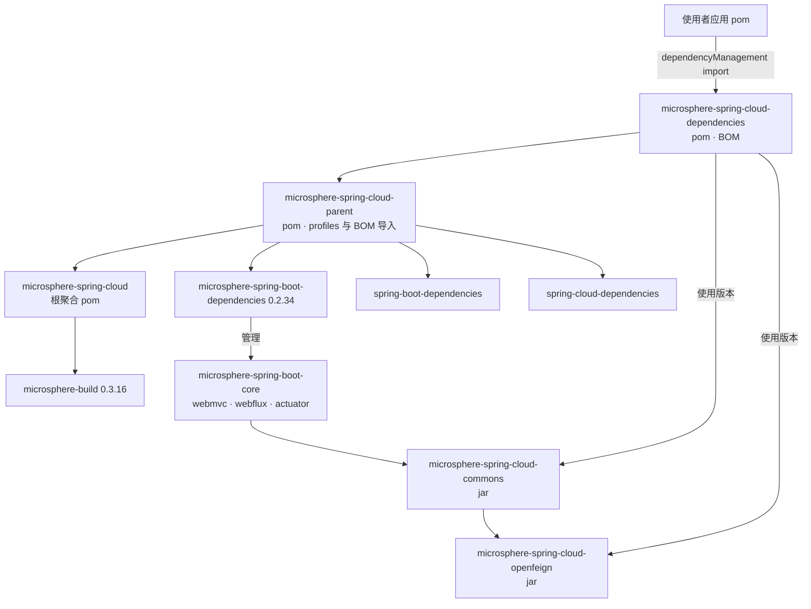
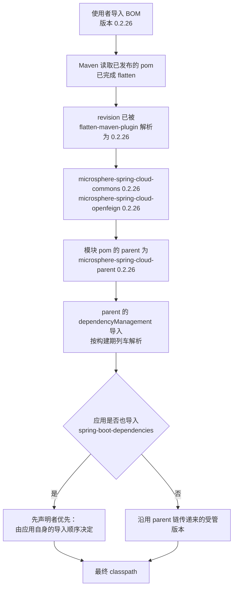

# 开发者文档 — `microsphere-spring-cloud-dependencies`

[English](../dependencies.md) · [1.x 版本线](../../1.x/zh/dependencies.md) · [开发者文档首页](../../README.md)

> 分支 `release` · 版本线 `0.2.x` · 最新发布版本 `0.2.26`，当前 HEAD `0.2.27-SNAPSHOT` · Java 17 · Spring Boot 3.0.x–4.0.x · Spring Cloud 2022.0.x–2025.1.x。
> 分析源码：`release` 分支中的 `microsphere-spring-cloud-dependencies/pom.xml`。

面向贡献者的 BOM 说明：它锁定什么、刻意**不**锁定什么，以及使用者的版本请求如何穿过整条 POM 链。

---

## 1. 职责

`microsphere-spring-cloud-dependencies`（`packaging: pom`）是**面向使用者的便利 BOM**。
它的 `<dependencyManagement>` 全部内容就是本项目的自有 artifact：

| 被管理的 artifact | 版本 |
|---|---|
| `io.github.microsphere-projects:microsphere-spring-cloud-commons` | `${revision}` |
| `io.github.microsphere-projects:microsphere-spring-cloud-openfeign` | `${revision}` |

仅此而已：没有第三方条目，没有插件，除 parent 链之外没有其它模块。
第三方版本策略位于 `microsphere-spring-cloud-parent`；本 POM 只回答“这些 artifact 来自哪一次构建”。

对 parent 的继承很重要且略显意外：BOM 继承 `microsphere-spring-cloud-parent`，因此即使使用者**只**导入
本 BOM，parent 的 `dependencyManagement` 导入链（`spring-boot-dependencies`、`spring-cloud-dependencies` 等）
仍会在“该 BOM 被 flatten 时所激活的 `spring-cloud-*` 构建 profile”上完成解析。

---

## 2. 模块与解析图



---

## 3. POM 结构剖析

| 元素 | 取值 | 为什么重要 |
|---|---|---|
| `<parent>` | `microsphere-spring-cloud-parent`、`${revision}`、`<relativePath>../microsphere-spring-cloud-parent/pom.xml</relativePath>` | `${revision}` 构建必须显式给出 relativePath，否则 Maven 会去找 `../pom.xml` 并失败 |
| `<version>` | `${revision}` | CI 友好；在 `process-resources` 阶段被 flatten |
| `<packaging>` | `pom` | 无源码、无测试、无 `AutoConfiguration.imports` |
| 被管理条目 | 2 条 | 都是同一 reactor 中的 `jar` 模块 |
| `<name>` / `<description>` | `Microsphere :: Spring Cloud :: Dependencies` | 站点与 javadoc 聚合使用 |

没有 `<properties>` 块：它需要的每个版本（`${revision}`、`${spring-boot.version}` …）都来自 parent 链，
这正是设计意图——集中于一处修改。

---

## 4. 版本解析链



评审依赖类缺陷时必须记住的核心规则：**`dependencyManagement` 先声明者优先，并且导入方 POM 自身的条目
永远胜过通过导入继承来的条目。** 如果应用看到非预期的 Spring Cloud 版本，原因几乎总是 BOM 导入的相对位置，
而不是本文件。

---

## 5. BOM 与 parent 的职责划分

| 问题 | 由谁回答 |
|---|---|
| “我的 `microsphere-spring-cloud-*` 依赖该用哪个版本？” | **dependencies** BOM |
| “使用哪个 Spring Boot / Spring Cloud / Alibaba 列车？” | **parent** 的 profiles |
| “测试中的 JUnit / Testcontainers 版本？” | **parent**（`junit-bom`、`testcontainers-bom`） |
| “插件、编译级别、flatten 行为？” | `microsphere-build` + 根 POM 的 `java.version` / `revision` |
| “运行期哪些第三方依赖是可选的？” | 各 jar 模块自己的 `<dependencies>` 加 `<optional>true</optional>` |

---

## 6. 影响 BOM 发布形态的构建行为

| 插件 / 设置 | 行为 |
|---|---|
| `flatten-maven-plugin` 1.7.3，`flattenMode=resolveCiFriendliesOnly` | 仅解析 `${revision}`、`${sha1}`、`${changelist}`；`pomElements` 保留 `properties`、展开 `parent`、插值 `dependencyManagement` |
| `updatePomFile=true` | 被安装/部署的就是 flatten 后的 pom——使用者永远不会看到 `${revision}` |
| Central 发布（`publish`/`release` 下的 `central-publishing-maven-plugin` 0.11.0） | BOM 以纯 `.pom` 部署，无 jar |
| surefire | 本模块没有测试；`mvn test -pl microsphere-spring-cloud-dependencies` 是空跑，但仍会校验 POM 模型 |

---

## 7. 构建与验证命令

```bash
# 连同其 parent 一起构建 BOM（其它模块解析它之前需要先安装）
./mvnw -N install
./mvnw -pl microsphere-spring-cloud-dependencies -am install

# 检查被管理的坐标
./mvnw -pl microsphere-spring-cloud-dependencies help:effective-pom \
    | grep -A2 microsphere-spring-cloud-commons

# 证明使用者解析到了正确版本
./mvnw -f /path/to/consumer/pom.xml dependency:tree -Dincludes=io.github.microsphere-projects

# 真正发布出去的扁平化 pom
cat microsphere-spring-cloud-dependencies/target/.flattened-pom.xml
```

仓库根目录也存在聚合 POM 的 `.flattened-pom.xml`；它是构建产物而非源码，已被 Git 忽略。

---

## 8. 贡献者清单

**向 BOM 增加新的 jar 模块**

1. 创建模块，并在根 `microsphere-spring-cloud/pom.xml` 中加入 `<module>` 条目。
2. 声明 `<parent>` = `microsphere-spring-cloud-parent`，版本 `${revision}` 且带 `<relativePath>`。
3. 在此新增一条 `<dependency>`：`groupId io.github.microsphere-projects`、新 `artifactId`、
   `<version>${revision}</version>`——不写 `<type>`，也不写 `<scope>`。
4. 列表按 artifactId 保持字母序；这个块很短，diff 会被反复阅读。
5. **不要**在这里管理第三方 artifact——那属于 parent 的导入链。

**版本线规则**

- 每个被管理条目都必须使用 `${revision}`；在此硬编码版本会破坏发布自动化，并产出一个无法被
  `0.2.x` 流水线推进的 BOM。
- BOM 的版本线（`0.2.x`）就是契约：使用 `0.2.26` BOM 的应用得到 `0.2.26` 的 artifact；
  混线（例如 `0.1.x` BOM 搭配 `0.2.x` artifact）不受支持，因为 `commons` 把
  `javax.servlet` 换成了 `jakarta.servlet`，并改变了 `DefaultServiceInstance` 的复制语义。

---

## 9. 已知注意点

| 注意点 | 细节 |
|---|---|
| BOM 不是 starter | 只导入它**不会**增加任何依赖；应用必须显式声明 `microsphere-spring-cloud-commons` / `-openfeign` |
| BOM 不会重导出 Spring Cloud 列车 | 通过 parent 链的传递导入只是让版本在**本次构建**中可用，使用者自己的 `spring-cloud-dependencies` 导入可能优先级更高 |
| 可选依赖在此不可见 | `commons` 中除四个 `microsphere-spring-boot-*` artifact 与 `aspectjweaver` 外全部是 `<optional>`，因此应用必须自行添加 `spring-cloud-commons`、Boot starter 和注册中心客户端 |
| `2025.1` 线 | Boot 4.0.x 移动了部分 actuator/autoconfigure 类；若在该列车上消费本 BOM，请确认 `FeaturesEndpoint` 与 `spring-cloud-context` 仍可解析 |

---

## 10. 相关文档

- [开发者文档 — `microsphere-spring-cloud-parent`](./parent.md)
- [开发者文档 — `microsphere-spring-cloud-commons`](./commons.md)
- [开发者文档 — `microsphere-spring-cloud-openfeign`](./openfeign.md)
- [用户文档 — current](../../../user-guide/current/zh/dependencies.md)
