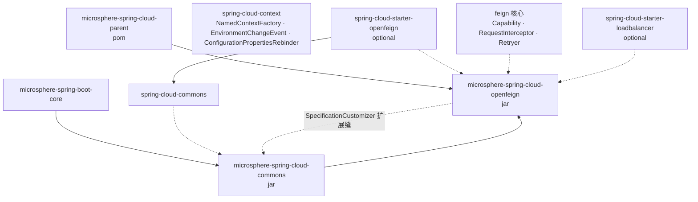
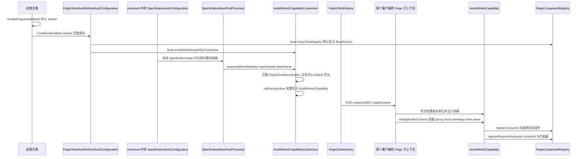
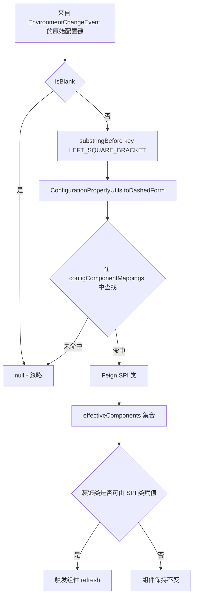
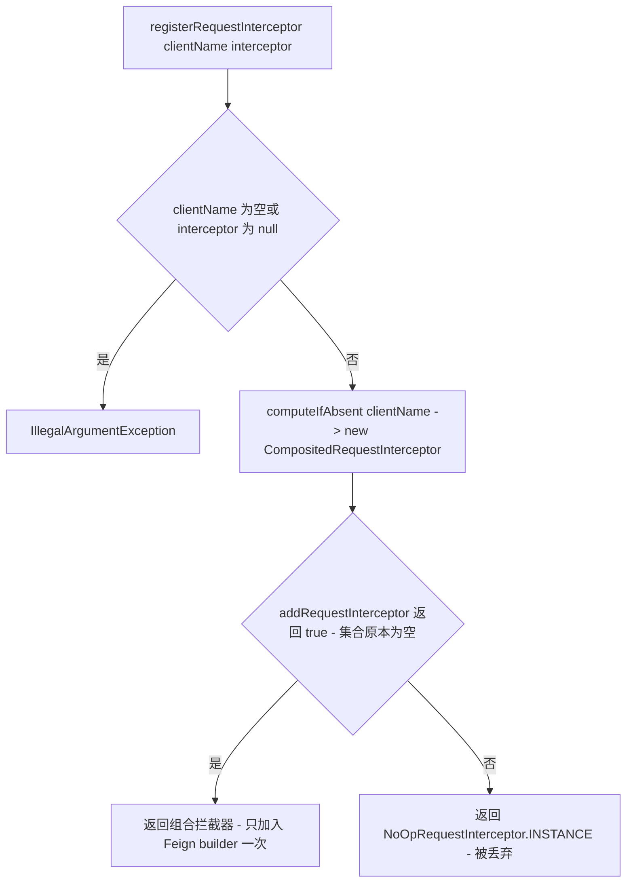
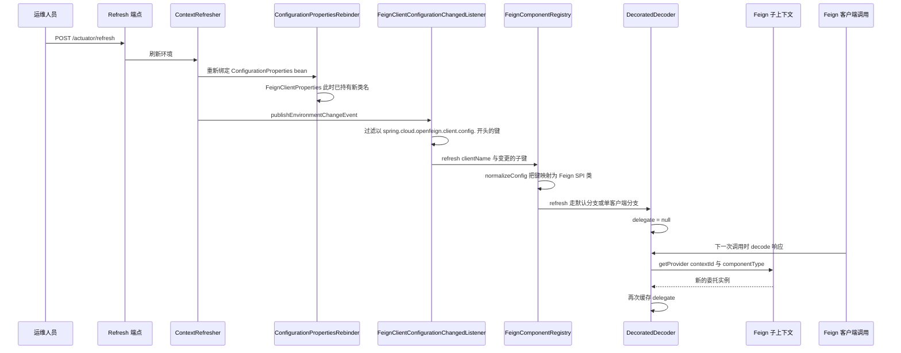

# 开发者文档 — `microsphere-spring-cloud-openfeign`

[English](../openfeign.md) · [1.x 版本线](../../1.x/zh/openfeign.md) · [开发者文档首页](../../README.md)

> 分支 `release` · 版本线 `0.2.x` · 最新发布版本 `0.2.26`，当前 HEAD `0.2.27-SNAPSHOT` · Java 17 · Spring Boot 3.0.x–4.0.x · Spring Cloud 2022.0.x–2025.1.x · 上游 `microsphere-spring-boot` 0.2.34。
> 分析源码：`microsphere-spring-cloud-openfeign/src/main/java/io/microsphere/spring/cloud/openfeign/**`（21 个生产类）、`src/main/resources/META-INF/**`、`src/test/java/**`（44 个测试类）。

面向贡献者：架构设计、源码级行为、设计模式与扩展点。
与 `commons` 共享的模块级事实见 [commons.md](./commons.md)；构建分层见 [parent](./parent.md) / [dependencies](./dependencies.md)。

---

## 1. 模块概览

| 维度 | 取值 |
|---|---|
| 坐标 | `io.github.microsphere-projects:microsphere-spring-cloud-openfeign:${revision}` |
| 打包 | `jar`，parent 为 `microsphere-spring-cloud-parent` |
| 根包 | `io.microsphere.spring.cloud.openfeign` |
| 必需依赖 | `microsphere-spring-cloud-commons`（同一 reactor，`${revision}`） |
| 可选依赖 | `spring-cloud-starter-openfeign`（排除 ribbon）、`spring-cloud-starter-loadbalancer`、两个 Boot 注解处理器、`microsphere-annotation-processor` |
| 能力 | 在 `/actuator/refresh` 之后于运行期替换 Feign 组件（`Decoder`、`Encoder`、`Retryer`、`Contract`、`ErrorDecoder`、`QueryMapEncoder`、`RequestInterceptor`），**无需重建客户端、无需重启** |
| 自动配置 | 2 个，位于 `META-INF/spring/org.springframework.boot.autoconfigure.AutoConfiguration.imports`（本分支不存在 `spring.factories`） |

### 包结构

| 包 | 内容 |
|---|---|
| `autorefresh` | `EnableFeignAutoRefresh`（含 `Marker`）、`AutoRefreshCapability`、`AutoRefreshCapabilityCustomizer`、`FeignComponentRegistry`、`FeignClientConfigurationChangedListener` |
| `components` | `Refreshable`、`DecoratedFeignComponent<T>` 及六个 `Decorated*`、`CompositedRequestInterceptor`、`NoOpRequestInterceptor` |
| `autoconfigure` | `FeignAutoConfiguration`、`FeignClientAutoRefreshAutoConfiguration` |
| `condition` | `ConditionalOnOpenFeignEnabled`、`ConditionalOnOpenFeignAvailable` |
| `constants` | `FeignConstants` |

---

## 2. 模块依赖图



从 `openfeign` 反向指向 `commons` 的虚线边是本模块的架构关键：它从不干预 Feign 自身自动配置的顺序，
而是注册一个 `SpecificationCustomizer` bean，由 `commons` 的 `SpecificationAutoConfiguration` 负责把
`AutoRefreshCapability` 注入 Feign 子上下文。

---

## 3. 架构设计

### 3.1 三段式装配

1. **启用阶段** — `@EnableFeignAutoRefresh` 通过 `@Import` 引入空的嵌套类
   `EnableFeignAutoRefresh.Marker`。该注解**没有任何属性**，它存在的唯一目的是往上下文中放入一个
   `Marker` 类型的 bean，从而让
   `FeignClientAutoRefreshAutoConfiguration` 上的
   `@ConditionalOnBean(EnableFeignAutoRefresh.Marker.class)` 能够匹配。全局开关是属性
   `microsphere.spring.cloud.openfeign.enabled`（`matchIfMissing = true`）。
2. **播种 specification** — `FeignAutoConfiguration` 贡献一个 `FeignBuilderCustomizer`，
   它在每个 builder 上注册 `NoOpRequestInterceptor.INSTANCE`；
   `FeignClientAutoRefreshAutoConfiguration` 贡献 `FeignComponentRegistry` 与
   `AutoRefreshCapabilityCustomizer`。
3. **逐客户端装饰** — 当 Spring Cloud 依据某个 `FeignClientSpecification` 构建客户端时，子上下文会实例化
   `AutoRefreshCapability`（它已被前置写入 `configuration()`），随后 Feign 会用即将使用的组件调用每一个
   `Capability.enrich(...)` 重载。

### 3.2 启动时序



注意 `@AutoConfigureAfter(name = …)` 所表达的顺序约束：
`org.springframework.cloud.openfeign.FeignAutoConfiguration` 必须先执行（这样
`FeignClientProperties` 与 specification bean 才存在），而
`io.microsphere.spring.cloud.context.named.autoconfigure.SpecificationAutoConfiguration`
必须在 customizer bean 可用之后执行 —— 因此 `commons` 的自动配置先于本模块加载。

### 3.3 降级行为

| 缺失的构件 / 设置 | 结果 |
|---|---|
| 缺少 `feign.Feign` | `@ConditionalOnOpenFeignAvailable` 不满足 → 完全不产生任何 bean |
| `microsphere.spring.cloud.openfeign.enabled=false` | 两个自动配置均被跳过 |
| 缺少 `feign.Capability` 或 `FeignClientFactoryBean` | 跳过 `FeignClientAutoRefreshAutoConfiguration`，`FeignAutoConfiguration` 仍可能生效 |
| 缺少 `FeignBuilderCustomizer` | 跳过 `FeignAutoConfiguration` |
| 未使用 `@EnableFeignAutoRefresh` | 缺少 `Marker` bean → 自动刷新不生效；但 NoOp 拦截器的播种仍会执行 |

---

## 4. 源码解析

### 4.1 `AutoRefreshCapability`

`implements feign.Capability, ApplicationContextAware`；构造器签名为
`(FeignClientProperties, NamedContextFactory<FeignClientSpecification>, FeignComponentRegistry)` —— 在本分支上
上下文工厂被声明为泛型的 `NamedContextFactory`，而不是 `0.1.x` 中具体的 `FeignContext`。

`setApplicationContext` 负责解析所属客户端：
`applicationContext.getEnvironment().getProperty("spring.cloud.openfeign.client.name")` → `contextId`。

每个 `enrich` 都遵循同一套模板，并在入参为 `null` 时返回 `null`：

```java
DecoratedDecoder decoratedDecoder = instantiate(DecoratedDecoder.class, Decoder.class,
        contextId, contextFactory, clientProperties, decoder);
this.componentRegistry.register(contextId, decoratedDecoder);
return decoratedDecoder;
```

| `enrich` 重载 | 产生的包装类 | 注册方式 |
|---|---|---|
| `Retryer` | `DecoratedRetryer` | 作为 `Refreshable` 注册在 `contextId` 下 |
| `Contract` | `DecoratedContract` | `Refreshable` |
| `Decoder` | `DecoratedDecoder` | `Refreshable` |
| `Encoder` | `DecoratedEncoder` | `Refreshable` |
| `ErrorDecoder` | `DecoratedErrorDecoder` | `Refreshable` |
| `QueryMapEncoder` | `DecoratedQueryMapEncoder` | `Refreshable` |
| `RequestInterceptor` | 不包装 | `registerRequestInterceptor(...)` → 组合拦截器或 NoOp |
| `InvocationHandlerFactory` | 未覆写 | 测试通过 `MockCapability` 自行注入 |

`DecoratedFeignComponent.instantiate` 是一个反射式工厂：`findConstructor(decoratedClass, String.class,
NamedContextFactory.class, FeignClientProperties.class, componentClass)` + `BeanUtils.instantiateClass(...)`。
`enrich` 返回的包装对象最终会被写进构建好的客户端，因此客户端持有的是**对装饰器的稳定引用**，
而其背后的委托对象才是可替换的。

### 4.2 `DecoratedFeignComponent<T>` — volatile 委托

| 成员 | 行为 |
|---|---|
| `protected volatile T delegate` | 唯一的可变状态；volatile 语义保证重置能被正在处理请求的线程看到 |
| `delegate()` | 若 `delegate == null` → 调用 `loadInstance()` 并缓存；否则直接返回缓存 |
| `loadInstance()` | `loadInstanceFromContextFactory(contextId(), componentType())` |
| `loadInstanceFromContextFactory(...)` | `contextFactory.getProvider(contextId, componentType)` → `ObjectProvider.getIfAvailable(() -> instantiateClass(componentType))` —— 优先取**当前 bean**，取不到则直接实例化该类 |
| `refresh()` | `this.delegate = null`（trace 日志）—— 重载发生在*下一次*调用，而非刷新当时 |
| `componentType()` | 抽象方法；各子类从 `FeignClientProperties.FeignClientConfiguration` 读取所配置的类 |
| `get(Function<FeignClientConfiguration, T>)` | **默认配置优先**，其次当前客户端配置 —— 与常规优先级相反，因为 `…config.default.*` 是共享基线 |
| `equals` / `hashCode` / `toString` | 全部委派给 `delegate()` |

| 子类 | `componentType()` 取值来源 | 兜底 |
|---|---|---|
| `DecoratedContract` | `FeignClientConfiguration::getContract` | `Contract.class` |
| `DecoratedDecoder` | `::getDecoder` | `Decoder.class` |
| `DecoratedEncoder` | `::getEncoder` | `Encoder.class` |
| `DecoratedErrorDecoder` | `::getErrorDecoder` | `ErrorDecoder.Default.class` |
| `DecoratedRetryer` | `::getRetryer` | `Retryer.class` |
| `DecoratedQueryMapEncoder` | 通过 `MethodHandle` 调用 `getQueryMapEncoder`，**当前配置优先**，其次默认配置 | `PageableSpringQueryMapEncoder.class` |

`DecoratedQueryMapEncoder` 是跨版本防御的典型：

```java
static final MethodHandle getQueryMapEncoderMethodHandle = findVirtual(FeignClientConfiguration.class, "getQueryMapEncoder");
...
if (methodHandle == NOT_FOUND_METHOD_HANDLE) return null;
```

因此，某个不暴露 `query-map-encoder` 的 Spring Cloud 版本会退化到兜底实现，而不会在链接期失败。
`DecoratedRetryer.continueOrPropagate` 通过一个静态的 null 保护辅助方法委派，并覆写了 `clone()`。

### 4.3 `FeignComponentRegistry` — 键、存储与扇出

静态 `configComponentMappings`：`retryer`→`Retryer`、`error-decoder`→`ErrorDecoder`、
`request-interceptors`→`RequestInterceptor`、`default-request-headers`→`RequestInterceptor`、
`default-query-parameters`→`RequestInterceptor`、`decoder`→`Decoder`、`encoder`→`Encoder`、
`contract`→`Contract`、`query-map-encoder`→`QueryMapEncoder`。



以下写法均被接受，并由 `FeignComponentRegistryTest` 验证：`errorDecoder`、`error-decoder`、
`errorDecoder[0]`、`error-decoder[0]`。**Map 子键**（如 `default-request-headers.app`）无法解析，
因为归一化只移除 `[...]` —— 若确实需要按 header 键名刷新，需扩展 `normalizeConfig`。

存储结构：`Map<String, List<Refreshable>> refreshableComponents` 与
`Map<String, CompositedRequestInterceptor> interceptorsMap`，均以客户端名/contextId 为键，
均为 `newConcurrentHashMap(32)`。注册时会断言名字非空、列表非空且不含 null 元素
（否则抛 `IllegalArgumentException`）。



`refresh(String clientName, Set<String> changedConfigs)` 是 `synchronized` 的：先从每个键中剥离
`clientName + "."` 前缀，再把键映射为 SPI 类，然后：

- 若 `clientName.equals(defaultClientName)` → 刷新**所有**客户端中类匹配的**全部**已注册组件，
  只要变更中包含任何 `RequestInterceptor` 类型，还会刷新**全部**组合拦截器；
- 否则 → 只刷新该客户端匹配的组件以及它自己的组合拦截器。

匹配通过 `isComponentPresent(component, effectiveComponents)` → `actualComponent.isAssignableFrom(component.getClass())`
完成，这正是 `DecoratedDecoder`（实现 `feign.codec.Decoder`）会被 `decoder` 变更命中的原因。

### 4.4 `CompositedRequestInterceptor` — 刷新时重建

内部持有 `LinkedHashSet<RequestInterceptor>`（保持插入顺序，所有修改都在
`synchronized (this.set)` 中；`apply` 同样加锁，因此刷新对请求是安全的）。`refresh()` 会先从
`BeanFactory` 重新解析 `FeignClientProperties`（`getOrInstantiate` = `getBeanProvider(...).getIfAvailable(fallback)`），
再按以下来源重建集合：

1. **默认**配置的 `getRequestInterceptors()` 类列表，然后是**当前**配置的 —— 每个类优先解析为 bean，
   取不到则按类实例化；
2. 一个 lambda，把默认 **headers** 合并后的值（`putIfAbsent`，默认优先）应用到尚不存在的键；
3. 一个 lambda，用同样的保护逻辑应用默认 **query parameters**。

这就是 `default-request-headers.*` / `default-query-parameters.*` 的变更能在不重建客户端的前提下传播的原因 ——
组合拦截器是被构建好的客户端持有的同一个稳定对象。

### 4.5 `AutoRefreshCapabilityCustomizer`

```java
if (specification instanceof FeignClientSpecification && beanName.startsWith("default.")) {
    injectAutoRefreshCapability((FeignClientSpecification) specification);
}
...
specification.setConfiguration(combine(AUTO_REFRESH_CAPABILITY_CLASS, originConfigurationClasses));
```

只有以 `default.` 前缀 bean 名注册的 specification 会被改写 —— 即共享的默认配置 —— 并且能力类是被
**前置**写入的（`combine` 把它放在第一位），因此它先于用户配置类创建，其 `enrich` 调用看到的是原始组件。
由于 `AutoRefreshCapability` 在每个子上下文内部自行捕获自己的 `contextId`，一次注入即可覆盖所有客户端。
在本分支上，判断与赋值都是直接的（`instanceof` + `setConfiguration`）；`0.1.x` 曾使用类名解析加反射式
`setConfiguration`，以避免对 `FeignClientSpecification` 的编译期依赖。

### 4.6 `FeignClientConfigurationChangedListener`

`implements ApplicationListener<org.springframework.cloud.context.environment.EnvironmentChangeEvent>`，
其中 `private final String PREFIX = "spring.cloud.openfeign.client.config.";`。
`resolveChangedClient` 按前缀过滤、剥离前缀，并以剩余的第一段点分片做分组，因此
`…config.my-client.decoder` → `{"my-client" → {"my-client.decoder"}}` —— 分组值中保留了客户端前缀，
而这正是 `FeignComponentRegistry.refresh` 会再次剥离的部分。不匹配前缀的键被忽略，因此刷新无关属性不产生开销。

该监听器**不是 bean**。`FeignClientAutoRefreshAutoConfiguration` 手动注册它：

```java
@EventListener(ApplicationReadyEvent.class)
public void onApplicationReadyEvent(ApplicationReadyEvent event) {
    /** Make sure the FeignClientConfigurationChangedListener is registered after the ConfigurationPropertiesRebinder */
    registerFeignClientConfigurationChangedListener(event);
}
```

理由：`ConfigurationPropertiesRebinder` 本身也是一个 `EnvironmentChangeEvent` 监听器，它负责重新绑定
`@ConfigurationProperties` bean —— 包括 `FeignClientProperties`。Spring 中监听器的注册顺序即调用顺序，
所以只在 `ApplicationReadyEvent` 时订阅，可保证本监听器运行时 `FeignClientProperties.getConfig()` 已是新值。
若更早注册（例如做成 bean，或通过 `@Bean` 返回 `ApplicationListener`），它就可能观察到"环境已变但属性尚未重新绑定"
的中间状态 —— 此时 `componentType()` 读到的是过期类名，刷新会变成空操作，直到下一次变更才生效。

### 4.7 `NoOpRequestInterceptor`

`public static final NoOpRequestInterceptor INSTANCE`，`apply(RequestTemplate)` 为空实现。它有两个用途：
`FeignAutoConfiguration.addDefaultRequestInterceptorCustomizer()` 播种用的拦截器（保证能力管线至少能看到一个
拦截器），以及第 2…n 个拦截器的"丢弃"返回值 —— 从而让组合拦截器每个客户端只被加入 builder 一次。

---

## 5. 运行期刷新流程



整个设计的关键在于两步式：*立即失效，惰性重建*。刷新从不触碰运行中的客户端对象图；
由下一次调用承担一次查找开销。

---

## 6. 设计模式

| 模式 | 相关类 | 说明 |
|---|---|---|
| **装饰器 Decorator** | `DecoratedFeignComponent<T>` + `Decorated{Contract,Decoder,Encoder,ErrorDecoder,Retryer,QueryMapEncoder}` | 保持 Feign SPI 身份不变，替换实现 |
| **组合 Composite** | `CompositedRequestInterceptor` | 以一个 `RequestInterceptor` 呈现 N 个，刷新时重建 |
| **空对象 Null Object** | `NoOpRequestInterceptor.INSTANCE` | 用于播种与去重中立拦截器 |
| **注册表 Registry** | `FeignComponentRegistry` | 以客户端名为键的 `Refreshable` 注册表，外加组合拦截器查找 |
| **观察者 Observer** | `FeignClientConfigurationChangedListener` 监听 `EnvironmentChangeEvent` | 前缀过滤，非 bean 监听器 |
| **模板方法 Template Method** | `DecoratedFeignComponent`（`delegate()` / `loadInstance()` 固定，`componentType()` 抽象） | 子类只需声明类名从哪里取 |
| **策略 Strategy** | `AutoRefreshCapabilityCustomizer implements SpecificationCustomizer` | 可插拔的逐 specification 变更 |
| **工厂方法 Factory Method** | `DecoratedFeignComponent.instantiate(...)` 反射式构造器查找 | |
| **标记类门控 Marker-class gating** | `EnableFeignAutoRefresh.Marker` + `@ConditionalOnBean` | 无属性注解，显式开启语义 |
| **后置处理器 Post-Processor** | `SpecificationBeanPostProcessor`（commons）驱动 customizer | |
| **代理 / 调用拦截（测试用）** | `MockCapability` + `ObservableFeignInvocationHandler` | 反射抵达 `ResponseHandler` 以断言当前委托 |

---

## 7. 配置参考

| 属性 | 默认值 | 作用 |
|---|---|---|
| `microsphere.spring.cloud.openfeign.enabled` | `true`（`matchIfMissing`） | 两个自动配置的总开关 |
| `spring.cloud.openfeign.client.config.<client>.{decoder,encoder,retryer,contract,error-decoder,query-map-encoder}` | — | 取值是类名；变更会触发委托替换 |
| `spring.cloud.openfeign.client.config.<client>.request-interceptors[n]` | — | 重建组合拦截器列表 |
| `spring.cloud.openfeign.client.config.<client>.default-request-headers.<k>` / `default-query-parameters.<k>` | — | 任何拦截器类型的变更都会触发重建；按键名无法被 `normalizeConfig` 匹配 |
| `spring.cloud.openfeign.client.name` | 由 Spring Cloud 在每个子上下文中设置 | `AutoRefreshCapability.setApplicationContext` 据此取得 `contextId` |
| `@EnableFeignAutoRefresh` | 不使用即关闭该能力 | 注册 `Marker`；无属性 |

刷新触发器是 `EnvironmentChangeEvent`，通常由 `/actuator/refresh` 发布；仅发布 `RefreshEvent`
对本模块监听器是不够的（测试中会显式发布两者）。

---

## 8. 构建与测试

```bash
# reactor with commons
./mvnw -pl microsphere-spring-cloud-openfeign -am clean test

# another release train
./mvnw -pl microsphere-spring-cloud-openfeign -am -P spring-cloud-2022 test
./mvnw -pl microsphere-spring-cloud-openfeign -am -P "spring-cloud-2025.1" test

# a single refresh scenario
./mvnw -pl microsphere-spring-cloud-openfeign test -Dtest=DecoderChangedTest
```

### 8.1 可观测调用测试模式

本模块的测试在不 mock HTTP 层的前提下验证刷新行为：

1. `BaseTest<T>`（`@EnableFeignClients(clients = BaseClient.class)`、`@EnableFeignAutoRefresh`、
   `@ComponentScan`、`@TestPropertySource` 预置 `spring.cloud.openfeign.client.config.default.*` 为
   `ADecoder`、`AEncoder`、`ARetry`、`AErrorDecoder`、`AQueryMapEncoder`、
   `ARequestInterceptor`、`default-request-headers.app=my-app`、`default-query-parameters.sign=my-sign`）。
2. `BaseClient` 是 `@FeignClient(contextId = "my-client", name = "my-client", configuration = {MockCapability.class})`。
   `MockCapability implements Capability` 只替换 `InvocationHandlerFactory` 为
   `ObservableFeignInvocationHandler::new`。
3. `ObservableFeignInvocationHandler.invoke(...)` 反射进入 Feign 的 `MethodHandler`
   （`methodHandlerConfiguration`，以 `isPresent("feign.MethodHandlerConfiguration", …)` 做跨版本兼容保护，
   再取 `responseHandler`），并在真正分发之前请求静态的 `FeignComponentAssert` 校验当前委托类的类型 ——
   这是一个位于**调用路径内部**的断言，因此过期的委托会让测试直接失败，而不是静默通过。
4. `replaceConfig()` 先在环境中插入 `MapPropertySource("after", …)`，随后发布 `RefreshEvent`
   与 `EnvironmentChangeEvent(Set.of(key))`，下一次调用必须观察到新的实现类。
   无需重启，无需重建客户端。

被测组件族：`decoder`、`encoder`、`errordecoder`、`querymapencoder`、`retryer`、
`requestInterceptor` —— 每个都配有 `A*`/`B*` 实现、一个 `*ComponentAssert` 与一个 `*ChangedTest`。
自定义 Feign 组件**不必**是 Spring bean：一个实现 Feign SPI 且具有公共默认构造器的普通类即可，
因为 `loadInstanceFromContextFactory` 会回退到 `instantiateClass(componentType)`。

### 8.2 自动配置测试

`FeignAutoConfigurationTest` 与 `FeignClientAutoRefreshAutoConfigurationTest` 继承
`microsphere-spring-boot-test` 的 `AutoConfigurationTest<A>`，并覆写三个钩子
（`configureAutoConfiguredClasses`、以
`microsphere.spring.cloud.openfeign.enabled=false` 实现的 `configureGlobalDisabledPropertyValues`、
以 `Feign.class`、`Capability.class`、`FeignClientFactoryBean.class` 实现的
`configureGlobalMissingClasses`）。后者以
`classes = {EnableFeignAutoRefresh.Marker.class, …}` 启动 —— 用以证明 `Marker` 的存在就是激活门控。
`AutoRefreshCapabilityTest` 断言每个 `enrich` 重载在入参为 `null` 时返回 `null`，
`AutoRefreshCapabilityCustomizerTest` 断言 `injectAutoRefreshCapability` 的前置写入行为。

### 8.3 代码风格约束

以 `java.version=17` 编译，但按 Java 8 风格书写：不使用 record、`var`、sealed 类型、文本块或
模式匹配的 `instanceof`；**完全不使用** `javax.*` 与 `jakarta.*` 导入。跨版本兼容通过类名条件、
`MethodHandle` 查找和反射读字段实现 —— 改动代码时请保持这一思路；面对在 `2022.0.x` 与 `2025.1.x` 之间
发生变动的 Spring Cloud API，优先添加 `MethodHandle` 保护而不是直接调用。

---

## 9. 扩展点

| 扩展缝 | 用法 |
|---|---|
| `SpecificationCustomizer` | 贡献另一个 customizer bean 以改写所有 `FeignClientSpecification`；有顺序，由 commons 的 `SpecificationBeanPostProcessor` 执行 |
| `Refreshable` | 凡注册进 `FeignComponentRegistry` 的组件都会收到 `refresh()`；为自定义的每客户端状态实现它 |
| `feign.Capability` | 在 `FeignClientSpecification` 的配置数组中加入一个 bean 即可参与 `enrich` —— 与 `AutoRefreshCapability` 相同的钩子；测试中的 `MockCapability` 即演示了这一点 |
| 新增可刷新的 Feign 组件 | 在 `FeignComponentRegistry.configComponentMappings` 中登记"短横线键 → SPI 类"，添加一个具备 `(String, NamedContextFactory, FeignClientProperties, T)` 构造器的 `Decorated*` 子类，并补一个 `enrich` 重载 |
| 特性目录 | `META-INF/config/default/features.yaml` 已列出 `FeignComponentRegistry` 与 `AutoRefreshCapability` 以及 `spring-cloud-openfeign-core` 的类 —— 新增面向用户的特性时请同步扩展 |

---

## 10. 注意点

| 注意点 | 说明 |
|---|---|
| 前缀耦合 | `FeignClientConfigurationChangedListener` 在分组值中保留客户端前缀，而 `FeignComponentRegistry.refresh` 再把它剥离；只改一侧就会破坏映射 |
| `hasInterceptor` 用的是 `=` 而非 `\|=` | 在遍历 `changedConfigs` 的循环中，该标志只反映最后一个被迭代的键；因此包含拦截器变更的多键事件会依赖迭代顺序 —— 建议先补测试再修复 |
| 默认配置刷新是全局的 | `…config.default.decoder` 的变更会刷新所有客户端的匹配组件，这是有意为之，但在基准测试时容易被遗忘 |
| 只有 `spring.cloud.openfeign.client.config.` 会触发刷新 | 自定义的配置命名空间需要自己的监听器 |
| 委托重载是惰性的 | 在 `refresh()` 与下一次调用之间，旧委托仍在使用中；进行中的请求会基于旧实现完成 |
| `InvocationHandlerFactory` 未被 enrich | Feign 的 handler 工厂无法由本模块热替换 |

---

## 11. 相关文档

- [开发者文档 — `microsphere-spring-cloud-commons`](./commons.md) — `SpecificationCustomizer` / `SpecificationBeanPostProcessor`
- [开发者文档 — parent](./parent.md) · [开发者文档 — dependencies](./dependencies.md)
- [用户文档 — openfeign](../../../user-guide/current/zh/openfeign.md)
