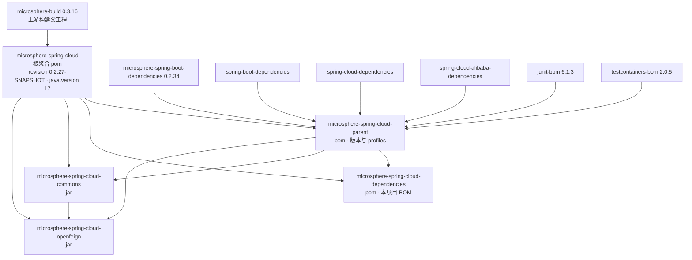
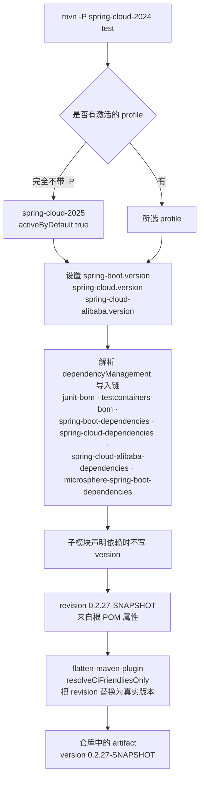

# 开发者文档 — `microsphere-spring-cloud-parent`

[English](../parent.md) · [1.x 版本线](../../1.x/zh/parent.md) · [开发者文档首页](../../README.md)

> 分支 `release` · 版本线 `0.2.x` · 最新发布版本 `0.2.26`，当前 HEAD `0.2.27-SNAPSHOT` · Java 17 · Spring Boot 3.0.x–4.0.x · Spring Cloud 2022.0.x–2025.1.x。
> 分析源码：`release` 分支中的 `microsphere-spring-cloud-parent/pom.xml`。

本文面向**贡献者**，说明 parent POM 的职责边界、构建分层结构，以及在该 POM 中的改动如何传导到其它模块。

---

## 1. 职责

`microsphere-spring-cloud-parent`（`packaging: pom`）是本项目的**构建策略层**，只负责三件事：

| 关注点 | 体现位置 |
|---|---|
| Spring Boot / Spring Cloud 之外其它 BOM 的集中版本属性 | `<properties>` — `microsphere-spring-boot.version`、`testcontainers.version`、`junit-jupiter.version` |
| 为所有模块提供依赖版本的 **BOM 导入链** | `<dependencyManagement>` — 六个 `scope: import` 条目 |
| **Spring Cloud 发布列车矩阵**与测试基础设施开关 | `<profiles>` — `spring-cloud-2022` … `spring-cloud-2025.1` 以及 `testcontainers` |

它**不**管理本项目自身的 artifact（那是 `microsphere-spring-cloud-dependencies` 的职责），也**不**配置插件
（那是上游构建父工程 `microsphere-build` 的职责）。

---

## 2. 构建分层



继承与导入是两个容易混淆的机制：

| 关系 | 机制 | 结果 |
|---|---|---|
| `microsphere-build` → 根 → `parent`/`commons`/`openfeign`/`dependencies` | Maven `<parent>` | 插件管理、`flatten`、checkstyle、enforcer、发布 profile 行为 |
| `parent` → 各 BOM 导入 | `<dependencyManagement>` `scope: import` | 向子模块提供 `${spring-boot.version}` 这类坐标 |
| 使用者应用 → `dependencies` | 应用中的 `<dependencyManagement>` `scope: import` | 只锁定本项目的 artifact |

四个 reactor 模块都声明 `<version>${revision}</version>`，并使用显式 `<relativePath>`
（`../pom.xml` 或 `../microsphere-spring-cloud-parent/pom.xml`）引用父工程——因为 reactor 版本是
CI 友好属性而非字面量，必须显式给出路径。

---

## 3. parent 持有的版本属性

| 属性 | `release` 分支取值 | 作用 |
|---|---|---|
| `microsphere-spring-boot.version` | `0.2.34` | 锁定上游与 Spring Cloud 无关的 Microsphere 层（`microsphere-spring-boot-core/-webmvc/-webflux/-actuator/-test`） |
| `testcontainers.version` | `2.0.5` | 导入 `org.testcontainers:testcontainers-bom`，供 `commons` 的集成测试使用 |
| `junit-jupiter.version` | `6.1.3` | 导入 `org.junit:junit-bom` |
| `spring-boot.version` | *由 profile 决定* | `3.0.13` / `3.3.13` / `3.4.13` / `3.5.15` / `4.0.8` |
| `spring-cloud.version` | *由 profile 决定* | `2022.0.5` / `2023.0.6` / `2024.0.3` / `2025.0.3` / `2025.1.3` |
| `spring-cloud-alibaba.version` | *由 profile 决定* | `2022.0.0.2` / `2023.0.3.4` / `2023.0.3.4` / `2025.0.0.0` / `2025.1.0.0` |

`${revision}` 与 `${java.version}` **不定义在这里**，它们位于根聚合 POM（`0.2.27-SNAPSHOT`、`17`），
以便一次提交同时决定 reactor 版本与编译级别。

---

## 4. 由 profile 驱动的版本解析



| Profile | Spring Boot | Spring Cloud | Spring Cloud Alibaba | 说明 |
|---|---|---|---|---|
| `spring-cloud-2022` | 3.0.13 | 2022.0.5 | 2022.0.0.2 | `0.2.x` 兼容范围的下界 |
| `spring-cloud-2023` | 3.3.13 | 2023.0.6 | 2023.0.3.4 | |
| `spring-cloud-2024` | 3.4.13 | 2024.0.3 | 2023.0.3.4 | 有意复用 Alibaba 列车 |
| `spring-cloud-2025` | 3.5.15 | 2025.0.3 | 2025.0.0.0 | `<activeByDefault>true</activeByDefault>` |
| `spring-cloud-2025.1` | 4.0.8 | 2025.1.3 | 2025.1.0.0 | Spring Boot 4 / Jakarta EE 11 线 |
| `testcontainers` | — | — | — | 向 surefire 注入 **系统属性** `testcontainers.enabled=true`，JUnit 5 用例据此开关 |

`spring-cloud-2025.1` 这个 id 含点号，Maven 允许，但在 shell 命令中必须加引号：`mvn -P "spring-cloud-2025.1" test`。

关于 `activeByDefault`：只要同一 POM 中**任意**其它 profile 被显式激活，默认 profile 即失效，
因此 `mvn -P spring-cloud-2022 test` 会静默放弃默认的 `2025` 列车。

---

## 5. 导入链及其顺序规则

Maven 解析 `dependencyManagement` 遵循**先声明者优先**。parent 中的顺序为：

1. `org.junit:junit-bom`
2. `org.testcontainers:testcontainers-bom`
3. `org.springframework.boot:spring-boot-dependencies`
4. `org.springframework.cloud:spring-cloud-dependencies`
5. `com.alibaba.cloud:spring-cloud-alibaba-dependencies`
6. `io.github.microsphere-projects:microsphere-spring-boot-dependencies`

对贡献者的实际影响：

- Spring Boot 与 Spring Cloud 的版本冲突由 **Spring Boot** 胜出，因为它更早被导入。要覆盖某个受管版本，
  应重定义属性（如 `-Dspring-boot.version=…`），而不是在导入之后追加依赖条目。
- `microsphere-spring-boot-dependencies` 位于最后：它可以补充 Microsphere 专有 artifact，
  但已无法再改写 Boot/Cloud 管理过的版本。
- 在 `spring-boot-dependencies` **之前**新增导入会改变所有模块的解析结果——请评审整个 reactor，
  而不是单个模块。

---

## 6. 从 `microsphere-build` 0.3.16 继承的构建行为

parent POM 完全不声明 `<build>`，以下内容均来自上游 POM：

| 关注点 | `microsphere-build` 0.3.16 中的配置 |
|---|---|
| 编译 | `maven-compiler-plugin` 3.16.0，`source`/`target` = `${java.version}`（根 POM 提供 17），`<parameters>true</parameters>` |
| CI 友好版本 | `flatten-maven-plugin` 1.7.3，`flattenMode=resolveCiFriendliesOnly`，`updatePomFile=true`，绑定 `process-resources` |
| 测试执行 | surefire 3.6.0 包含 `**/*Test.java`、`**/*Tests.java`，排除 `**/Abstract*.java`；`argLine = @{jacoco.argLine} ${jvm.argLine}` |
| 覆盖率 | `coverage` profile 下的 `jacoco-maven-plugin` 0.8.15 |
| 代码风格 | `test` profile 下的 `maven-checkstyle-plugin` 3.6.0（checkstyle 14.1.0），`<skip>${disable.checks}</skip>`，而 `disable.checks` 默认为 `true` |
| 约束检查 | `bannedDependencies`（含传递依赖）与 `banDuplicatePomDependencyVersions` |
| 发布 | `release`/`publish` profile 附加 javadoc、sources、GPG 签名与 `central-publishing-maven-plugin` 0.11.0（`publishingServerId=ossrh`、`autoPublish=true`） |
| 元数据 | `git-commit-id-plugin` 将过滤后的 `git.properties` 写入 jar |

资源以分隔符 `@` 过滤，且 `src/main/java` 被作为资源目录包含 `**/*.properties` / `**/*.xml`——
这就是与源码并列放置的非 Java 文件仍会被打包的原因。

---

## 7. 构建与测试命令

```bash
# 默认列车（spring-cloud-2025），全 reactor，不安装
./mvnw clean verify

# 指定发布列车
./mvnw -P spring-cloud-2022 clean test
./mvnw -P "spring-cloud-2025.1" clean test

# CI 执行的命令（GitHub Actions “Maven Build”，java 17 / 21 / 25 矩阵）
mvn --batch-mode --update-snapshots --file pom.xml \
    -Drevision=0.0.1-SNAPSHOT \
    -Dsurefire.useSystemClassLoader=false \
    test --activate-profiles test,coverage,testcontainers,spring-cloud-2025

# 显式启用 checkstyle（默认被跳过）
./mvnw -P test -Ddisable.checks=false validate

# 查看解析出的版本链
./mvnw -P spring-cloud-2024 help:evaluate -Dexpression=spring-cloud.version -q -DforceStdout
./mvnw dependency:tree -pl microsphere-spring-cloud-commons
```

CI 中的 `-Drevision=0.0.1-SNAPSHOT` 是刻意设计：让快照发布与版本线解耦，同时仍然真实走一遍
`${revision}` 的 flatten 流程。

---

## 8. 贡献者清单

**新增一个 Spring Cloud 发布列车**

1. 在 `microsphere-spring-cloud-parent/pom.xml` 中新增 `<profile>`，包含三个属性
   （`spring-boot.version`、`spring-cloud.version`、`spring-cloud-alibaba.version`）。
2. 对整个 reactor 执行 `./mvnw -P <new-profile> clean test`。
3. 把该 id 加入 `.github/workflows/maven-build.yml` 的 `maven-profile-spring-cloud` 矩阵。
4. 若新列车跨越 Boot 大版本，需重新检查 `javax`→`jakarta` 边界，以及
   `TomcatDynamicConfigurationListener` 使用到的 `ServerProperties` 访问器改名。

**升级上游层**

只需修改 `microsphere-spring-boot.version`。各模块从不单独锁定 Microsphere artifact 版本——
版本来自 `microsphere-spring-boot-dependencies`，模块只声明 `<optional>` 或 compile 作用域。

**发布**

`revision` 由 `release` 分支的发布自动化推进（例如发布 `0.2.26`，HEAD 变为 `0.2.27-SNAPSHOT`）；
没有模块级版本，因此无需修改其它文件。

---

## 9. 设计说明与已知陷阱

| 说明 | 细节 |
|---|---|
| profile 只在**构建期**生效 | `flattenMode=resolveCiFriendliesOnly` 不会内联 profile 依赖（`embedBuildProfileDependencies=false`），发布的 POM 仍通过 parent 链解析版本，使用者必须自行选择同一 Spring Cloud 列车。 |
| 本 POM 无插件块 | 刻意如此：构建策略属于上游。在此添加插件会使本项目的行为与 Microsphere 其它项目分叉。 |
| `2024` 复用 Alibaba `2023.0.3.4` 列车 | 与 Alibaba 官方兼容声明一致；未验证 Nacos artifact 可解析前不要“修正”。 |
| `testcontainers` profile 只设置开关 | 测试通过 `@EnabledIfSystemProperty(named = "testcontainers.enabled", matches = "true")` 开关；该 profile 不添加依赖，依赖由各模块自行声明。 |

---

## 10. 相关文档

- [开发者文档 — `microsphere-spring-cloud-dependencies`](./dependencies.md)
- [开发者文档 — `microsphere-spring-cloud-commons`](./commons.md)
- [开发者文档 — `microsphere-spring-cloud-openfeign`](./openfeign.md)
- [用户文档 — current](../../../user-guide/current/zh/parent.md)
