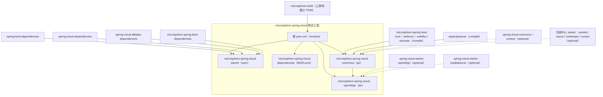
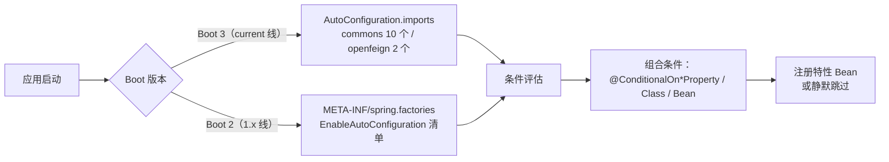

# Microsphere Spring Cloud — 开发者文档首页

[English →](../README.md) · [文档总索引](../../README.md) · [用户文档](../../user-guide/zh/README.md)

开发者文档面向**贡献者与维护者**：架构设计、源码级分析、所使用的设计模式、复杂流程的 mermaid 流程图/时序图，以及构建与测试指南。

## 选择版本线

| Git 分支 | 版本线 | 文档目录 | 平台 |
|---|---|---|---|
| `release` | 0.2.x（最新发布 `0.2.26`） | [current/](../current/zh/commons.md) | Java 17 · Spring Boot 3.x–4.x · Spring Cloud 2022–2025.1 |
| `release-1.x` | 0.1.x（最新发布 `0.1.26`） | [1.x/](../1.x/zh/commons.md) | Java 8 · Spring Boot 2.3–2.6 · Spring Cloud Hoxton–2021 |

## 各版本线的模块文档（每个 Maven 模块一篇）

| 模块 | 开发者文档重点 | current | 1.x |
|---|---|---|---|
| `microsphere-spring-cloud-parent` | 构建体系、`${revision}` 展平、Profile 驱动的版本解析 | [parent.md](../current/zh/parent.md) | [parent.md](../1.x/zh/parent.md) |
| `microsphere-spring-cloud-dependencies` | BOM 构成及其在依赖图中的位置 | [dependencies.md](../current/zh/dependencies.md) | [dependencies.md](../1.x/zh/dependencies.md) |
| `microsphere-spring-cloud-commons` | 自动配置管线、多注册中心聚合内核、事件切面、发现/特性目录/Specification 子系统、容错 | [commons.md](../current/zh/commons.md) | [commons.md](../1.x/zh/commons.md) |
| `microsphere-spring-cloud-openfeign` | Capability 注入、装饰器/注册表刷新机制、时序图 | [openfeign.md](../current/zh/openfeign.md) | [openfeign.md](../1.x/zh/openfeign.md) |

每篇中文文档的英文原文位于其上级同名目录。

## 模块依赖关系图



读图要点：

- **实线**为必需的构建/编译关系；**虚线**为可选依赖，由 `@ConditionalOnClass` 守卫——这是全项目统一的“缺类即静默降级”策略。
- `openfeign` 在编译期依赖 `commons`，因为它通过 `commons` 定义的 `SpecificationCustomizer` 扩展点注入 `AutoRefreshCapability`。
- 所有 Spring 第三方依赖均为 `optional`：使用者自带 Spring Boot / Spring Cloud / 注册中心 starter，缺失对应类时特性自动关闭。

## 自动配置注册机制



分支细节：[current/commons.md](../current/zh/commons.md) · [current/openfeign.md](../current/zh/openfeign.md) ·
[1.x/commons.md](../1.x/zh/commons.md) · [1.x/openfeign.md](../1.x/zh/openfeign.md)。

## 设计模式速览

| 模式 | 出处 |
|---|---|
| 装饰器 Decorator | `Decorated*` Feign 组件（openfeign）、`ReactiveDiscoveryClientAdapter`（commons） |
| 组合 Composite | `MultipleRegistration`、`MultipleServiceRegistry`、`CompositedRequestInterceptor` |
| 观察者/事件 | `RegistrationPre/Post…Event` 事件族 + `EventPublishingRegistrationAspect`、`ServiceInstancesChangedEvent` |
| 模板方法 | `WebServiceRegistryAutoConfiguration`（抽象钩子）、`AbstractServiceRegistrationEndpoint` |
| 空对象 Null Object | `NoOpRequestInterceptor` |
| 注册表 Registry | `FeignComponentRegistry`、`InMemoryServiceRegistry` |
| 策略 Strategy | `RegistrationCustomizer`、`SpecificationCustomizer` |
| 后处理器 | `SpecificationBeanPostProcessor` |
| Marker 类门控 | `@EnableFeignAutoRefresh.Marker` + `@ConditionalOnBean` |

类级分析与流程图见上述模块文档。

## 构建与测试速查

```bash
# current 线（release）：选择目标 Spring Cloud 版本，默认 2025
mvn clean install -Pspring-cloud-2023
mvn clean install                      # 等于 -Pspring-cloud-2025

# 1.x 线（release-1.x）：hoxton / 2020 / 2021（默认）
mvn clean install -Pspring-cloud-hoxton

# 需要容器的集成测试
mvn verify -Ptestcontainers
```
