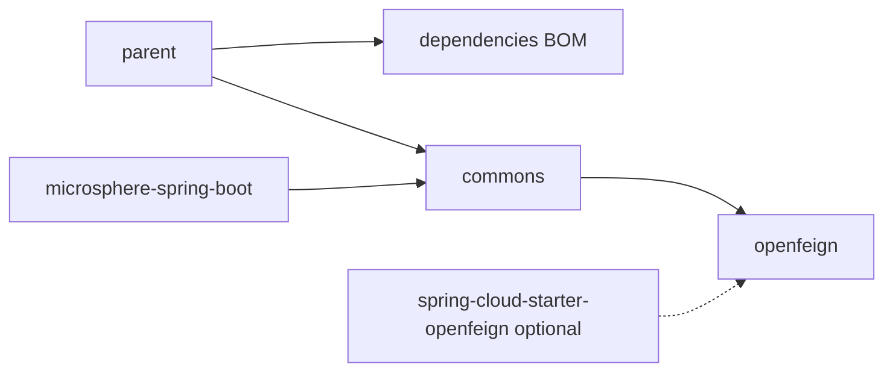

# Microsphere Spring Cloud — User Guide

[中文 →](./zh/README.md) · [Docs home](../README.md) · [Developer Guide](../developer-guide/README.md)

The User Guide explains **what each module does and how to use it**: APIs, configuration properties,
runnable examples (derived from the modules' own test cases), version information, and version compatibility ranges.

## Choose Your Version Line

| Your platform | Branch | Go to |
|---|---|---|
| Java 17+ · Spring Boot 3.0.x–4.0.x · Spring Cloud 2022.0.x–2025.1.x | `release` (0.2.x, latest release `0.2.26`) | [current/](./current/commons.md) |
| Java 8+ · Spring Boot 2.3.x–2.6.x · Spring Cloud Hoxton.SR12–2021.0.x | `release-1.x` (0.1.x, latest release `0.1.26`) | [1.x/](./1.x/commons.md) |

## Documents per Version Line (one per Maven module)

| Module | Purpose | current (0.2.x) | 1.x (0.1.x) |
|---|---|---|---|
| `microsphere-spring-cloud-parent` | Parent POM: dependency management + Spring Cloud version profiles | [parent.md](./current/parent.md) | [parent.md](./1.x/parent.md) |
| `microsphere-spring-cloud-dependencies` | BOM: aligns this project's artifact versions | [dependencies.md](./current/dependencies.md) | [dependencies.md](./1.x/dependencies.md) |
| `microsphere-spring-cloud-commons` | Core capabilities: multiple registries, registration events, discovery enhancements, fault tolerance, actuator endpoints, feature catalogue | [commons.md](./current/commons.md) | [commons.md](./1.x/commons.md) |
| `microsphere-spring-cloud-openfeign` | Runtime hot-swap of OpenFeign components on `EnvironmentChangeEvent` | [openfeign.md](./current/openfeign.md) | [openfeign.md](./1.x/openfeign.md) |

Every English page has a same-named Chinese mirror in the `zh/` subdirectory of its directory
(e.g. [current/zh/commons.md](./current/zh/commons.md)).

## Module Relationships (overview)



`commons` is the feature module you normally depend on; `openfeign` adds the Feign auto-refresh layer on top of it.
`parent` and `dependencies` only manage versions. See the [Developer Guide](../developer-guide/README.md) for the full architecture.

## Typical Quick Start (0.2.x)

```xml
<!-- import the BOM -->
<dependencyManagement>
    <dependencies>
        <dependency>
            <groupId>io.github.microsphere-projects</groupId>
            <artifactId>microsphere-spring-cloud-dependencies</artifactId>
            <version>0.2.26</version>
            <type>pom</type>
            <scope>import</scope>
        </dependency>
    </dependencies>
</dependencyManagement>

<dependencies>
    <dependency>
        <groupId>io.github.microsphere-projects</groupId>
        <artifactId>microsphere-spring-cloud-commons</artifactId>
    </dependency>
    <dependency>
        <groupId>io.github.microsphere-projects</groupId>
        <artifactId>microsphere-spring-cloud-openfeign</artifactId>
    </dependency>
</dependencies>
```

Then consult [commons.md](./current/commons.md) and [openfeign.md](./current/openfeign.md) for the features and switches you need.
