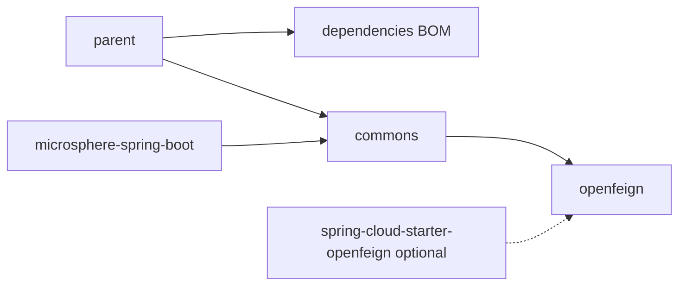

# Microsphere Spring Cloud — 用户文档首页

[English →](../README.md) · [文档总索引](../../README.md) · [开发者文档](../../developer-guide/zh/README.md)

用户文档面向**使用者**：解释各模块 API、配置属性、可运行示例（取材于模块自身的测试用例）、版本信息与版本兼容范围。

## 选择版本线

| 你的平台 | Git 分支 | 入口 |
|---|---|---|
| Java 17+ · Spring Boot 3.0.x–4.0.x · Spring Cloud 2022.0.x–2025.1.x | `release`（0.2.x，最新发布 `0.2.26`） | [current/](../current/zh/commons.md) |
| Java 8+ · Spring Boot 2.3.x–2.6.x · Spring Cloud Hoxton.SR12–2021.0.x | `release-1.x`（0.1.x，最新发布 `0.1.26`） | [1.x/](../1.x/zh/commons.md) |

## 各版本线的模块文档（每个 Maven 模块一篇）

| 模块 | 用途 | current（0.2.x） | 1.x（0.1.x） |
|---|---|---|---|
| `microsphere-spring-cloud-parent` | 父 POM：依赖管理与 Spring Cloud 版本 Profile | [parent.md](../current/zh/parent.md) | [parent.md](../1.x/zh/parent.md) |
| `microsphere-spring-cloud-dependencies` | BOM：对齐本项目构件版本 | [dependencies.md](../current/zh/dependencies.md) | [dependencies.md](../1.x/zh/dependencies.md) |
| `microsphere-spring-cloud-commons` | 核心能力：多注册中心、注册事件、服务发现增强、容错、运维端点、特性目录 | [commons.md](../current/zh/commons.md) | [commons.md](../1.x/zh/commons.md) |
| `microsphere-spring-cloud-openfeign` | OpenFeign 组件在 `EnvironmentChangeEvent` 时的运行时热替换 | [openfeign.md](../current/zh/openfeign.md) | [openfeign.md](../1.x/zh/openfeign.md) |

每篇中文文档的英文原文位于其上级同名目录（如 [../current/commons.md](../current/commons.md)）。

## 模块关系总览



`commons` 是通常直接依赖的功能模块；`openfeign` 在其之上提供 Feign 自动刷新层；
`parent` 与 `dependencies` 仅负责版本管理。完整架构解释见[开发者文档首页](../../developer-guide/zh/README.md)。

## 典型快速开始（0.2.x）

```xml
<!-- 导入 BOM -->
<dependencyManagement>
    <dependencies>
        <dependency>
            <groupId>io.github.microsphere-projects</groupId>
            <artifactId>microsphere-spring-cloud-dependencies</artifactId>
            <version>0.2.26</version>
            <type>pom</type>
            <scope>import</scope>
        </dependency>
    </dependencies>
</dependencyManagement>

<dependencies>
    <dependency>
        <groupId>io.github.microsphere-projects</groupId>
        <artifactId>microsphere-spring-cloud-commons</artifactId>
    </dependency>
    <dependency>
        <groupId>io.github.microsphere-projects</groupId>
        <artifactId>microsphere-spring-cloud-openfeign</artifactId>
    </dependency>
</dependencies>
```

随后按需要阅读 [commons 中文文档](../current/zh/commons.md) 与 [openfeign 中文文档](../current/zh/openfeign.md) 中的特性与开关说明。
