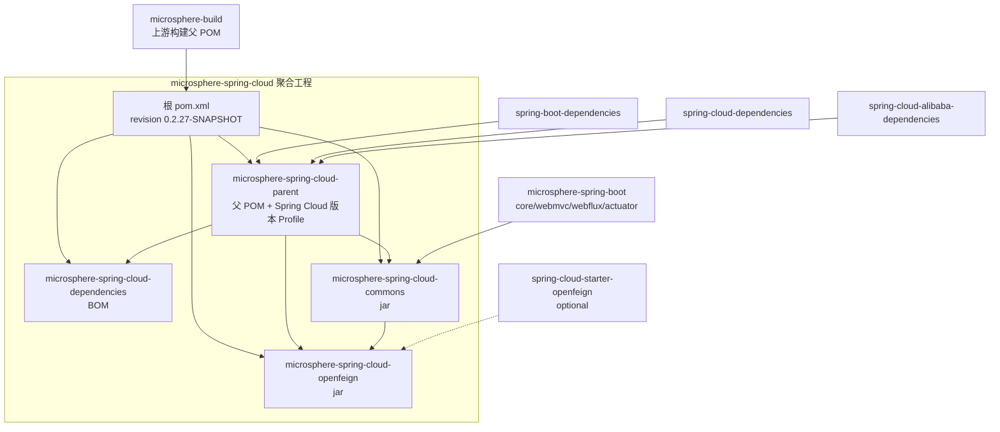

# Microsphere Spring Cloud — 文档总索引

[English →](../README.md)

本文档集覆盖 [microsphere-spring-cloud](https://github.com/microsphere-projects/microsphere-spring-cloud) 的
`release` 与 `release-1.x` 两个发布分支。英文为默认语言，存放在主路径；中文文档以相同文件名平行存放于各 `zh/` 目录。

## 目录结构

```
docs/
├── README.md                  ← 英文总索引
├── zh/README.md               ← 你在这里（中文总索引）
├── user-guide/                ← 用户文档（英文为默认语言）
│   ├── README.md              ← 用户文档首页（英文）
│   ├── zh/                    ← 用户文档首页（中文）
│   ├── current/               ← release 分支（0.2.x），每个 Maven 模块一篇
│   │   ├── parent.md  dependencies.md  commons.md  openfeign.md
│   │   └── zh/          （同名中文文档）
│   └── 1.x/                   ← release-1.x 分支（0.1.x）
│       ├── parent.md  dependencies.md  commons.md  openfeign.md
│       └── zh/          （中文镜像）
└── developer-guide/           ← 开发者文档（英文为默认语言）
    ├── README.md              ← 开发者文档首页（英文）
    ├── zh/                    ← 开发者文档首页（中文）
    ├── current/               ← release 分支架构与源码分析
    │   ├── parent.md  dependencies.md  commons.md  openfeign.md
    │   └── zh/          （同名中文文档）
    └── 1.x/                   ← release-1.x 分支
        ├── parent.md  dependencies.md  commons.md  openfeign.md
        └── zh/          （中文镜像）
```

## 快速入口

| 我的场景 | 入口 |
|---|---|
| 在 Spring Boot 3/4 应用中使用本库 | [用户文档 → current](../user-guide/current/zh/commons.md) |
| 在 Spring Boot 2.x / Java 8 应用中使用本库 | [用户文档 → 1.x](../user-guide/1.x/zh/commons.md) |
| 参与贡献或研究内部设计 | [开发者文档首页（中文）](../developer-guide/zh/README.md) |
| 阅读英文文档 | [User Guide](../user-guide/README.md) · [Developer Guide](../developer-guide/README.md) |

- [用户文档（中文）](../user-guide/zh/README.md) —— API 解释、配置属性、可运行示例（取材于模块自身的测试用例）、版本信息与兼容范围。
- [开发者文档（中文）](../developer-guide/zh/README.md) —— 架构设计、源码分析、设计模式、mermaid 流程图/时序图、模块依赖关系图、构建与测试指南。

## 分支与版本线 / 分支—目录对照

| Git 分支 | 版本线 | 文档目录 | Java | Spring Boot | Spring Cloud | 最新发布版本 |
|---|---|---|---|---|---|---|
| `release` | 0.2.x | [`current`](../user-guide/current/zh/commons.md) | 17+ | 3.0.x – 4.0.x | 2022.0.x – 2025.1.x | `0.2.26` |
| `release-1.x` | 0.1.x | [`1.x`](../user-guide/1.x/zh/commons.md) | 8+ | 2.3.x – 2.6.x | Hoxton.SR12 – 2021.0.x | `0.1.26` |

两条版本线的构件均发布到 Maven Central，groupId 为 `io.github.microsphere-projects`。
`main` / `dev` 为开发工作分支，不在文档覆盖范围内。

## Maven 模块依赖总览



依赖关系的详细解释见[开发者文档首页（中文）](../developer-guide/zh/README.md)。
